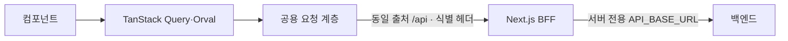

# 1-1-web-design

## 문서 정보

| 항목 | 값 |
| --- | --- |
| 버전 | v0.2 |
| 작성일 | 2026-09-09 |
| 수정일 | 2026-10-23 |
| 대상 | manyak-web |
| 작성 목적 | 웹의 현재 요청·라우팅·인증·관측 구조를 설명합니다. |
| 기준 코드 | [manyak-web](../../../manyak-web) |

## 읽는 순서

- [웹 Spec](../spec/3-2-web-spec.md)으로 계약을 확인한 뒤 요청 흐름 → 라우팅 → 인증 → 관측 순서로 읽습니다.

## 목차

- [1-1-1. 검증된 기술 환경과 요청 흐름](#1-1-1-검증된-기술-환경과-요청-흐름)
- [1-1-2. 라우팅·레이아웃·공통 셸](#1-1-2-라우팅레이아웃공통-셸)
- [1-1-3. BFF 프록시·토큰 세션](#1-1-3-bff-프록시토큰-세션)
- [1-1-4. 관측 연동](#1-1-4-관측-연동)
- [1-1-5. 테스트·Definition of Done](#1-1-5-테스트definition-of-done)

---

[공통 스펙](../spec/3-1-client-spec.md)과 [웹 스펙](../spec/3-2-web-spec.md)을 충족하는 현재 구조입니다. 역사적 선택은 [웹 ADR](../adr/1-2-web-adr.md)을 따릅니다.

## 1-1-1. 검증된 기술 환경과 요청 흐름

### 기술 환경

| 책임 | 기술·정본 |
| --- | --- |
| 렌더·타입 | Next.js App Router, React·React Compiler, TypeScript |
| 요청·검증 | TanStack Query, Orval, Zod |
| UI | Base UI·shadcn/ui, CVA, Tailwind CSS, motion, sonner, next-themes |
| 관측·테스트 | Amplitude·Sentry, Vitest·Playwright |
| 버전·실행 환경 | [package.json](../../../manyak-web/package.json)·[pnpm-lock.yaml](../../../manyak-web/pnpm-lock.yaml). 코드 작성·실행 규칙은 [웹 AGENTS](../../../manyak-web/AGENTS.md) |

### 요청 흐름

브라우저 요청은 BFF를 통합니다. 서버 직접 조회는 `API_BASE_URL` 절대 URL과 생성 URL 빌더를 사용합니다. Orval도 Next.js 환경 변수 우선순위로 같은 값의 `/v3/api-docs`를 읽습니다. 읽은 스펙은 [stabilize-operation-ids](../../../manyak-web/tools/orval/stabilize-operation-ids.ts)가 서로 겹치는 operationId(Springdoc의 `get`, `get_1` 같은 순번 이름)만 HTTP 메서드와 경로 이름(`/api/v1` 제외, 경로 변수는 `By` 접두어)으로 바꾼 뒤 생성합니다. 예를 들어 `GET /api/v1/stories/genres`는 `useGetStoriesGenres`가 됩니다. 겹치지 않는 이름은 그대로 둡니다(이유는 [W-035](../adr/1-2-web-adr.md#w-035)). 공용 요청 계층([custom-instance](../../../manyak-web/src/api/mutator/custom-instance.ts))이 2xx가 아닌 응답을 `FetchError`로 던지므로, 생성 응답 타입은 `forceSuccessResponse`로 2xx 응답만 담습니다. 에러 응답은 호출부에서 `FetchError`의 `status`로 구분합니다.

### SSE 클라이언트 구현 (웹)

CHAT 내용은 도메인 문서에서 관리한다. ([새 문서](../domain/CHAT/CLIENT/WEB/4-4-EXECUTION.md#4-4-1-수신과-재연결))

### 게스트 서재 상태 판정 (웹)

ACCOUNT 내용은 다음 문서에서 관리한다. ([4-3-2 게스트 목록](../domain/ACCOUNT/CLIENT/WEB/4-3-STATE-MANAGEMENT.md#4-3-2-게스트-목록))

웹 채팅 목록 변환은 `lastStoryPreview=null`을 제외합니다. 빈 문자열은 안내 문구로 표시하며 제목이 없는 삭제된 스토리의 채팅은 유지합니다. Android 목록에 이 필터를 적용하지 않습니다.

### 게스트 저장소 키 (웹)

키·직렬화의 실제 값은 각 `*-storage.ts`가 소유합니다. 사용자 보존 계약은 [웹 사용자 모델](../domain/ACCOUNT/CLIENT/WEB/2-2-REQUIREMENTS.md#2-2-1-게스트와-회원)을 따릅니다.

| 저장소 | 값·소유 코드 |
| --- | --- |
| localStorage 스토리·채팅 ID | [4-3-1 저장 위치와 수명](../domain/ACCOUNT/CLIENT/WEB/4-3-STATE-MANAGEMENT.md#4-3-1-저장-위치와-수명) |
| localStorage 안내 | 간편 제작 첫 진입 안내에서 마지막으로 마친 단계 `manyak:create-tutorial-stage`(끝까지 보거나 건너뛰면 `done`), `manyak:chat-tour-seen`·`manyak:chat-choices-hint-seen`, 실시간 이미지 안내 판단용 기기 누적 턴 전송 완료 횟수 `manyak:chat-completed-turn-count`(3에서 더 세지 않음, [판정](../../../manyak-web/src/features/chats/room/utils/realtime-image-nudge.ts)). 체험 사용량은 브라우저에 두지 않고 서버 조회([체험 잔여 패칭](../domain/PAYMENT/CLIENT/WEB/4-4-EXECUTION.md#4-4-1-정책과-체험-내역))를 따른다 |
| localStorage 채팅 설정 | [CHAT 웹](../domain/CHAT/CLIENT/WEB/AGENTS.md) |
| IndexedDB 제작 | [STORY 웹 상태](../domain/STORY/CLIENT/WEB/4-3-STATE-MANAGEMENT.md) |
| localStorage 공지 읽음 기록 | `manyak:notice-read-ids`의 공지 ID JSON 배열(최신순, 최대 100개). 상세가 공지를 받으면 그 ID를 맨 앞에 넣는다. 안 읽음 판정은 "게시 30일 안이고 이 목록에 없음"이며 헤더 버튼의 점, 마이 메뉴 배지, 목록 줄 제목 끝의 점이 모두 이 판정을 쓴다. [공지 읽음 저장소](../../../manyak-web/src/features/notices/_shared/utils/notice-read-storage.ts) |
| localStorage 제작 세대 | [STORY 웹 상태](../domain/STORY/CLIENT/WEB/4-3-STATE-MANAGEMENT.md) |
| sessionStorage 채팅 열기 의도 | [STORY 웹 상태](../domain/STORY/CLIENT/WEB/4-3-STATE-MANAGEMENT.md) |
| sessionStorage 재개 의도 | [STORY 웹 상태](../domain/STORY/CLIENT/WEB/4-3-STATE-MANAGEMENT.md) |
| sessionStorage 게스트 채팅·로그인 초안 | [4-3-1 저장 위치와 수명](../domain/ACCOUNT/CLIENT/WEB/4-3-STATE-MANAGEMENT.md#4-3-1-저장-위치와-수명) |
| sessionStorage 로그인 진행 표시 | [4-3-1 저장 위치와 수명](../domain/ACCOUNT/CLIENT/WEB/4-3-STATE-MANAGEMENT.md#4-3-1-저장-위치와-수명) |
| localStorage 결제 대기 주문 | [저장 위치와 수명](../domain/PAYMENT/CLIENT/WEB/4-3-STATE-MANAGEMENT.md#4-3-1-저장-위치와-수명) |
| sessionStorage 결제 전 히스토리 길이 | [저장 위치와 수명](../domain/PAYMENT/CLIENT/WEB/4-3-STATE-MANAGEMENT.md#4-3-1-저장-위치와-수명) |

제작 저장과 복구는 [STORY 웹 상태](../domain/STORY/CLIENT/WEB/4-3-STATE-MANAGEMENT.md)와 [실행](../domain/STORY/CLIENT/WEB/4-4-EXECUTION.md)에서 관리한다.

### 데이터 패칭 기본 옵션 (웹)

[query-client.ts](../../../manyak-web/src/lib/query-client.ts): `retry: false`, `staleTime: 60초`, `refetchOnWindowFocus: false`, `throwOnError: false`. 화면이 오류 상태·명시적 재시도를 처리합니다.

채팅 턴 완료([chat-room.tsx](../../../manyak-web/src/features/chats/room/components/chat-room.tsx))는 채팅 목록 쿼리(회원 `getGetMyChatsQueryKey()`, 게스트 `chats-batch`)를 `refetchType: 'all'`로 무효화합니다. 기본 무효화는 구독 중인 쿼리만 다시 받는데 채팅방에 있는 동안 목록은 구독자가 없어 낡음 표시만 남고, 돌아온 순간 옛 순서가 먼저 그려진 뒤 재조회 응답으로 순서가 바뀝니다. 채팅방에 있는 동안 미리 받아 두면 돌아왔을 때 방금 대화한 채팅이 이미 맨 위에 있습니다. 목록 재조회가 선택지 생성을 늦추지 않도록 결과를 기다리지 않습니다.

### 이프 정책 수치 패칭 (웹)

PAYMENT 내용은 도메인 문서에서 관리한다. ([이프 정책 수치 패칭 (웹)](../domain/PAYMENT/CLIENT/WEB/4-4-EXECUTION.md#4-4-1-정책과-체험-내역))

### 체험 잔여 패칭 (웹)

PAYMENT 내용은 도메인 문서에서 관리한다. ([체험 잔여 패칭 (웹)](../domain/PAYMENT/CLIENT/WEB/4-4-EXECUTION.md#4-4-1-정책과-체험-내역))

### 커서 목록 패칭 (웹)

PAYMENT 내용은 도메인 문서에서 관리한다. ([커서 목록 패칭 (웹)](../domain/PAYMENT/CLIENT/WEB/4-4-EXECUTION.md#4-4-1-정책과-체험-내역))

### 제공 장르 조회와 선택 (웹)

STORY 내용은 [도메인 문서](../domain/STORY/CLIENT/WEB/4-4-EXECUTION.md)에서 관리한다.

## 1-1-2. 라우팅·레이아웃·공통 셸

### 라우트 등록과 호환

일반 제작과 수정 구성은 [STORY 웹](../domain/STORY/CLIENT/WEB/4-2-COMPONENT-ARCHITECTURE.md)에서 관리한다.

`/create`는 `/studio`로, `/create/story`·`/stories/new`는 `/studio/story/simple`로 영구 리다이렉트합니다. `/studio/story`는 KNK-994부터 간편 제작으로 영구 리다이렉트하던 경로였으나 제작 방식 선택 화면으로 바뀌었으므로, 이전 308 응답을 캐시한 브라우저는 간편 제작으로 바로 이동할 수 있습니다. 다이얼로그·신고 시트·이미지 뷰어는 별도 화면 라우트를 만들지 않습니다. 이미지 뷰어는 이미지를 화면 전체 박스에 contain으로 그려 박스가 여백까지 덮으므로, 탭 지점이 원본 비율로 다시 계산한 그림 영역 안이면 닫지 않습니다([contained-image](../../../manyak-web/src/lib/contained-image.ts)). 확대·이동은 브라우저 기본 확대를 `touch-action: none`으로 막고 포인터 이벤트로 직접 처리합니다. 그림 위 두 번의 클릭이 300ms·30px 안이면 더블 탭으로 보고, 8px 넘게 움직인 포인터는 탭이 아니라 끌기·핀치로 봅니다. 배율·이동량 계산은 [image-zoom](../../../manyak-web/src/lib/image-zoom.ts)이 Android `FullscreenImageViewer`와 같은 값(2.5배, 1~5배, 영역 밖 이동 금지)으로 맡습니다. `naturalWidth`는 `srcset` 밀도로 나눈 값이라 1px 테스트 이미지는 0이 되므로 E2E 이미지는 60px로 둡니다.

### 라우팅 규칙

라우트 그룹은 권한이 아닌 셸을 나눕니다. `(main)`만 헤더·하단 탭을 공유하며 `(story)`·`(chat)`은 별도 레이아웃 없이 루트를 상속합니다. 그 밖의 화면은 자체 헤더를 사용하고 법적 문서·서비스 안내는 링크 없는 로고 헤더(`LogoHeader`)를 공유합니다.

- 루트 제목 템플릿은 `%s - 마냑`이며 기본값은 `src/constants/site.ts`입니다. 법적 문서·서비스 안내는 콘텐츠 제목, 스토리·채팅·공유는 조회한 제목을 사용합니다. 클라이언트 조회 전에는 서버 제목을 유지합니다.
- 알림함, 공지사항 목록과 상세의 페이지는 별도 제목 메타데이터 없이 루트의 기본 제목을 상속합니다.
- 홈 메타데이터는 홈 `page.tsx`가 `HOME_DESCRIPTION`([site.ts](../../../manyak-web/src/constants/site.ts))과 홈 canonical을 선언합니다. 루트 메타데이터에 canonical을 두지 않으며 다른 화면의 공통 설명은 그대로 상속합니다.
- 공유 메타데이터는 공유본과 스토리 썸네일을 조회합니다. 실패에는 기본 제목과 `noindex, nofollow`를 반환하고 화면 조회는 계속합니다. 색인 범위는 [웹 Spec](../spec/3-2-web-spec.md#문서-열람과-검색-노출)을 따릅니다.
- 루트의 `WebSite`·`Organization` JSON-LD는 로마자 `alternateName`·공식 SNS `sameAs`를 포함합니다. 인라인 JSON의 `<`를 이스케이프해 `</script>` 조기 종료를 막습니다. 검색 결과·오타 보정 효과를 보장하지 않습니다.

### 히스토리 처리

| 이동 | 구현 |
| --- | --- |
| 카드 → 상세, 제작 → 퍼널 | `Link`; 초안이 있으면 먼저 재개 확인 |
| 상세 → 새 채팅 | `push`. 채팅방 메뉴의 새 채팅은 `replace`. 일반 제작 승인은 [pending-chat-open](../../../manyak-web/src/features/stories/_shared/utils/pending-chat-open.ts)에 열기 의도를 남기고 폼 자리를 상세로 `replace`만 하며, 상세가 마운트되면 의도를 읽어 채팅방을 `push`(두 이동을 연달아 부르면 Next가 앞의 이동을 버리므로 주소 폴링 대신 마운트를 기준으로 함) |
| 상세 헤더 뒤로 | [in-app-navigation-tracker](../../../manyak-web/src/components/providers/in-app-navigation-tracker.tsx)의 `hasInAppNavigation`이 Navigation API `entries()`에서 더미 칸을 뺀 현재 화면 바로 아래 기록이 같은 문서(클라이언트 이동)인지 봅니다([in-app-navigation](../../../manyak-web/src/lib/in-app-navigation.ts)). 교체 이동은 인덱스를 늘리지 않아 바로 진입으로 남습니다. API가 없는 브라우저는 문서를 연 뒤 `history.length`가 늘었는지(더미 제외)로만 봅니다. 있으면 `back()`, 없으면(공유·외부 링크·알림으로 바로 진입) `replace('/')` |
| 완성 제출 → 제작 | 저장 성공 뒤 [return-to-main-tab](../../../manyak-web/src/lib/return-to-main-tab.ts)로 제작 탭; 직접 복구·저장 실패 예외는 웹 Spec |
| 채팅 헤더 뒤로 | 상세 헤더와 같은 판정으로 `back()`, 바로 진입이면 `replace('/chats')` |
| 스토리·채팅 삭제 성공 | [return-to-main-tab](../../../manyak-web/src/lib/return-to-main-tab.ts)로 각각 제작 탭·채팅 탭. Navigation API `entries()`에서 가장 가까운 아래 탭 기록을 찾아 `history.go`로 되돌아가고, 다른 탭이면 이어서 `push`, 찾지 못하거나 그 기록이 이전 문서에 있으면 `replace`; 목록 삭제는 현재 화면 유지 |
| 하단 탭 | `Link replace scroll={false}`, 정확한 pathname 일치로 `aria-current="page"`. `(main)` 레이아웃이 [use-scroll-restoration](../../../manyak-web/src/hooks/use-scroll-restoration.ts)으로 탭별 스크롤 위치를 경로 키로 기억했다가 돌아올 때 되돌립니다(문서 단위 Map, 내용이 짧으면 ResizeObserver로 최대 2초 재시도) |
| 퍼널 X·브라우저 back | 예약 저장 flush와 더미 기록 정리 후 [return-to-main-tab](../../../manyak-web/src/lib/return-to-main-tab.ts)로 제작 탭 |
| 마이 → 서비스 안내·법적 문서 | 새 탭 |
| 시트·다이얼로그 열림 | 아래 히스토리 레이어 매니저의 `close` 레이어. 뒤로가기면 소비자의 `onOpenChange(false)`를 부르고, 소비자가 열림을 유지하면(처리 중 잠금) 더미를 다시 쌓음 |
| 시트 안 이동 | `returnToMainTab`, `useStartChat`의 이동, `startSocialLogin`, 옵션 시트의 수정하기 `push`, 로그인 필요 시트의 문서 링크(`LoginLegalLinks`)가 `leaveLayers`로 더미를 먼저 소비한 뒤 이동 |

**히스토리 레이어 매니저.** [history-layer-stack](../../../manyak-web/src/lib/history-layer-stack.ts)이 레이어 스택과 더미 칸, 작업 큐를 DOM 없이 관리하고 [history-layers](../../../manyak-web/src/lib/history-layers.ts)가 캡처 단계 `popstate` 리스너 하나로 이벤트를 넣습니다. 레이어는 `close`(뒤로가기 한 번에 소비)와 `guard`(제작 퍼널, 소비될 때마다 재적재)입니다. 더미 state는 `null`이며 객체를 넣으면 Next 앱 라우터가 `__NA` 없는 state에서 전체 리로드합니다. `navigator.userActivation.isActive`가 거짓이면 더미를 쌓지 않고(Chrome이 조작 없는 항목을 뒤로가기에서 건너뜀), `guard`만 첫 `pointerdown`·`keydown`에서 쌓습니다. 더미 쌓기와 되감기는 큐로 직렬화하며 되감기는 1초 안에 `popstate`가 없으면 큐를 비웁니다. `popstate`는 맨 위 더미의 주인에게만 가고 주인 없는 잔여 칸은 이어서 소비하며, 주소가 기록과 다르면 상태를 버리고 Next에 넘깁니다. [use-back-layer](../../../manyak-web/src/hooks/use-back-layer.ts)가 `Drawer`·`Dialog`·`AlertDialog` 래퍼(`closeOnBack` 기본 참)와 채팅 투어, 실시간 이미지 안내에서 레이어를 열고, [use-prevent-page-leave](../../../manyak-web/src/hooks/use-prevent-page-leave.ts)는 `guard` 레이어로 `confirmLeave`와 `leaveAfterCleanup`(`leaveLayers`)을 제공합니다. `confirmLeave`는 `leaveLayers`와 같은 정리 흐름으로 더미 기록을 먼저 소비한 뒤 `history.go(-1)`로 이전 화면에 이동합니다. 더미 정리의 `popstate`만 흡수하고 실제 화면 이동의 이벤트는 Next 라우터에 전달해 URL과 화면이 함께 바뀌도록 합니다.

### 레이아웃 구조

루트만 관측·Query·Motion·테마 Provider와 토스트를 두고 `max-w-md`·`h-dvh` 중앙 프레임을 만듭니다. Motion Provider 안쪽의 `ConsentGate`가 앱 프레임·토스트·로그인 후 부수 효과 컴포넌트(`AnalyticsUserSync`·`AutoMigration`·`InviteOnboardingSheet`·`PushTokenSync`·`PushPromptSheet`)를 함께 감싸 회원 접근 상태를 내려줍니다([동의 게이트](../domain/ACCOUNT/CLIENT/WEB/4-3-STATE-MANAGEMENT.md#4-3-3-회원-동의-상태)). `lang="ko"`, `viewportFit: cover`, 하단 `env(safe-area-inset-bottom)`을 적용합니다. iOS Safari는 글자 크기 16px 미만 입력 칸에 포커스하면 화면을 확대하므로, [ios-input-zoom-lock](../../../manyak-web/src/components/layout/ios-input-zoom-lock.tsx)이 iOS에서만 viewport에 `maximum-scale=1`을 붙입니다. iOS는 이 값이 있어도 핀치 확대를 허용하지만 Android Chrome은 핀치 확대까지 막으므로 다른 기기에는 붙이지 않습니다. Next는 클라이언트 이동마다 viewport 메타를 새 요소로 바꾸므로 head 변경을 지켜보며 다시 붙입니다.

루트 프레임과 이를 대체하는 `global-error.tsx`는 `100dvh`로 동적 뷰포트 높이를 따릅니다. 브라우저 도구 막대가 접히거나 펼쳐질 때 프레임 높이도 갱신하며, 키보드 처리는 기존 `VisualViewport`와 화면별 입력 로직을 유지합니다.

앱 프레임 안은 맨 위 [앱 안내 배너](#앱-안내-배너-웹)와 그 아래 화면 영역 래퍼(`relative flex min-h-0 flex-1 flex-col`)로 나뉩니다. 메인 레이아웃을 포함한 각 화면은 `h-full`로 이 래퍼 높이를 따르며 헤더 / 스크롤 본문 / 푸터의 flex column입니다. CTA·하단 탭은 본문과 형제로 두고 본문만 스크롤합니다. 스크롤·오버레이의 구현 규칙은 [웹 AGENTS](../../../manyak-web/AGENTS.md)를 따릅니다.

문서의 `html`과 `body`는 `globals.css`에서 `bg-background`를 사용합니다. `body`의 절대 위치 가상 요소 두 개가 `--container-md`를 넘는 좌우 여백만 `bg-border`로 칠하고 포인터 입력은 통과시킵니다. 앱 프레임의 `max-w-md`와 같은 너비 토큰을 사용하며, 화면 폭이 그 이하이면 여백 너비는 0입니다. 루트 오류 화면도 같은 전역 스타일을 공유합니다.

- 상세, 피드백, 공유는 `scroll-fade-b`를 씁니다.
- 제작 단계 푸터의 키워드·비용 행은 공용 상단 슬롯을 씁니다. 텍스트 입력 포커스가 있고 `VisualViewport`(대체 `innerHeight`)가 기준보다 120px 이상 줄면 푸터를 숨기고 복원 시 다시 표시합니다. 포커스만으로 숨기지 않습니다.
- Drawer는 앱 프레임에 포털하고 투어는 `body`에 포털합니다. 투어 카드 좌표는 앱 프레임 폭·하이라이트 변을 기준으로 제한하며 세로 가용 공간을 `max-height`로 설정합니다. 채팅방 헤더는 flex 형제가 아니라 스크롤 영역 위 `absolute` 오버레이입니다. 탭으로 숨기고 나타날 때 스크롤 영역 높이가 바뀌면 읽던 위치가 튀기 때문입니다. 높이는 화면 루트의 `--chat-header-height` 하나로 정하고 헤더 `h-`와 메시지 목록 `pt-`가 같은 변수를 씁니다(목록 위 여백은 메시지 스크롤러의 시작 정렬 기준에도 반영됩니다). 탭 판정은 [header-toggle-tap](../../../manyak-web/src/features/chats/room/utils/header-toggle-tap.ts)이 조작 요소와 텍스트 선택을 걸러 내고, 포인터가 눌릴 때 입력 요소에 포커스가 있었으면(키보드 닫기 탭) 전환하지 않으며 투어 중에는 항상 표시합니다. 숨긴 헤더는 `invisible`로 접근·포커스 대상에서도 제외하고 200ms 페이드이며, 데스크톱 스크롤바 트랙 위쪽 끝은 헤더에 가려집니다. 공유 열람은 헤더·CTA를 in-flow로 항상 고정합니다.

채팅 일반 입력의 [use-chat-plain-composer](../../../manyak-web/src/features/chats/room/hooks/use-chat-plain-composer.ts)는 추천 채우기와 상황 강조 삽입의 값과 선택 범위를 함께 갱신합니다. `useLayoutEffect`에서 DOM 반영 직후 포커스와 선택 범위를 적용해, 다음 프레임의 지연된 커서 이동이 사용자가 새로 선택한 편집 영역을 덮어쓰지 않게 합니다. 사용자 입력만 바뀌면 이 커서 이동을 다시 실행하지 않습니다.

### 공통 셸

`next-themes`가 기기 선택값과 시스템 테마를 적용합니다. 레이아웃·키보드·안전 영역 계약은 [웹 Spec](../spec/3-2-web-spec.md#3-2-5-반응형접근성브라우저-지원)을 따릅니다.

메인 레이아웃의 스크롤러는 `components/motion/pull-to-refresh`(beui 이식, `LazyMotion strict`에 맞춰 `m` 컴포넌트 사용, 네이티브 터치 리스너만 두고 마우스·펜 포인터 경로는 없음)이며 이프 충전의 무료 충전·내역 탭과 공지사항 목록([notice-list-screen](../../../manyak-web/src/features/notices/list/components/notice-list-screen.tsx))도 같은 컴포넌트가 스크롤러입니다. 새로고침이 끝나도 표시자는 마스코트 애니메이션 주기 경계(최소 한 주기)까지 기다린 뒤 닫아, 회전이 중간에 끊기거나 되감기지 않게 합니다. 새로고침은 `useRefreshActiveQueries`가 `queryClient.refetchQueries({ type: 'active' })`로 화면이 구독 중인 쿼리만 다시 읽고, 마이 탭은 `disabled`로 두고 네이티브 터치 리스너를 연결하지 않습니다. 활성 화면으로 돌아오면 리스너를 다시 연결합니다. 비활성화 시 진행 중인 당김은 복원하되 이미 시작한 새로고침은 완료까지 유지합니다. 스크롤 상태(`MainScrollProvider`)는 홈과 제작에서만 컴포넌트의 `onScroll`로 받습니다. 홈 필터 바는 컴포넌트의 `header` 슬롯으로 넘겨 당김에 밀리지 않는 스크롤러의 첫 자식(sticky)으로 두고, 표시자는 그 아래 콘텐츠 상자의 맨 위에 나타납니다. 홈은 필터 바의 스크롤 방향을, 제작은 FAB 축소 여부만 계산하며 탭 전환 시 유지되는 스크롤러의 실제 위치와 표시 상태를 동기화합니다.

앱 안내 배너의 홈 화면 추가 안내는 공용 [snap-strip](../../../manyak-web/src/components/common/snap-strip.tsx)(82% 폭 카드, 점 표시)을 씁니다. 가로 스크롤 영역(`overflow-x-auto` + `scrollbar-none`)의 마우스 드래그는 [use-drag-scroll](../../../manyak-web/src/hooks/use-drag-scroll.ts)이 반환한 포인터 핸들러를 스크롤 컨테이너에 펼쳐 처리합니다. `pointerType`이 `mouse`인 주 버튼만 다루고 터치·펜은 네이티브 스크롤에 맡깁니다. 5px 이상 움직여야 드래그로 보고, 그 뒤의 클릭은 캡처 단계에서 한 번 막습니다. 스냅 컨테이너는 드래그 중 `scroll-snap-type`을 끄고, 놓으면 스크롤 범위 안에서 가장 가까운 `snap-start` 지점으로 부드럽게 이동한 뒤 그 지점에 도착한 `scrollend`에서 스냅을 되돌립니다(놓치면 최대 1초 뒤). 바로 되돌리면 브라우저가 순간 이동으로 스냅하고, WebKit은 이동 중에 되돌리면 맞추지 않은 채 멈출 수 있기 때문입니다. 커서는 `pointerenter`마다 넘침을 재서 컨테이너에 `data-drag-scrollable`(`grab`)을 두고, 드래그 중에는 문서 루트의 `data-drag-scrolling`으로 모든 요소에 `grabbing`을 적용합니다(`globals.css`). 루트에 두는 이유는 포인터가 영역 밖으로 나가도 커서를 유지하기 위해서입니다.

### 앱 안내 배너 (웹)

[app-banner](../../../manyak-web/src/components/layout/app-banner.tsx)를 루트 앱 프레임의 첫 자식으로 두고 화면은 그 아래 래퍼 안에 렌더합니다. 노출 계약은 [웹 Spec](../spec/3-2-web-spec.md#앱-안내-배너)을 따릅니다.

- 판정은 [lib/app-banner](../../../manyak-web/src/lib/app-banner.ts)의 순수 함수가 맡습니다. `resolveAppBannerVariant`가 UA, 터치 포인트, 홈 화면 설치본 여부, 경로로 `android_inapp`, `android_browser`, `ios_inapp`, `ios_browser` 또는 미노출을 정하고, `shouldShowAppBanner`가 접속 회차와 닫기 여부로 빈도를 적용합니다. 인앱 판정은 [in-app-browser](../../../manyak-web/src/lib/in-app-browser.ts)의 `isInAppBrowser`(알려진 앱 토큰, Android `; wv)`)와 iOS의 `Safari/` 토큰 부재를 함께 씁니다.
- 컴포넌트는 `useSyncExternalStore`로 클라이언트에서만 판정합니다. 서버 스냅샷은 미노출이라 하이드레이션 뒤 높이 애니메이션으로 나타납니다. 노출 대상일 때만 접속 회차를 기록합니다.
- 저장 키는 localStorage `manyak:app-banner:visits`(누적 접속 수), sessionStorage `manyak:app-banner:session`(이 탭의 접속 회차)와 `manyak:app-banner:dismissed`(이 접속에서 닫음)입니다. 저장소 접근이 실패하면 첫 접속, 닫지 않음으로 취급합니다.
- Android 앱 열기는 `intent://manyak.app{경로}#Intent;scheme=manyak;package=app.manyak;S.market_referrer=...;end`(앱이 받는 전용 스킴 `manyak://manyak.app{경로}`) 링크(`<a href>`)입니다. `browser_fallback_url`을 두지 않아 앱이 없으면 브라우저가 플레이스토어를 엽니다. 인스타그램처럼 앱이 없을 때 intent 링크를 버리는 인앱 브라우저가 있어, 누른 뒤 0.7초 안에 문서가 한 번도 숨겨지지 않으면 `ANDROID_PLAY_STORE_URL`(`https://play.google.com/store/apps/details?id=app.manyak`, 같은 referrer)로 직접 이동합니다. 앱이 열리거나 브라우저가 플레이스토어를 열면 문서가 숨겨져 이동을 취소합니다([W-041](../adr/1-2-web-adr.md#w-041)). 앱 쪽 진입은 [Android Design](1-2-android-design.md)을 따릅니다.
- iOS 인앱은 [external-browser-escape](../../../manyak-web/src/lib/external-browser-escape.ts)의 `openExternalBrowser`로 전환을 시도하고, 1.5초 안에 문서가 한 번도 숨겨지지 않으면 실패로 보고 안내 시트를 엽니다. 다시 누르면 이전 대기를 취소하므로 실패 안내 이벤트는 한 번만 나갑니다.
- 닫기를 누르면 루트의 화면 영역 래퍼(`APP_SCREEN_ID`)에 임시 `tabindex=-1`을 주고 포커스를 옮깁니다. 닫기 버튼이 사라지며 포커스가 문서 처음으로 가지 않게 하려는 것이며, 블러되면 tabindex를 지웁니다.
- 문구는 [constants/app-banner](../../../manyak-web/src/constants/app-banner.ts)에 있습니다. 배너 첫 줄의 앱 이름은 [constants/site](../../../manyak-web/src/constants/site.ts)의 `SITE_NAME`이고, 아이콘은 웹 앱 매니페스트와 같은 `public/icons/icon-192.png`를 장식 이미지(`alt=""`)로 씁니다. 안내 시트는 앱 프레임에 포털한 `Drawer`라 뒤로가기로 닫힙니다. 홈 화면 추가 안내는 `supportsHomeScreenImageGuide`(UA `iPhone`과 `Version/` 주 버전 26 이상)가 참이면 `public/app-banner/ios-safari-step-{1..4}.webp` 스크린샷을 [snap-strip](../../../manyak-web/src/components/common/snap-strip.tsx)(브라우저 기본 가로 스크롤 스냅, 점 표시, 마우스 끌기)으로, 아니면 텍스트 단계를 보여줍니다. 스트립을 감싼 요소의 `data-base-ui-swipe-ignore`로 가로 넘기기가 시트 끌어 닫기로 이어지지 않게 합니다. iOS 26 Safari는 UA의 OS 버전을 고정하므로 Safari 버전으로 판정합니다.
- E2E 기본 fixture는 닫기 표식을 심어 배너를 숨기고, 배너 스펙만 `test.use({ appBanner: true })`로 켭니다.

### 앱 공유 링크 (웹)

`/app`은 [(share)/app/page](../../../manyak-web/src/app/(share)/app/page.tsx)가 서버에서 미리보기 메타데이터(루트 Open Graph 이미지 상속, 홈 설명, `noindex`)를 만들고 [app-share-screen](../../../manyak-web/src/features/app/components/app-share-screen.tsx)을 그립니다. 계약은 [웹 Spec](../spec/3-2-web-spec.md#앱-공유-링크)을 따릅니다. 서버(middleware) 리다이렉트는 쓰지 않습니다. 스크래퍼가 HTML과 메타를 받아야 하기 때문입니다.

- 자동 이동은 [lib/app-share](../../../manyak-web/src/lib/app-share.ts)의 `startAppShareRedirect`가 맡고 화면은 첫 마운트 때 한 번만 부릅니다. sessionStorage `manyak:app-share:redirected`로 탭마다 한 번만 실행해 앱에서 돌아오거나 새로고침해도 반복하지 않고, bfcache 복원(`pageshow`의 `persisted`)에서는 남은 폴백을 취소합니다.
- Android는 `window.location.href`로 배너와 같은 `buildAppIntentUrl`(앱 홈, 공유용 `S.market_referrer`)에 보내고, 배너와 공유하는 `scheduleEscapeFallback`(0.7초 안에 문서가 숨겨지지 않으면 실패)으로 `buildPlayStoreUrl`의 공유용 플레이스토어 주소에 `location.replace`합니다. 카카오톡 인앱은 폴백에서 먼저 `openExternalBrowser`로 플레이스토어를 외부 브라우저에 열고 같은 대기를 한 번 더 거칩니다. Android가 아니면 홈으로 `location.replace`합니다. `replace`를 쓰는 이유는 `/app`이 히스토리에 남아 뒤로가기마다 다시 이동하는 루프를 막기 위해서입니다.
- 문구는 [features/app/constants](../../../manyak-web/src/features/app/constants.ts)에 있고 버튼은 공유용 플레이스토어 주소로 가는 링크입니다. 배너 판정의 제외 경로에 `/app`을 넣어 배너를 겹쳐 보이지 않습니다.

### 상단 헤더·하단 네비게이션

메인 헤더는 현재 섹션을 표시하며 홈만 로고와 스크린 리더용 `h1` "홈"을 사용합니다. 홈·채팅·제작의 로그인 버튼은 세션이 게스트로 확정된 뒤 표시하고 마이 헤더에는 두지 않습니다. 하단 4탭의 라벨·경로는 웹 Spec을 따릅니다.

홈·채팅·제작 헤더의 오른쪽 묶음은 [main-header](../../../manyak-web/src/components/layout/main-header.tsx)가 그리며 [notification-header-button](../../../manyak-web/src/features/notifications/_shared/components/notification-header-button.tsx)이 `useMemberAccess`로 `isMember`면 알림함 버튼(`useUnreadCount`의 `total`로 점)을, `isGuest`면 게스트의 로그인 버튼 오른쪽에 [notice-header-button](../../../manyak-web/src/features/notices/_shared/components/notice-header-button.tsx)을 두며, 둘 다 아닌 판정 중에는 버튼 크기의 빈 `span`만 둡니다. 공지 버튼은 생성 훅 `useGetNotices()`로 첫 페이지(20건)를 받아 [notice-read-storage](../../../manyak-web/src/features/notices/_shared/utils/notice-read-storage.ts)의 읽은 ID 목록과 30일 기간으로 안 읽은 공지가 있는지 판정해 빨간 점과 접근 이름을 정합니다. 저장소는 `useSyncExternalStore`로 구독해 상세를 열어 기록이 바뀌면 열린 목록 줄과 돌아온 헤더가 다시 읽지 않아도 갱신됩니다. 마이 알림 섹션의 [notice-menu-item](../../../manyak-web/src/features/notices/_shared/components/notice-menu-item.tsx)은 같은 훅으로 `MyMenuItem`의 `badge`("새 공지")를 켭니다.

일반 하위 화면의 `BackHeader`는 고정 제목과 뒤로가기를 담당하고, `action` 슬롯에 넘긴 요소(알림함의 "모두 읽음")를 제목 오른쪽 끝에 둡니다. `fallbackHref`가 있으면 상세 헤더와 같은 앱 안 이동 판정으로 바로 진입일 때만 그 화면으로 교체합니다. 로그인은 홈, 마이 하위 화면은 마이 탭, 페르소나 생성은 페르소나 관리를 지정합니다. 이프 충전은 결제 복귀 되감기 뒤 다른 문서의 기록으로 돌아가야 하므로 `fallbackWhen="no-history"`로 아래 기록이 전혀 없을 때(`hasHistoryBelow`가 거짓)만 마이 탭으로 교체합니다. 없는 경로 화면은 [go-back-button](../../../manyak-web/src/components/common/go-back-button.tsx)이 `hasHistoryBelow`를 `useSyncExternalStore`로 읽어 같은 사이트의 이전 기록이 있을 때만 "이전 화면으로"를 보입니다(없는 경로는 Next가 전체 이동으로 열어 늘 새 문서)(문구는 [not-found 상수](../../../manyak-web/src/constants/not-found.ts)).

상세 헤더와 공개 렌더는 [STORY 웹 실행](../domain/STORY/CLIENT/WEB/4-4-EXECUTION.md)에서 관리한다.

### 오리지널 태그 이미지 (웹)

STORY 내용은 [도메인 문서](../domain/STORY/CLIENT/WEB/4-4-EXECUTION.md)에서 관리한다.

### 바텀 시트 (웹)

`src/components/ui/drawer.tsx`는 shadcn Base UI Drawer(`@base-ui/react/drawer`) 기반입니다. 시트는 `DrawerContent`의 `container`로 앱 프레임(`#app-frame`)에 포탈하며, 이때 Backdrop·Viewport·Popup을 `absolute`로 프레임 안에 가둡니다. 닫기 잠금은 `disablePointerDismissal`로 처리합니다.

`DrawerContent`에는 `overflow-y-auto`를 두지 않습니다. 팝업 아래 틈을 메우는 bleed(`::after`)까지 스크롤 영역에 잡힙니다. 스크롤은 시트 본문 래퍼(`min-h-0 overflow-y-auto overscroll-contain`)가 맡습니다.

### 바텀 시트 닫기 버튼 (웹)

닫기는 `variant="ghost"`·`size="lg"`·`w-full`(양옆 꽉 채움, 보조색 텍스트)입니다. 신고 버튼 아래 간격은 4px입니다. 초대의 간격과 닫기 재시도는 [ACCOUNT 웹 UI](../domain/ACCOUNT/CLIENT/WEB/3-3-LAYOUT.md#3-3-2-회원-시트와-팝업)에서 정합니다. 요청 잠금·실패 복구는 공통 Spec을 따릅니다.

### 법적 콘텐츠 소스 (웹)

ACCOUNT 내용은 다음 문서에서 관리한다. ([4-1-2 법적 콘텐츠](../domain/ACCOUNT/CLIENT/WEB/4-1-CONTRACT.md#4-1-2-법적-콘텐츠))

### 게스트 동의 시트 (웹)

ACCOUNT 내용은 다음 문서에서 관리한다. ([4-4-3 동의 게이트와 이관](../domain/ACCOUNT/CLIENT/WEB/4-4-EXECUTION.md#4-4-3-동의-게이트와-이관))

### 간편 제작 첫 진입 안내 (웹)

STORY 내용은 [도메인 문서](../domain/STORY/CLIENT/WEB/4-3-STATE-MANAGEMENT.md)에서 관리한다.

### 공지사항 (웹)

`features/notices`는 `_shared`(문구 상수·읽음 저장소·헤더 버튼), `list`, `detail` 유닛으로 나뉘고 페이지는 `app/(notices)/notices`와 `[noticeId]` 아래에 `BackHeader`를 감싼 얇은 서버 컴포넌트입니다. 목록은 [use-notices](../../../manyak-web/src/features/notices/list/hooks/use-notices.ts)가 이프 내역과 같은 커서 무한 목록 패턴(`useInfiniteQuery`, `nextCursor` 되돌리기, 끝 sentinel 교차 관찰, 다음 페이지 실패 시 자동 재요청 중단)으로 받고, 읽은 ID 목록을 구독해 줄마다 안 읽음을 판정합니다. 상세는 생성 훅 `useGetNoticesByNoticeId`를 쓰고 공지를 받으면 `markNoticeRead`로 읽음을 기록하며 `FetchError` 404를 미존재 안내로 구분하고, 본문은 `whitespace-pre-wrap`으로 줄바꿈만 살립니다. 문구와 태그 라벨(`NOTICE_TAG_LABEL`)의 정본은 [notices/_shared/constants](../../../manyak-web/src/features/notices/_shared/constants.ts)이고 태그 배지는 [notice-tag-badge](../../../manyak-web/src/features/notices/_shared/components/notice-tag-badge.tsx)가 목록 줄·상세 헤더·알림 카드 라벨에 같은 라벨을 씁니다. 공지 게시 푸시의 딥링크가 `https://manyak.app/notices/{noticeId}`로 고정돼 있어 경로를 마이 아래에 두지 않습니다.

### 알림함 (웹)

`features/notifications`는 `_shared`(문구 상수·안 읽은 수 훅·헤더 버튼)와 `inbox` 유닛으로 나뉘고 페이지는 `app/(notifications)/notifications`의 얇은 서버 컴포넌트입니다. [notification-inbox-screen](../../../manyak-web/src/features/notifications/inbox/components/notification-inbox-screen.tsx)이 `BackHeader`(`action`에 모두 읽음)와 이프 충전과 같은 라인 `Tabs`를 셸에 고정하고 탭 패널 [notification-list](../../../manyak-web/src/features/notifications/inbox/components/notification-list.tsx)가 자기 `PullToRefresh` 스크롤러를 소유합니다. 목록은 [use-notifications](../../../manyak-web/src/features/notifications/inbox/hooks/use-notifications.ts)가 분류별 키(`[...getGetUsersMeNotificationsQueryKey({ category }), 'infinite']`)로 공지사항과 같은 커서 무한 목록 패턴을 쓰고, 회원 판정(`isMember`) 전에는 `enabled`를 꺼 둡니다. 읽음은 [use-notification-read](../../../manyak-web/src/features/notifications/inbox/hooks/use-notification-read.ts)가 생성 훅 `useRead`·`useReadAll`의 `onMutate`에서 목록 키 접두어(`/api/v1/users/me/notifications`)로 캐시된 모든 분류 페이지의 `readAt`을 채우고 `onSettled`에서 `unread-count` 키를 무효화하며, 모두 읽음만 실패 시 스냅숏으로 되돌리고 토스트를 띄웁니다. 카드의 이동 경로는 [notification-link](../../../manyak-web/src/features/notifications/inbox/utils/notification-link.ts)가 푸시 클릭과 같은 `resolvePushLinkPath`로 `deepLink`를 상대 경로로 바꾸고 `noticeId`·`storyId`로 대체합니다. 카드는 `Link`라 이동은 즉시 일어나고 읽음 요청은 뒤에서 끝납니다. 문구와 유형 라벨 정본은 [notifications/_shared/constants](../../../manyak-web/src/features/notifications/_shared/constants.ts)입니다.

### 스토리 신고 진입점 (웹)

상세·오리지널 카드 `story-options-menu`(`card-options-sheet` 래퍼), 채팅 `chat-menu-drawer`(바텀 시트, 시트를 닫은 뒤 신고 시트를 엶), 목록 `card-options-sheet`(바텀 시트)가 공용 `story-report-sheet`를 엽니다. 세 곳의 항목 버튼은 공용 `option-menu-button`입니다. 채팅 시작 훅 `use-start-chat`은 스토리 상세 CTA와 채팅 메뉴 드로어가 함께 쓰므로 `stories/_shared/hooks`에 둡니다. 상세 메뉴는 `canReport`·`canDelete`가 모두 거짓이면 트리거도 숨깁니다. 채팅의 삭제된 참조 스토리는 `useChatDetail`이 신고 ID를 `null`로 정리합니다. 삭제는 공용 훅을 공유합니다.

### 웹 표현 값

공통 Spec의 동작을 웹 컴포넌트로 표현하는 값입니다. 같은 값을 화면별 Spec·QA에서 다시 정의하지 않습니다.

| 영역 | 표현 |
| --- | --- |
| 기본·서사 서체 | Pretendard / MaruBuri. `.font-maruburi` 한 곳에서 자간 -2%·행간 175%. 본문 16px(28px), 추천 14px(24.5px) |
| 줄바꿈 | [globals.css](../../../manyak-web/src/app/globals.css) 기본 규칙 한 곳에서 정합니다. `body`에 `word-break: keep-all`(어절 중간에서 끊지 않음)과 `overflow-wrap: break-word`(한 줄보다 긴 어절만 넘칠 때 끊음), `p`와 `li`에 `text-wrap-style: pretty`, `h1`~`h3`에 `balance`를 둡니다. 단축 속성 `text-wrap`은 부모의 `nowrap`을 덮어쓰므로 longhand를 씁니다. 스트리밍하는 채팅 본문(`ChatMessageContent`)은 `pretty`가 글이 붙을 때마다 위쪽 줄까지 다시 배치해 어절이 오가므로 `auto`로 되돌립니다. 컴포넌트에 `break-keep`이나 `wrap-break-word`를 다시 붙이지 않고, 띄어쓰기 없는 긴 글이 flex 자식 폭을 밀어낼 때만 `min-w-0`이나 `wrap-anywhere`를 씁니다 |
| 목록 행 | 가로 16px·세로 8px 패딩, 열 간격 16px, 하단 8px. 홈·채팅·제작(진행·제출본 포함) 카드 제목은 16px·500으로 Android와 같음. 표지 옆 글 영역은 채팅 카드 위아래 2px, 제작 카드 위아래 4px(스켈레톤 동일) 제작 표지 128px·3:4, 채팅 표지 56px·3:4·모서리 12px. 채팅 카드 글 영역은 표지 높이까지 늘어나 제목과 미리보기는 위에, 메타 줄은 표지 아랫변에 맞춰 두고 미리보기와 최소 8px을 띄움(Android와 같음, 스켈레톤 동일). 옵션 아이콘 위로 1px 보정; 스켈레톤 동일 |
| 지연 로딩 | 스켈레톤·로딩 문구는 공용 [useDelayedLoading](../../../manyak-web/src/hooks/use-delayed-loading.ts)으로 띄운다. 기본 지연 250ms 안에 끝난 조회는 표시하지 않고, 조회가 끝나면 최소 유지 시간 없이 그 즉시 실제 내용으로 바꾼다. 장르 검색만 Android와 같은 200ms를 쓴다 |
| 채팅 목록 재정렬 | [CHAT 웹](../domain/CHAT/CLIENT/WEB/AGENTS.md) |
| 홈·상세 | [STORY 웹 표현](../domain/STORY/CLIENT/WEB/3-3-LAYOUT.md) |
| 제작 FAB·진행 카드 | [STORY 웹 표현](../domain/STORY/CLIENT/WEB/3-3-LAYOUT.md) |
| 제작 방식 선택 화면 | [STORY 웹 표현](../domain/STORY/CLIENT/WEB/3-3-LAYOUT.md) |
| 제작 퍼널 로딩 | [STORY 웹 표현](../domain/STORY/CLIENT/WEB/3-3-LAYOUT.md) |
| 채팅 스트림 로딩 | [CHAT 웹](../domain/CHAT/CLIENT/WEB/AGENTS.md) |
| 메인 헤더·탭 | 헤더 20px semibold, 탭 아이콘 24px outline/filled와 같은 전경색 라벨. 모든 상단 헤더(메인·뒤로가기·상세·채팅방·간편 제작·일반 제작·스토리 수정)의 가장자리 아이콘 글리프는 화면 좌우 16px에 맞춘다(아이콘 버튼 40px 안의 글리프 20px이라 버튼 가장자리는 6px: `px-1.5` 또는 `px-4` + `-mr-2.5`). ORIGINAL 태그 72×26px·좌상단 11px/우하단 6px 클리핑 |
| 제작 탭·푸터 | [STORY 웹 표현](../domain/STORY/CLIENT/WEB/3-3-LAYOUT.md) |
| 인물·추가 정보 | [STORY 웹 표현](../domain/STORY/CLIENT/WEB/3-3-LAYOUT.md) |
| 입력·추천 | [CHAT 웹](../domain/CHAT/CLIENT/WEB/AGENTS.md) |
| 재생성·인물 이미지 | [CHAT 웹](../domain/CHAT/CLIENT/WEB/AGENTS.md) |
| 계정·공유 | 잔액 카드 안쪽 16px. 초대와 탈퇴 표현은 [ACCOUNT 웹 UI](../domain/ACCOUNT/CLIENT/WEB/3-3-LAYOUT.md#3-3-2-회원-시트와-팝업). 신고 사유는 motion `RadioGroup`(20px·2px 보더, 선택 점은 `layoutId` 스프링 이동)·행 높이 40px. 공유 화면 진입 opacity 150ms |

## 1-1-3. BFF 프록시·토큰 세션

### 인증 API 라우트

| 라우트 | [4-1-1 인증과 게스트 API](../domain/ACCOUNT/CLIENT/WEB/4-1-CONTRACT.md#4-1-1-인증과-게스트-api) |
| --- | [4-1-1 인증과 게스트 API](../domain/ACCOUNT/CLIENT/WEB/4-1-CONTRACT.md#4-1-1-인증과-게스트-api) |
| `/api/auth/[...nextauth]` | [4-1-1 인증과 게스트 API](../domain/ACCOUNT/CLIENT/WEB/4-1-CONTRACT.md#4-1-1-인증과-게스트-api) |
| `/api/auth/session-refresh` | [4-1-1 인증과 게스트 API](../domain/ACCOUNT/CLIENT/WEB/4-1-CONTRACT.md#4-1-1-인증과-게스트-api) |

### BFF 프록시

`/api/[...path]`는 `host`·브라우저 `cookie`를 제거하고 식별 헤더와 서버에서 결정한 Authorization을 전달합니다. `cache: no-store`, 응답 본문 스트리밍 통과를 사용하고, 브라우저 요청의 `signal`을 백엔드 요청에 넘겨 브라우저가 끊으면 백엔드 연결도 닫습니다. `API_BASE_URL` 누락은 500입니다. 배포 실행 시간 상한은 코드의 요청 제한과 별개이며 [배포 문서](4-deployment.md)·운영 설정에서 확인합니다.

### 요청 타임아웃

공용 브라우저 데이터 요청과 BFF 인증 요청은 200초입니다. 백엔드 동기 컴파일 예산 180초에 전달·재발급 여유 20초를 둡니다. SSE는 이 계층을 우회하므로 같은 상한이 적용되지 않습니다.

### 토큰 세션 (BFF)

ACCOUNT 내용은 다음 문서에서 관리한다. ([4-4-2 토큰 재발급과 종료](../domain/ACCOUNT/CLIENT/WEB/4-4-EXECUTION.md#4-4-2-토큰-재발급과-종료))

### 동의 게이트 (웹)

ACCOUNT 내용은 다음 문서에서 관리한다. ([4-3-3 회원 동의 상태](../domain/ACCOUNT/CLIENT/WEB/4-3-STATE-MANAGEMENT.md#4-3-3-회원-동의-상태))

### 웹 푸시 (웹)

사용자 계약은 [웹 PWA 푸시](../spec/3-2-web-spec.md#pwa-푸시)를 따릅니다. Firebase JS SDK(`firebase/app`·`firebase/messaging`)로 FCM 등록 토큰을 받고 서버가 토큰으로 발송합니다(SDK 12의 FID 기반 `register`는 서버 발송 대상 계약이 달라 쓰지 않습니다). 오프라인 캐싱·next-pwa·Serwist는 두지 않습니다.

- **설정과 게이팅.** [lib/push/config.ts](../../../manyak-web/src/lib/push/config.ts)가 `NEXT_PUBLIC_FIREBASE_*` 4개와 `NEXT_PUBLIC_FIREBASE_VAPID_KEY`를 읽고 하나라도 비면 `IS_PUSH_ENABLED=false`로 전체를 끕니다. 분석·픽셀과 달리 production 게이팅은 없습니다(localhost는 보안 컨텍스트라 로컬에서 수신을 확인해야 하기 때문). E2E는 `playwright.config`가 VAPID 키를 비워 끕니다.
- **매니페스트·서비스 워커.** [app/manifest.ts](../../../manyak-web/src/app/manifest.ts)가 `/manifest.webmanifest`를 만들고 아이콘은 `public/icons/`(192·512·maskable)입니다. `icon-192.png` 경로는 서버 `MANYAK_PUSH_WEB_ICON_URL` 기본값과 같아야 합니다. [public/firebase-messaging-sw.js](../../../manyak-web/public/firebase-messaging-sw.js)는 compat SDK를 초기화하고 Firebase 설정은 등록 URL 쿼리스트링으로 받습니다(SW는 env를 못 읽음). 알림 클릭은 SDK에 맡기지 않고 SW가 `importScripts` 전에 등록한 `notificationclick` 리스너가 처리합니다. SDK 기본 처리는 같은 host의 창이 하나라도 있으면 그 창을 focus만 하고 링크로 이동하지 않아, 창이 늘 살아 있는 iOS 설치본에서는 푸시를 눌러도 앱만 열렸기 때문입니다. 리스너는 `stopImmediatePropagation`으로 SDK 처리를 막고, 알림 `data.FCM_MSG`의 `fcmOptions.link` → `notification.click_action` → `data.deepLink` 순으로 링크를 찾아 같은 origin일 때만 쿼리(`utm_*`)를 보존한 채 쓰며 없거나 다른 origin이면 앱 루트로 보냅니다. 같은 origin의 열린 창이 있으면 `WindowClient.navigate` 뒤 `focus`, 창이 없거나 이동이 실패하면(이 SW가 제어하지 않는 창) `clients.openWindow`로 엽니다. 단위 테스트는 [firebase-messaging-sw.test](../../../manyak-web/tests/lib/push/firebase-messaging-sw.test.ts)가 전역을 스텁해 스크립트를 불러 검증합니다. `next.config.ts`가 SW 응답에 `no-store`를 붙입니다.
- **토큰 수명주기.** [lib/push/messaging.ts](../../../manyak-web/src/lib/push/messaging.ts)가 Messaging 지연 초기화·토큰 발급·폐기·포그라운드 구독을 감쌉니다. 루트의 `PushTokenSync`([use-push-token-sync](../../../manyak-web/src/features/my/_shared/hooks/use-push-token-sync.ts))가 `isMember`이고 권한 `granted`일 때 토큰을 발급해 생성된 `useRegister`로 PUT하고 성공 토큰을 `manyak:push-token`에 둡니다. 토큰 발급은 시작 시점과 서비스 워커 등록 직후에 `navigator.onLine`을 확인해 오프라인이면 건너뜁니다. 권한 변경(`manyak:push-permission-changed`)과 연결 복구(`online`) window 이벤트에서 재동기화하며, 회원 상태가 해제되거나 컴포넌트가 해제되면 리스너를 제거합니다. `clearLocalMemberState`가 [revoke-push-token](../../../manyak-web/src/features/my/_shared/utils/revoke-push-token.ts)으로 저장 토큰을 DELETE하고 `deleteToken()`을 fire-and-forget합니다.
- **권한 요청과 광고 동의.** `usePushTokenSync`가 회원 판정 뒤 페이지 로드당 한 번 Android의 앱 시작 역할을 한다: 권한이 미결정이고 기기 플래그(`manyak:push-permission-asked`)가 없으면 `Notification.requestPermission()`을 부르고, 광고 동의 재진입 횟수([marketing-consent-storage](../../../manyak-web/src/features/my/_shared/utils/marketing-consent-storage.ts), `manyak:marketing-consent:{userId}`)를 올려 재질문 차례면 탭 내 외부 스토어([marketing-consent-store](../../../manyak-web/src/features/my/_shared/utils/marketing-consent-store.ts))에 신호를 둔다. 필수 동의 시트([consent-sheet](../../../manyak-web/src/features/auth/_shared/components/consent-sheet.tsx))는 제출 클릭에서 같은 조건으로 권한을 먼저 요청한 뒤 동의를 기록하고, 선택 항목의 답을 `onRecorded`로 게이트에 넘기면 게이트가 스토어에 싣는다. 루트의 `MarketingConsentSheet`가 두 신호를 구독해 답을 [use-marketing-consent](../../../manyak-web/src/features/my/_shared/hooks/use-marketing-consent.ts)로 처리(허용이면 `GET` 뒤 광고만 켠 `PUT`과 통지, 거절이면 기록)하고 재질문 시트를 띄운다. 권한 판정은 [push-permission](../../../manyak-web/src/features/my/_shared/utils/push-permission.ts), iOS와 설치본 판정은 [device](../../../manyak-web/src/lib/device.ts)의 순수 함수와 `usePushPromptState`(`useSyncExternalStore`, 서버 스냅샷은 미지원)가 맡는다.
- **설정 화면.** `features/my/notifications`가 생성된 `useGetPushSettings`(회원일 때만)와 [use-push-settings-update](../../../manyak-web/src/features/my/_shared/hooks/use-push-settings-update.ts)를 씁니다. 저장은 항상 세 값 전체 교체이며 광고를 끄면 야간을 함께 끕니다. 처리 결과 통지는 프롬프트와 같은 `PushConsentNoticeDialog`를 쓰고 일시는 의사 표시 시점의 기기 시각입니다. 문구 정본은 [push-copy](../../../manyak-web/src/features/my/_shared/constants/push-copy.ts)입니다.
- **한계.** 백그라운드 알림은 브라우저가 `webpush.notification`으로 표시해 `recipientId`를 대조하지 못합니다. 서비스 워커 캐시(`updateViaCache: 'none'`)와 Firebase compat 스크립트는 gstatic CDN에서 받습니다.

### 소셜 로그인·계정 연동 (웹 구현)

ACCOUNT 내용은 다음 문서에서 관리한다. ([4-4-4 계정 연동](../domain/ACCOUNT/CLIENT/WEB/4-4-EXECUTION.md#4-4-4-계정-연동))

#### 소셜 로그인 인증 팝업

ACCOUNT 내용은 다음 문서에서 관리한다. ([4-4-5 인증 팝업](../domain/ACCOUNT/CLIENT/WEB/4-4-EXECUTION.md#4-4-5-인증-팝업))

### 원격 이미지 최적화

| 경계 | 허용 범위 |
| --- | --- |
| Next 이미지 최적화 | Google `lh3.googleusercontent.com` 전체, `api.manyak.app`·`dev-api.manyak.app`의 `/profile-presets/**`, `cdn.manyak.app`·`dev-cdn.manyak.app` 전체. [next.config.ts](../../../manyak-web/next.config.ts) |
| 인물 이미지 런타임 | HTTPS + 정확한 운영·개발 CDN 호스트 + `/characters/generated/`·`/characters/originals/`·`/characters/uploaded/`(일반 제작·수정 업로드)·`/chat-images/`(실시간 이미지)·`/scenes/originals/`(오리지널 장면 이미지). 스트림·저장 마커·상세 인물 카드·프롤로그·상황 설명에 동일 적용 |
| 저장 마커 파싱 | 독립된 `[[URL]]` 한 줄 + 빈 줄 하나 + 비어 있지 않은 `인물명:` 대사 라벨 + 위 URL 허용 범위. `/scenes/originals/` URL은 대사 라벨 없이 장면 이미지로 해석하고 뒤의 빈 줄을 함께 소비. 불일치는 이미지 요청 없이 일반 본문 유지. 파서는 [chat-message-segments.ts](../../../manyak-web/src/features/chats/_shared/utils/chat-message-segments.ts)이고 프롤로그·상황 설명도 같은 파서를 씀. 공유 링크 미리보기 설명은 [share-description.ts](../../../manyak-web/src/features/shares/utils/share-description.ts)에서 마커 줄을 지움 |

최적화기의 호스트 허용이 임의 모델 출력 URL을 허용하지는 않습니다. 이전 `[[인물이름:URL]]` 형식은 지원하지 않습니다. 이미지 실패·대체 텍스트·뷰어는 공통 계약을 따릅니다.

### 인앱 브라우저 감지와 탈출 스킴

루트 `in-app-browser-observer`는 SSR에서 미감지 상태, 클라이언트에서 UA를 판정합니다. 진입을 차단하거나 자동 탈출하지 않습니다.

루트 [in-app-scroll-anchor](../../../manyak-web/src/components/layout/in-app-scroll-anchor.tsx)는 `isInAppBrowser`가 참일 때 [in-app-browser](../../../manyak-web/src/lib/in-app-browser.ts)의 `anchorDocumentScroll`로 문서 스크롤 위치를 1px에 둡니다. 앱은 프레임 안 컨테이너가 스크롤해 문서 위치가 늘 0이고, 인앱 브라우저의 당겨서 닫기 제스처는 WebView 문서 위치만 봅니다. 그래서 목록을 내린 뒤 위로 스크롤해도 호스트 앱이 페이지 최상단에서 당긴 것으로 보고 브라우저를 끌어내립니다. `body`에 하단 1px 여분을 주고 문서 위치가 0으로 내려가면 1로 되돌립니다. iOS가 입력 칸을 키보드 위로 올리려 문서를 더 내린 위치는 되돌리지 않습니다. 안쪽 스크롤러는 `overscroll-contain`으로 문서에 스크롤을 넘기지 않으므로 바꾸지 않습니다.

| UA | 외부 전환 시도 |
| --- | --- |
| `KAKAOTALK` | `kakaotalk://web/openExternal?url=…` |
| `Instagram`·`Barcelona` | Android `intent://`, iOS `x-safari-`; 사용자 클릭과 수동 외부 열기 안내 병행 |
| 그 밖의 iOS 인앱(앱 안내 배너) | `x-safari-`; 1.5초 뒤에도 화면이 보이면 외부 브라우저 안내 시트 |

탈출 스킴과 안내는 [앱 안내 배너](#앱-안내-배너-웹)의 iOS 인앱 외부 전환에 사용합니다. 스킴 호출은 [external-browser-escape](../../../manyak-web/src/lib/external-browser-escape.ts)가 맡습니다. 새 로그인은 [웹 지원 표](../domain/ACCOUNT/CLIENT/WEB/3-2-INTERACTION-FLOWS.md#3-2-3-팝업과-계정-연동)에 따라 일반 로그인 화면과 Google 인증 팝업을 사용합니다.

### 인앱 게스트 허용과 로그인

ACCOUNT 내용은 다음 문서에서 관리한다. ([4-4-5 인증 팝업](../domain/ACCOUNT/CLIENT/WEB/4-4-EXECUTION.md#4-4-5-인증-팝업))

공유 식별자는 관측 데이터에서 제외합니다([share-id-redaction](../../../manyak-web/src/observability/analytics/share-id-redaction.ts)). 실패 분기는 [인증 QA](../domain/ACCOUNT/CLIENT/WEB/5-1-VERIFICATION.md)로 확인합니다.

## 1-1-4. 관측 연동

### 발화 경로

수동 이벤트는 단일 관측 진입점에서 `screen_name`을 결정하고 Sentry breadcrumb 후 활성 Amplitude로 전달합니다. 화면 마운트·직렬화 props 변경, 액션 핸들러, 노출 관찰 훅이 이 경로를 사용합니다. 노출 비율·시간·중복 억제값과 이벤트 목록은 [분석 Spec](../spec/6-analytics.md)을 따릅니다.

### 활성 조건·상관관계

프로덕션에서 기본 전송하고 그 밖에서는 콘솔 디버그를 사용합니다. 초기화한 Amplitude device ID를 Sentry user와 API의 `X-Manyak-Device-Id`·`X-Manyak-Session-Id`에 연결합니다. 수집·제외 기준은 분석 Spec을 따릅니다.

## 1-1-5. 테스트·Definition of Done

### 테스트 범위

| 수단 | 경계 |
| --- | --- |
| Vitest | SSE·저장·상태 전환 등 순수 로직 |
| Playwright Pixel 5 | 전체 기능·요청 계약 |
| iPhone 13 | [Playwright 설정](../../../manyak-web/playwright.config.ts)의 Mobile Safari 대상. 핵심 진입과 이동, 팝업 로그인, 제작 복구와 저장소, 프로필 수정과 스토리 수정의 복귀를 검증합니다. 복귀는 URL과 실제 화면을 함께 확인하며 COOP 참조 단절 케이스는 Chromium에서만 실행합니다. |
| 비주얼 회귀 | Linux 기준 `e2e/visual/`; UI 변경 시 diff 검토. macOS는 스냅샷 비교 제외 |

서버 렌더링 SEO 회귀는 `E2E_SEO=1 pnpm test:e2e e2e/seo/original-story-ssr.spec.ts`로 별도 실행합니다. 이 모드만 로컬 테스트 백엔드를 띄워 첫 HTML과 클라이언트 개인화 전환을 검증합니다. 기본 E2E는 서버의 `API_BASE_URL`을 비워 기존 브라우저 목을 유지하며 해당 SSR 스펙은 건너뜁니다.

### e2e ↔ US 매핑

[QA 인덱스](../qa/AGENTS.md)의 도메인별 케이스·자동화 열과 [e2e](../../../manyak-web/e2e)의 실제 테스트를 함께 확인합니다. 실행되지 않는 skip과 미작성 계약은 통과로 처리하지 않습니다.

### Definition of Done

변경 범위에 따른 필수 명령은 [웹 AGENTS](../../../manyak-web/AGENTS.md), 수동·실기기 검수는 QA, 실행 환경·결과·릴리스 근거는 해당 계획·PR에 남깁니다. 문서 편집과 제품 실행 검증을 구분합니다.
