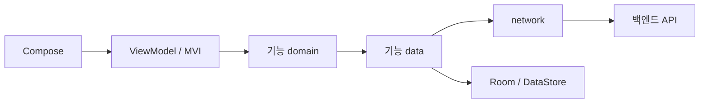

# 1-2-android-design

## 문서 정보

| 항목 | 값 |
| --- | --- |
| 버전 | v0.9 |
| 작성일 | 2026-09-09 |
| 수정일 | 2026-10-28 |
| 대상 | manyak-android |
| 작성 목적 | 모듈 책임, 상태 수명, 인증·제작·알림의 실패와 복구 경계를 설명합니다. |
| 기준 코드 | [manyak-android](../../../manyak-android) |

## 읽는 순서

- 공통·Android Spec으로 사용자 계약을 확인한 뒤 모듈 → UI 상태 → 담당 기능 순서로 읽습니다. API 필드·화면별 수용 기준은 Spec을 참조하고 이 문서에서는 내부 책임과 수명을 확인합니다.

## 목차

- [1-2-1. 기술 환경과 요청 흐름](#1-2-1-기술-환경과-요청-흐름)
- [1-2-2. 모듈과 소유권](#1-2-2-모듈과-소유권)
- [1-2-3. UI 상태와 작업 수명](#1-2-3-ui-상태와-작업-수명)
- [1-2-4. 내비게이션과 화면](#1-2-4-내비게이션과-화면)
- [1-2-5. 인증과 세션](#1-2-5-인증과-세션)
- [1-2-6. 푸시와 알림](#1-2-6-푸시와-알림)
- [1-2-7. 제작과 상태 복원](../domain/STORY/CLIENT/ANDROID/AGENTS.md)
- [1-2-8. 관측](#1-2-8-관측)
- [1-2-9. 검증 방법](#1-2-9-검증-방법)

---

[공통 스펙](../spec/3-1-client-spec.md)과 [Android 스펙](../spec/3-3-android-spec.md)을 구현하는 구조입니다. 선택 이유는 [Android ADR](../adr/1-3-android-adr.md)을 따릅니다.

## 1-2-1. 기술 환경과 요청 흐름

| 구분 | 기준 |
| --- | --- |
| 언어·UI | Kotlin, Jetpack Compose, Material 3. 정확한 버전은 [버전 카탈로그](../../../manyak-android/gradle/libs.versions.toml) 참조 |
| Android | minSdk 24, compileSdk·targetSdk 37 |
| 빌드 | 빌드 JDK 25, JVM bytecode 11. AGP·Gradle은 [앱 빌드 설정](../../../manyak-android/app/build.gradle.kts)·[Wrapper](../../../manyak-android/gradle/wrapper/gradle-wrapper.properties) 참조 |
| 구조 | 직접 구현 MVI, Hilt, Navigation 3 |
| 통신·이미지 | Retrofit, OkHttp, kotlinx.serialization, okhttp-sse, Coil |
| 푸시 | Firebase Cloud Messaging — Crashlytics와 같은 Firebase 프로젝트·BOM |
| 저장 | Room, DataStore, Android Keystore |
| 관측 | Amplitude, Firebase Crashlytics |

Android는 BFF 없이 백엔드에 직접 요청합니다. `network`는 공용 HTTP 전송과 인증 연동 포트를, 기능 `data`는 DTO·매핑·Repository 구현을 소유합니다. API 정본은 [백엔드 Spec](../spec/4-backend-server-spec.md)입니다.

## 1-2-2. 모듈과 소유권

### 모듈 구성과 의존 방향

18개 Gradle 모듈과 별도 included build인 `build-logic`을 사용합니다. `app`만 Application이며 `common`도 Android 기반 MVI·리소스·저장을 포함하는 Android Library입니다. `entity/domain/data/presentation`은 필요한 모듈 내부의 패키지이며 별도 Gradle 모듈이 아닙니다.

| 모듈 | 책임·허용 의존 |
| --- | --- |
| `app` | 조립 지점. 내비게이션 연결, DI, 세션 종료 조정, 실제 기능 모듈 결합 |
| `common` | `DomainError`·`DomainResult`, 공유 모델·계약. 다른 프로젝트 모듈에 의존하지 않음 |
| `designsystem` | 공용 Compose UI·토큰·리소스. 값과 콜백을 받으며 Repository에 의존하지 않음 |
| `navigation` | 경로·결과 타입. 다른 프로젝트 모듈에 의존하지 않음 |
| `network` | HTTP·인증 포트. `common`에 의존 |
| `analytics` | 관측 어댑터. `common`에 의존하며 기능 모델 대신 자체 값·기본 타입을 받음 |
| `auth` | 인증·토큰·세션. `common`, `network`에 의존 |
| `report` | 신고 흐름·`StoryReportController`. `common`, `network`, `designsystem`, `analytics`에 의존 |
| `home`, `chat`, `studio`, `story`, `create`, `my`, `login`, `legal`, `notification`, `notice` | 기능 소유권. 필요한 공통 모듈·`auth`를 사용하고 HTTP 의존은 data로 제한. 신고 소비 기능만 `report` 사용 |

기능은 실제 책임에 필요한 내부 패키지만 만들고 단순 위임 UseCase·빈 계층·하위 UI 전용 ViewModel을 추가하지 않습니다. `create/presentation/state`는 공유 퍼널 상태를, `my/data`는 profile·invite의 저장 인스턴스 구성을 소유합니다.

화면 기능 간 직접 의존을 만들지 않습니다. `app`이 콜백을 연결하고 기능 간 호출은 아래 공유 계약으로 연결합니다. `domain/entity`는 Android·Compose·Retrofit·Room·data 구현에 의존하지 않으며, `presentation`도 data·network 구현을 직접 참조하지 않습니다. `entity`의 domain 의존은 `DomainError` 값 같은 허용 예외로 제한합니다.

### 공유 계약과 구현 소유자

| 계약·상태 | 소유자와 소비 방식 |
| --- | --- |
| `ChatStarter` | `common` 계약, `chat` 구현. 다른 기능의 채팅 시작 요청을 연결 |
| `PersonaAccess` | [4-2-1 모듈과 공용 포트](../domain/ACCOUNT/CLIENT/ANDROID/4-2-COMPONENT-ARCHITECTURE.md#4-2-1-모듈과-공용-포트) |
| `CreationProgressAccess` | `common` 계약, `create` 구현. 제작 요약 관찰·폐기·새로고침(완성 요청 상태, 서버 초안 목록)만 노출 |
| `StoryDeletion` | `common` 계약, `studio` 구현. 상세 화면의 삭제와 목록 상태를 연결 |
| `SignupOnboardingWriter` | [4-2-1 모듈과 공용 포트](../domain/ACCOUNT/CLIENT/ANDROID/4-2-COMPONENT-ARCHITECTURE.md#4-2-1-모듈과-공용-포트) |
| `MemberConsent` | [4-2-1 모듈과 공용 포트](../domain/ACCOUNT/CLIENT/ANDROID/4-2-COMPONENT-ARCHITECTURE.md#4-2-1-모듈과-공용-포트) |
| `SessionIdAccess` | `network` 포트, `app`이 `AnalyticsIdentity`에 연결. Amplitude의 현재 세션 ID를 조회하며 값이 없으면 헤더 생략 |
| `SessionTokenAccess` | [4-2-1 모듈과 공용 포트](../domain/ACCOUNT/CLIENT/ANDROID/4-2-COMPONENT-ARCHITECTURE.md#4-2-1-모듈과-공용-포트) |
| `UserProfile`·초대 온보딩 | [4-2-1 모듈과 공용 포트](../domain/ACCOUNT/CLIENT/ANDROID/4-2-COMPONENT-ARCHITECTURE.md#4-2-1-모듈과-공용-포트) |
| `CreditPolicy`, 공유 `StorySummary`·DTO | 기존 공유 타입은 `common`에 유지. 비즈니스 Repository 구현은 옮기지 않음 |
| `StoryReportController` | 채팅 목록·채팅방·제작·스토리 상세에서 사용. 별도 공용 ViewModel·Singleton을 추가하지 않음 |
| `AttendanceClaimer` | `common` 계약, `my`의 `CreditRepositoryImpl` 구현. 이프 부족 시트의 출석 요청을 연결 |
| `CreditShortageController` | `common`. 채팅방과 간편 제작 추가 정보 단계에서 사용. 시트 상태는 각 ViewModel 상태에 싣고 분석 이벤트는 ViewModel이 보냄 |

ACCOUNT 내용은 다음 문서에서 관리한다. ([4-2-1 모듈과 공용 포트](../domain/ACCOUNT/CLIENT/ANDROID/4-2-COMPONENT-ARCHITECTURE.md#4-2-1-모듈과-공용-포트))

리소스는 기능·designsystem·common·app의 실제 소유권에 맞춥니다. `build-logic`은 공통 빌드 설정을 소유하고 앱 서명 설정을 가져가지 않습니다. 공개 타입은 소비 지점에 필요한 최소 범위로 두되 Hilt 생성 코드의 접근성을 확인합니다.

### 구조 검사와 호환성

`checkModuleArchitecture`는 Gradle 의존과 Kotlin PSI 참조를 검사합니다. import alias·완전 수식 이름·typealias도 검사하지만 완전한 의미 분석이나 reflection 검증은 아닙니다. 루트 `check`와 CI에 연결합니다.

패키지 이동 때문에 DB 파일명·버전·스키마 identity hash, DataStore 파일·키, Keystore alias, 직렬화된 경로 이름·패키지, Application ID·Manifest·백업 제외 규칙을 바꾸지 않습니다. 구조 변경을 이유로 destructive migration이나 일괄 저장소 삭제를 사용하지 않습니다.

## 1-2-3. UI 상태와 작업 수명

`MviViewModel<I, S, E, F>`는 Intent → side effect → ReducerEvent → 순수 reducer → 불변 UiState 흐름을 사용합니다. ViewModel 밖이나 비동기 작업에서 `MutableStateFlow`를 직접 갱신하지 않습니다.

- Intent·ReducerEvent·UiEffect는 각각 용량 64, `SUSPEND` 방식의 bounded Channel과 단일 소비자를 사용합니다. 버리기 정책이나 결과를 무시한 `trySend`를 쓰지 않습니다.
- UiEffect는 `receiveAsFlow`로 제공하고 STARTED 상태의 단일 host가 소비합니다. 정지 중에는 큐에 남고 소비한 이벤트는 재생하지 않으며 ViewModel 종료 시 사라집니다. 반드시 처리해야 하는 결과는 확인 가능한 지속 상태로 모델링합니다.
- 비동기 작업은 명시적인 자식 코루틴과 요청별 single-flight로 중복을 막습니다. `CancellationException`을 일반 오류로 삼키지 않습니다.
- 재시도 책임은 한 계층에 두며 소셜 로그인·계정 연동을 자동 반복하지 않습니다. 공용 `apiCall`은 전송 오류를 도메인 오류로 매핑하고 UI 문구는 presentation이 소유합니다.
- 무거운 IO·암복호화는 호출된 함수가 주입받은 dispatcher에서 실행합니다. `stateIn`·`shareIn`은 scope·시작 조건·구독자 부재 시 유지 시간을 명시합니다.
- 화면 작업은 ViewModel, 프로세스 내 제작 실행·푸시 등록은 앱 수명을 사용합니다. 프로세스 사망을 넘겨야 하는 상태는 Room 등 저장소에서 복구하며 WorkManager·Foreground Service로 실행을 유지하지 않습니다.

## 1-2-4. 내비게이션과 화면

ACCOUNT 내용은 다음 문서에서 관리한다. ([4-2-2 화면 조립](../domain/ACCOUNT/CLIENT/ANDROID/4-2-COMPONENT-ARCHITECTURE.md#4-2-2-화면-조립))

로그인·탭·상세·제작·채팅·마이 화면의 사용자 동작은 [공통 Spec](../spec/3-1-client-spec.md), 플랫폼 적용 차이는 [Android Spec](../spec/3-3-android-spec.md)이 정본입니다. 화면 구현에서는 다음 경계를 유지합니다.

ACCOUNT 내용은 다음 문서에서 관리한다. ([4-3-3 프로필과 페르소나](../domain/ACCOUNT/CLIENT/ANDROID/4-3-STATE-MANAGEMENT.md#4-3-3-프로필과-페르소나))

- 공지사항 목록(`NoticeListRoute`)과 상세(`NoticeDetailRoute(noticeId)`)는 `notice`가 소유합니다. `NoticeApi`는 공개 API라 `@PlainClient`로 토큰 없이 부르고, 읽은 공지 ID는 `NoticeReadStore`가 기기 귀속 `@DeviceDataStore`의 `notice_read_ids` 키에 최신순 JSON 배열(최대 100개)로 두며 `UserScopedStore`에 참여하지 않습니다. 안 읽음 판정(`notice/domain`의 `isUnread`: 게시 30일 안이고 읽은 목록에 없음)은 `NoticeUnreadViewModel`이 소유하고 `app`의 `MainTabsScreen`이 셸 수명으로 들어 `ON_RESUME`마다 첫 페이지를 다시 읽습니다. 셸은 그 값으로 `MyScreen`의 "새 공지" 배지를 그립니다. 홈, 채팅, 제작 헤더의 종 버튼과 점은 회원 알림함이 관리합니다. `NoticeListViewModel`은 커서 페이지를 이어 붙이고 읽은 ID 흐름을 관찰해 상세에서 돌아온 줄의 점만 끄며, `NoticeDetailViewModel`은 공지를 받으면 `markRead`를 호출하고 404는 읽음으로 기록하지 않습니다. 게시일·수정일은 `formatNoticeDate`가 KST `yyyy-MM-dd`로 그립니다.

ACCOUNT 내용은 다음 문서에서 관리한다. ([4-3-3 프로필과 페르소나](../domain/ACCOUNT/CLIENT/ANDROID/4-3-STATE-MANAGEMENT.md#4-3-3-프로필과-페르소나))

- 시트 닫기는 `ManyakTextButton`을 사용하고, 마이 메뉴 규격·선택 컨트롤 행의 리플과 접근성 규칙은 [Android 디자인 시스템](../../../manyak-android/DESIGN.md#컴포넌트)을 따릅니다.
- 카드 옵션·상세 옵션·채팅 메뉴는 `designsystem`의 `ManyakOptionsSheet`·`ManyakOptionItem`으로 그립니다. 시트 열림은 제작·채팅 목록에서 ViewModel의 대상 카드 상태(`optionsTarget`)가, 상세·채팅방에서 화면의 `rememberSaveable`이 들어 구성 변경에서 유지합니다. 삭제 확인·신고 시트는 옵션 시트를 닫은 뒤 엽니다. 채팅방 메뉴의 새 채팅은 `ChatRoomViewModel`이 `ChatRepository`(`ChatStarter`)로 single-flight 생성하고 진행 상태를 소유하며, `app`이 백스택 맨 위 `ChatRoomRoute`를 새 방으로 바꿔 끼웁니다. 내 이프 카드는 `designsystem/credit/CreditBalanceCard`를 마이와 함께 쓰고, 채팅방은 메뉴를 열 때 `UserProfileRepository.refresh()`로 잔액을 다시 읽습니다. 공유하기는 `ChatRepository.createShareLink`가 `DataLayerConfig.webBaseUrl`로 웹 열람 URL을 완성해 돌려주고, 화면이 `common`의 `shareText`(초대와 같은 `ACTION_SEND` 공유 시트)로 보냅니다.
- 목록의 필터·선택·로딩과 채팅 스트림 상태는 해당 ViewModel이 소유합니다. 도메인 호출·데이터 복구를 Composable 재구성에 연결하지 않습니다.
- `designsystem`의 `FullscreenImageViewer`는 이미지 URL과 닫기 콜백을 받아 확대·이동·뒤로가기 처리를 공유합니다. 배경 탭 닫기는 Coil이 알려 준 원본 크기로 Fit 그림 영역을 계산하고 현재 확대·이동을 되돌려 판정하므로, 그림 위 탭으로는 닫지 않습니다(원본 크기를 알기 전에는 그림이 없는 것으로 봅니다). 배경 탭은 떼는 즉시 닫고, 더블 탭의 두 번째 탭 대기는 그림 위 탭에만 겁니다. 상세·채팅 ViewModel의 `imageViewerUrl`이 열린 대상을 소유하며 저장 상태나 라우트에 넣지 않습니다. 상세 재조회에서 대상 이미지가 사라지면 닫습니다. `CharacterImage`는 URL 허용 검사·로드 실패 처리 뒤 탭을 화면 콜백으로 전달하고, 분석 이벤트는 화면 ViewModel이 기록합니다.
PAYMENT 내용은 도메인 문서에서 관리한다. ([Android 이프 부족 실행](../domain/PAYMENT/CLIENT/ANDROID/4-4-EXECUTION.md#4-4-2-부족-시트))
- 구성 변경은 Activity 재생성으로 처리합니다. `configChanges`나 화면 방향 고정으로 우회하지 않습니다. 화면 폭을 제한한 스크롤 레이아웃과 상태 복원으로 대응합니다.

채팅의 구성, 상태와 실행은 [CHAT Android](../domain/CHAT/CLIENT/ANDROID/AGENTS.md)에서 관리한다.

## 1-2-5. 인증과 세션

### 세션과 프로필의 정본

ACCOUNT 내용은 다음 문서에서 관리한다. ([4-3-1 세션과 토큰](../domain/ACCOUNT/CLIENT/ANDROID/4-3-STATE-MANAGEMENT.md#4-3-1-세션과-토큰), [4-1-1 서버와 문서](../domain/ACCOUNT/CLIENT/ANDROID/4-1-CONTRACT.md#4-1-1-서버와-문서))

### 약관 동의 게이트

ACCOUNT 내용은 다음 문서에서 관리한다. ([4-3-2 가입 대기와 회원 동의](../domain/ACCOUNT/CLIENT/ANDROID/4-3-STATE-MANAGEMENT.md#4-3-2-가입-대기와-회원-동의))

### 토큰 저장과 만료 판정

ACCOUNT 내용은 다음 문서에서 관리한다. ([4-3-1 세션과 토큰](../domain/ACCOUNT/CLIENT/ANDROID/4-3-STATE-MANAGEMENT.md#4-3-1-세션과-토큰))

### 재발급과 세션 경합

ACCOUNT 내용은 다음 문서에서 관리한다. ([4-4-2 재발급](../domain/ACCOUNT/CLIENT/ANDROID/4-4-EXECUTION.md#4-4-2-재발급))

### 중앙 로그아웃과 복구

ACCOUNT 내용은 다음 문서에서 관리한다. ([4-4-3 중앙 로그아웃과 복구](../domain/ACCOUNT/CLIENT/ANDROID/4-4-EXECUTION.md#4-4-3-중앙-로그아웃과-복구))

### 소셜 로그인·계정 연동·기기 식별

ACCOUNT 내용은 다음 문서에서 관리한다. ([4-4-1 인증과 동의](../domain/ACCOUNT/CLIENT/ANDROID/4-4-EXECUTION.md#4-4-1-인증과-동의), [6-1 공급자 설정](../domain/ACCOUNT/CLIENT/ANDROID/6-DEPLOYMENT.md#6-1-공급자-설정), [4-1-2 식별 정보](../domain/ACCOUNT/CLIENT/ANDROID/4-1-CONTRACT.md#4-1-2-식별-정보))

### 마이 조회와 초대 안내 실패

ACCOUNT 내용은 다음 문서에서 관리한다. ([4-3-4 초대와 종료 상태](../domain/ACCOUNT/CLIENT/ANDROID/4-3-STATE-MANAGEMENT.md#4-3-4-초대와-종료-상태))

### 이프 정책 캐시

PAYMENT 내용은 도메인 문서에서 관리한다. ([이프 정책 캐시](../domain/PAYMENT/CLIENT/ANDROID/4-3-STATE-MANAGEMENT.md#4-3-1-값과-수명))

### 체험 잔여 조회

PAYMENT 내용은 도메인 문서에서 관리한다. ([체험 잔여 조회](../domain/PAYMENT/CLIENT/ANDROID/4-3-STATE-MANAGEMENT.md#4-3-1-값과-수명))

## 1-2-6. 푸시와 알림

### 회원 알림함

`notification/inbox`가 회원 알림 API, 분류별 목록과 커서, 읽음 상태, 화면을 관리합니다. 인증 클라이언트와 공통 오류 변환을 사용하며 본문 없는 읽음 성공은 `emptyBodyApiCall`로 처리합니다. 서버 목록과 읽음 기록을 디스크에 복제하지 않습니다. 카드 제목은 공지 목록과 같이 제목 글만 한 줄로 줄이고 안 읽음 점은 별도 글로 줄 끝에 둬 말줄임에 잘리지 않게 합니다.

알림함 ViewModel은 선택한 분류와 두 분류의 목록을 유지합니다. 목록 조회와 읽음 요청은 같은 Mutex로 순서를 맞춰 이전 응답이 읽음 표시를 되돌리지 않게 합니다. 한 건 읽음은 요청 결과와 관계없이 목적지로 이동하고, 모두 읽음 실패는 두 분류의 읽음과 개수를 복원합니다. 화면 재생성은 읽음 요청을 다시 실행하지 않으며 탭별 스크롤은 저장 가능한 화면 상태입니다. 알림 내용은 회원 그래프 안의 ViewModel 수명에만 존재합니다.

`app`이 메인 헤더 종 버튼을 `NotificationInboxRoute`에 연결합니다. 헤더의 안 읽은 수는 셸이 다시 보일 때 갱신하며 조회 실패는 점을 끕니다. 마이 공지 메뉴는 기존 `NoticeUnreadViewModel`과 기기 읽음 기록을 사용합니다. 알림함의 링크는 기존 `DeepLink` 해석을 사용하고 해석할 수 없으면 공지 ID, 스토리 ID 순으로 대체합니다. 허용 HTTPS origin은 기본 포트만 받고 사용자 정보가 포함된 URL은 거절합니다. 공지와 스토리 상세는 알림함 위에 쌓고 제작은 기존 탭으로 전환합니다. 공지 응답의 태그는 `notice`의 목록과 상세에서 같은 배지로 표시합니다.

### 푸시 토큰 등록

회원 세션과 `MemberConsent.isSatisfied`가 모두 참일 때만 최초 등록 및 FCM 토큰 갱신 등록을 실행합니다. 같은 세션 generation에서 성공한 동일 토큰은 반복 등록하지 않으며 새 토큰이나 새 세션은 다시 등록합니다. 토큰 조회 중 동의 상태가 초기화되면 등록 작업을 취소하고 요청 직전에도 상태를 재확인합니다.

`notification`이 FirebaseMessagingService·등록기·토큰 API·권한·수신·표시·수신 동의를 소유합니다. `app`은 google-services 플러그인과 권한 UI·세션 종료 연결을 조립합니다.

앱 수명의 registrar가 필수 동의 확인 후의 `getToken()`과 `onNewToken()`을 같은 직렬 경로로 처리하고 `platform=ANDROID`로 PUT합니다. 별도 FCM 토큰 영속 저장·재전송 큐는 없으며 네트워크·5xx 실패는 다음 등록 계기에서 재시도합니다.

푸시 등록의 403은 generation을 검사하는 `SessionGate.commit` 안에서 `ACCOUNT_SUSPENDED` 종료로 넘깁니다. 공통 Interceptor는 401 재발급만 담당합니다. 로그아웃 barrier와 등록 작업의 순서는 앞 절을 따릅니다.

### 수신·표시와 계정 격리

payload의 `recipientId`를 현재 프로필 ID와 대조합니다. Pending·프로필 대기는 합계 최대 5초이며 일치하는 회원을 확인하지 못하면 폐기합니다. 표시 직전 다시 확인하고 계정 전환을 넘어 알림을 보관하지 않습니다. 로그아웃의 `UserScopedStore` 정리는 표시 알림을 `cancelAll`합니다.

서비스 채널은 HIGH·PRIVATE, 마케팅 채널은 DEFAULT·PUBLIC입니다. foreground·background 모두 시스템 알림을 사용하며 type+target에서 안정된 알림 ID를 만듭니다. `STORY_MODERATION_COMPLETED`의 target은 `submissionId`이며, `APPROVED`, `REJECTED`, `FAILED`만 수신합니다. 이 타입은 서버 `title`과 `body`를 그대로 사용하고 서비스 알림의 공개 버전은 제목 줄만 표시합니다. title이 없으면 표시하지 않고 알 수 없는 type의 진입 목적지는 홈입니다. 검수 결과를 화면에서 확인하는 제출본은 `common`의 `ReviewWatch` 계약으로 알립니다. `create`의 `GeneralReviewWatch`가 결과 조회 중인 제출본과 화면에 보여 준 결과를 프로세스 메모리에만 두고, `PushNotificationTray`가 표시 직전에 이를 물어 걸러 냅니다.

### 알림 진입과 권한

`PushEntry`는 payload의 `deepLink`가 있으면 그 URL을 정본으로 삼아 `:navigation`의 `DeepLink`가 내부 목적지로 해석합니다 — `https`이고 호스트가 `manyak.app`·`www.manyak.app`일 때 `/stories/{id}`→스토리 상세, `/my/credits`→이프 충전(쿼리 중 `tab`만 읽어 `history`면 `MyCreditChargeRoute(openHistory = true)`로 내역 탭, 그 밖의 값과 쿼리 없음은 무료 충전 탭. 화면은 이 값을 처음 탭으로만 쓰고 탭 전환을 라우트에 다시 쓰지 않음), `/studio`→제작 탭, `/notices`→공지 목록, `/notices/{noticeId}`→공지 상세(`openExternalDestination`이 `NoticeListRoute`를 먼저 쌓아 뒤로가기가 목록으로 감)이며 그 외는 홈입니다. 해석에 실패해도 `type` 매핑으로 되돌아가지 않습니다. `deepLink`가 없는 payload(프로모션·업데이트 전에 만든 PendingIntent)만 스토리 완성→storyId 상세, 검수 완료→제작 탭(submissionId 필수), 출석→이프, 프로모션·미지원·필수 값 누락→홈으로 매핑합니다. 이동 시 공통 셸+목적지로 정리해 상세 화면을 중복 적재하지 않습니다. 제작 진입은 `StudioRoute`를 루트에 쌓지 않고 기존 셸의 제작 탭을 선택합니다. 루트의 재조회 번호를 셸을 통해 `StudioScreen`에 전달하므로 이미 선택된 탭도 즉시 재조회하며, 홈 도착은 실제 홈 탭을 선택합니다. 파서는 `java.net.URI`를 쓰며 App Links(HTTPS intent-filter·`assetlinks.json`)는 아직 없습니다.

웹 앱 안내 배너의 앱 열기는 `MainActivity`의 전용 스킴 intent-filter(`manyak://manyak.app`, VIEW와 BROWSABLE)로 들어옵니다. `PushEntry.readAppLinkFrom`이 VIEW 인텐트의 주소를 `TYPE_APP_LINK` 진입으로 바꾸고 경로를 같은 주소의 https로 옮겨 `DeepLink`로 해석합니다. 이 진입은 수신자를 비교하지 않고 회원과 프로필 확인 뒤 소비하며, 푸시 진입 extra가 있으면 푸시를 먼저 읽습니다([A-071](../adr/1-3-android-adr.md#a-071-웹의-앱-열기-링크를-https-대신-전용-스킴으로-받기)).

`onCreate`·`onNewIntent`에서 루트 ViewModel의 pending 값을 SavedStateHandle로 전달합니다. 프로세스 복원 때 최초 Intent를 다시 해석하지 않습니다. 로그인 대기 진입은 회원·프로필 확인 뒤 recipient가 일치할 때만 소비하고 불일치하면 홈으로 보냅니다.

Android 13+ 알림 권한 안내는 설치 단위 플래그로 한 번 수행합니다. 로그아웃 시 플래그를 지우지 않으며 권한 거부는 세션·토큰 등록을 막지 않고 반복 요청하지 않습니다.

### 광고 알림 수신 동의

`notification/consent`가 재질문 시트·처리 결과 다이얼로그·질문 단계 저장소를 소유합니다. 첫 질문은 약관 동의 시트의 선택 항목이며, 루트가 그 답을 `MarketingConsentIntent.AnsweredInConsentSheet`로 같은 ViewModel에 넘깁니다. 허용이면 `GET /users/me/push-settings`로 서비스 값을 읽어 광고만 켠 `PUT`으로 저장하고 통지하며, 거절이면 첫 거절로 기록합니다. 루트는 이 저장·통지가 도는 동안(`isBusy`) 알림 권한·초대 코드 안내를 시작하지 않습니다.

재질문 순서는 루트가 정합니다 — 알림 권한 응답과 약관 동의가 끝난 뒤 루트 ViewModel이 초대 코드 안내의 `pending`(초기값 참)을 읽어 끝났을 때만 `MarketingConsentSheet(enabled = true)`입니다. 시트는 `claimPrompt()`가 참이고 `areNotificationsEnabled`가 참이며 서버 `marketingPush`가 거짓일 때만 뜹니다.

질문 단계는 사용자 귀속 DataStore(`marketing-consent`)에 거절 횟수(0 미질문·1 한 번 거절·2 닫힘)와 첫 거절 뒤 재진입 횟수로 두고 `UserScopedStore`로 로그아웃 정리 대상입니다. `claimPrompt()`는 호출마다 재진입을 세어 거절 1회일 때 세 번째부터 참을 돌려주고, 두 번째 거절·허용은 닫힘으로 기록합니다. 단계 도입 전의 "물었음" 값은 한 번 거절로 읽습니다. 기록은 사용자가 답한 뒤에 남기며 저장 실패는 시트를 유지합니다. ViewModel은 세션이 회원이 아니게 되면 준비 표시를 되돌려 같은 프로세스의 재로그인에서도 판정합니다. 처리 결과 통지(`ConsentNotice`)의 일시는 서버 응답이 아니라 의사 표시 시점의 기기 시각이며, 시트 허용과 설정 화면의 광고·야간 토글이 같은 `ConsentNoticeDialog`를 씁니다. 세부 결정은 [Android 계획](../../../manyak-android/docs/plans/legal-consent.md)과 [A-044](../domain/ACCOUNT/CLIENT/ANDROID/DECISIONS.md#a-044)를 참조합니다.

## 1-2-7. 제작과 상태 복원

STORY 내용은 [도메인 문서](../domain/STORY/CLIENT/ANDROID/AGENTS.md)에서 관리한다.

## 1-2-8. 관측

분석 이벤트·식별자·수집 제한은 [분석 Spec](../spec/6-analytics.md)이 정본입니다. Android는 Amplitude와 Firebase Crashlytics를 사용하고 Firebase Analytics는 사용하지 않습니다.

- 첫 이벤트 이전에 공용 device ID를 주입합니다. 로그인은 공개 사용자 ID, 로그아웃은 세션 정리 순서에 맞춰 사용자 해제와 device ID 교체를 수행합니다.
- 사용자 속성(`setOnce`)도 이벤트와 같은 대기열을 타서 device ID 주입 뒤에 나갑니다.
- `InstallReferrerReporter`는 앱 시작마다 기기 DataStore의 `install_referrer_reported` 키를 보고, 없을 때만 Play Install Referrer를 읽어 유입 귀속 속성을 보냅니다([분석 Spec §6-2](../spec/6-analytics.md#6-2-식별자-정책)). 조회 실패와 서비스 연결 끊김은 키를 남기지 않고 다음 실행에 다시 읽으며, Play 밖 설치(`FEATURE_NOT_SUPPORTED`)는 보낼 값 없이 완료로 남깁니다. 키는 device ID와 별개라 로그아웃의 device ID 교체 뒤에도 다시 보내지 않습니다.
- Crashlytics는 release에서 활성화하고 debug에서는 끕니다. release는 R8을 적용하고 빌드마다 mapping 파일을 Crashlytics에 올립니다. 빌드·매핑 상태는 [배포 Design](4-deployment.md#manyak-android-ci)에서 확인합니다. 토큰·입력 원문·PII를 보내지 않으며 개별 오류 연결은 request ID를 사용합니다. 예상한 4xx·취소는 보고 대상에서 제외합니다.
- 화면 이벤트는 현재 화면 소유 ViewModel의 노출 guard로 구성 변경 중 중복을 막습니다. 노출 집계 조건은 분석 Spec을 따릅니다. reducer에 관측 호출을 넣지 않습니다.
- breadcrumb는 Amplitude 어댑터에서 연결해 화면에서 중복 발화하지 않습니다. 지속 Crashlytics 키는 `screen_name`을 사용하고 개별 식별자는 breadcrumb로 연결합니다.
- ANR은 API 30+ Crashlytics와 그 이전 Android vitals의 관측 범위를 구분합니다.

화면별 `screen_name`과 필수 프로퍼티는 [분석 Spec](../spec/6-analytics.md)과 [AnalyticsEvent](../../../manyak-android/analytics/src/main/java/app/manyak/analytics/entity/AnalyticsEvent.kt)에서 확인합니다.

## 1-2-9. 검증 방법

변경 영역에 맞춰 구현 저장소의 `checkModuleArchitecture`, 루트 `check`, 기존 단위·기기·CI 검증을 사용합니다. 사용자 수용 기준은 [Android Spec](../spec/3-3-android-spec.md), 앱 검증 절차는 [Android AGENTS](../../../manyak-android/AGENTS.md), 실행 결과는 해당 기능 계획·PR에 남깁니다.

| 경계 | 필수 확인 |
| --- | --- |
| 모듈 이동 | 허용 의존·PSI 검사, Hilt 생성 코드, Manifest·경로 직렬화·저장 식별자 호환 |
| 인증 | [5-1-1 기존 검증 경계](../domain/ACCOUNT/CLIENT/ANDROID/5-1-VERIFICATION.md#5-1-1-기존-검증-경계) |
| 로그아웃 | [5-1-1 기존 검증 경계](../domain/ACCOUNT/CLIENT/ANDROID/5-1-VERIFICATION.md#5-1-1-기존-검증-경계) |
| 푸시 | 회원 전환·늦은 PUT·403·recipient 불일치·Pending 5초 제한·로그아웃 알림 제거 |
| 제작 | [STORY Android 검증](../domain/STORY/CLIENT/ANDROID/5-1-VERIFICATION.md) |
| 화면·복원 | 회전·프로세스 재생성·back stack·SSE 중단·이미지 순서·키보드·접근성 |
