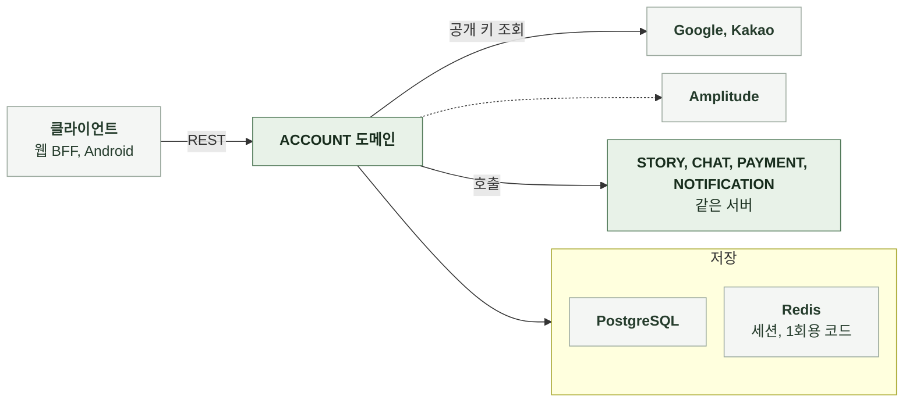

# 3-1 소프트웨어 구조

이 문서는 ACCOUNT 도메인 백엔드의 개요, 배경과 목표, 품질 속성, 배포 단위, 모듈 구조, 의존 방향, 도메인 모델을 정한다.

테이블과 컬럼은 DB 스키마에, 코딩 규칙은 컨벤션에, 엔드포인트별 처리 순서는 처리 흐름에 있다. ([3-2 DB 스키마](3-2-DB-SCHEMA.md), [3-3 컨벤션](3-3-CONVENTIONS.md), [4-1 처리 흐름](4-1-PIPELINES.md))

 

### 3-1-1 개요

ACCOUNT 도메인은 서버 애플리케이션의 내부 패키지다. 별도 프로세스로 실행하지 않는다. 같은 서버의 다른 도메인과는 서비스 호출로 연결한다. 모든 요청에 적용되는 인증과 계정 상태 필터를 제공한다.

| 외부 시스템 | 역할 | 연결 방식 |
|---|---|---|
| 클라이언트 | 신원 증명 전달, 토큰 보관과 갱신, 계정 관리 요청 | REST |
| Google, Kakao | 신원 증명의 서명 검증용 공개 키 제공 | HTTPS로 공개 키 집합 조회 |
| PostgreSQL | 회원, 소셜 연동, 동의, 페르소나 저장 | JDBC |
| Redis | 세션, 핸드오프, 동의 대기 코드, 링크 코드 | Lettuce 체험 카운터는 PAYMENT 도메인을 거쳐 접근 |
| 정적 자산 | 프로필 프리셋 이미지 40종 | 서버가 직접 제공 |
| Amplitude | 서버 분석 이벤트 | HTTP API |

 

### 3-1-2 배경과 목표

| 배경 | 설계 목표 |
|---|---|
| 소셜 제공자는 신원만 증명하고 계정 존재 여부를 모름 | 신원 증명 검증과 계정 찾기 또는 만들기를 한 요청에서 처리 실패 사유를 구분하지 않아 계정 존재 여부를 드러내지 않음 |
| 가입 전에 필수 동의가 있어야 하지만 신원 검증은 먼저 끝남 | 동의 전에는 계정을 만들지 않고 1회용 대기 코드로 신원을 잠시 보관 동의 제출 시 계정과 동의를 한 트랜잭션으로 저장 |
| 웹은 토큰을 브라우저에 두지 않아 BFF가 갱신을 대신하고 동시 갱신이 생김 | 갱신 토큰을 원자적으로 회전하고 짧은 유예 안의 동시 회전은 같은 결과로 응답 |
| 게스트 콘텐츠에 기기 식별자를 저장하지 않음 | 이관은 제출된 식별자를 신뢰하되 성공 1회와 시도 상한으로 열거와 파밍을 제한 |
| 탈퇴한 소셜 계정으로 재가입하면 1회성 혜택이 초기화됨 | 연동을 끊되 행을 보존해 재가입 시 반드시 해당 행을 재사용 혜택 자격은 보상 신원으로 최초 계정에 고정 |
| 1회용 코드를 URL에 포함하면 요청 로그에 기록됨 | 핸드오프, 동의 대기, 링크 코드는 헤더나 본문으로만 받고 저장 키는 해시 |
| 회원 행에 초대 코드 제출 여부, 이관 시도 횟수, 체험 이전 완료 시각처럼 반복 처리를 막는 값이 함께 있음 | 표식을 바꾸는 경로는 모두 사용자 행을 잠그고 상태를 재검사 |

 

### 3-1-3 품질 속성

| 속성 | 기준 | 보장 방법 |
|---|---|---|
| 신원 신뢰 | 서명, 발급자, 대상을 검증한 신원 증명만 계정에 연결 | 제공자별 공개 키와 허용 대상 목록 |
| 계정 유일성 | 같은 소셜 계정이 두 계정을 만들지 않음 | 제공자와 제공자 쪽 식별자의 유니크 제약 동시 첫 로그인의 유니크 위반은 재조회로 처리 |
| 세션 안전 | 회전된 갱신 토큰을 재사용하면 세션 전체를 폐기 탈퇴 즉시 모든 요청 거절 | 회전과 폐기를 하나의 원자 스크립트로 실행 인증 직후 공통 필터가 탈퇴 계정을 거절 |
| 동의 증빙 | 문서 버전별 최초 동의 시각을 바꾸지 않음 | 추가 전용 저장과 충돌을 무시하는 삽입 계정 생성과 동의 저장을 같은 트랜잭션에 둠 |
| 혜택 1회성 | 가입 보상, 초대 제출, 회원 체험이 재가입과 재로그인으로 초기화되지 않음 | 보상 신원 기준 멱등 키 표식 승계와 끊긴 연동 재사용 |
| 비밀값 격리 | 코드 원문과 신원 증명 원문을 저장소, 로그, 오류 보고에 기록하지 않음 | 해시 키, 헤더 전달, 인증 경로의 요청 필드 제거와 안전한 오류 변환 |
| 개인정보 최소화 | 소셜 프로필의 이름과 사진을 쓰지 않고 이메일은 저장만 함 | 랜덤 닉네임과 프리셋 이미지 발급 탈퇴 시 이메일 삭제 |
| 관측 작업의 실패 격리 | 분석 이벤트, 재색인 이벤트 발행 실패가 요청을 실패시키지 않음 | 예외를 요청에 전파하지 않음 |

 

### 3-1-4 배포 단위

ACCOUNT는 다른 도메인의 백엔드와 하나의 서버 이미지에 포함된다. 따로 배포하지 않는다.

 

### 3-1-5 모듈 구조

로그인은 소셜 인증, 계정 등록, 로그인 후속 처리의 세 구성 요소가 순서대로 맡는다. 1회용 코드는 용도별 저장소가 발급과 소비를 담당한다.

| 구성 요소 | 입력 | 출력 | 책임 |
|---|---|---|---|
| API 계층 | HTTP 요청 | HTTP 응답 | 형식 검증, 요청자 식별, 상태 코드, 제공자 경로값 해석 |
| 신원 검증 | 신원 증명, 제공자 | 제공자 쪽 식별자, 이메일, 발급 시각 | 제공자별 공개 키와 허용 대상으로 서명, 발급자, 대상, 인가 대상 검증 |
| 소셜 인증 | 제공자, 신원 증명, 기기 식별자, 핸드오프 코드, 동의 제출 | 완료 토큰 또는 동의 대기 응답 | 동의 필요 판정, 대기 코드 발급과 소비, 계정 등록과 후속 처리 호출 |
| 계정 등록 | 제공자, 제공자 쪽 식별자, 동의 제출 | 회원 | 활성 연동 조회, 신규 계정과 연동 생성, 끊긴 연동을 재사용한 재가입, 랜덤 프로필 발급 |
| 로그인 후속 처리 | 회원, 신규 여부, 기기 식별자, 핸드오프 | 토큰 응답 | 회원 체험 스냅샷, 가입 보상, 핸드오프 소비, 토큰 발급, 분석 이벤트 |
| 토큰 | 회원 또는 갱신 토큰 | 접근 토큰과 갱신 토큰 | 접근 토큰 서명과 검증, 세션 생성, 회전, 폐기 |
| 핸드오프 | 게스트 식별자 목록, 기기 식별자, 코드 | 코드, 요약, 상태 | 핸드오프 데이터 보관, 외부 브라우저 확인 시 상태 변경, 같은 코드로 들어온 동시 요청 중 하나만 이관하도록 소비권 선점, 이관 결과 보관 |
| 계정 연동 | 재인증 요청, 연동 요청 | 링크 코드, 연동 결과 | 재인증 신선도 판정, 링크 코드 발급과 소비, 충돌 판정, 연동 행 추가 |
| 이관 | 회원, 식별자 목록 | 항목별 결과 | 잠금과 상태 검사, 1회와 시도 상한, 조건부 소유권 설정, 집계 보정 호출 |
| 프로필 | 회원, 닉네임과 프리셋 키 | 세션 응답 | 닉네임 규칙과 유일성, 프리셋 배정, 재색인 이벤트 |
| 페르소나 | 회원, 이름과 설명 | 페르소나 | 개수 상한, 소유 확인, 스냅샷 제공 |
| 동의 | 회원 또는 기기 해시, 제출 버전 | 동의 상태 | 현행 버전 비교, 충돌 무시 삽입, 인증 경로용 필수 검사 |
| 탈퇴 | 회원 | 없음 | 상태 전환, 개인정보 파기, 연동 끊기, 다른 도메인 삭제 호출, 세션 폐기 |
| 초대 | 회원, 초대 코드 | 코드와 진행, 적립 결과 | 코드 발급, 자격 판정, 보상 요청 순서 |
| 보안 필터 | 모든 요청 | 요청자 신원, 거절 응답 | 공개 인증 경로의 토큰 무시, 선택 인증, 탈퇴 거부, 동의 게이트 |
| 공통 | 모든 요청 | 오류 응답 본문, 로그와 분석 이벤트 | 오류 응답, 상관관계 식별자, 구조화 로그 |

 

### 3-1-6 의존 방향

| 방향 | 규칙 |
|---|---|
| API 계층 → 서비스 | API 계층은 서비스만 호출 저장 계층과 Redis를 직접 호출하지 않음 |
| 소셜 인증 → 계정 등록, 로그인 후속 처리 | 소셜 인증은 트랜잭션을 열지 않고 순서만 관리 계정 등록은 독립 트랜잭션으로 처리 |
| ACCOUNT → PAYMENT | 가입과 초대 보상, 체험 스냅샷, 잔액과 출석 조회, 정책값은 PAYMENT 서비스 호출 |
| ACCOUNT → STORY, CHAT | 이관의 소유권 설정, 내 목록 조회, 재색인 이벤트, 탈퇴 시 초안과 제출본 삭제는 해당 도메인의 서비스와 저장 계층 호출 |
| ACCOUNT → NOTIFICATION | 탈퇴 시 푸시 토큰 삭제 호출 |
| 다른 도메인 → ACCOUNT | 요청자 식별, 계정 상태 검사, 페르소나 스냅샷, 회원 프로필 조회 |
| 보안 필터 → 동의 | 동의 게이트가 동의 서비스로 현행 동의 여부 조회 |
| 외부 시스템 | 신원 검증기는 인터페이스로 분리 테스트는 고정 신원을 돌려주는 구현으로 대체 |

 

### 3-1-7 도메인 모델

| 모델 | 하위 데이터 | 설계 의도 |
|---|---|---|
| 회원 | 소셜 연동, 회원 동의, 페르소나 | 외부에는 공개 식별자만 노출 1회성 표식과 상태를 회원 행에 저장 |
| 소셜 연동 | 없음 | 제공자와 제공자 쪽 식별자가 계정을 가리킴 탈퇴 시 삭제하지 않고 끊긴 연동으로 보존 |
| 회원 동의 | 없음 | 문서 종류와 버전별 최초 동의 시각 추가만 하고 갱신하지 않음 |
| 게스트 동의 | 없음 | 기기 해시 단위 회원과 연결하지 않음 |
| 페르소나 | 없음 | 회원 소유 삭제 시 조회에서 제외 |
| 세션 | 현재 갱신 토큰 해시, 과거 토큰 매핑 | 로그인 1회마다 세션 1개 생성 로그아웃과 탈취 탐지는 세션 단위 |
| 핸드오프 | 게스트 식별자 목록, 기기 식별자, 복귀 경로, 상태, 이관 결과 | 코드 해시를 키로 수명 동안만 존재 |
| 동의 대기 | 제공자, 제공자 쪽 식별자, 이메일, 기존 회원 참조, 기기 식별자, 핸드오프 코드 | 동의 완료에 필요한 검증된 신원과 요청 정보를 임시 보관 신규 사용자의 계정은 아직 만들지 않고 기존 회원의 계정 참조는 함께 보관 |
| 링크 코드 | 소유 회원 | 재인증 증명 |

 

| 회원의 판정 | 의미 |
|---|---|
| 상태 | `ACTIVE`, `SUSPENDED`, `DELETED` 정지는 쓰기만 거절, 삭제는 모든 요청 거절 |
| 활성 연동 | 끊긴 연동이 아닌 소셜 연동 로그인 시 활성 연동에 연결된 탈퇴하지 않은 계정만 조회 |
| 재가입 계정 | 끊긴 연동을 재사용해 만든 계정 회원 체험을 부여하지 않음 |
| 보상 신원 | 재가입 계정이면 최초 계정, 아니면 자기 자신 |
| 이관 닫힘 | 이관에 한 번 성공했거나 시도 상한에 도달한 계정 |
