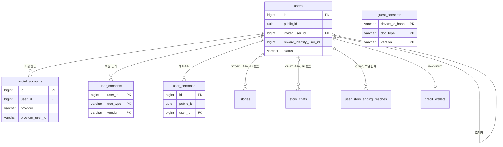

# 3-2 DB 스키마

이 문서는 ACCOUNT 도메인이 관리하는 PostgreSQL 테이블의 컬럼, 제약, 인덱스, Redis 키와 데이터 수명을 정한다.

다른 도메인의 테이블에서는 ACCOUNT 도메인이 참조하거나 기록하는 컬럼만 설명한다.

입력값의 검증 규칙은 보안에, 표식을 바꾸는 처리 순서는 처리 흐름에, 코드와 토큰의 수명은 오류 처리에 있다. ([5-1-5 입력 검증](5-1-SECURITY.md#5-1-5-입력-검증), [4-1-6 계정 생성과 재가입](4-1-PIPELINES.md#4-1-6-계정-생성과-재가입), [5-3-5 재시도와 시간 한도](5-3-ERROR-HANDLING.md#5-3-5-재시도와-시간-한도))

 

### 3-2-1 공통 규칙

| 규칙 | 내용 |
|---|---|
| 식별자 | 내부 PK는 `bigint` 자동 증가 회원과 페르소나는 외부 노출용 `public_id uuid`를 따로 둠 접근 토큰의 주체와 모든 API는 공개 식별자만 사용 |
| 시각 | `timestamp with time zone` 회원, 소셜 연동, 페르소나에 `created_at`과 `updated_at`이 있고 기본값은 `now()` 아래 표에서는 생략 |
| 삭제 | 회원과 페르소나는 `deleted_at` 기록 소셜 연동은 `deleted_at`으로 묘비 표시 물리 삭제 경로 없음 |
| FK | 소셜 연동은 회원 삭제 시 함께 삭제(`ON DELETE CASCADE`) 초대자 참조는 초대자 삭제 시 비움(`ON DELETE SET NULL`) 동의와 페르소나는 연쇄 없음 |
| 상태 | `status`는 `ACTIVE`, `SUSPENDED`, `DELETED` 제공자는 `GOOGLE`, `KAKAO`, `APPLE`, `NAVER` CHECK 제약 |

 

### 3-2-2 관계도

관계도는 데이터 묶음별 소유 관계를 보여준다. 각 상자에는 식별과 연결에 쓰는 컬럼만 표시한다. 전체 컬럼은 아래 표에서 정의한다. 다른 도메인의 테이블은 관계 라벨에 도메인을 적고 컬럼을 생략한다.

 

### 3-2-3 users

회원 1명이 1행이다. 푸시 수신 동의 컬럼 `service_push_enabled`, `marketing_push_agreed_at`, `marketing_push_night_agreed_at`은 NOTIFICATION 도메인이 정한다.

| 컬럼 | 타입 | 제약 | 의미 |
|---|---|---|---|
| `id` | `bigint` | PK | |
| `public_id` | `uuid` | NOT NULL, UNIQUE, 기본값 생성 | 외부 식별자, 접근 토큰의 주체 |
| `nickname` | `varchar(50)` | NOT NULL | 표시 이름 탈퇴하면 `탈퇴한 사용자` |
| `profile_image_url` | `text` | | 프리셋 원본 이미지 URL 매핑이 없거나 탈퇴하면 NULL |
| `profile_thumbnail_base64` | `text` | | 48×48 인라인 썸네일 |
| `status` | `varchar(20)` | NOT NULL, 기본값 `ACTIVE`, CHECK | |
| `deleted_at` | `timestamptz` | | 탈퇴 시각 |
| `invite_code` | `varchar(16)` | UNIQUE | 처음 조회 때 발급하는 8자 초대 코드 탈퇴해도 유지 |
| `inviter_user_id` | `bigint` | FK users, SET NULL | 제출한 초대 코드의 소유자 값이 있으면 제출 자격 소진 |
| `migrated_at` | `timestamptz` | | 이관에 처음 성공한 시각 값이 있으면 이관 닫힘 |
| `migration_attempts` | `integer` | NOT NULL, 기본값 0 | 이관 시도 누계 재가입 시 승계 |
| `member_trial_seeded_at` | `timestamptz` | | 게스트 체험 사용량을 회원으로 옮긴 시각 |
| `rejoined_at` | `timestamptz` | | 묘비 재사용으로 만든 계정의 생성 시각 |
| `reward_identity_user_id` | `bigint` | | 보상 신원 NULL이면 자기 자신, 재가입 계정은 최초 계정의 `id` |
| `withdrawn_from_status` | `varchar(20)` | | 탈퇴 직전 상태 재가입 계정의 정지 승계 근거 |

| 인덱스 | 정의 |
|---|---|
| `uq_users_nickname_key` | `replace(lower(nickname), ' ', '')`에 유니크, `deleted_at IS NULL`인 행만 |

 

### 3-2-4 social_accounts

회원과 소셜 제공자 계정의 연결 1건이 1행이다.

| 컬럼 | 타입 | 제약 | 의미 |
|---|---|---|---|
| `id` | `bigint` | PK | |
| `user_id` | `bigint` | NOT NULL, FK users, CASCADE | 재가입과 묘비 재사용 시 새 소유자로 갱신 |
| `provider` | `varchar(20)` | NOT NULL, CHECK | |
| `provider_user_id` | `varchar(255)` | NOT NULL | 제공자가 발급한 사용자 식별자 |
| `email` | `varchar(255)` | | 저장만 하고 읽지 않음 탈퇴 시 NULL |
| `connected_at` | `timestamptz` | NOT NULL | 연동 시각 묘비 재사용 시 갱신 |
| `last_login_at` | `timestamptz` | | 이 제공자로 마지막으로 로그인한 시각 계정 연동으로 추가한 행은 처음 로그인할 때까지 NULL |
| `deleted_at` | `timestamptz` | | 묘비 시각 NULL이면 살아 있는 연동 |

| 제약과 인덱스 | 정의 |
|---|---|
| `uq_social_accounts_provider_user` | `(provider, provider_user_id)` 유니크 묘비를 포함하므로 같은 소셜 계정의 재가입은 이 행을 재사용해야 함 |
| `uq_social_accounts_user_provider` | `(user_id, provider)` 유니크 한 회원에 같은 제공자는 하나 |
| `idx_social_accounts_user` | `(user_id)` |

 

### 3-2-5 user_consents

회원의 문서 버전별 동의 1건이 1행이다. 추가만 하며 갱신하거나 삭제하지 않는다.

| 컬럼 | 타입 | 제약 | 의미 |
|---|---|---|---|
| `user_id` | `bigint` | PK, FK users | 연쇄 없음 |
| `doc_type` | `varchar(20)` | PK, CHECK | `TERMS`, `PRIVACY`, `AGE14` |
| `version` | `varchar(20)` | PK | 동의한 문서 버전 `AGE14`는 `1` 고정 |
| `agreed_at` | `timestamptz` | NOT NULL, 기본값 `now()` | 최초 동의 시각 |

 

### 3-2-6 guest_consents

기기 해시별 게스트 문서 동의 1건이 1행이다. 추가만 하며 갱신하거나 삭제하지 않는다.

| 컬럼 | 타입 | 제약 | 의미 |
|---|---|---|---|
| `device_id_hash` | `varchar(64)` | PK | 디바이스 ID의 pepper 해시 원문은 저장하지 않음 |
| `doc_type` | `varchar(20)` | PK, CHECK | `GUEST_PRIVACY` |
| `version` | `varchar(20)` | PK | |
| `agreed_at` | `timestamptz` | NOT NULL, 기본값 `now()` | 최초 동의 시각 |

 

### 3-2-7 user_personas

회원이 저장한 페르소나 1개가 1행이다.

| 컬럼 | 타입 | 제약 | 의미 |
|---|---|---|---|
| `id` | `bigint` | PK | |
| `public_id` | `uuid` | NOT NULL, UNIQUE | 외부 식별자 |
| `user_id` | `bigint` | NOT NULL, FK users | 연쇄 없음 |
| `name` | `text` | NOT NULL, CHECK 길이 1~20 | 앞뒤 공백 제거 후 저장 |
| `description` | `text` | NOT NULL, CHECK 길이 1~1000 | 앞뒤 공백 제거 후 저장 |
| `deleted_at` | `timestamptz` | | |

| 인덱스 | 정의 |
|---|---|
| `idx_user_personas_active_user_created` | `(user_id, created_at DESC, id DESC)`, `deleted_at IS NULL`인 행만 목록 정렬과 개수 검사 |

 

### 3-2-8 다른 도메인 테이블의 참조 컬럼

| 테이블 | 컬럼 | ACCOUNT가 하는 일 |
|---|---|---|
| `stories` | `user_id` | 이관 시 NULL인 행에 요청자 설정 닉네임 변경 시 소유 스토리의 재색인 요청 내 스토리 목록 조회 |
| `story_creation_sessions` | `user_id` | 스토리 이관 시 연결된 진행의 소유자도 함께 설정 |
| `story_chats` | `user_id`, `reached_ending_id`, `reached_ending_name_snapshot` | 이관 시 NULL인 행에 요청자 설정 도달 엔딩이 있으면 집계 보정 내 채팅 목록 조회 |
| `user_story_ending_reaches` | 전체 | 이관한 채팅의 도달 엔딩을 회원 집계에 최초 1회 삽입 |
| `story_drafts` | `user_id` | 탈퇴 시 해당 회원의 행 삭제 |
| `story_submissions` | `user_id` | 탈퇴 시 해당 회원의 행 삭제 |
| `device_push_tokens` | `user_id` | 탈퇴 시 해당 회원의 행 삭제 |
| `credit_transactions` | `idempotency_key` | 가입 보상 `signup:{보상 신원}` 초대 보상 `invite:{초대자 신원}:{제출자 신원}:{수혜자 신원}` 출석 보상의 신원도 ACCOUNT가 제공 |

 

### 3-2-9 Redis 키

값에 코드 원문을 저장하지 않는다. 키의 해시는 SHA-256 해시를 base64url로 표현한 값이다.

| 키 | 값 | 삭제 |
|---|---|---|
| `rt:fam:{familyId}` | `{userId}:{현재 갱신 토큰 해시}` | 갱신 토큰 수명 만료, 로그아웃, 재사용 탐지, 탈퇴와 정지 판정 |
| `rt:tok:{갱신 토큰 해시}` | `familyId` 과거 토큰도 유지 | 갱신 토큰 수명 만료 유예보다 짧게 남으면 유예 길이까지 연장 |
| `rt:grace:{제시한 토큰 해시}` | `{새 토큰 해시}:{새 토큰 원문}` | 유예 만료 |
| `rt:user:{userId}` | `familyId` 집합 | 갱신 토큰 수명 만료, 탈퇴 |
| `login_handoff:{코드 해시}` | 핸드오프 JSON 소비 뒤에는 기기 식별자를 비움 | 핸드오프 수명 만료 소비 뒤에는 결과 보관 수명 만료 |
| `login_handoff_claim:{코드 해시}` | `1` | 결과 보관 수명 만료 이관 실패 시 즉시 삭제 |
| `social_consent:{코드 해시}` | 동의 대기 JSON | 대기 수명 만료, 완료 성공 |
| `link_auth:{코드 해시}` | `userId` | 링크 코드 수명 만료, 연동 성공 |

 

### 3-2-10 데이터 수명

| 데이터 | 삭제 |
|---|---|
| 회원 | 삭제하지 않음 탈퇴는 상태 전환과 익명화 |
| 소셜 연동 | 삭제하지 않음 탈퇴는 묘비화와 이메일 삭제 |
| 회원 동의, 게스트 동의 | 삭제하지 않음 |
| 페르소나 | 삭제하지 않음 삭제 요청은 `deleted_at` 기록 |
| 프로필 프리셋 썸네일 | 기동 시 생성하는 메모리 값 |
| Redis 키 | 위 표의 삭제 조건 |
