# 4-1 처리 흐름

이 문서는 ACCOUNT 도메인의 요청 수신부터 응답까지의 처리 단계를 정한다.

요청 필드, 응답 필드와 실패 응답은 계약에, 코드와 토큰의 수명과 복구 규칙은 오류 처리에, 잠금과 멱등은 동시성에 있다. ([4-2 계약](4-2-CONTRACT.md), [5-3 오류 처리](5-3-ERROR-HANDLING.md), [5-2 동시성](5-2-CONCURRENCY.md))

 

### 4-1-1 공통 처리

모든 요청은 상관관계 필터에서 요청 ID를 받는다. 이어서 보안 필터가 경로의 인증 수준에 따라 요청자를 정한다. 공개 인증 경로는 토큰을 읽지 않는다. 선택 경로는 유효한 토큰만 회원으로 처리한다. 필수 경로는 토큰이 없거나 무효이면 거절한다. 인증이 확정된 뒤 공통 필터가 탈퇴 계정의 토큰을 거절한다. 동의 게이트가 켜진 환경이면 허용 목록 밖 요청의 현행 필수 동의를 확인한다. 관리자 경로는 관리자 판정 필터가 요청자를 정하고 통과하지 못하면 거절한다.

회원 행의 표식을 바꾸는 경로는 사용자 행에 비관적 잠금을 건 뒤 상태를 다시 검사한다. 체험 스냅샷 시각이 비어 있을 때만 해당 컬럼을 채우는 조건부 갱신에는 잠금을 쓰지 않는다. 정지 계정은 쓰기를 거절하고 탈퇴 계정은 인증 실패로 응답한다. 로그인, 세션 조회, 탈퇴는 정지 계정도 처리한다.

흐름도에서 소셜 제공자, Redis, 다른 도메인을 호출하는 단계는 주황색이다.

 

**신원 검증**

소셜 인증, 호환 로그인, 연동 재인증, 연동은 같은 검증기를 쓴다. 제공자별로 공개 키 주소, 허용 발급자, 허용 대상 목록만 다르다.

| 검사 | 규칙 |
|---|---|
| 서명 | 제공자의 공개 키 집합으로 검증 |
| 발급자 | Google은 `https://accounts.google.com`과 `accounts.google.com`, Kakao는 `https://kauth.kakao.com` |
| 대상 | 허용 client ID 목록 중 하나를 포함 |
| 인가 대상 | 대상이 여러 개면 `azp`가 있어야 하고 허용 목록에 있어야 함 대상이 하나이고 `azp`가 없으면 통과 |
| 만료 | 만료된 증명은 거절 시계 오차 60초 허용 |
| 결과 | 제공자 쪽 식별자, 이메일, 발급 시각 이름과 사진은 받아도 쓰지 않음 |

 

### 4-1-2 소셜 인증

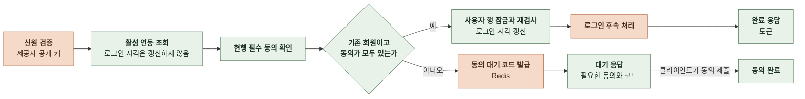

- 대기 응답을 받은 클라이언트는 필요한 문서를 표시하고 사용자가 동의한 문서 버전을 동의 완료 요청으로 제출한다. 코드가 만료되기 전에 제출하지 않으면 소셜 인증부터 다시 시작한다.
- 동의 대기에는 제공자, 제공자 쪽 식별자, 이메일, 기존 회원인 경우 회원 참조, 기기 식별자를 보관한다. 신원 증명 원문은 보관하지 않는다.
- 대기 응답의 신규 가입 여부는 조회 시점의 판정이다. 사용자 행을 잠근 뒤 다시 확인했을 때 기존 회원이 이미 탈퇴했으면 재가입으로 처리하고 필수 동의 세 항목을 모두 다시 받는다.
- 대기 단계에서는 계정, 연동, 로그인 시각, 보상, 체험, 토큰을 만들거나 바꾸지 않는다.
- 정지 계정도 같은 흐름으로 처리한다. 동의가 있으면 완료하고 없으면 대기한다.

 

### 4-1-3 동의 완료

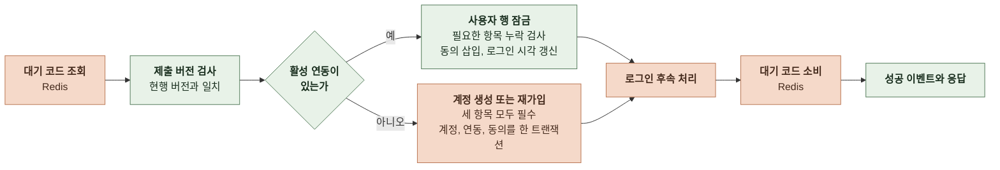

- 코드가 없거나 만료됐거나 소비됐으면 거절하고 소셜 인증부터 다시 시작하게 한다.
- 버전 불일치와 필수 항목 누락은 코드를 소비하지 않는다. 사용자가 문서를 다시 보고 동의하면 같은 코드로 재시도한다.
- 연동 조회와 계정 생성이 유니크 위반이나 끊긴 연동 재사용 경쟁으로 실패하면 다시 조회해 재시도한다. 재시도가 모두 실패하면 서버 오류다.
- 기기 식별자는 대기에 보관한 값, 완료 요청 헤더 순으로 고른다.
- 코드는 토큰 발급 후 성공 이벤트 전에 소비한다. 소비에 실패하면 성공 이벤트 없이 실패로 응답한다. 코드는 남아 있으므로 재시도할 수 있다.

 

### 4-1-4 호환 로그인

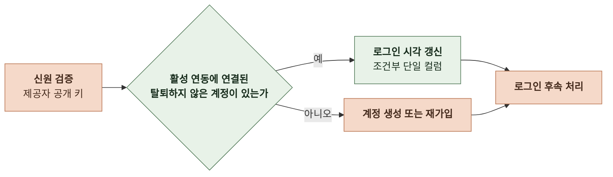

- 동의를 확인하지 않는다. 동의 게이트가 켜진 환경에서는 이 경로로 로그인한 미동의 회원의 허용 목록 밖 요청이 거절된다.
- 로그인 시각 갱신이 0행이거나 읽은 계정이 삭제 상태이면 그 사이 탈퇴가 커밋된 것이다. 활성 연동이 없는 것으로 보고 재가입으로 넘긴다.
- 계정 생성이 유니크 위반으로 실패하면 새 시각으로 다시 조회해 상대 요청이 만든 계정을 재사용한다. 없으면 닉네임 충돌로 보고 다시 생성한다.

 

### 4-1-5 로그인 후속 처리

소셜 인증 완료, 동의 완료, 호환 로그인이 같은 후속 처리를 공유한다.

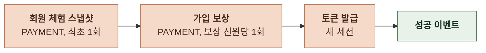

| 단계 | 처리 |
|---|---|
| 회원 체험 스냅샷 | 스냅샷 시각이 비어 있는 계정만 시도 기기 식별자가 있으면 그 기기의 스토리 제작, 채팅 턴, 채팅 이미지 사용량을 회원 카운터로 복사 기기 식별자가 없으면 한도값으로 채워 소진 상태로 시작 재가입 계정은 기기 식별자를 넘기지 않아 소진 상태 완료 시 스냅샷 시각 기록. Redis 장애 시에는 기록하지 않고 다음 로그인 시 재시도 |
| 가입 보상 | 로그인마다 요청하되 보상 신원을 기준으로 한 멱등 키로 1회만 적립 |
| 토큰 발급 | 접근 토큰과 갱신 토큰, 새 세션 신규 가입 여부를 응답에 포함 |
| 성공 이벤트 | 제공자별 로그인 성공 이벤트 1회 동의 완료는 대기 코드 소비까지 끝난 뒤에 발행 검증 통과 뒤의 실패는 서버 실패로 분류한 실패 이벤트 |

 

### 4-1-6 계정 생성과 재가입

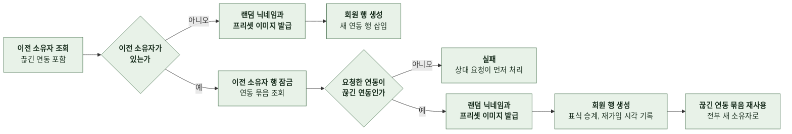

이 흐름은 독립 트랜잭션이다. 실패해도 바깥의 로그인 처리에서 다시 조회해 계속할 수 있다.

| 항목 | 처리 |
|---|---|
| 닉네임 | 형용사 40개와 명사 40개를 공백 없이 붙여 생성 정규화 키가 이미 있으면 최대 5회 다시 뽑고 그래도 충돌하면 숫자 4자리를 붙임 명사는 원본을 유지해 프리셋 이미지 매핑에 사용 |
| 프로필 이미지 | 명사에 대응하는 프리셋의 원본 URL과 썸네일 대응 이미지가 없으면 둘 다 비움 |
| 재가입 승계 | 상태: 이전 소유자가 정지였거나 탈퇴 직전 상태가 정지였으면 정지 초대자: 이전 소유자 값 보상 신원: 이전 소유자의 보상 신원, 없으면 이전 소유자 자신 이관 시도 횟수: 이전 소유자 값 이관 닫힘 시각과 체험 스냅샷 시각은 승계하지 않음 |
| 끊긴 연동 재사용 | 로그인한 제공자의 행은 이메일, 연동 시각, 로그인 시각을 갱신 함께 옮기는 다른 제공자의 행은 소유자를 바꾸고 끊긴 연동을 활성 연동으로 되돌리기만 함 |
| 동의 | 동의 완료 경로에서는 같은 트랜잭션에서 세 항목을 삽입 이전 계정의 동의는 승계하지 않음 |

 

### 4-1-7 세션 조회

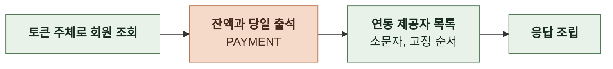

- 토큰 주체가 공개 식별자 형식이 아니거나 회원이 없으면 인증 실패로 응답한다.
- 연동 제공자는 로그인 경로가 있는 제공자만 포함한다. 순서는 Google, Kakao로 고정한다.
- 프로필 수정 응답도 같은 방식으로 조립한다.

 

### 4-1-8 토큰 회전과 로그아웃

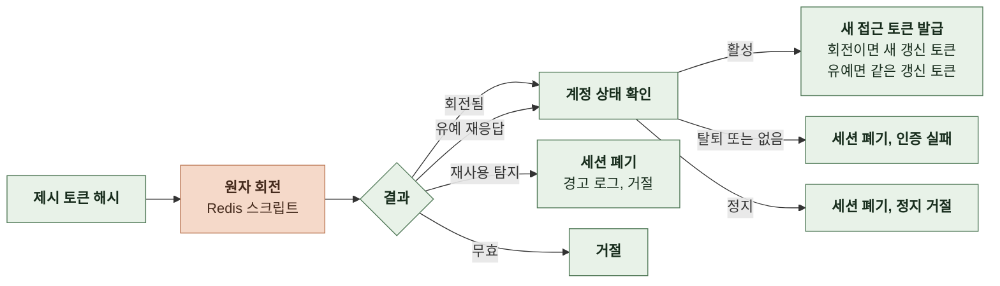

| 결과 | 조건 |
|---|---|
| 회전됨 | 제시 토큰이 세션의 현재 토큰 세션의 현재 토큰을 새 해시로 변경하고 수명 재설정. 유예 키에 새 원문 보관 |
| 유예 재응답 | 제시 토큰이 과거 토큰이고 유예 키가 만료되지 않았으며 보관된 새 토큰이 여전히 세션의 현재 토큰 세션과 수명은 바꾸지 않음 |
| 재사용 탐지 | 제시 토큰이 과거 토큰이고 유예 조건을 만족하지 않음 스크립트 안에서 세션 삭제 |
| 무효 | 토큰 매핑이나 세션이 없음 |

- 로그아웃 시 제시 토큰이 속한 세션 전체를 폐기한다. 없는 토큰도 같은 응답이다. 접근 토큰은 읽지 않는다.

 

### 4-1-9 계정 연동

```mermaid
%%{init: {"flowchart": {"curve": "basis", "nodeSpacing": 24, "rankSpacing": 40}}}%%
flowchart LR
    subgraph R["재인증"]
        direction LR
        A["`**계정 상태 확인**`"] --> B["`**신원 검증**
이미 연동된 제공자`"]
        B --> C["`**신선도와 소유 확인**
발급 시각, 같은 제공자 쪽 식별자`"]
        C --> D["`**링크 코드 발급**
Redis`"]
    end
    subgraph L["연동"]
        direction LR
        E["`**링크 코드 확인**
내 것인지`"] --> F["`**계정 상태 확인**`"]
        F --> G["`**신원 검증**
연동할 제공자`"]
        G --> H["`**충돌 판정**`"]
        H --> I["`**연동 행 삽입**
로그인 시각 비움`"]
        I --> J["`**링크 코드 소비**`"]
    end
    D -.-> E
    classDef comp fill:#E8F2E8,stroke:#527A59,color:#182D1D
    classDef task fill:#F5D9C9,stroke:#B97450,color:#452B1D
    class A,C,E,F,H,I comp
    class B,D,G,J task
```

- 발급 시각이 없는 증명은 거절한다.
- 그 소셜 계정의 행이 있으면 끊긴 연동, 내 것, 타인 것 순으로 충돌 사유를 정한다. 행이 없어도 내게 그 제공자가 이미 있으면 거절한다. 끊긴 연동은 재사용하지 않는다.

 

### 4-1-10 게스트 이관

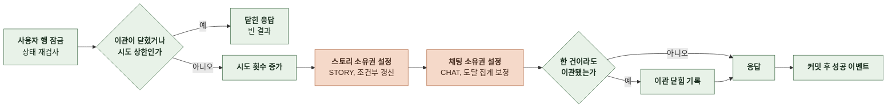

| 항목별 판정 | 결과 |
|---|---|
| 조회한 목록에 없음 | `NOT_FOUND` 삭제된 항목 포함 |
| 요청자 소유 | `ALREADY_OWNED` |
| 다른 회원 소유 | `CONFLICT` |
| 같은 요청 안의 중복 식별자 | 첫 항목만 `MIGRATED`, 이후는 `ALREADY_OWNED` |
| 소유자 없음, 조건부 갱신 1행 | `MIGRATED` |
| 소유자 없음, 조건부 갱신 0행 | 실제 소유자를 다시 읽어 요청자면 `ALREADY_OWNED`, 아니면 `CONFLICT` |

- 식별자 형식에 오류가 있으면 요청 전체를 거절한다. 실패 이벤트를 기록한다.
- 스토리를 이관하면 연결된 간편 제작 진행의 소유자도 같이 설정한다.
- 채팅을 이관할 때는 저장된 도달 엔딩 이름을 쓴다. 저장된 이름이 없으면 엔딩 행에서 찾는다. 이름을 찾았고 해당 엔딩의 회원 도달 집계가 아직 없을 때만 집계에 추가한다.

 

### 4-1-11 프로필 수정과 프리셋 목록

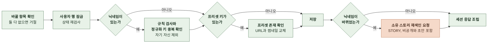

- 정규화 키는 닉네임을 소문자로 바꾸고 공백을 지운 값이다.
- 닉네임을 바꿔도 이미지는 다시 매핑하지 않는다.
- 프리셋 목록은 기동 시 메모리에 올린 명사 순서 그대로 응답한다. 이미지 파일이 없는 명사는 목록에서 빠진다.

 

### 4-1-12 페르소나

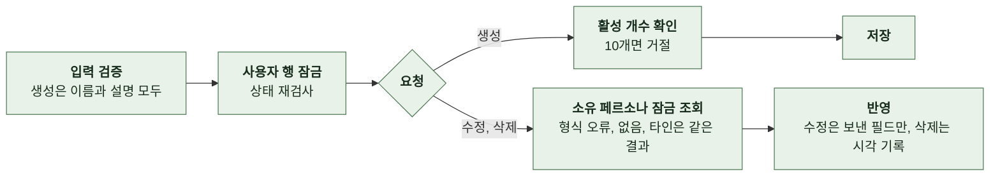

- 목록은 잠금 없이 삭제되지 않은 페르소나를 반환한다. 생성 시각이 최신인 순으로 정렬한다. 같은 시각이면 내부 ID 내림차순으로 정렬한다.
- 수정 시에는 잠금을 걸고 소유 페르소나를 조회한 뒤 입력을 검증한다. 두 필드가 모두 없으면 거절한다.
- 채팅 시작 시 스냅샷은 소유 페르소나의 이름과 설명을 그대로 제공한다.

 

### 4-1-13 회원 동의와 게스트 동의

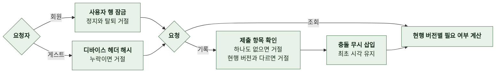

- 동의 필요 여부는 해당 문서의 현행 버전 행이 없으면 참이다.
- 회원 조회도 사용자 행을 잠근다. 정지 계정은 조회도 거절한다.
- 게스트 기록은 게스트 개인정보 수집 동의 한 종류만 받는다.
- 인증 경로에서 동의 필요 여부를 조회할 때는 계정 상태와 로그인 시각을 바꾸지 않는다.

 

### 4-1-14 탈퇴

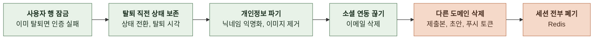

- 정지 계정의 탈퇴도 처리한다. 재가입 계정이 정지를 이어받는다.
- 초대 코드, 동의, 페르소나, 소유 스토리와 채팅은 그대로 둔다. 소유 스토리의 작성자 표시는 익명화된 닉네임이 된다.

 

### 4-1-15 초대 코드 조회와 제출

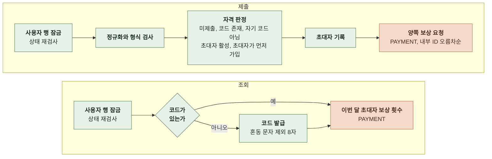

- 제출 코드는 앞뒤 공백을 지우고 대문자로 바꾼 뒤 대문자와 숫자 8자인지 확인한다. 혼동 문자로 생긴 오타는 형식 검사를 통과한 뒤 코드 없음으로 처리한다.
- 가입 순서는 보상 신원의 내부 ID를 비교해 판정한다. 재가입으로 나중 가입자가 되어도 비교를 피할 수 없다. 서로의 코드를 등록하는 순환은 성립하지 않는다.
- 초대자 몫은 KST 기준 월 상한을 적용해 요청한다. 제출자 몫은 상한 없이 요청한다. 초대자가 상한에 도달하면 초대자 보상만 건너뛰고 성공으로 응답한다.
- 월 상한과 보상액은 PAYMENT 정책값을 요청 안에서 한 번만 읽어 양쪽에 같은 값을 쓴다.
- 초대자 기록과 두 적립은 한 트랜잭션이다. 적립 하나라도 실패하면 기록과 다른 적립도 롤백한다.

 

### 4-1-16 내 콘텐츠 목록

- 스토리는 생성 시각이 최신인 순으로, 채팅은 최근 활동순으로 정렬한다. 같은 시각이면 내부 ID 내림차순으로 정렬한다.
- 카드는 STORY와 CHAT의 일괄 조회와 같은 방식으로 변환한다. 요청자가 소유자다.

 

### 4-1-17 계정 정지와 해제

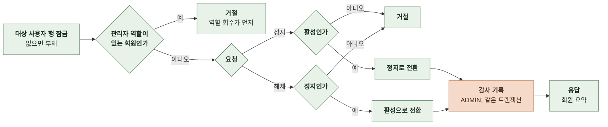

- 관리자 자신을 포함해 관리자 역할이 있는 회원은 정지할 수 없다. 운영자가 역할을 회수한 뒤에 정지한다. 해제는 역할과 무관하다.
- 탈퇴 계정은 정지도 해제도 거절한다. 탈퇴 직전 상태를 보존하는 컬럼은 바꾸지 않는다.
- 정지는 세션을 폐기하지 않는다. 쓰기 거절과 회전 시 세션 폐기는 기존 집행 규칙이 맡는다. 해제하면 다음 요청부터 쓰기가 허용된다.
- 감사 기록의 변경 전후 값은 계정 상태다. 사유는 감사 로그에만 남고 회원에게 노출하지 않는다.
