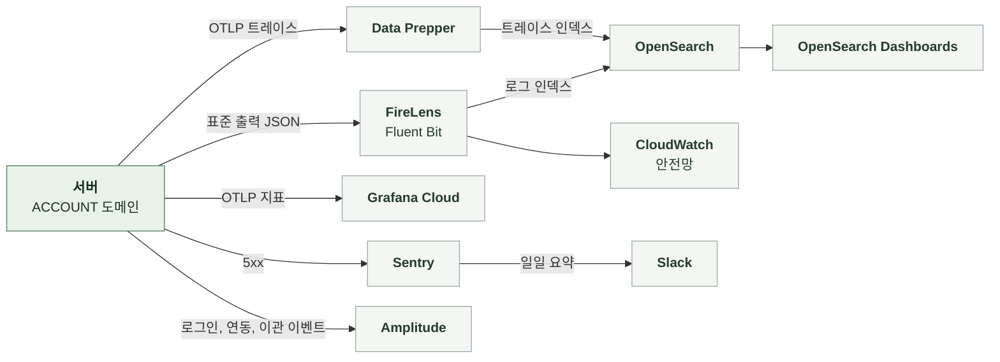

# 5-4 관측

이 문서는 ACCOUNT 도메인의 관측 스택, 요청을 추적할 식별자, 구조화 로그 이벤트, 오류 확인 위치, 지표, 트레이스, 알림, 수집 조건, 분석 이벤트를 정한다.

비밀값과 개인정보 취급 규칙은 보안에, 오류 로그 수준은 오류 처리에 있다. ([5-1-6 비밀값과 코드 취급](5-1-SECURITY.md#5-1-6-비밀값과-코드-취급), [5-3-8 로그와 Sentry](5-3-ERROR-HANDLING.md#5-3-8-로그와-sentry))

<br>

### 5-4-1 관측 스택



<br>

### 5-4-2 상관관계 식별자

상관관계 필터는 모든 요청의 MDC에 다음 값을 기록한다. 로그와 Sentry는 같은 식별자 값을 사용한다.

| MDC 필드 | 값 | 규칙 |
|---|---|---|
| `request_id` | `req_` + UUID | 요청 헤더 값을 쓰고 없으면 생성<br>응답 헤더로 반환 |
| `session_id` | `X-Manyak-Session-Id` | 없으면 `unknown` |
| `device_id_hash` | `device_hash_` + SHA-256(pepper + 원본) 앞 16자 | 원본은 저장하지 않음 |
| `sentry_event_id` | Sentry 이벤트 ID | 5xx를 Sentry로 보낸 요청만 |
| `traceId`, `spanId` | 현재 스팬 | 트레이스 전송이 비활성화되어도 생성해 로그에 포함 |

| 식별자 | 기록 위치 | 연결 대상 |
|---|---|---|
| `request_id` | 로그 MDC, Sentry 태그, 분석 이벤트 | 한 요청의 로그와 이벤트 |
| `user_public_id` | 유예 적용 로그, 분석 이벤트 `user_id` | 회원 |
| `handoffId` | 핸드오프 소비 실패 로그 | 코드와 별개인 분석용 핸드오프 식별자 |
| 회원 내부 ID | 재사용 탐지 WARN, 재색인 요청 로그 | 회원 |

<br>

### 5-4-3 구조화 로그 이벤트

구조화 로그는 `event_name`을 맨 앞에 둔 JSON 형식으로 INFO 수준에 기록한다. 이벤트 이름은 snake_case다. `prod`, `dev`, `jsonlog` 프로파일에서만 JSON 형식을 쓴다. 그 외에는 콘솔 패턴을 쓴다. JSON에는 `service=manyak-server`가 붙는다. MDC 값은 인코더가 최상위 필드로 싣는다.

| 단위 | 기록 시점과 이름 | 기록 내용 |
|---|---|---|
| 모든 API 요청 | 응답 종료<br>`api_request_completed`, 5xx는 `api_request_failed` | `endpoint`, `http_method`, `status_code`, `duration_ms` |
| 회전 유예 적용 | 유예 재응답<br>`refresh_reuse_grace_applied` | `user_public_id` |
| 재사용 탐지 | 유예 밖 재사용<br>평문 WARN | 회원 내부 ID, 세션 폐기 사실 |
| 핸드오프 소비 실패 | 이관 예외<br>평문 WARN | `handoffId`, 예외 |
| 핸드오프 조회 폴백 | Redis 장애<br>평문 WARN | 예외 |
| 핸드오프 결과 저장 재시도 | Redis 장애<br>평문 WARN | 시도 횟수, 예외 |
| 체험 스냅샷 실패 | Redis 장애<br>평문 WARN | 회원 내부 ID, 예외 |
| 닉네임 변경 재색인 | 프로필 저장 뒤<br>평문 INFO `nickname_reindex_requested` | 회원 내부 ID, 스토리 수 |
| 닉네임 접미 발급 | 5회 충돌 뒤<br>평문 INFO | 시도 횟수 |
| 프리셋 이미지 누락 | 기동 시<br>평문 WARN | 명사 |
| 프리셋 적재 | 기동 시<br>평문 INFO | 적재 수와 명사 수 |

<details>
<summary><b>예시: 유예 적용 로그 1줄</b></summary>

<br>

예시에는 가상 값을 썼다. 로그 프레임워크가 붙이는 필드는 생략했다.

```json
{"@timestamp":"2026-10-16T01:23:45.678Z","message":"event_name=refresh_reuse_grace_applied, user_public_id=3f2504e0-4f89-41d3-9a0c-0305e82c3301","level":"INFO","request_id":"req_0f1e2d3c4b5a69788796a5b4c3d2e1f0","session_id":"unknown","traceId":"4bf92f3577b34da6a3ce929d0e0e4736","spanId":"00f067aa0ba902b7","event_name":"refresh_reuse_grace_applied","user_public_id":"3f2504e0-4f89-41d3-9a0c-0305e82c3301","service":"manyak-server"}
```

</details>

<br>

### 5-4-4 오류 확인

| 기능 | 오류 조회 위치 |
|---|---|
| 로그인 | 분석 이벤트의 로그인 실패 `error_type`<br>Sentry `endpoint=/api/v1/auth/social/{provider}`, `/api/v1/auth/login/{provider}` |
| 토큰 회전 | 로그 `refresh_reuse_grace_applied`와 재사용 탐지 WARN<br>요청 로그의 `/api/v1/auth/token/refresh` 401 비율 |
| 핸드오프 | 핸드오프 소비 실패와 저장 재시도 WARN<br>요청 로그의 `/api/v1/auth/handoffs` 404 비율 |
| 이관 | 분석 이벤트의 이관 실패 `error_type`과 성공 이벤트의 `conflict_count`, `not_found_count` |
| 계정 연동 | 분석 이벤트의 연동 실패 `error_type` |
| 체험 스냅샷 | 스냅샷 실패 WARN |
| 프로필 | 요청 로그의 `/api/v1/users/me` 409 비율, 재색인 요청 로그 |

<br>

### 5-4-5 지표

ACCOUNT 전용 지표는 없다. 요청률, 오류율, 응답 시간은 공통 HTTP 지표로 본다.

| 지표 | 종류와 태그 | 의미 |
|---|---|---|
| `http.server.requests` | Timer<br>`uri`, `method`, `status`, `outcome` | 인증 경로의 요청률, 401과 403 비율, 응답 시간 |

| 항목 | 기준과 제한 |
|---|---|
| 전송 여부 | 지표 전송을 켠 환경에서만 Grafana Cloud로 전송 |
| 전송 주기 | 60초 간격 |
| 인스턴스 | 리소스 속성 `service.instance.id`가 기동마다 바뀜 |

<br>

### 5-4-6 트레이스

| 항목 | 내용 |
|---|---|
| 활성화와 표본 | 환경 변수로 켜며 기본값은 비활성 |
| 스팬 | HTTP 요청 아래에 JDBC(QUERY만, 바인딩 값 제외), Redis 스팬<br>소셜 제공자 공개 키 조회는 별도 스팬 없음 |
| 제외 | actuator 요청, Spring Security 내부 관측, 요청 밖 루트 DB와 Redis 관측은 노이즈 필터가 제외 |

<br>

### 5-4-7 알림

| 항목 | 기준 |
|---|---|
| 정기 보고 | 매일 오전 10시(KST), 지난 24시간 동안 발생한 운영 Sentry 오류 요약 |
| ACCOUNT에서 수집하는 오류 | 500 예상하지 못한 예외, Redis 장애로 인한 500<br>4xx 거절, 재사용 탐지, 핸드오프 소비 실패는 Sentry에 없어 보고에 포함되지 않음 |
| 지표 기반 알림 | ACCOUNT 전용 규칙 없음 |

<br>

### 5-4-8 수집 조건과 실패 처리

**1. 데이터 범위**

| 데이터 | 현재 기록 방식 |
|---|---|
| 신원 증명, 코드 원문, 갱신 토큰 | 로그, Sentry, 분석 이벤트에 싣지 않음 |
| 제공자 쪽 식별자, 이메일 | 로그, Sentry, 분석 이벤트에 싣지 않음<br>새 인증 경로의 DB 예외는 원인 체인을 끊고 그 스레드의 ORM 로그를 막음 |
| 디바이스 ID | 해시만<br>원문은 로그에 싣지 않음 |
| 닉네임, 페르소나 본문 | 로그에 싣지 않음 |
| 요청 경로 | 요청 로그 `endpoint`와 Sentry breadcrumb에 남음<br>코드가 헤더로만 오가므로 경로에 비밀값이 없음 |
| Sentry 요청 필드 | 소셜 인증과 동의 완료 경로의 본문, 헤더, 쿠키, 쿼리 제거<br>그 외 경로는 기본 수집 |
| Sentry 이벤트 | 5xx만 캡처<br>기본 개인정보 수집 끔<br>`request_id`는 태그, `session_id`와 `device_id_hash`는 `identity` 컨텍스트, `unknown`은 제외 |
| 인증 경로 본문 파싱 실패 | 경로, 예외 종류, 요청 ID만 DEBUG |

<br>

**2. 수집 실패**

| 상황 | 처리 |
|---|---|
| 분석 이벤트 전송 실패 | 비동기 호출 뒤 WARN만 남기고 재시도 없음 |
| 로그인 실패 이벤트 | 회원 식별자를 싣지 않고 게스트 식별 방식으로 발행<br>로그인 경로가 없는 제공자는 발행하지 않음 |
| 이관 성공 이벤트 | 커밋 후 발행<br>롤백되면 발행하지 않음 |
| Sentry 캡처 실패 | SDK 내부에서 처리<br>DSN 없는 환경은 no-op |
| OTLP 전송 실패 | SDK로 배치 전송<br>실패분은 유실 |
| 미수집과 누락 | 수집 비활성화, 기록 실패, 전송 유실을 구분<br>기록이 없다는 이유만으로 요청이 없었다고 판단하지 않음 |

<br>

### 5-4-9 분석 이벤트

**서버 이벤트**

Amplitude HTTP API로 비동기 발행한다. 분석 전송을 켜고 API 키가 있는 환경에서만 전송한다. 로그인 이벤트 이름은 제공자별로 다르며 프로퍼티는 같다.

| 이벤트 | 시점 | 프로퍼티 |
|---|---|---|
| `server_login_googleLogin_processed_succeeded` | Google 로그인 완료 | `is_new_user` |
| `server_login_googleLogin_processed_failed` | Google 로그인 실패 | `error_type` |
| `server_login_kakaoLogin_processed_succeeded` | Kakao 로그인 완료 | `is_new_user` |
| `server_login_kakaoLogin_processed_failed` | Kakao 로그인 실패 | `error_type` |
| `server_link_socialLink_processed_succeeded` | 계정 연동 성공 | `provider` |
| `server_link_socialLink_processed_failed` | 계정 연동 실패 | `provider`, `error_type` |
| `server_login_migration_processed_succeeded` | 이관 커밋, 부분 성공 포함 | `migrated_story_count`, `migrated_chat_count`, `already_owned_count`, `conflict_count`, `not_found_count` |
| `server_login_migration_processed_failed` | 이관 요청 실패 | `error_type` |

| 공통 프로퍼티 | 값 |
|---|---|
| `user_id` | 회원이면 공개 식별자<br>로그인 실패와 동의 대기는 없음 |
| `device_id` | 게스트면 디바이스 해시 |
| `session_id`, `request_id`, `is_logged_in` | 요청 문맥 |
| `insert_id` | `{request_id}:{eventType}`<br>재시도 중복 제거 |
| `error_type` | `network`, `validation`, `server`<br>검증 실패는 `validation`, 공개 키 조회와 연결 실패는 `network`, 검증 통과 뒤 저장 실패는 `server` |

- 로그인 성공 이벤트는 소셜 인증 완료, 동의 완료, 호환 로그인에서 요청당 1회다. 동의 대기 단계에서는 발행하지 않는다.
- 이관 카운트의 합은 제출 총수와 같다. 제출 배열이 둘 다 비면 발행하지 않는다.
- 연동 실패의 `error_type`은 3가지 값만 쓴다. 같은 회원과 타 회원의 충돌을 구분하면 특정 소셜 계정의 가입 여부를 알려주는 신호가 된다.
- 로그아웃, 탈퇴, 프로필, 페르소나, 동의, 초대에는 서버 이벤트가 없다.
