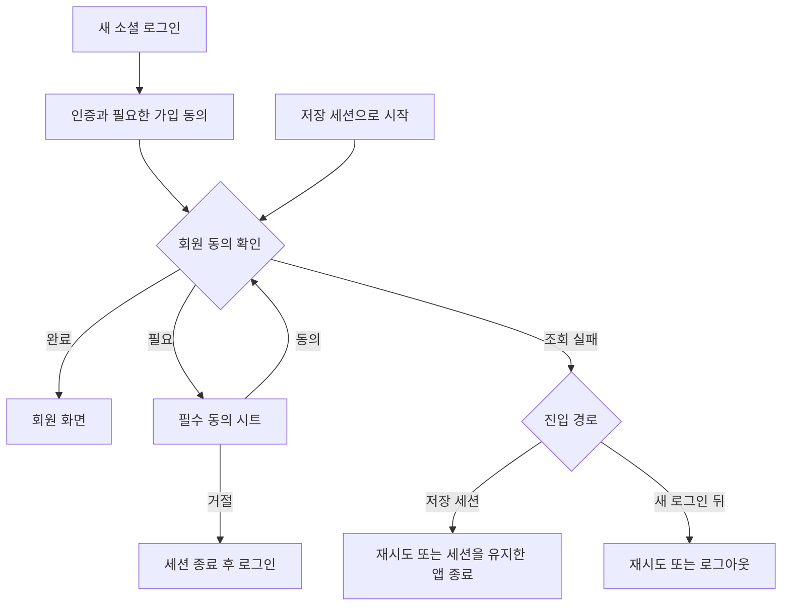

# 3-2 화면 흐름: 안드로이드

 

### 3-2-1 로그인과 시작

| 시작 | 진행 | 종료 또는 복귀 |
|---|---|---|
| 새 소셜 로그인 | 인증 → 필요 시 가입 동의 → 가입 완료 → 회원 동의 확인 | 회원 화면, 실패 시 로그인과 안내 |
| 저장 세션 | 시작 화면 → 동의 확인 | 완료 시 회원 화면, 필요 시 시작 화면 위 시트 |
| 시작 조회 실패 | 재시도 또는 기기 뒤로가기 | 재시도, 또는 세션을 유지한 채 앱 종료 |
| 로그인 뒤 조회 실패 | 재시도와 로그아웃 | 재시도, 또는 로그인 화면 |
| 회원 동의 거절 | 로그아웃 또는 뒤로가기 | 세션 종료 후 로그인 화면 |
| 동의 중 전문 보기 | 시트 위 문서 창 | 닫으면 같은 체크 상태 |
| 신규 회원 | 스토리 온보딩과 회원 안내 | 초대 코드는 다음 실행의 홈에서 표시 |

공통 로그인 흐름의 Android 진입과 실패 조건을 적용한다. ([공통 3-2-1](../3-2-INTERACTION-FLOWS.md#3-2-1-로그인과-필수-동의), [2-2-1](2-2-REQUIREMENTS.md#2-2-1-진입과-동의))

 

### 3-2-2 편집과 종료

| 조작 | 화면 동작 |
|---|---|
| 페르소나 행 탭 | 펼침과 접힘 |
| 더보기 또는 길게 누르기 | 같은 옵션 시트 |
| 상세에서 페르소나 생성 | 저장 후 상세에서 새 항목 선택 |
| 다른 주인공 선택 또는 채팅 시작 | 생성 항목의 미리 선택 소비. 채팅에서 돌아오면 마지막 선택 유지 |
| 프로필 저장 | 마이 복귀와 표시 갱신 |
| 미저장 프로필 뒤로가기 | 공통 이탈 확인. 저장 중에는 이동 안 함 |
| 로그아웃과 탈퇴 성공 | 정리 중 대기, 완료 후 로그인 화면 |
| 정리 실패 | 재시도 화면. 새 로그인 차단 |

편집 상태의 보존과 복귀는 Android 요구사항을 적용한다. ([2-2-2](2-2-REQUIREMENTS.md#2-2-2-편집과-법적-문서))
