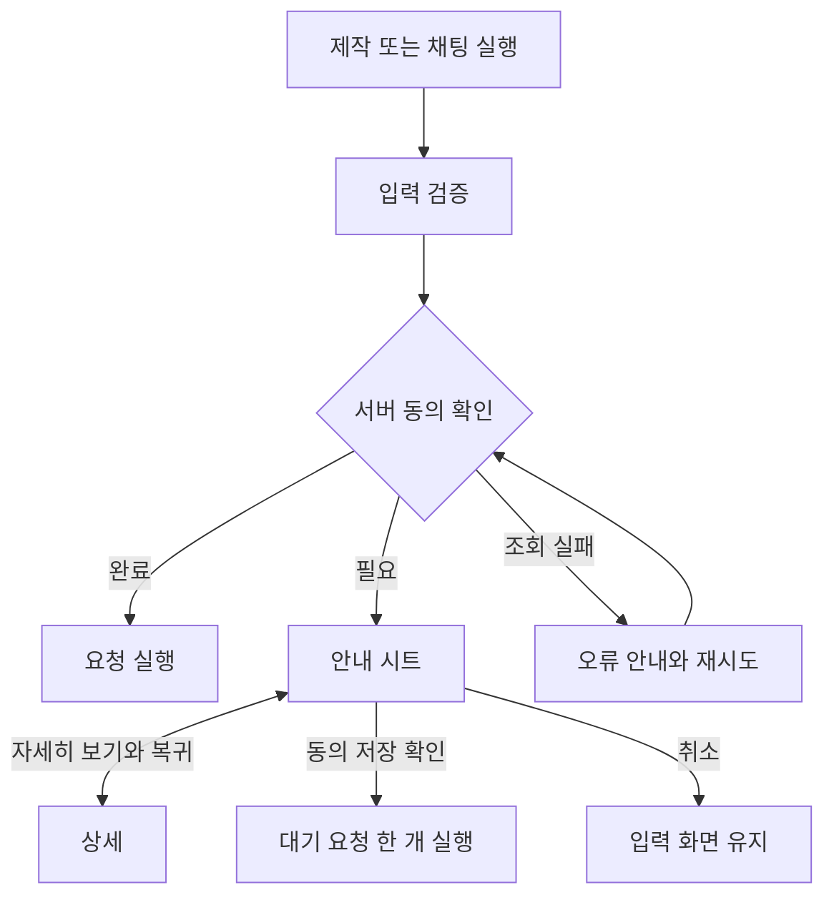

# 3-2 화면 흐름: 웹

 

### 3-2-1 게스트 이용 동의

| 조작 | 화면 동작 |
|---|---|
| 자세히 보기 | 같은 시트에서 상세, 다시 안내로 복귀 가능 |
| 전문 링크 | 새 탭 |
| 버전 변경 | 상세와 갱신 안내 표시, 사용자 재확인 |
| 화면 또는 인증 변경 | 대기 동작 취소 |

게스트 동의는 회원 동의와 별개이다. ([2-2-1 게스트와 회원](2-2-REQUIREMENTS.md#2-2-1-게스트와-회원))

 

### 3-2-2 로그인과 회원 이관

| 단계 | 화면 동작 |
|---|---|
| 소셜 인증 시작 | 팝업 또는 같은 탭 인증, 원래 입력 유지 |
| 인증 완료 | 검증된 복귀 경로로 이동, 로그인 화면은 히스토리에서 대체 |
| 가입 대기 | 복귀한 원래 탭 위에 필수 동의 시트 |
| 회원 재동의 | 같은 화면 위에 회원 동의 시트. 법적 문서에서는 회원 기능만 잠금 |
| 동의 완료 | 회원 화면, 자동 이관과 실제 이관 수 안내 |
| 이관 실패 | 회원 화면 유지 |
| 초대 안내 대상 | 가입 탭에서는 미표시, 다음 탭 세션의 홈에서 표시 |
| 가입 중 요구 변경 또는 만료 | 시트 종료와 재로그인 안내 |

복귀, 보존과 재시도 조건은 웹 로그인 요구사항을 적용한다. ([2-2-3](2-2-REQUIREMENTS.md#2-2-3-로그인과-이관))

 

### 3-2-3 팝업과 계정 연동

| 환경 또는 상태 | 동작 |
|---|---|
| 일반 브라우저의 Google과 Kakao | 팝업 우선, 차단 시 같은 탭 |
| KakaoTalk, Instagram, Threads의 Google | iOS와 Android 모두 팝업 시도 |
| 같은 인앱의 Kakao | 같은 탭 |
| 팝업 연결 단절 | 원래 탭 복귀 시 확인, 즉시 취소로 처리하지 않음 |
| 실패 또는 5분 만료 | 원래 화면과 입력 유지, 잠금 해제 |
| 명시적 재시도 | 제어 가능한 이전 팝업 정리 후 새 인증 |
| 일반 브라우저의 계정 연동 | 같은 탭에서 현재 공급자 재인증, 대상 공급자 인증 |
| 인앱 계정 연동 | "계정 연동은 외부 브라우저에서만 할 수 있어요" |

성공 판정과 늦은 응답 차단 조건은 인앱 요구사항을 적용한다. ([2-2-4](2-2-REQUIREMENTS.md#2-2-4-인앱과-인증-팝업))
