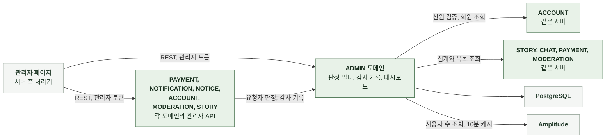

# 3-1 소프트웨어 구조

이 문서는 ADMIN 도메인 백엔드의 개요, 배경과 목표, 품질 속성, 배포 단위, 모듈 구조, 의존 방향, 도메인 모델을 정한다.

테이블과 컬럼은 DB 스키마에, 코딩 규칙은 컨벤션에, 엔드포인트별 처리 순서는 처리 흐름에 있다. ([3-2 DB 스키마](3-2-DB-SCHEMA.md), [3-3 컨벤션](3-3-CONVENTIONS.md), [4-1 처리 흐름](4-1-PIPELINES.md))

 

### 3-1-1 개요

ADMIN 도메인은 서버 애플리케이션의 내부 패키지다. 별도 프로세스로 실행하지 않는다. 관리자 페이지는 별도 저장소의 웹이며 그 서버 측 처리기가 백엔드의 관리자 API를 호출한다. 다른 도메인의 관리자 API는 ADMIN의 관리자 판정 필터와 감사 기록 연산을 쓴다.

| 외부 시스템 | 역할 | 연결 방식 |
|---|---|---|
| 관리자 페이지 | 로그인, 대시보드, 콘텐츠와 회원 조회, 운영 작업 화면 | 서버 측 처리기의 REST 호출 |
| Google | 관리자 신원 증명의 서명 검증용 공개 키 제공 | 계정 도메인의 검증기 경유 |
| PostgreSQL | 관리자 역할과 감사 로그 | JDBC |
| Amplitude | 활성과 신규 사용자 수 제공 | Dashboard REST API 사용자 수 조회 HTTPS 호출 |

 

### 3-1-2 배경과 목표

| 배경 | 설계 목표 |
|---|---|
| 서버에 역할 개념이 없어 운영 작업을 DB 직접 수정으로만 처리함 | 관리자 역할을 두되 부여와 회수는 저장소에서만 해 관리자 화면이 탈취돼도 권한 상승이 불가능하게 함 |
| 앱 접근 토큰이 유출되면 그 회원이 관리자여도 관리자 API에 쓰이면 안 됨 | 관리자 토큰에 별도 표식을 두고 각 토큰을 다른 토큰의 경로에서 거절 |
| 역할을 회수해도 토큰이 살아 있는 동안 권한이 남으면 안 됨 | 토큰의 역할 값을 믿지 않고 요청마다 저장소에서 다시 확인 |
| 관리자 토큰은 쿠키에 오래 남으면 탈취 위험에 노출되는 시간이 길어짐 | 갱신 없이 짧은 수명만 두고 만료되면 다시 로그인 |
| 여러 사람이 운영 작업을 하면 누가 바꿨는지 알 수 없음 | 모든 변경을 그 변경과 같은 트랜잭션에 감사 로그로 기록해 로그 없는 변경이 없게 함 |
| 회원 개인정보 조회는 법적으로 접속 기록 보관 대상 | 회원 검색과 상세 조회도 감사 로그에 남기고 영구 보존 |
| 새 관리자 엔드포인트가 권한 검사에서 빠질 수 있음 | 경로 접두 전체를 판정 대상으로 두고 등록된 모든 핸들러를 자동으로 검사하는 회귀 테스트 |
| 방문자 수의 기준은 클라이언트 기기 식별자와 분석 도구 | 서버는 방문자를 세지 않고 분석 도구의 집계값을 받아 캐시해 전달 |
| 운영 통계가 외부 대시보드 도구에 있어 팀원이 SQL 패널을 읽어야 함 | 같은 정의의 차트를 서버가 계산하고 막대마다 목록 조건을 함께 줘 차트에서 목록, 상세로 이어지게 함 |
| 채팅 대화 원문은 회원의 사생활 | 관리자 응답에 메시지 원문을 두지 않고 시각과 수치만 제공 |

 

### 3-1-3 품질 속성

| 속성 | 기준 | 보장 방법 |
|---|---|---|
| 권한 격리 | 관리자가 아닌 요청이 관리자 API를 통과하지 않음 | 경로 접두 전체에 판정 필터 토큰 표식 검사 뒤 저장소에서 역할과 상태 재확인 |
| 권한 상승 불가 | 관리자 API로 관리자 역할을 바꿀 수 없음 | 역할 변경 API 없음 |
| 회수 즉시성 | 역할 회수 뒤 첫 요청부터 거절 | 요청마다 저장소 조회 |
| 감사 완전성 | 감사 로그 없는 관리자 변경이 없음 | 변경과 로그를 같은 트랜잭션에 기록 로그 기록 실패는 변경도 롤백 |
| 감사 불변성 | 감사 로그를 고치거나 지울 수 없음 | 수정과 삭제 경로 없음 |
| 지표 일관성 | 한 응답의 지표가 같은 시각 기준 | 요청 시작 때 현재 시각과 KST 오늘 범위를 한 번 정해 모든 집계에 사용 |
| 개인정보 최소화 | 회원 조회 응답에 이메일과 소셜 식별자가 없음 어떤 응답에도 채팅 메시지 원문이 없음 | 응답 구조에 포함하지 않음 메시지는 시각과 역할만 읽음 |
| 차트와 목록의 일치 | 차트 막대의 값과 그 막대가 여는 목록의 건수가 같은 조건 | 막대마다 목록 쿼리를 서버가 만들어 응답 팀 계정 제외만 차트에 있어 그만큼 차이 |

 

### 3-1-4 배포 단위

ADMIN은 다른 도메인의 백엔드와 하나의 서버 이미지에 포함된다. 따로 배포하지 않는다. 관리자 페이지는 별도 저장소에서 따로 배포한다.

 

### 3-1-5 모듈 구조

| 구성 요소 | 입력 | 출력 | 책임 |
|---|---|---|---|
| API 계층 | HTTP 요청 | HTTP 응답 | 형식 검증, 요청자 식별, 상태 코드 |
| 관리자 로그인 | Google 신원 증명 | 관리자 토큰 | 검증기 호출 회원, 역할, 상태 판정 토큰 발급 |
| 관리자 토큰 | 회원 공개 식별자 | 서명된 토큰 | 표식을 넣어 발급 표식, 서명, 만료 검증 |
| 관리자 판정 필터 | 관리자 경로 요청 | 통과 또는 거절 | 토큰 표식 확인, 역할과 계정 상태 재확인, 요청자 확정 |
| 앱 토큰 검증 보강 | 앱 경로 요청 | 통과 또는 거절 | 관리자 표식이 있는 토큰을 회원으로 식별하지 않음 필수 경로는 거절, 선택 경로는 익명 |
| 감사 기록 | 처리자, 작업 종류, 대상, 사유, 변경 전후 값 | 감사 로그 행 | 호출 트랜잭션에 참여해 기록 |
| 감사 조회 | 필터 페이지 | 감사 로그 목록 | 최신순 조회 처리자 표시 조립 |
| 대시보드 | 현재 시각, 기간 | 지표 묶음, 일별 추이, 분포 차트 | KST 날짜 범위 계산 팀 계정 제외 목록 적용 도메인별 집계 조회 막대별 목록 쿼리 조립 |
| 목록 조회 | 검색어, 필터, 정렬, 페이지 | 스토리, 채팅방, 회원, 결제의 페이지와 상세 | 조건 조립, 전체 건수와 페이지 조회, 집계 결합, 요약 조립 |
| 분석 지표 | 기간 | 활성과 신규 사용자 일별 수 | 분석 도구 호출, 코호트 제외 조건, 10분 캐시, 실패 시 사용 불가 |
| 회원 조회 | 검색어 또는 공개 식별자 | 회원 요약과 상세, 거래와 출석 페이지 | 검색, 잔액과 콘텐츠 수 조회, 접속 기록 |

 

### 3-1-6 의존 방향

| 방향 | 규칙 |
|---|---|
| API 계층 → 서비스 | API 계층은 서비스만 호출 저장 계층을 직접 호출하지 않음 |
| ADMIN → ACCOUNT | 신원 검증기, 회원 조회, 계정 상태 |
| ADMIN → PAYMENT, STORY, CHAT, MODERATION | 대시보드, 목록, 상세의 읽기 조회만 쓰기 호출 없음 |
| 다른 도메인 → ADMIN | 관리자 판정 필터가 확정한 요청자 감사 기록 연산 감사 기록은 호출자의 트랜잭션에 참여 |
| 보안 필터 → 관리자 역할 저장소 | 요청마다 조회 캐시 없음 |
| ADMIN → Amplitude | 분석 지표 조회만 이벤트 발행은 공통 분석 발행기가 함 |

 

### 3-1-7 도메인 모델

| 모델 | 하위 데이터 | 설계 의도 |
|---|---|---|
| 관리자 역할 | 없음 | 회원당 최대 한 행 행의 존재가 곧 역할이며 부여 시각만 가짐 |
| 감사 로그 행 | 변경 전후 값 | 추가만 하고 수정하지 않음 대상은 외부 식별자로 기록해 응답에 그대로 노출 가능 |
| 관리자 토큰 | 없음 | 서버에 저장하지 않는 서명 토큰 표식으로 앱 토큰과 구분 |
| 대시보드 지표 | 일별 추이, 분포 차트 | 저장하지 않고 요청마다 집계 |
| 목록 항목 | 스토리, 채팅방, 회원, 결제 요약 | 다른 도메인 행을 읽어 조립한 표시용 구조 저장하지 않음 |
| 분석 지표 캐시 | 90일 일별 값 | 프로세스 메모리에만 10분 태스크마다 따로 |

 

| 판정 | 의미 |
|---|---|
| 관리자 | 역할 행이 있고 계정 상태가 활성인 회원 |
| 작업 종류 | `CHANGE`는 데이터를 바꾼 작업 `ACCESS`는 개인정보 조회 세부 종류는 감사 로그의 작업 이름 |
| 오늘 | KST 자정부터 요청 시각까지 |
| 팀 계정 | 설정값 목록에 있는 회원 대시보드 집계에서만 제외 |
