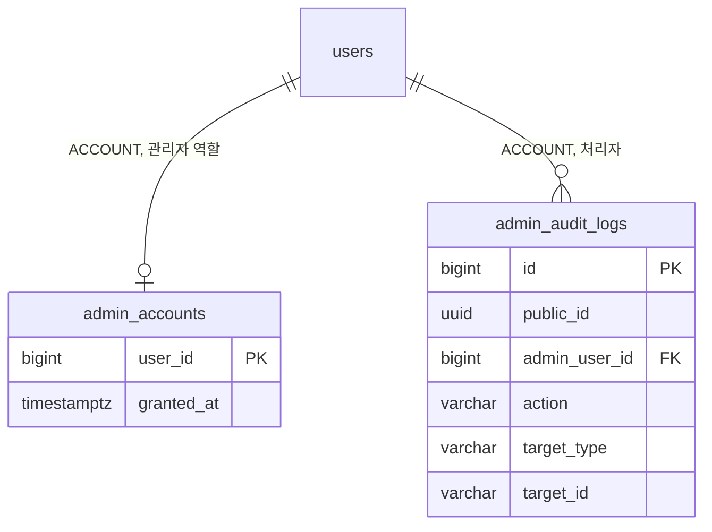

# 3-2 DB 스키마

이 문서는 ADMIN 도메인이 관리하는 PostgreSQL 테이블의 컬럼, 제약, 인덱스와 데이터 수명을 정한다.

다른 도메인의 테이블에서는 ADMIN 도메인이 참조하는 컬럼만 설명한다.

입력값의 검증 규칙은 보안에 있으며 감사 기록의 트랜잭션 규칙은 동시성에 있다. ([5-1-5 입력 검증](5-1-SECURITY.md#5-1-5-입력-검증), [5-2 동시성](5-2-CONCURRENCY.md))

 

### 3-2-1 공통 규칙

| 규칙 | 내용 |
|---|---|
| 식별자 | 내부 PK는 `bigint` 자동 증가 감사 로그는 외부 노출용 `public_id uuid`를 따로 둠 감사 로그의 대상은 그 도메인의 외부 식별자 문자열로 기록 |
| 시각 | `timestamp with time zone` `created_at`의 기본값은 `now()`이며 아래 표에서는 표시하지 않음 |
| 삭제 | 감사 로그는 삭제 경로 없음 관리자 역할은 운영자가 행을 삭제 |
| FK | 관리자 역할은 회원 삭제 시 함께 삭제(`ON DELETE CASCADE`) 감사 로그의 처리자는 연쇄 삭제 없음 회원 행은 탈퇴해도 남으므로 실제 연쇄 삭제는 일어나지 않음 |

 

### 3-2-2 관계도

관계도는 데이터 묶음별 소유 관계를 보여준다. 각 상자에는 식별과 연결에 쓰는 컬럼만 표시한다. 전체 컬럼은 아래 표에서 정의한다. 다른 도메인의 테이블은 관계 라벨에 도메인을 적고 컬럼을 생략한다.

 

### 3-2-3 관리자 역할

**`admin_accounts`**

관리자 역할을 가진 회원 1명이 1행이다. 운영자가 직접 기록하고 삭제한다.

| 컬럼 | 타입 | 제약 | 의미 |
|---|---|---|---|
| `user_id` | bigint | PK, FK `users.id` CASCADE | |
| `granted_at` | timestamptz | NOT NULL, 기본 `now()` | 부여 시각 |

 

### 3-2-4 감사 로그

**`admin_audit_logs`**

관리자의 변경 작업 1건 또는 개인정보 조회 1건이 한 행이다. 추가만 하고 수정하지 않는다.

| 컬럼 | 타입 | 제약 | 의미 |
|---|---|---|---|
| `id` | bigint | PK | 목록 정렬의 2차 키 |
| `public_id` | uuid | NOT NULL, UNIQUE | 외부 노출 식별자 |
| `admin_user_id` | bigint | NOT NULL, FK `users.id` | 처리자 |
| `category` | varchar(10) | NOT NULL, CHECK `CHANGE` `ACCESS` | 변경 작업 또는 개인정보 조회 |
| `action` | varchar(50) | NOT NULL | 작업 이름 목록은 아래 |
| `target_type` | varchar(30) | NOT NULL | 대상 종류 목록은 아래 |
| `target_id` | varchar(255) | NOT NULL | 대상의 외부 식별자 회원, 공지, 캠페인, 제출본은 공개 식별자 정책값은 정책 키 검색은 검색어 |
| `reason` | varchar(500) | | 사유 변경 작업은 NOT NULL, 조회는 NULL |
| `before_state` | jsonb | | 변경 전 값 조회와 생성은 NULL |
| `after_state` | jsonb | | 변경 후 값 조회와 삭제는 NULL |
| `request_id` | varchar(64) | NOT NULL | 요청 ID |

| 인덱스 | 컬럼 |
|---|---|
| `idx_admin_audit_logs_created` | `created_at DESC` `id DESC` |
| `idx_admin_audit_logs_admin` | `admin_user_id` `created_at DESC` |
| `idx_admin_audit_logs_target` | `target_type`, `target_id`, `created_at DESC` |

| `action` | `category` | `target_type` | 기록하는 도메인 |
|---|---|---|---|
| `MEMBER_SEARCHED` | `ACCESS` | `MEMBER_QUERY` | ADMIN |
| `MEMBER_VIEWED` | `ACCESS` | `MEMBER` | ADMIN |
| `MEMBER_SUSPENDED` | `CHANGE` | `MEMBER` | ACCOUNT |
| `MEMBER_UNSUSPENDED` | `CHANGE` | `MEMBER` | ACCOUNT |
| `CREDIT_GRANTED` | `CHANGE` | `MEMBER` | PAYMENT |
| `CREDIT_REVOKED` | `CHANGE` | `MEMBER` | PAYMENT |
| `CREDIT_POLICY_UPSERTED` | `CHANGE` | `CREDIT_POLICY` | PAYMENT |
| `CREDIT_POLICY_DELETED` | `CHANGE` | `CREDIT_POLICY` | PAYMENT |
| `PUSH_CAMPAIGN_CREATED` | `CHANGE` | `PUSH_CAMPAIGN` | NOTIFICATION |
| `PUSH_CAMPAIGN_CANCELED` | `CHANGE` | `PUSH_CAMPAIGN` | NOTIFICATION |
| `PUSH_CAMPAIGN_RETRIED` | `CHANGE` | `PUSH_CAMPAIGN` | NOTIFICATION |
| `PUSH_TEMPLATE_UPSERTED` | `CHANGE` | `PUSH_TEMPLATE` | NOTIFICATION |
| `NOTICE_CREATED` | `CHANGE` | `NOTICE` | NOTICE |
| `NOTICE_UPDATED` | `CHANGE` | `NOTICE` | NOTICE |
| `NOTICE_PUBLISHED` | `CHANGE` | `NOTICE` | NOTICE |
| `NOTICE_UNPUBLISHED` | `CHANGE` | `NOTICE` | NOTICE |
| `NOTICE_DELETED` | `CHANGE` | `NOTICE` | NOTICE |
| `SUBMISSION_HOLD_RELEASED` | `CHANGE` | `SUBMISSION` | MODERATION |

 

### 3-2-5 참조하는 다른 도메인의 컬럼

| 테이블 | 컬럼 | ADMIN이 하는 일 |
|---|---|---|
| `users` | `public_id`, `nickname`, `status`, `created_at`, `deleted_at` | 관리자 판정, 회원 검색과 상세, 회원 수와 탈퇴 수 집계 |
| `story_chats` | `created_at` `user_id` | 채팅 시작 수 회원 상세의 채팅 수 |
| `story_messages` | `role` `created_at` | 채팅 턴 수 |
| `stories` | `created_at`, `user_id`, `deleted_at` | 스토리 수 회원 상세의 스토리 수 |
| `credit_transactions` | `amount`, `reason`, `created_at` | 이프 지급과 소진 |
| `credit_orders` | `status`, `price_krw`, `completed_at`, `refunded_at` | 결제 건수와 금액 환불 건수 |
| `story_submissions` | `held_at` | 검수 보류 수 |

 

### 3-2-6 데이터 수명

| 데이터 | 삭제 |
|---|---|
| 관리자 역할 | 운영자가 삭제 |
| 감사 로그 | 없음 |
