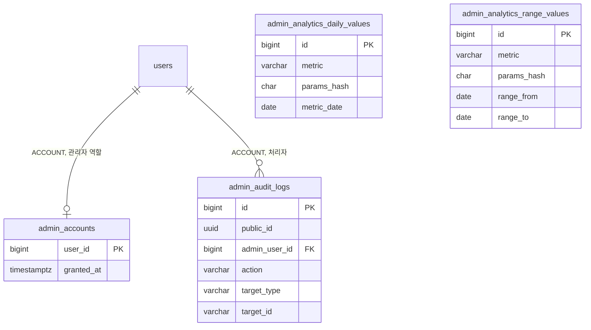

# 3-2 DB 스키마

이 문서는 ADMIN 도메인이 관리하는 PostgreSQL 테이블의 컬럼, 제약, 인덱스와 데이터 수명을 정한다.

다른 도메인의 테이블에서는 ADMIN 도메인이 참조하는 컬럼만 설명한다.

입력값의 검증 규칙은 보안에 있으며 감사 기록의 트랜잭션 규칙은 동시성에 있다. ([5-1-5 입력 검증](5-1-SECURITY.md#5-1-5-입력-검증)과 [5-2 동시성](5-2-CONCURRENCY.md))

 

### 3-2-1 공통 규칙

| 규칙 | 내용 |
|---|---|
| 식별자 | 내부 PK는 `bigint` 자동 증가 감사 로그는 외부 노출용 `public_id uuid`를 따로 둠 감사 로그의 대상은 그 도메인의 외부 식별자 문자열로 기록 Amplitude 조회 값은 API로 노출하지 않아 `public_id`가 없음 |
| 시각 | `timestamp with time zone` `created_at`의 기본값은 `now()`이며 아래 표에서는 표시하지 않음 |
| 삭제 | 감사 로그는 삭제 경로 없음 관리자 역할은 역할 관리 운영자가 행을 삭제 Amplitude 조회 값은 삭제 경로 없음 |
| FK | 관리자 역할은 회원 삭제 시 함께 삭제(`ON DELETE CASCADE`) 감사 로그의 처리자는 연쇄 삭제 없음 회원 행은 탈퇴해도 남으므로 실제 연쇄 삭제는 일어나지 않음 |

 

### 3-2-2 관계도

관계도는 데이터 묶음별 소유 관계를 보여준다. 각 상자에는 식별과 연결에 쓰는 컬럼만 표시한다. 전체 컬럼은 아래 표에서 정의한다. 다른 도메인의 테이블은 관계 라벨에 도메인을 적고 컬럼을 생략한다.

Amplitude 조회 값 두 테이블은 다른 테이블과 관계가 없다.

 

### 3-2-3 관리자 역할

**`admin_accounts`**

관리자 역할을 가진 회원 1명이 1행이다. 역할 관리 운영자가 직접 기록하고 삭제한다.

| 컬럼 | 타입 | 제약 | 의미 |
|---|---|---|---|
| `user_id` | bigint | PK, FK `users.id` CASCADE | |
| `granted_at` | timestamptz | NOT NULL, 기본 `now()` | 부여 시각 |

 

### 3-2-4 감사 로그

**`admin_audit_logs`**

관리자의 변경 작업 1건 또는 개인정보 조회 1건이 한 행이다. 추가만 하고 수정하지 않는다.

| 컬럼 | 타입 | 제약 | 의미 |
|---|---|---|---|
| `id` | bigint | PK | |
| `public_id` | uuid | NOT NULL, UNIQUE | 외부 노출 식별자 |
| `admin_user_id` | bigint | NOT NULL, FK `users.id` | 처리자 |
| `category` | varchar(10) | NOT NULL, CHECK `CHANGE` `ACCESS` | 변경 작업 또는 개인정보 조회 |
| `action` | varchar(50) | NOT NULL | 작업 이름 목록은 아래 |
| `target_type` | varchar(30) | NOT NULL | 대상 종류 목록은 아래 |
| `target_id` | varchar(255) | NOT NULL | 대상의 외부 식별자 회원, 공지, 캠페인, 제출본, 스토리는 공개 식별자 정책값은 정책 키 채팅 모델은 모델 코드 검색은 검색어 |
| `reason` | varchar(500) | | 사유 변경 작업은 NOT NULL, 조회는 NULL |
| `before_state` | jsonb | | 변경 전 값 조회와 생성은 NULL 필드는 아래 기록 허용 목록만 |
| `after_state` | jsonb | | 변경 후 값 조회와 삭제는 NULL 필드는 아래 기록 허용 목록만 |
| `request_id` | varchar(64) | NOT NULL | 상관관계 필터가 확정한 요청 ID 헤더 값이 조건에 어긋나면 서버 생성 값 |

| 인덱스 | 컬럼 |
|---|---|
| `idx_admin_audit_logs_created` | `created_at DESC` `public_id` |
| `idx_admin_audit_logs_admin` | `admin_user_id` `created_at DESC` |
| `idx_admin_audit_logs_target` | `target_type`, `target_id`, `created_at DESC` |

| `action` | `category` | `target_type` | 기록하는 도메인 |
|---|---|---|---|
| `MEMBER_SEARCHED` | `ACCESS` | `MEMBER_QUERY` | ADMIN |
| `MEMBER_VIEWED` | `ACCESS` | `MEMBER` | ADMIN |
| `MEMBER_SUSPENDED` | `CHANGE` | `MEMBER` | ACCOUNT |
| `MEMBER_UNSUSPENDED` | `CHANGE` | `MEMBER` | ACCOUNT |
| `CREDIT_GRANTED` | `CHANGE` | `MEMBER` | PAYMENT |
| `CREDIT_REVOKED` | `CHANGE` | `MEMBER` | PAYMENT |
| `CREDIT_POLICY_UPSERTED` | `CHANGE` | `CREDIT_POLICY` | PAYMENT |
| `CREDIT_POLICY_DELETED` | `CHANGE` | `CREDIT_POLICY` | PAYMENT |
| `PUSH_CAMPAIGN_CREATED` | `CHANGE` | `PUSH_CAMPAIGN` | NOTIFICATION |
| `PUSH_CAMPAIGN_CANCELED` | `CHANGE` | `PUSH_CAMPAIGN` | NOTIFICATION |
| `PUSH_CAMPAIGN_RETRIED` | `CHANGE` | `PUSH_CAMPAIGN` | NOTIFICATION |
| `PUSH_TEMPLATE_UPSERTED` | `CHANGE` | `PUSH_TEMPLATE` | NOTIFICATION |
| `PUSH_TEMPLATE_RESET` | `CHANGE` | `PUSH_TEMPLATE` | NOTIFICATION |
| `NOTICE_CREATED` | `CHANGE` | `NOTICE` | NOTICE |
| `NOTICE_UPDATED` | `CHANGE` | `NOTICE` | NOTICE |
| `NOTICE_PUBLISHED` | `CHANGE` | `NOTICE` | NOTICE |
| `NOTICE_UNPUBLISHED` | `CHANGE` | `NOTICE` | NOTICE |
| `NOTICE_DELETED` | `CHANGE` | `NOTICE` | NOTICE |
| `SUBMISSION_HOLD_RELEASED` | `CHANGE` | `SUBMISSION` | MODERATION |
| `STORY_TAKEN_DOWN` | `CHANGE` | `STORY` | MODERATION |
| `ORIGINAL_CREATED` | `CHANGE` | `STORY` | STORY |
| `ORIGINAL_UPDATED` | `CHANGE` | `STORY` | STORY |
| `ORIGINAL_THUMBNAIL_DELETED` | `CHANGE` | `STORY` | STORY |
| `CHAT_MODEL_PROMOTION_UPSERTED` | `CHANGE` | `CHAT_MODEL` | CHAT |
| `CHAT_MODEL_PROMOTION_DELETED` | `CHANGE` | `CHAT_MODEL` | CHAT |

변경 전후 값에 넣을 수 있는 필드는 작업마다 다음으로 한정한다. 목록에 없는 필드는 넣지 않는다. 회원의 이메일, 닉네임, 소셜 식별자, 프로필 이미지, 채팅 메시지 원문은 어떤 작업에서도 넣지 않는다.

| `action` | `before_state` | `after_state` |
|---|---|---|
| `MEMBER_SUSPENDED`, `MEMBER_UNSUSPENDED` | `status` | `status` |
| `CREDIT_GRANTED` | `balance` | `balance`, `amount`, `expiresInDays`, `expiresAt` |
| `CREDIT_REVOKED` | `balance` | `balance`, `amount`, `shortfall` |
| `CREDIT_POLICY_UPSERTED` | `policyKey`, `amount`, `effectiveUntil` | `policyKey`, `amount`, `effectiveUntil` |
| `CREDIT_POLICY_DELETED` | `policyKey`, `amount`, `effectiveUntil` | 없음 |
| `PUSH_CAMPAIGN_CREATED` | 없음 | `kind`, `title`, `body`, `scheduledAt`, `status`, `storyId`, `noticeId` |
| `PUSH_CAMPAIGN_CANCELED`, `PUSH_CAMPAIGN_RETRIED` | `status`, `scheduledAt` | `status`, `scheduledAt` |
| `PUSH_TEMPLATE_UPSERTED` | 없음 | `templateKey`, `title`, `body`, `effectiveFrom`, `effectiveUntil` |
| `PUSH_TEMPLATE_RESET` | `templateKey`와 종료한 행마다 `title`, `body`, `effectiveFrom`, `effectiveUntil` | 없음 |
| `NOTICE_CREATED` | 없음 | `title`, `tag`, `status` |
| `NOTICE_UPDATED` | `title`, `tag`, `status` | `title`, `tag`, `status` |
| `NOTICE_PUBLISHED`, `NOTICE_UNPUBLISHED` | `status`, `publishedAt`, `notifiedAt` | `status`, `publishedAt`, `notifiedAt` |
| `NOTICE_DELETED` | `title`, `tag`, `status` | 없음 |
| `SUBMISSION_HOLD_RELEASED` | `holdReason`, `attempt` | 없음 |
| `STORY_TAKEN_DOWN` | `visibility` | `visibility`, `takedownReason`, `takedownReasonDetail`, `takenDownAt`, `memo` |
| `ORIGINAL_CREATED` | 없음 | `status`, `visibility`, `title`, `genres` |
| `ORIGINAL_UPDATED` | `status`, `visibility`, `title`, `genres` | `status`, `visibility`, `title`, `genres` |
| `ORIGINAL_THUMBNAIL_DELETED` | `thumbnailUrl` | 없음 |
| `CHAT_MODEL_PROMOTION_UPSERTED` | `turnCost`, `startsAt`, `endsAt` 프로모션이 없었으면 없음 | `turnCost`, `startsAt`, `endsAt` |
| `CHAT_MODEL_PROMOTION_DELETED` | `turnCost`, `startsAt`, `endsAt` | 없음 |

공지 본문은 5,000자까지라 변경 전후 값의 상한을 넘으므로 넣지 않는다. 변경 내용은 공지 상세로 확인한다.

`STORY_TAKEN_DOWN`의 `reason`은 소유자에게 보인 사유다. 사유 분류의 표시 이름이고 `ETC`면 관리자가 입력한 사유다. 내부 메모는 변경 후 값의 `memo`이고 없으면 `null`이다. `takedownReasonDetail`은 `ETC`가 아니면 `null`이다. ([MODERATION 4-2-10 공개 중단](../../MODERATION/BACKEND/4-2-CONTRACT.md#4-2-10-공개-중단))

 

### 3-2-5 Amplitude 조회 값

Amplitude에서 받은 지표 값과 Langfuse에서 받은 AI 비용(`metric` `langfuse_ai_cost`)을 저장한다. 조회 흐름과 유효 판정은 처리 흐름에 있다. ([4-1-23 AI 비용의 Langfuse 조회](4-1-PIPELINES.md#4-1-23-ai-비용의-langfuse-조회)) ([4-1-20 Amplitude 조회 공통](4-1-PIPELINES.md#4-1-20-amplitude-조회-공통)) 마이그레이션 번호는 서버 저장소의 다음 번호를 쓴다.

**`admin_analytics_daily_values`**

일별 지표 조회 하나의 한 날짜 값, 또는 리텐션 조회 하나의 한 코호트 날짜 배열이 한 행이다.

| 컬럼 | 타입 | 제약 | 의미 |
|---|---|---|---|
| `id` | bigint | PK | |
| `metric` | varchar(64) | NOT NULL | 지표 식별자 서버 코드가 조회 정의마다 정한 이름 |
| `params_hash` | char(64) | NOT NULL | 조회 정의의 매개변수를 정해진 순서로 직렬화한 JSON의 SHA-256 16진 문자열 |
| `params` | jsonb | NOT NULL | 해시를 만든 매개변수 원문 운영자가 행의 의미를 확인하는 용도 |
| `metric_date` | date | NOT NULL | KST 날짜 리텐션은 코호트 날짜 |
| `value` | jsonb | NOT NULL | 일별 지표는 숫자 하나 푸시 열람과 알림함 열람, 광고 소재, 설치 경로는 묶음 값과 고유 사용자 수 객체 배열 리텐션은 `count`, `outof`, `incomplete` 객체 배열 세션 길이 분포는 구간 9개의 세션 수 정수 배열 앱 신규 활성 사용자는 퍼널 두 단계의 사용자 수 정수 배열 `langfuse_ai_cost`는 `traceName`, `model`, `costUsd`, `totalTokens` 객체 배열이고 정상 조회에 데이터가 없던 날은 빈 배열 |
| `fetched_at` | timestamptz | NOT NULL | Amplitude나 Langfuse에서 받은 시각 |
| `finalized_at` | timestamptz | | 확정한 시각 NULL이면 다시 받을 수 있음 |

| 제약과 인덱스 | 컬럼 |
|---|---|
| `uk_admin_analytics_daily_values_key` UNIQUE | `metric`, `params_hash`, `metric_date` |

**`admin_analytics_range_values`**

범위 지표 조회 하나의 한 범위 값이 한 행이다.

| 컬럼 | 타입 | 제약 | 의미 |
|---|---|---|---|
| `id` | bigint | PK | |
| `metric` | varchar(64) | NOT NULL | 지표 식별자 |
| `params_hash` | char(64) | NOT NULL | 일별 테이블과 같은 규칙 |
| `params` | jsonb | NOT NULL | 해시를 만든 매개변수 원문 |
| `range_from` | date | NOT NULL | 범위 첫날 KST 날짜 |
| `range_to` | date | NOT NULL, CHECK `range_from <= range_to` | 범위 마지막 날 KST 날짜 |
| `value` | jsonb | NOT NULL | 응답을 만들 원값 퍼널은 단계별 사용자 수 배열, 묶음 조회는 묶음 값과 사용자 수 배열, MAU는 숫자 하나 |
| `fetched_at` | timestamptz | NOT NULL | Amplitude에서 받은 시각 |
| `finalized_at` | timestamptz | | 확정한 시각 NULL이면 다시 받을 수 있음 |

| 제약과 인덱스 | 컬럼 |
|---|---|
| `uk_admin_analytics_range_values_key` UNIQUE | `metric`, `params_hash`, `range_from`, `range_to` |

- 두 테이블 모두 고유 키 인덱스로 조회한다. 일별 테이블은 `metric`, `params_hash`가 같고 `metric_date`가 범위 안인 행을 읽는다.
- 저장은 고유 키 충돌 시 값과 `fetched_at`을 덮어쓰는 upsert이며 `finalized_at`이 있는 행은 덮어쓰지 않는다.
- 회원 식별자와 개인정보는 넣지 않는다. 값은 집계 수치뿐이다.

 

### 3-2-6 참조하는 다른 도메인의 컬럼

| 테이블 | 컬럼 | ADMIN이 하는 일 |
|---|---|---|
| `users` | `id`, `public_id`, `nickname`, `status`, `created_at`, `deleted_at`, `migrated_at` | 관리자 판정, 회원 목록과 상세, 회원 수 집계, 팀 계정 제외 판정, 소유자 요약 |
| `social_accounts` | `user_id`, `email`, `provider`, `connected_at`, `deleted_at` | 회원 목록의 이메일 정확 일치 검색 신규 가입자의 가입 경로와 연동 행 없는 예전 계정 제외 |
| `story_chats` | `id`, `public_id`, `story_id`, `user_id`, `current_turn`, `persona_name_snapshot`, `model_code`, `created_at`, `updated_at`, `deleted_at` | 채팅 시작 수, 채팅 목록과 상세, 턴 분포, 기준 턴 도달률, 턴 도달률과 게스트 이관 비율, 페르소나와 모델 비중, 회원의 채팅 수와 최근 활동, 회원 목록과 상세의 누적 턴 수 관리자 조회용 인덱스 `(user_id, created_at)`은 삭제된 채팅도 포함 |
| `story_chats` | `summary_through_turn` | 채팅 목록과 상세의 요약 끝 턴 `summary`는 읽지 않음 |
| `chat_models` | `code` | 모델 비중의 키 플랫폼별 모델 턴 수의 조회 대상 모델 |
| `story_messages` | `chat_id`, `role`, `created_at`, `model_code` | 채팅 턴 수, 모델별 턴 수(`model_code`), 회원 목록과 상세의 누적 턴 수, 첫 사용자 메시지 시각, 턴 날짜 필터 `content`는 읽지 않음 |
| `stories` | `id`, `public_id`, `user_id`, `title`, `description`, `genre`, `visibility`, `created_at`, `deleted_at` | 스토리 수, 스토리 목록과 상세, 장르 필터, 범위 판정 |
| `stories` | `taken_down_at`, `takedown_reason`, `takedown_reason_detail` | 스토리 목록과 상세의 공개 중단 표시 |
| `story_creation_sessions` | `id`, `user_id`, `story_id`, `status`, `created_at` | 제작 세션 차트, 스토리의 태그와 주변 인물 수, 스토리의 제작 방식 |
| `story_creation_characters` | `id`, `creation_session_id`, `role`, `name`, `gender` | 입력한 주변 인물 수 |
| `story_creation_session_tags` | `creation_session_id`, `character_id`, `tag_id` | 스토리의 태그 인물에 연결된 특징 태그로 입력 여부 판정 |
| `story_creation_tags` | `id`, `name`, `tag_type` | 태그 이름 |
| `story_creation_requests` | `user_id`, `stage`, `status`, `created_at` | 간편 제작 실패율 |
| `ai_call_logs` | `feature`, `status`, `model`, `input_token_count`, `output_token_count`, `latency_ms`, `story_id`, `chat_id`, `device_id_hash`, `created_at` | AI 호출 차트, 스토리와 채팅의 AI 호출 필터, AI 비용, 게스트 채팅의 사용자 수 `feature`는 CHAT이 기록하는 `chat_image`와 `chat_compact`를 포함하고 AI 비용은 `chat_image`를 장당 원가로 계산 `chat_compact`는 `model`과 토큰 수가 `NULL` |
| `credit_transactions` | `id`, `user_id`, `amount`, `reason`, `ref_type`, `ref_id`, `created_at` | 이프 적립과 소모, 출석, 회원 이프 내역과 소모량, 채팅 소모량, 결제 전후 비교 |
| `credit_orders` | `id`, `public_id`, `user_id`, `product_id`, `status`, `price_krw`, `credit_amount`, `completed_at`, `refunded_at`, `reversal_shortfall` | 결제 건수와 금액, 결제 내역과 상세, 회원 결제액 |
| `story_submissions` | `story_id`, `status`, `held_at` | 스토리의 보류 상태 |

 

### 3-2-7 데이터 수명

| 데이터 | 삭제 |
|---|---|
| 관리자 역할 | 역할 관리 운영자가 삭제 |
| 감사 로그 | 없음 |
| Amplitude 조회 값 | 없음 지표 정의가 바뀌면 새 키로 다시 받고 옛 행은 남음 잘못 받은 값은 운영 DB에서 그 행을 지워 다음 요청에서 다시 받게 함 |
