# 4-1 처리 흐름

이 문서는 ADMIN 도메인의 요청 수신부터 응답까지의 처리 단계와 다른 도메인의 관리자 API가 쓰는 판정과 감사 기록의 단계를 정한다.

요청 필드, 응답 필드와 실패 응답은 계약에, 토큰 수명과 복구 규칙은 오류 처리에, 트랜잭션 규칙은 동시성에 있다. ([4-2 계약](4-2-CONTRACT.md), [5-3 오류 처리](5-3-ERROR-HANDLING.md), [5-2 동시성](5-2-CONCURRENCY.md))

 

### 4-1-1 공통 처리

모든 요청은 상관관계 필터에서 요청 ID를 받는다. 관리자 로그인은 토큰을 읽지 않는다. 그 밖의 관리자 경로는 관리자 판정 필터가 요청자를 정한다. 앱 경로의 토큰 검증은 관리자 표식이 있는 토큰을 거절한다.

관리자 경로는 `/api/v1/admin/` 아래 전체다. 다른 도메인의 관리자 API도 같은 접두 아래에 두어 같은 필터를 거친다. 필터를 거치지 않는 관리자 경로는 없다.

관리자 판정은 토큰의 값으로 끝내지 않는다. 요청마다 토큰 주체의 회원 행을 읽어 관리자 역할과 계정 상태를 다시 확인한다.

흐름도에서 Google과 다른 도메인을 호출하는 단계는 주황색이다.

 

### 4-1-2 관리자 로그인

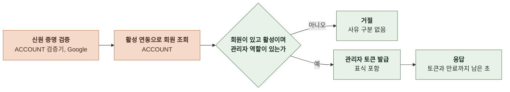

- 검증 실패와 자격 없음은 다른 상태로 응답하되 자격 없음 안에서 회원 없음, 역할 없음, 정지, 탈퇴는 구분하지 않는다.
- 계정을 만들지 않고 가입 보상, 체험 스냅샷, 세션 생성, 로그인 분석 이벤트도 수행하지 않는다.
- 로그인 결과는 구조화 로그로 남긴다. 성공은 회원 공개 식별자를 기록하고 실패는 사유 분류만 기록한다.

 

### 4-1-3 관리자 판정

관리자 판정 필터는 `/api/v1/admin/` 아래에서 로그인을 제외한 모든 요청에 실행된다.

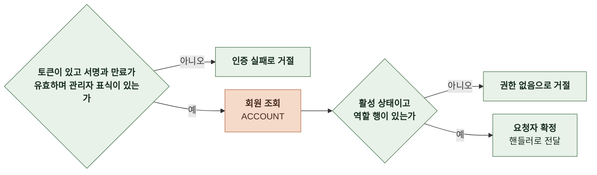

- 앱 접근 토큰은 표식이 없어 첫 단계에서 거절된다. 유효한 관리자 토큰이라도 그 사이 역할이 회수되거나 계정이 정지되면 두 번째 단계에서 거절된다.
- 요청자는 회원 내부 ID로 확정해 핸들러와 감사 기록에 전달한다.

 

### 4-1-4 감사 기록

다른 도메인의 관리자 API가 변경을 적용한 뒤 같은 트랜잭션에서 호출한다. ADMIN의 회원 검색과 상세는 조회 뒤 접속 기록으로 호출한다.

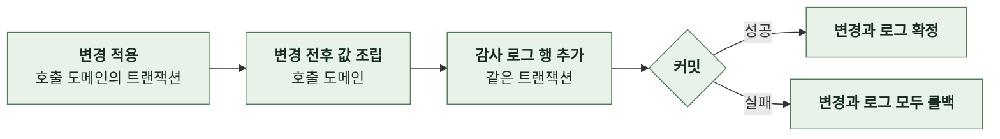

- 변경 전후 값은 호출 도메인이 작업별 기록 허용 목록의 필드로 조립한다. ([3-2-4 감사 로그](3-2-DB-SCHEMA.md#3-2-4-감사-로그)) 생성은 변경 전 값이 없고 삭제는 변경 후 값이 없다.
- 대상은 외부 식별자로 기록한다. 순차 PK를 넣지 않는다.
- 접속 기록은 조회 응답을 만든 뒤 독립 트랜잭션으로 기록한다. 기록에 실패하면 조회 응답도 실패로 바꾼다.

 

### 4-1-5 목록 공통 처리

스토리, 채팅, 회원, 결제, 이프 내역, 감사 로그 목록은 같은 순서로 처리한다.

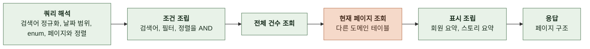

| 항목 | 규칙 |
|---|---|
| 검색어 | 앞뒤 공백 제거, 연속 공백 하나로, 소문자화 부분 일치는 대상 문자열을 같은 규칙으로 정규화한 뒤 포함 여부 정확 일치는 정규화한 값이 같은지 UUID 형식이면 정확 일치 대상에만 비교 |
| 날짜 범위 | KST 달력 날짜를 UTC 구간으로 바꿔 시각 컬럼과 비교 `from`이 있으면 그날 자정 이상, `to`가 있으면 다음 날 자정 미만 한쪽만 있으면 그 경계만 적용 |
| 정렬 | 요청 열과 방향 뒤에 공개 식별자 오름차순을 항상 덧붙임 `null`은 마지막 |
| 페이지 | 건너뛸 행 수는 `(page - 1) × size` 전체 건수와 현재 페이지는 별도 쿼리 |
| 팀 계정 | 목록과 상세에는 제외 목록을 적용하지 않음 |
| 삭제 행 | 삭제된 스토리와 채팅은 목록과 상세에서 제외 탈퇴 회원은 `excludeDeleted`가 없으면 포함 |

 

### 4-1-6 대시보드 요약

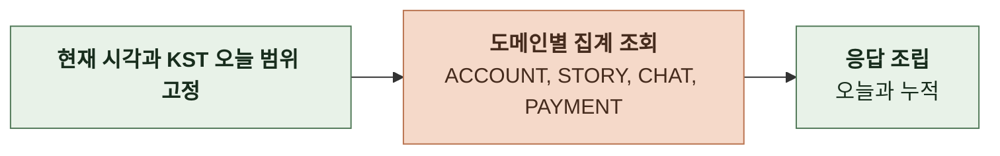

- 지표 정의는 제품 제약을 따른다. ([2-4 제품 제약](2-REQUIREMENTS.md#2-4-제품-제약))
- 오늘 범위는 요청 시작 때 한 번 계산해 모든 집계에 같은 값을 쓴다. 자정을 걸치는 요청에서 지표끼리 기준이 어긋나지 않게 한다.
- 집계는 읽기 전용이며 캐시하지 않는다.
- 팀 계정 제외 목록은 설정에서 읽어 모든 집계의 소유 회원 조건에 적용한다.

 

### 4-1-7 대시보드 차트

| 항목 | 규칙 |
|---|---|
| 날짜 범위 | `from`과 `to`가 있으면 그대로, `days`면 오늘을 포함한 최근 N일, 둘 다 없으면 최근 30일 `to`는 오늘 이하이고 길이는 1~366일 날짜 경계는 KST 자정 |
| 일별 추이 | 지표마다 날짜별로 집계한 뒤 범위의 모든 날짜를 채움 기준 시각 컬럼은 제품 제약의 표 |
| 분포 | 차트마다 한 번의 집계 쿼리 구간 차트는 값이 0인 구간도 항목으로 둠 |
| 제작 세션 차트 | 팀 계정 제외 목록에서 공식 계정을 뺀 나머지만 제외 오리지널 제작 세션을 포함하기 위함 인물 수는 스토리 목록의 주변 인물 수와 같은 판정 |
| 그 외 차트와 추이 | 요약과 같은 제외 목록 적용 |
| 목록 링크 | 막대마다 그 막대의 조건을 목록 쿼리 이름으로 바꿔 넣음 날짜 범위는 응답의 `from`과 `to` 그대로이며 차트가 정한 접두가 붙은 이름 |
| 캐시 | 없음 기간 상한 366일이 집계 범위를 제한 |

 

### 4-1-8 스토리 목록과 상세

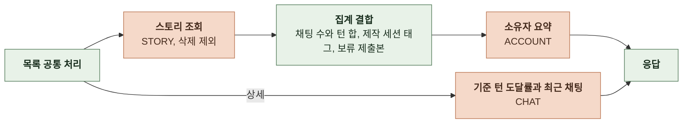

| 항목 | 규칙 |
|---|---|
| 범위 | 공식 계정 설정값의 회원이 소유하면 `original`, 그 외는 `user` 공식 계정 설정이 비어 있으면 모든 스토리가 `user` |
| 장르 필터 | 스토리의 장르 문자열을 `, `로 나눈 값에 정식 이름이 있는지 |
| 태그 | 스토리를 완성한 제작 세션의 선택 태그 이름 세션이 없으면 빈 배열 |
| 주변 인물 수 | 그 제작 세션에서 사용자가 직접 입력한 주변 인물 수 이름이 공백이 아니거나 성별이 있거나 인물에 연결된 특징 태그가 하나라도 있는 주변 인물 역할 행 셋 다 비면 AI가 채우는 빈 자리라 세지 않음 |
| 보류 상태 | 그 스토리를 대상으로 하는 대기 상태이면서 보류 시각이 있는 제출본이 있으면 `HELD` |
| 채팅 수와 턴 합 | 삭제되지 않은 채팅 `chatFrom` 또는 `chatTo`가 있으면 지정된 경계 안에 생성된 채팅만 |
| AI 호출 필터 | AI 호출 기록의 스토리 ID로 연결 조건에 맞는 기록이 하나 이상인 스토리 |
| 기준 턴 도달률 | 기준 턴 1, 3, 5, 10, 20마다 현재 턴이 기준 이상인 채팅 수를 채팅 수로 나눔 |
| 최근 채팅 | 생성 시각 내림차순 5개 채팅 목록 항목과 같은 조립 |

 

### 4-1-9 채팅 목록과 상세

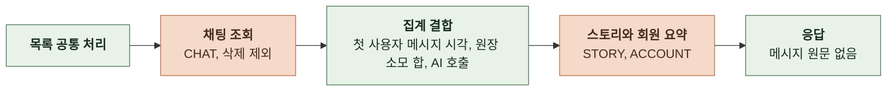

| 항목 | 규칙 |
|---|---|
| 턴 구간 | 현재 턴을 턴 수 분포 차트의 11구간에 대응 |
| 첫 사용자 메시지 | 역할이 사용자인 메시지 중 가장 이른 생성 시각과 채팅 생성 시각의 차 `hasFirstMessage=true`는 차가 900초 이하인 채팅 |
| 턴 날짜 | 그 KST 날짜에 생성된 AI 응답 메시지가 하나 이상인 채팅 |
| 이프 소모 | 참조 종류가 채팅 또는 채팅 이미지이고 참조 ID가 이 채팅인 원장 소모 행 합계의 절댓값 |
| AI 호출 필터 | AI 호출 기록의 채팅 ID와 채팅 공개 식별자로 연결 |
| 메시지 원문 | 조회하지 않음 시각과 역할만 읽음 |

 

### 4-1-10 회원 목록과 상세

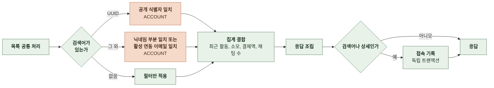

| 항목 | 규칙 |
|---|---|
| 닉네임 검색 | 앞뒤 공백을 제거하고 연속 공백을 하나로 줄인 뒤 대소문자를 무시한 부분 일치 탈퇴 계정은 닉네임이 익명화되어 공개 식별자나 이메일로만 찾음 |
| 이메일 검색 | 탈퇴 처리되지 않은 소셜 연동의 이메일과 소문자 정확 일치 응답에 이메일을 넣지 않음 |
| 최근 활동 | 삭제되지 않은 채팅의 마지막 갱신 시각, 원장 기록 시각, 스토리 생성 시각 중 최댓값 |
| 채팅 구간 | 채팅 수를 회원별 채팅 생성 횟수 차트의 5구간에 대응 `chatFrom` 또는 `chatTo`가 있으면 지정된 경계 안의 채팅 수로 판정 |
| 원장 필터 | `creditDirection`은 적립 사유의 양수 행 또는 소모 사유의 음수 행 `creditDate`는 그 행의 기록일 |
| 출석 필터 | 출석 보상 사유의 행이 그 KST 날짜에 있는 회원 |
| 상세 | 목록 항목에 잔액, 소유 스토리 수, 탈퇴 시각을 더함 잔액은 PAYMENT의 잔액 연산 |
| 이프 내역 | 회원의 원장 행을 기록 시각과 내부 ID에 같은 `order` 방향을 적용해 조회 누계는 방향과 무관하게 기록 시각과 내부 ID 오름차순의 수량 합 |
| 출석 기록 | 출석 보상 행을 KST 날짜로 묶음 |
| 접속 기록 | 검색어가 있는 목록은 정규화한 검색어를 대상으로 `MEMBER_SEARCHED` 상세, 이프 내역, 출석 기록은 회원 공개 식별자를 대상으로 `MEMBER_VIEWED` 검색어 없는 목록은 기록하지 않음 |

 

### 4-1-11 결제 내역과 상세

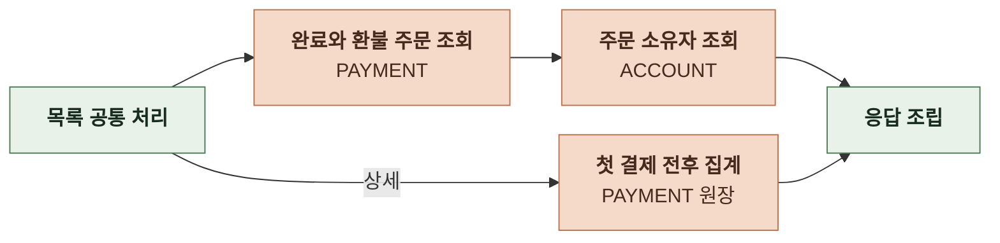

| 항목 | 규칙 |
|---|---|
| 대상 | 완료 시각이 있는 주문 대기 주문은 목록과 상세 모두 제외 |
| 기간 | 완료 시각의 KST 날짜 |
| 전후 비교 | 기준은 그 회원의 완료 시각이 가장 이른 완료 또는 환불 주문의 완료 시각 턴은 채팅 턴 사유 행 수, 제작은 간편 제작 사유 행 수, 소모는 소모 사유 합계의 절댓값에서 환불 사유 합계를 뺀 값 |

 

### 4-1-12 이프 내역

| 항목 | 규칙 |
|---|---|
| 대상 | 모든 회원의 원장 행 팀 계정 제외 없음 |
| 방향 | `granted`는 적립 사유이면서 양수인 행, `spent`는 소모 사유이면서 음수인 행 사유 집합은 대시보드 요약의 이프 적립과 소모와 같음 |
| 날짜 | 기록 시각의 KST 달력 날짜 |
| 정렬 | 기록 시각 내림차순 같으면 내부 ID 내림차순 원장 행에 공개 식별자가 없어 동률 규칙의 예외 |
| 회원 | 필터 없음 탈퇴 회원의 행도 포함 |
| 누계 | 계산하지 않음 |

 

### 4-1-13 감사 로그 조회

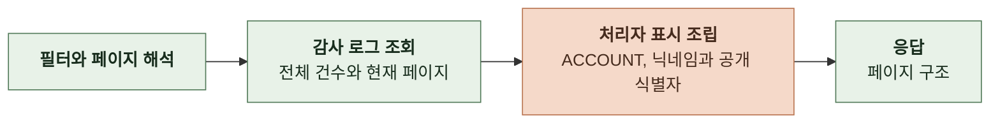

- 검색어는 처리자 닉네임, 작업 이름, 사유의 부분 일치와 공개 식별자, 대상 식별자의 정확 일치다. 사유에 대한 부분 일치는 전체 스캔이라 다른 필터와 함께 쓰는 것을 전제로 한다.
- 정렬은 요청 열이며 같으면 감사 로그 공개 식별자 오름차순이다. 처리자 닉네임 정렬은 회원 테이블과 결합한다.
- 감사 로그 조회 자체는 접속 기록을 남기지 않는다.

 

### 4-1-14 분석 지표

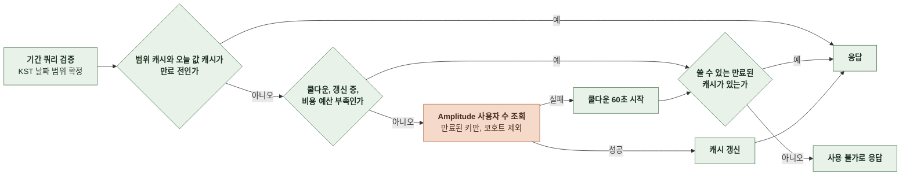

주소, 인증, 비용 예산, 캐시, 실패 처리는 Amplitude 조회 공통 규칙을 따르며 비용과 기간 상한도 그 절의 표에 있다. ([4-1-20 Amplitude 조회 공통](#4-1-20-amplitude-조회-공통))

| 항목 | 규칙 |
|---|---|
| 호출 대상 | 사용자 수 조회 `GET /api/2/users` 이벤트가 없는 조회라 조건을 이벤트 필터로 넣을 수 없음 |
| 조회 | 요청 범위로 `m=active`와 `m=new` 각 1회, `i=1` |
| 오늘 활성 사용자 | 범위와 무관한 값이라 범위 키와 따로 캐시 범위가 오늘을 포함하면 그 범위를 갱신할 때 `m=active`의 마지막 값으로 함께 갱신 포함하지 않으면 오늘 하루의 `m=active` 1회로 갱신 |
| 팀 계정 제외 | 세그먼트 정의 `s`에 `{"prop":"userdata_cohort","op":"is not","values":["<코호트 ID>"]}`를 넣음 코호트 ID 설정이 비어 있으면 `s` 없이 조회 |
| 캐시 키 | 범위(`from`, `to`) 오늘 활성 사용자는 KST 오늘 날짜 |
| 집계와의 분리 | 대시보드 요약과 차트와 다른 엔드포인트라 분석 도구 장애가 DB 지표에 영향을 주지 않음 |

 

### 4-1-15 설치 지표

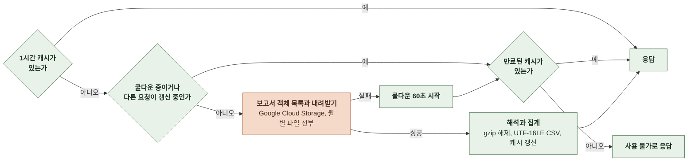

| 항목 | 규칙 |
|---|---|
| 원천 | Play Console 일괄 보고서 버킷의 `stats/installs/installs_{패키지 이름}_{YYYYMM}_overview.csv` 월별 파일 전부를 접두어 목록으로 찾아 내려받음 |
| 인증 | 서비스 계정 키 JSON을 base64로 받은 설정값 저장소 읽기 권한만 |
| 해석 | gzip 해제 뒤 UTF-16LE CSV 열은 날짜, 패키지 이름, 일별 기기 설치, 일별 앱 삭제, 일별 기기 업그레이드, 총 사용자 설치, 일별 사용자 설치, 일별 사용자 삭제, 활성 기기 설치, 설치 이벤트, 업데이트 이벤트, 삭제 이벤트 총 사용자 설치 열은 읽지 않음 |
| 집계 | 누적 기기 설치 수는 모든 행의 일별 기기 설치 합 활성 기기 수는 날짜가 가장 늦은 행의 활성 기기 설치 기준 날짜는 그 행의 날짜 일별 추이는 첫 날짜부터 마지막 날짜까지 모든 날이며 날짜별 항목에 첫날부터의 설치 누계와 그날의 활성 기기 수를 함께 담음 보고서에 없는 날은 설치와 삭제 0, 누계는 전날 값, 활성 기기는 `null` |
| 날짜 | Play 기준 날짜 문자열을 그대로 씀 KST 변환 없음 |
| 캐시 | 집계 결과를 프로세스 안에 1시간 보관 태스크마다 따로 |
| 갱신과 실패 | 만료 뒤 첫 요청 하나만 호출, 나머지는 만료된 캐시 또는 사용 불가 호출 실패, 시간 초과 10초, 파일 없음, 해석 실패는 60초 쿨다운 키가 비어 있으면 호출 없이 사용 불가 |
| 집계와의 분리 | 다른 대시보드 응답과 별도 엔드포인트라 저장소 장애가 DB 지표에 영향을 주지 않음 |

 

### 4-1-16 캠페인 분석

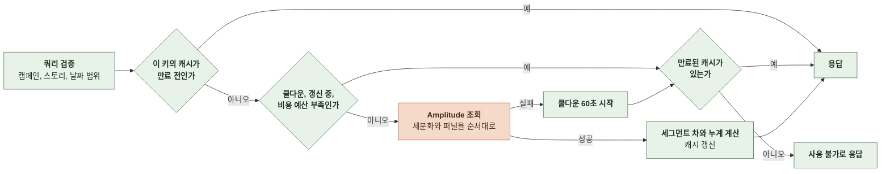

주소, 인증, 조건을 넣는 방식, 비용 예산, 캐시, 실패 처리는 Amplitude 조회 공통 규칙을 따르며 비용과 기간 상한도 그 절의 표에 있다. ([4-1-20 Amplitude 조회 공통](#4-1-20-amplitude-조회-공통))

| 항목 | 규칙 |
|---|---|
| 호출 대상 | 이벤트 세분화 조회 `GET /api/2/events/segmentation`과 퍼널 조회 `GET /api/2/funnels` |
| 공통 조건 | 모든 조회의 이벤트 필터에 사용자 속성 `country`가 `South Korea` 또는 `(none)`인 조건 신규 가입자를 뺀 조회에는 `platform`이 `Web`인 조건을 더함 퍼널은 단계마다 같은 조건 |
| 광고 구분 | 전체는 공통 조건만 광고 유입은 공통 조건에 사용자 속성 `gp:initial_utm_campaign`이 캠페인 값인 이벤트 필터를 더함 광고 외 유입은 조회하지 않고 전체에서 광고 유입을 뺌 |
| 캠페인 목록 | 설정 파일 고정값 `campaign` 쿼리가 없으면 종료일이 없는 마지막 항목, 상세 진입 퍼널의 `storyId`가 없으면 적용한 캠페인과 값이 같은 항목의 대상 스토리 |
| 추이 조회 | 웹 DAU는 `_active` 고유 사용자, 전체 1회 신규 방문자는 `_new` 고유 사용자, 전체와 광고 2회 소스별은 `_new`에 캠페인이 아니면서 `gp:initial_utm_source`가 `ig`, `th`와 `threads`, `dc`, 그 밖인 이벤트 필터 4회 신규 가입자는 구글과 카카오 로그인 성공 이벤트에 이벤트 속성 `is_new_user`가 `true`인 필터로 전체와 광고 각각 2회씩 4회를 받아 두 이벤트를 더함 서버 가입 이벤트에는 사용자 속성 `platform`이 대부분 없어 가입자 조회에는 `platform` 조건을 넣지 않고 `country`와 `gp:initial_utm_campaign`만 씀 횟수는 스토리라인 생성 요청, 스토리 완성 요청, 채팅 메시지 전송 이벤트의 합계(totals) 3회 |
| 퍼널 조회 | 순서 모드, 전환 창 86,400초, 활성 사용자 기준 간편 제작 퍼널과 상세 진입 퍼널은 별도 엔드포인트라 따로 갱신 간편 제작 퍼널은 전체와 광고 2회 상세 진입 퍼널은 전체 1회이며 1단계는 이벤트 속성 `story_id`가 대상 스토리이고 사용자 속성 `gp:utm_campaign`이 캠페인 값, 2단계는 `story_id`가 대상 스토리, 3~7단계는 채팅 메시지 전송의 이벤트 속성 `turn_number`가 문자열 `1`~`5` |
| 유입 소스 조회 | `_new` 고유 사용자를 묶음 속성 `g`에 `gp:initial_utm_source` 하나만 넣어 1회 페이지 조회 이벤트 `[Amplitude] Page Viewed`에 이벤트 속성 `utm_medium`이 `community` 또는 `social`인 필터를 걸고 이벤트 묶음 `utm_content` 하나로 고유 사용자 1회 값이 열린 묶음이라 묶음 속성을 쓰되 조회마다 하나만 써서 비용을 줄임 매체(`gp:initial_utm_medium`)와 게시글의 소스(`utm_source`)로는 묶지 않음 |
| 계산 | 광고 외 유입은 날짜마다 전체에서 광고를 뺌 누적 가입자는 범위 첫날부터 누계 퍼널의 광고 외는 단계마다 전체에서 광고를 뺌 |
| 캐시 키 | 엔드포인트, 범위, 캠페인, 대상 스토리 |
| 기본값 | 캠페인 목록과 소스 목록은 설정 파일 고정값 |

 

### 4-1-17 사용자 지표

사용자 활동, 사용자 리텐션, 사용자 세션은 Amplitude를, 신규 가입자는 서버 DB를 읽는다. Amplitude 조회는 공통 규칙을 따르며 비용과 기간 상한도 그 절의 표에 있다. ([4-1-20 Amplitude 조회 공통](#4-1-20-amplitude-조회-공통))

| 항목 | 규칙 |
|---|---|
| 공통 조건 | 사용자 속성 `country`가 `South Korea` 또는 `(none)` 플랫폼은 사용자 속성 `platform`이 `Web`, `Android`, 값 없음 `(none)` |
| 활동 조회 | `_active` 고유 사용자를 전체, Web, Android, 플랫폼 없음의 이벤트 필터로 4회 `_new` 고유 사용자를 같은 네 필터로 4회 채팅 메시지 전송 이벤트의 사용자당 평균(`m=average`)을 Web과 Android 이벤트 필터로 2회 전체는 국가 조건만, 플랫폼별은 국가 조건에 `platform` 조건을 더함 MAU는 사용자 수 조회 `m=active`, `i=30`을 `start`가 `to`의 29일 전, `end`가 `to`인 범위로 1회이며 국가 조건은 세그먼트 `s`에 넣음 30일 구간이 `start`에서 시작하므로 `start`를 이렇게 맞춰야 `to`로 끝나는 30일 값이 나옴 |
| 리텐션 조회 | 리텐션 조회 `GET /api/2/retention`에 시작 이벤트 `_new`, 복귀 이벤트 `_active`로 전체, Web, Android 3회 구간 모드 `rm`은 보내지 않아 기본값 `n-day`이며 원본 Amplitude 차트와 같음 국가와 플랫폼 조건은 시작과 복귀 이벤트의 이벤트 필터로 넣음 리텐션 조회가 이벤트 필터를 적용하는지는 구현 때 운영 키로 확인하고 적용하지 않으면 세그먼트 `s`에 넣으며 이때 기간 상한이 짧아짐 응답은 코호트 날짜마다 시작일부터 하루씩의 `count`, `outof`, `incomplete` 배열이며 인덱스 0이 시작일 인덱스 1, 7, 30의 `count`를 `outof`로 나눈 값이 D1, D7, D30 그 인덱스가 없거나 `incomplete`면 `null` |
| 세션 조회 | 평균 세션 길이 `GET /api/2/sessions/average`를 전체, Web, Android로 3회 사용자당 세션 수 `GET /api/2/sessions/peruser`는 조회하지 않음 국가와 플랫폼 조건은 세그먼트 `s`에 넣음 응답은 `data.series`의 일별 값(평균 길이는 초)이며 `seriesCollapsed`의 기간 평균은 쓰지 않음 |
| 신규 가입자 | `users`를 `created_at`의 KST 날짜로 묶고 팀 계정 제외 목록을 뺌 가입 경로는 그 회원의 `social_accounts` 중 `connected_at`이 가장 이른 행의 `provider`가 `GOOGLE`, `KAKAO`, 그 외 게스트 이관은 `migrated_at`이 있는 회원 |

 

### 4-1-18 전환 지표

Amplitude 퍼널은 공통 규칙을 따르며 비용과 기간 상한도 그 절의 표에 있다. ([4-1-20 Amplitude 조회 공통](#4-1-20-amplitude-조회-공통))

| 항목 | 규칙 |
|---|---|
| 퍼널 조회 | 순서 모드, 전환 창 86,400초, 활성 사용자 기준 단계마다 이벤트 필터에 사용자 지표의 국가 조건과 플랫폼 조건 퍼널마다 별도 엔드포인트 호출이라 따로 갱신 |
| `web-first-visit` | 캠페인 간편 제작 퍼널과 같은 6단계, 플랫폼 Web, 1회 |
| `android-first-visit` | `client_login_viewed` → `client_chat_messageInput_submitted`, 플랫폼 Android, 1회 |
| `story-creation` | `client_storyCreate_storyGeneration_requested` → `client_storyCreate_storylineOption_selected` → `client_storyCreate_storyCompletion_requested` → `client_storyCreate_completed`, 1회 |
| `story-detail-chat` | 캠페인 상세 진입 퍼널과 같은 7단계에서 캠페인 조건을 빼고 `storyId`가 있을 때만 1단계와 2단계에 `story_id` 필터, 1회 |
| `guest-limit-login` | `client_guestLimitDialog_shown` → `client_guestLimitDialog_loginButton_clicked` → 로그인 성공 마지막 단계는 구글과 카카오 로그인 성공 이벤트로 퍼널을 2회 조회해 1단계와 2단계는 첫 조회 값, 3단계는 두 조회의 합 같은 사용자가 두 경로로 로그인하면 두 번 셈 |
| 턴 도달률 | 범위 안에 생성된 삭제되지 않은 `story_chats`를 `user_id` 유무로 게스트와 회원으로 나누고 `current_turn`이 1, 5, 10, 20 이상인 수를 셈 팀 계정 제외 목록 적용 |
| 게스트에서 회원으로 | 소유 회원의 `users.migrated_at`이 있고 채팅 `created_at`이 그보다 이른 채팅 중 `current_turn`이 5 이상인 수와 6 이상인 수 채팅별 이관 시각이 없어 회원의 이관 시각으로 판정 |

 

### 4-1-19 기능과 품질 지표

Amplitude 조회는 공통 규칙을 따르며 비용과 기간 상한도 그 절의 표에 있다. ([4-1-20 Amplitude 조회 공통](#4-1-20-amplitude-조회-공통))

| 항목 | 규칙 |
|---|---|
| 기능 사용 조회 | 채팅 메시지 전송 이벤트 합계 1회와 이벤트 속성 `input_mode`가 `choice`, `plain`, `block`인 이벤트 필터를 하나씩 건 합계 3회 `client_chat_streamError_shown` 합계 1회 `client_chat_loadError_shown`, `client_storyList_loadError_shown`, `client_storyCreate_completeError_shown`, `client_creditShortageDialog_shown`, `client_creditCharge_viewed`, `client_creditCharge_attendanceButton_clicked`, `client_invite_codeInput_succeeded` 고유 사용자 7회 모든 조회의 이벤트 필터에 사용자 지표의 국가 조건을 넣고 `platform`이 `web`이나 `android`이면 플랫폼 조건을 더함 |
| 입력 방식 | `choice`, `plain`, `block`은 각 필터 조회의 합계 `unknown`은 전송 합계에서 세 값을 뺀 값 |
| 오류율 | 날짜마다 스트림 오류 합계를 전송 합계로 나눔 |
| 채팅 옵션 비중 | 범위 안에 생성된 삭제되지 않은 `story_chats`를 `created_at`의 KST 날짜로 묶고 `persona_name_snapshot`이 있는 수와 `model_code`별 수를 셈 팀 계정 제외 목록 적용 |
| AI 비용 | 상태가 성공인 `ai_call_logs`를 `created_at`의 KST 날짜, `feature`, `model`로 묶어 `input_token_count`와 `output_token_count`를 더함 `model`이 `NULL`인 기록은 한 묶음으로 두고 토큰 수가 `NULL`이면 0으로 더하며 그런 호출 수를 따로 셈 단가 표에서 모델 이름으로 입력과 출력 백만 토큰당 원을 찾아 토큰 합에 곱한 뒤 1,000,000으로 나눔 단가가 없는 모델과 `model`이 `NULL`인 묶음은 비용 `null`이고 단가가 없는 모델 이름만 응답의 `unpricedModels`에 적음 |

 

### 4-1-20 Amplitude 조회 공통

분석 지표, 캠페인 분석, 사용자와 전환과 기능 지표의 Amplitude 조회가 함께 쓰는 규칙이다. 엔드포인트별 조회 구성은 각 절에 있다.

**1. 호출과 조건**

| 항목 | 규칙 |
|---|---|
| 호출 대상 | Amplitude Dashboard REST API 사용자 수 `GET /api/2/users`, 이벤트 세분화 `GET /api/2/events/segmentation`, 퍼널 `GET /api/2/funnels`, 리텐션 `GET /api/2/retention`, 평균 세션 길이 `GET /api/2/sessions/average` US 데이터 센터 주소 API 키와 시크릿 키의 기본 인증 |
| 사용자 속성 조건 | 국가, 플랫폼, 캠페인, 소스 같은 사용자 속성 조건은 세그먼트 `s`가 아니라 이벤트 필터로 넣음 `e`의 `filters`에 `subprop_type`이 `user`인 조건이며 퍼널은 단계마다 같은 조건을 넣음 `gp:` 접두 속성 이름은 그대로 씀 세그먼트는 기본 하나뿐이라 조건 수가 1 |
| 세그먼트 조건 | 이벤트가 없는 사용자 수 조회와 세션 조회, 이벤트 필터가 적용되지 않는 것으로 확인된 리텐션 조회, 코호트 조건에만 `s`를 씀 |
| 값이 정해진 묶음 | 플랫폼과 입력 방식처럼 값을 미리 아는 묶음은 묶음 속성을 쓰지 않음 값마다 이벤트 필터를 건 같은 이벤트를 따로 조회 세분화 요청 하나에는 `e`와 `e2`로 이벤트 둘까지 넣을 수 있음 |
| 값이 열린 묶음 | 유입 소스와 게시글처럼 값을 미리 알 수 없는 묶음만 묶음 속성을 쓰고 한 조회에 하나만 씀 |
| 날짜 | `i=1`, `start`와 `end`는 범위의 `YYYYMMDD` Amplitude 프로젝트 시간대가 KST라 응답 날짜를 그대로 씀 |
| 호출 순서 | 한 태스크의 Amplitude 호출은 엔드포인트와 갱신이 달라도 한 번에 하나만 보냄 프로젝트 전체의 동시 요청 한도 5를 여러 태스크가 나눠 쓰기 때문 |

 

**2. 비용 산식**

Amplitude는 요청마다 비용을 매기고 프로젝트 전체에 5분 1,000, 1시간 108,000의 한도를 둔다.

| 항목 | 규칙 |
|---|---|
| 비용 | 일수 × 조건 수 × 유형 비용 |
| 일수 | 요청의 `start`부터 `end`까지의 날짜 수 `i`와 무관 |
| 조건 수 | 세그먼트 수 + 세그먼트 안 조건 수 `s`가 없으면 기본 세그먼트 하나라 1 코호트 조건은 조건으로 셈 이벤트 필터는 세지 않음 묶음 속성 하나는 세그먼트 4개로 셈 |
| 유형 비용 | 세분화는 이벤트 수, 묶음 속성이 있으면 묶음 하나와 이벤트 하나마다 4를 더함 퍼널은 단계 수 × 2, 묶음 속성이 있으면 같은 방식으로 더함 리텐션 8 세션 4 사용자 수 조회 1 |

이벤트 하나에 묶음 속성 하나를 건 세분화 조회는 조건 수 1 + 4 = 5, 유형 비용 1 + 4 = 5라 하루 25이고 묶음 속성이 둘이면 9 × 9 = 81이다.

 

**3. 비용 예산**

| 항목 | 규칙 |
|---|---|
| 예산 | 태스크마다 최근 5분 동안 500 설정값 운영 태스크 둘이 프로젝트 한도 1,000을 나눠 쓰는 몫 |
| 예약 | 갱신을 시작할 때 그 갱신의 조회 비용 합을 한 번에 예약 남은 예산 확인과 예약을 원자적으로 처리해 서로 다른 키의 갱신이 같은 잔여 예산을 함께 통과하지 않음 |
| 부족 | 예약할 수 없으면 호출하지 않고 실패와 같이 그 키에 60초 쿨다운을 시작 로그 사유 `budget_exceeded` |
| 반환 | 갱신이 끝나면 성공한 조회의 비용만 남김 실패한 조회와 보내지 않은 조회의 예약분은 되돌림 |
| 기간 상한 | 엔드포인트마다 한 번의 갱신 비용이 500 안에 들도록 정함 |

 

**4. 캐시와 갱신**

| 항목 | 규칙 |
|---|---|
| 키 | 엔드포인트와 적용한 쿼리 값 `days`는 날짜 범위로 바꾼 뒤 같은 키를 씀 |
| 보관 | 오늘을 포함한 범위는 10분이고 그 전에 KST 날짜가 바뀌면 만료 오늘을 포함하지 않는 범위는 24시간 태스크마다 프로세스 안에 따로 보관 |
| 범위와 무관한 오늘 값 | 분석 지표의 오늘 활성 사용자는 범위 키와 따로 보관 10분이고 그 전에 KST 날짜가 바뀌면 만료 날짜가 바뀐 값은 만료된 캐시로도 쓰지 않음 |
| 단일 갱신 | 키마다 만료 뒤 첫 요청 하나만 갱신 그 사이 요청은 기다리지 않고 만료된 캐시로 응답하고 없으면 사용 불가 |
| 실패 | 응답 오류, 호출 한도 초과, 시간 초과, 응답 해석 실패, 예산 부족이면 그 키에 60초 쿨다운 쿨다운 중 요청은 호출하지 않고 만료된 캐시로 응답하고 없으면 사용 불가 한 갱신의 조회 중 하나라도 실패하면 캐시를 갱신하지 않음 자격 증명이 비어 있으면 호출 없이 사용 불가 |

 

**5. 엔드포인트별 비용**

조회마다 조건 수 × 유형 비용을 하루 비용으로 적었다. 기간 비용은 일수 × 하루 비용에 기간과 무관한 고정 비용을 더한 값이다. 이 비용은 캐시가 없거나 만료된 키를 갱신할 때만 들고 그 뒤로는 캐시(오늘 포함 범위 10분, 지난 범위 24시간)로 응답한다. 여러 엔드포인트를 같은 5분에 갱신하면 합이 500을 넘을 수 있고 예산이 부족한 엔드포인트는 만료된 캐시나 사용 불가로 응답한다. 관리자 페이지는 그 카드만 쿨다운 뒤 다시 요청한다.

| 엔드포인트 | 조회별 하루 비용 | 하루 비용 | 기본 기간과 비용 | 상한과 비용 |
|---|---|---|---|---|
| 분석 지표 | `m=active` 사용자 수 2 × 1 = 2 `m=new` 사용자 수 2 × 1 = 2 코호트 ID가 비면 조건 수 1이라 각 1 고정 비용: 오늘 활성 사용자 하루 조회 1 × 2 × 1 = 2, 범위가 오늘을 포함하지 않고 오늘 값이 만료됐을 때만 | 4 | 30일 30 × 4 = 120 | 120일 120 × 4 + 2 = 482 |
| 캠페인 추이 | `_active` 1 × 1 = 1 `_new` 전체와 광고 2 × (1 × 1) = 2 `_new` 소스 넷 4 × (1 × 1) = 4 가입 이벤트 구글과 카카오의 전체와 광고 4 × (1 × 1) = 4 이용 횟수 이벤트 셋 3 × (1 × 1) = 3 | 14 | 30일 30 × 14 = 420 | 35일 35 × 14 = 490 |
| 캠페인 간편 제작 퍼널 | 6단계 퍼널 전체와 광고 2 × (1 × 6 × 2) = 24 | 24 | 7일 7 × 24 = 168 | 20일 20 × 24 = 480 |
| 캠페인 상세 진입 퍼널 | 7단계 퍼널 1 × 7 × 2 = 14 | 14 | 7일 7 × 14 = 98 | 31일 31 × 14 = 434 |
| 캠페인 유입 소스 | `_new` 소스 묶음 (1 + 4) × (1 + 4) = 25 페이지 조회 게시글 묶음 (1 + 4) × (1 + 4) = 25 | 50 | 7일 7 × 50 = 350 | 10일 10 × 50 = 500 |
| 사용자 활동 | `_active` 전체, Web, Android, 플랫폼 없음 4 × (1 × 1) = 4 `_new` 같은 넷 4 × (1 × 1) = 4 채팅 메시지 평균 Web과 Android 2 × (1 × 1) = 2 고정 비용: MAU 사용자 수 조회 30 × 2 × 1 = 60 | 10 | 30일 30 × 10 + 60 = 360 | 42일 42 × 10 + 60 = 480 |
| 사용자 리텐션 이벤트 필터 방식 | 전체, Web, Android 3 × (1 × 8) = 24 | 24 | 7일 7 × 24 = 168 | 20일 20 × 24 = 480 |
| 사용자 리텐션 세그먼트 방식 | 전체 2 × 8 = 16 Web 3 × 8 = 24 Android 3 × 8 = 24 | 64 | 7일 7 × 64 = 448 | 7일 7 × 64 = 448 |
| 사용자 세션 | 평균 세션 길이 전체 2 × 4 = 8 Web 3 × 4 = 12 Android 3 × 4 = 12 | 32 | 14일 14 × 32 = 448 | 15일 15 × 32 = 480 |
| `web-first-visit` | 6단계 퍼널 1 × 6 × 2 = 12 | 12 | 7일 7 × 12 = 84 | 31일 31 × 12 = 372 |
| `android-first-visit` | 2단계 퍼널 1 × 2 × 2 = 4 | 4 | 7일 7 × 4 = 28 | 31일 31 × 4 = 124 |
| `story-creation` | 4단계 퍼널 1 × 4 × 2 = 8 | 8 | 7일 7 × 8 = 56 | 31일 31 × 8 = 248 |
| `story-detail-chat` | 7단계 퍼널 1 × 7 × 2 = 14 | 14 | 7일 7 × 14 = 98 | 31일 31 × 14 = 434 |
| `guest-limit-login` | 3단계 퍼널 구글과 카카오 2 × (1 × 3 × 2) = 12 | 12 | 7일 7 × 12 = 84 | 31일 31 × 12 = 372 |
| 기능 사용과 안정성 | 전송 합계와 입력 방식 셋 4 × (1 × 1) = 4 스트림 오류 합계 1 × 1 = 1 오류와 이프 신호 사용자 수 7 × (1 × 1) = 7 | 12 | 30일 30 × 12 = 360 | 40일 40 × 12 = 480 |
