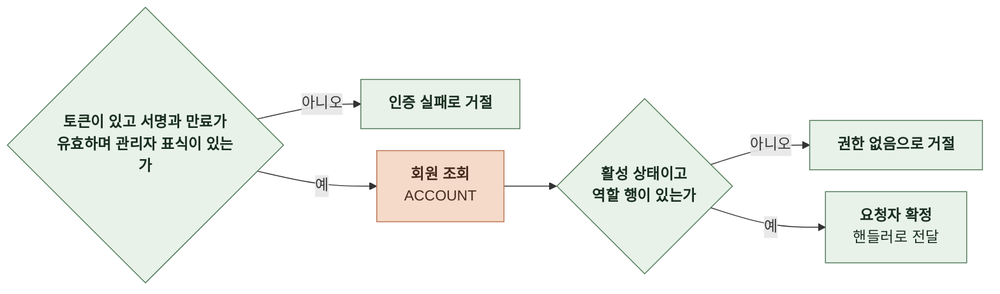
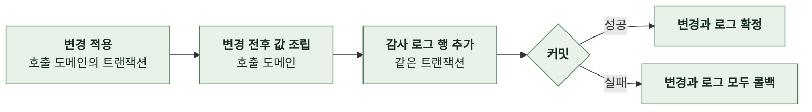
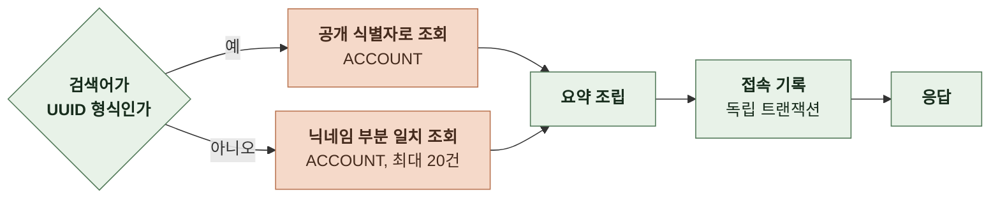

# 4-1 처리 흐름

이 문서는 ADMIN 도메인의 요청 수신부터 응답까지의 처리 단계와 다른 도메인의 관리자 API가 쓰는 판정과 감사 기록의 단계를 정한다.

요청 필드, 응답 필드와 실패 응답은 계약에, 토큰 수명과 복구 규칙은 오류 처리에, 트랜잭션 규칙은 동시성에 있다. ([4-2 계약](4-2-CONTRACT.md), [5-3 오류 처리](5-3-ERROR-HANDLING.md), [5-2 동시성](5-2-CONCURRENCY.md))

 

### 4-1-1 공통 처리

모든 요청은 상관관계 필터에서 요청 ID를 받는다. 관리자 로그인은 토큰을 읽지 않는다. 그 밖의 관리자 경로는 관리자 판정 필터가 요청자를 정한다. 앱 경로의 토큰 검증은 관리자 표식이 있는 토큰을 거절한다.

관리자 경로는 `/api/v1/admin/` 아래 전체다. 다른 도메인의 관리자 API도 같은 접두 아래에 두어 같은 필터를 거친다. 필터를 거치지 않는 관리자 경로는 없다.

관리자 판정은 토큰의 값으로 끝내지 않는다. 요청마다 토큰 주체의 회원 행을 읽어 관리자 역할과 계정 상태를 다시 확인한다.

흐름도에서 Google과 다른 도메인을 호출하는 단계는 주황색이다.

 

### 4-1-2 관리자 로그인

- 검증 실패와 자격 없음은 다른 상태로 응답하되 자격 없음 안에서 회원 없음, 역할 없음, 정지, 탈퇴는 구분하지 않는다.
- 계정을 만들지 않고 가입 보상, 체험 스냅샷, 세션 생성, 로그인 분석 이벤트도 수행하지 않는다.
- 로그인 결과는 구조화 로그로 남긴다. 성공은 회원 공개 식별자를 기록하고 실패는 사유 분류만 기록한다.

 

### 4-1-3 관리자 판정

관리자 판정 필터는 `/api/v1/admin/` 아래에서 로그인을 제외한 모든 요청에 실행된다.

- 앱 접근 토큰은 표식이 없어 첫 단계에서 거절된다. 유효한 관리자 토큰이라도 그 사이 역할이 회수되거나 계정이 정지되면 두 번째 단계에서 거절된다.
- 요청자는 회원 내부 ID로 확정해 핸들러와 감사 기록에 전달한다.

 

### 4-1-4 감사 기록

다른 도메인의 관리자 API가 변경을 적용한 뒤 같은 트랜잭션에서 호출한다. ADMIN의 회원 검색과 상세는 조회 뒤 접속 기록으로 호출한다.

- 변경 전후 값은 호출 도메인이 응답 구조와 같은 필드로 조립한다. 생성은 변경 전 값이 없고 삭제는 변경 후 값이 없다.
- 대상은 외부 식별자로 기록한다. 순차 PK를 넣지 않는다.
- 접속 기록은 조회 응답을 만든 뒤 독립 트랜잭션으로 기록한다. 기록에 실패하면 조회 응답도 실패로 바꾼다.

 

### 4-1-5 대시보드 요약

- 지표 정의는 제품 제약을 따른다. ([2-4 제품 제약](2-REQUIREMENTS.md#2-4-제품-제약))
- 오늘 범위는 요청 시작 때 한 번 계산해 모든 집계에 같은 값을 쓴다. 자정을 걸치는 요청에서 지표끼리 기준이 어긋나지 않게 한다.
- 집계는 읽기 전용이며 캐시하지 않는다.
- 팀 계정 제외 목록은 설정에서 읽어 모든 집계의 소유 회원 조건에 적용한다. 회원 검색과 상세, 감사 로그 조회에는 적용하지 않는다.

 

### 4-1-6 결제 내역

| 항목 | 규칙 |
|---|---|
| 대상 | 완료 시각이 있는 주문 대기 주문은 제외 |
| 정렬 | 요청한 열과 방향 같으면 주문 공개 식별자 오름차순 |
| 페이지 | 전체 건수 조회와 현재 페이지 조회를 각각 실행 건너뛸 행 수는 `(page - 1) × size` |

 

### 4-1-7 회원 검색과 상세

- 닉네임 검색은 대소문자와 공백을 무시한 정규화 키의 부분 일치다. 탈퇴 계정은 닉네임이 익명화되어 닉네임으로는 검색되지 않고 공개 식별자로만 검색된다.
- 상세는 요약에 잔액, 소유 스토리 수, 채팅 수, 가입 시각, 탈퇴 시각을 더한다. 잔액은 PAYMENT의 잔액 연산을 쓴다.
- 검색은 검색어를 대상으로 접속 기록을 남기고 상세는 회원 공개 식별자를 대상으로 접속 기록을 남긴다.

 

### 4-1-8 감사 로그 조회

- 정렬은 기록 시각이며 같으면 감사 로그 공개 식별자 오름차순이다. 페이지 규칙은 결제 내역과 같다.
- 감사 로그 조회 자체는 접속 기록을 남기지 않는다.
