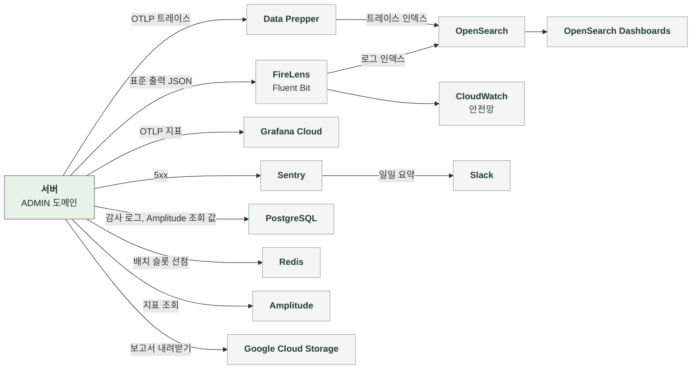

# 5-4 관측

이 문서는 ADMIN 도메인의 관측 스택, 요청을 추적할 식별자, 구조화 로그 이벤트, 오류 확인 위치, 지표, 트레이스, 알림, 수집 조건을 정한다.

비밀값과 개인정보 취급 규칙은 보안에 있으며 오류 로그 수준은 오류 처리에 있다. ([5-1-6 비밀값과 개인정보](5-1-SECURITY.md#5-1-6-비밀값과-개인정보)와 [5-3-8 로그와 Sentry](5-3-ERROR-HANDLING.md#5-3-8-로그와-sentry))

<br>

### 5-4-1 관측 스택



관리자의 변경과 조회 이력은 로그가 아니라 감사 로그 테이블이 원본이다. 관리자 페이지의 감사 로그 화면으로 본다.

<br>

### 5-4-2 상관관계 식별자

상관관계 필터는 모든 요청의 MDC에 다음 값을 기록한다. 로그와 Sentry는 같은 식별자 값을 사용한다.

| MDC 필드 | 값 | 규칙 |
|---|---|---|
| `request_id` | `req_` + UUID | 요청 헤더 값이 1~64자이고 영문, 숫자, 하이픈, 밑줄만이면 그대로 쓰고 없거나 조건에 어긋나면 새로 생성<br>응답 헤더로 반환하고 감사 로그에 같은 값을 저장 |
| `session_id` | `X-Manyak-Session-Id` | 관리자 페이지는 보내지 않아 `unknown` |
| `sentry_event_id` | Sentry 이벤트 ID | 5xx를 Sentry로 보낸 요청만 |
| `traceId`<br>`spanId` | 현재 스팬 | 트레이스 전송을 비활성화해도 생성해 로그에 포함 |

| 식별자 | 기록 위치 | 연결 대상 |
|---|---|---|
| `request_id` | 로그 MDC, Sentry 태그, 감사 로그 `request_id` | 한 요청의 로그와 그 요청이 남긴 감사 로그 |
| 관리자 공개 식별자 | 로그인 로그 `admin_public_id` | 관리자 |
| 감사 로그 공개 식별자 | 감사 로그 조회 응답 | 감사 로그 1행 |

<br>

### 5-4-3 구조화 로그 이벤트

구조화 로그는 `event_name`을 맨 앞에 둔 JSON 형식으로 INFO 수준에 기록한다. 이벤트 이름은 snake_case다. `prod`, `dev`, `jsonlog` 프로파일에서만 JSON 형식을 쓴다. 그 외에는 콘솔 패턴을 쓴다. JSON에는 `service=manyak-server`가 포함된다. 인코더는 MDC 값을 최상위 필드에 기록한다.

| 단위 | 기록 시점과 이름 | 기록 내용 |
|---|---|---|
| 모든 API 요청 | 응답 종료<br>`api_request_completed`<br>5xx는 `api_request_failed` | `endpoint`, `http_method`, `status_code`, `duration_ms`<br>실패 시 예외 클래스 이름 또는 상태 이름을 `error_code`로 추가 |
| 관리자 로그인 성공 | 토큰 발급 뒤<br>`admin_login_succeeded` | `admin_public_id` |
| 관리자 로그인 거절 | 자격 없음 판정<br>`admin_login_rejected` | `reason` = `no_member`, `no_role`, `suspended`, `deleted`<br>회원 식별자 없음 |
| 관리자 판정 거절 | 필터의 403<br>평문 WARN `admin_access_denied` | `endpoint`, `reason` = `no_role`, `suspended`, `deleted`, `no_member`, `admin_public_id` |
| 앱 경로의 관리자 토큰 | 앱 토큰 검증 보강의 401<br>평문 WARN | `endpoint` |
| 접속 기록 실패 | 독립 트랜잭션 예외<br>평문 WARN | 작업 이름<br>예외 클래스 |
| 분석 도구 호출 실패 | 세분화, 퍼널, 리텐션, 평균 세션 길이, 세션 길이 분포 조회 실패와 비용 예산 부족<br>평문 WARN `admin_analytics_fetch_failed`<br>쿨다운 중 건너뛴 요청은 기록하지 않음 | `reason` = `no_credentials`, `http_error`, `rate_limited`, `budget_exceeded`, `timeout`, `parse_error`(응답이 계약과 다른 형식, 퍼널의 `data` 누락이나 단계 수 불일치, 세션 길이 분포의 구간 수나 경계 불일치), HTTP 상태, `endpoint`(분석 지표와 캠페인, 사용자, 전환, 기능 지표의 엔드포인트 경로)<br>응답 본문과 키는 기록하지 않음 |
| 분석 값 갱신 | 분석 도구를 호출한 백그라운드 갱신이나 배치와 백필의 갱신이 끝날 때<br>요청이 대기를 먼저 끝내도 갱신이 끝날 때 한 번<br>`admin_analytics_refreshed`<br>갱신을 시작하지 않은 요청과 조회를 보내지 않은 갱신은 기록하지 않음 | `endpoint`, `queries`(보낸 조회 수), `fetched_days`(받은 날짜 수, 범위 지표는 0 또는 1), `reused_days`(저장 값으로 채운 날짜 수), `pending_days`(갱신이 끝난 때의 준비 중 날짜 수), `cost`(남긴 비용), `finalized_rows`(이번에 확정한 행 수), `duration_ms`(갱신 시작부터 끝까지이며 요청의 응답 시간과 다름)<br>값과 매개변수 원문은 기록하지 않음 |
| 분석 값 저장 실패 | 저장 트랜잭션 예외<br>평문 WARN `admin_analytics_store_failed` | `endpoint`, `metric`, 예외 클래스 |
| 분석 값 갱신 예외 | 백그라운드 갱신에서 Amplitude 호출 실패가 아닌 예상 밖 예외(저장소 읽기 실패 등)<br>평문 WARN `admin_analytics_refresh_failed`<br>기다리는 요청이 없으면 이 로그가 유일한 흔적 | `endpoint`, `exception`(예외 클래스 이름) |
| 분석 값 배치 | 슬롯을 잡은 배치 실행이 끝날 때<br>`admin_analytics_backfill`<br>슬롯을 잡지 못했거나 할 일이 없던 실행은 기록하지 않음 | `phase` = `nightly`, `backfill`<br>`result` = `done`(남은 날짜 없음), `partial`(다음 실행에서 이어 받음), `failed`, `skipped`<br>`reason` = 끝낸 사유이며 `budget_share`(배치 몫 소진), `rate_limited`, `http_error`, `timeout`, `no_credentials`, `claim_failed`<br>`keys`(처리한 기본 지표 키 수), `fetched_days`, `remaining_days`(그 단계에 남은 비어 있는 날짜 수), `cost`, `duration_ms` |
| 설치 보고서 실패 | 보고서 내려받기 또는 해석 실패<br>평문 WARN `admin_play_stats_fetch_failed`<br>쿨다운 중 건너뛴 요청은 기록하지 않음 | `reason` = `no_credentials`, `http_error`, `no_reports`, `timeout`, `parse_error`<br>`status` = 저장소 응답의 HTTP 상태이며 응답이 없으면 `null`<br>키 해석 실패와 연결 실패는 상태 없는 `http_error`<br>객체 이름, 파일 내용, 키는 기록하지 않음 |
| 인프라 지표 실패 | CloudWatch나 ECS 호출 실패와 설정 없음<br>평문 WARN `admin_infra_metrics_fetch_failed`<br>쿨다운 중 건너뛴 요청은 기록하지 않음 | `reason` = `not_configured`, `access_denied`, `throttled`, `timeout`, `incomplete`, `aws_error`<br>`incomplete`는 `GetMetricData` 질의 결과가 `Complete`가 아니거나 오류 메시지가 있음<br>`service` = `cloudwatch`, `ecs`이며 설정 없음은 `null`<br>`error_code` = AWS 오류 코드, `incomplete`면 결과의 `StatusCode`나 메시지 코드이며 없으면 `null` |
| AI 비용 조회 실패 | Langfuse 호출 실패와 설정 없음<br>평문 WARN `admin_ai_cost_fetch_failed`<br>화면 요청과 배치 저장의 실패 모두<br>쿨다운 중 건너뛴 요청은 기록하지 않음 | `reason` = `not_configured`, `http_error`, `rate_limited`, `timeout`, `parse_error`<br>`status` = Langfuse 응답의 HTTP 상태이며 응답이 없으면 `null`<br>키와 응답 본문은 기록하지 않음 |

<details>
<summary><b>로그인 거절 로그 1줄 예시</b></summary>

<br>

예시에는 가상 값을 썼다. 로그 프레임워크가 붙이는 필드는 생략했다.

```json
{"@timestamp":"2026-10-21T01:23:45.678Z","message":"event_name=admin_login_rejected, reason=no_role","level":"INFO","request_id":"req_0f1e2d3c4b5a69788796a5b4c3d2e1f0","session_id":"unknown","traceId":"4bf92f3577b34da6a3ce929d0e0e4736","spanId":"00f067aa0ba902b7","event_name":"admin_login_rejected","reason":"no_role","service":"manyak-server"}
```

</details>

<br>

### 5-4-4 오류 확인

| 기능 | 오류 조회 위치 |
|---|---|
| 관리자 로그인 | 로그 `admin_login_rejected`의 `reason` 분포<br>요청 로그의 `/api/v1/admin/auth/login/google` 401과 403 비율 |
| 권한 판정 | 로그 `admin_access_denied`<br>요청 로그의 `/api/v1/admin/` 접두 경로 401과 403 비율 |
| 운영 작업 | 감사 로그 조회<br>실패한 요청은 감사 로그에 없고 요청 로그에만 있음 |
| 대시보드 | 요청 로그의 `/api/v1/admin/dashboard/summary`와 `/api/v1/admin/dashboard/charts` 500 비율<br>`duration_ms` |
| 목록과 상세 | 요청 로그의 `/api/v1/admin/stories`, `/api/v1/admin/chats`, `/api/v1/admin/members`, `/api/v1/admin/payments/orders` 접두 경로의 400 비율과 `duration_ms`<br>회원 목록의 누적 턴 수 정렬은 걸러진 회원 전체를 세므로 `/api/v1/admin/members`의 `duration_ms`가 늘면 정렬 쿼리 계획 확인 |
| 접속 기록 | 접속 기록 실패 WARN |
| 분석 지표 | `admin_analytics_fetch_failed`의 `reason` 분포<br>요청 로그의 `/api/v1/admin/dashboard/analytics` 503 비율<br>`admin_analytics_refreshed`의 `pending_days`가 줄지 않으면 예산 경쟁이나 반복 실패<br>요청 로그의 `duration_ms`가 10초를 넘는 요청이 반복되면 요청 대기 설정이나 백그라운드 갱신 실행 이상 |
| 캠페인 분석 | `admin_analytics_fetch_failed`의 `budget_exceeded` 빈도<br>요청 로그의 `/api/v1/admin/campaigns/` 접두 경로 503 비율과 `duration_ms` |
| 사용자, 전환, 기능 지표 | 요청 로그의 `/api/v1/admin/users/`, `/api/v1/admin/conversion/`, `/api/v1/admin/quality/` 접두 경로 503과 500 비율, `duration_ms` |
| 분석 값 배치 | `admin_analytics_backfill`의 `phase`별 `result`와 `remaining_days`<br>`nightly`가 그날 `done`에 이르지 않거나 `backfill`의 `remaining_days`가 줄지 않으면 배치 몫 경쟁이나 반복 실패 |
| 설치 지표 | `admin_play_stats_fetch_failed`의 `reason` 분포<br>요청 로그의 `/api/v1/admin/dashboard/play-installs` 503 비율 |
| 인프라 지표 | `admin_infra_metrics_fetch_failed`의 `reason` 분포<br>요청 로그의 `/api/v1/admin/infra/metrics` 503 비율과 `/api/v1/admin/infra/db-tables`의 `duration_ms` |
| AI 비용 | `admin_ai_cost_fetch_failed`의 `reason` 분포<br>요청 로그의 `/api/v1/admin/quality/ai-cost` 503 비율<br>`unmapped`에 이름이 반복되면 추적 이름 매핑 점검 |

<br>

### 5-4-5 지표

ADMIN 전용 지표는 없다. 요청률, 오류율, 응답 시간은 공통 HTTP 지표로 본다.

| 지표 | 종류와 태그 | 의미 |
|---|---|---|
| `http.server.requests` | Timer<br>`uri`, `method`, `status`, `outcome` | 관리자 경로의 요청률, 401과 403 비율, 대시보드와 목록 응답 시간 |

| 항목 | 기준과 제한 |
|---|---|
| 전송 여부 | 지표 전송을 켠 환경에서만 Grafana Cloud로 전송 |
| 전송 주기 | 60초 간격 |

<br>

### 5-4-6 트레이스

| 항목 | 내용 |
|---|---|
| 활성화와 표본 | 환경 변수로 켜며 기본값은 비활성 |
| 스팬 | HTTP 요청 아래에 JDBC(QUERY만 포함하며 바인딩 값 제외) 스팬<br>대시보드는 집계 쿼리마다, 목록은 전체 건수와 페이지 쿼리마다 JDBC 스팬 |
| 제외 | actuator 요청, Spring Security 내부 관측, 요청 밖 루트 DB 관측은 노이즈 필터가 제외 |

<br>

### 5-4-7 알림

| 항목 | 기준 |
|---|---|
| 정기 보고 | 매일 오전 10시(KST)<br>지난 24시간 동안 발생한 운영 Sentry 오류 요약 |
| ADMIN에서 수집하는 오류 | 500 예상하지 못한 예외<br>감사 기록 실패로 인한 500<br>401과 403 거절은 Sentry에 없어 보고에 포함되지 않음 |
| 지표 기반 알림 | ADMIN 전용 규칙 없음 |

<br>

### 5-4-8 수집 조건과 실패 처리

**1. 데이터 범위**

| 데이터 | 현재 기록 방식 |
|---|---|
| 신원 증명<br>관리자 토큰<br>분석 도구 API 키와 시크릿 키<br>Play 서비스 계정 키 | 로그, Sentry, 트레이스에 기록하지 않음 |
| 사유 | 감사 로그에만<br>로그에 기록하지 않음 |
| 변경 전후 값 | 감사 로그에만 |
| 검색어 | 감사 로그의 대상 식별자에만<br>로그에 기록하지 않음<br>요청 로그 `endpoint`는 쿼리 문자열을 포함하지 않음 |
| 채팅 메시지 원문 | 조회하지 않으므로 로그, 응답, 트레이스에 없음 |
| 관리자 식별자 | 로그에는 공개 식별자 |
| 요청 경로 | 요청 로그 `endpoint`와 Sentry breadcrumb에 기록<br>경로에 비밀값 없음 |
| Sentry 요청 필드 | 관리자 로그인 경로의 본문, 헤더, 쿠키, 쿼리 제거<br>그 외 경로는 기본 수집 |
| Sentry 이벤트 | 5xx만 캡처<br>기본 개인정보 수집 비활성화 |

<br>

**2. 수집 실패**

| 상황 | 처리 |
|---|---|
| 감사 기록 실패 | 변경과 함께 롤백<br>실패한 요청은 요청 로그와 Sentry에 남음 |
| 접속 기록 실패 | WARN 기록 뒤 500 응답 |
| 지표 전송 실패 | SDK로 배치 전송<br>실패분은 유실 |
| Sentry 캡처 실패 | SDK 내부에서 처리<br>DSN 없는 환경은 no-op |
| 미수집과 누락 | 수집 비활성화, 기록 실패, 전송 유실을 구분<br>감사 로그가 없다는 이유만으로 변경이 없었다고 판단하지 않고 요청 로그를 함께 봄 |
