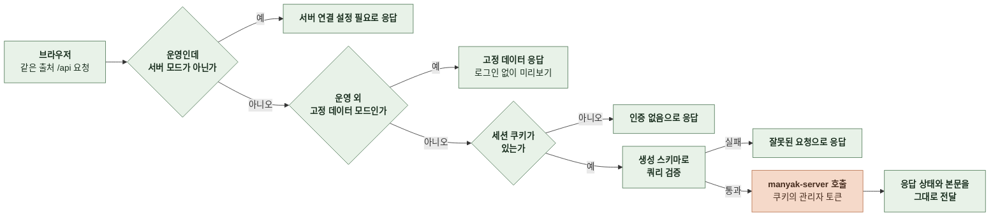

# 3-2 데이터 연동

이 문서는 관리자 웹이 지표와 목록 데이터를 받아 두고 다시 요청하는 방식, BFF의 검증과 전달, 데이터 모드를 정한다.

캐시 수명과 키는 상태 관리에, 경로와 쿼리는 계약에, 실패의 표시는 오류 처리에 있다. ([2-5-2 서버 상태](2-5-STATE-MANAGEMENT.md#2-5-2-서버-상태), [3-1 계약](3-1-CONTRACT.md), [4-1 오류 처리](4-1-ERROR-HANDLING.md))

 

### 3-2-1 조회

| 항목 | 규칙 |
|---|---|
| 요청 시점 | 화면이나 탭이 보일 때 지표 화면은 현재 탭의 요청만 보냄 |
| 요청 막음 | 기간 오류, 비어 있는 필수 조건(광고 캠페인, 대상 스토리)이면 보내지 않음 |
| 탭 사이 | 탭을 바꾸면 앞 탭의 응답은 캐시에 남고 다시 돌아오면 신선 기간 안에서는 다시 요청하지 않음 |
| 개요 | 요약, 차트, 오늘 활성 사용자, 앱 설치를 따로 요청 하나가 실패해도 나머지를 그림 기간을 바꾸면 오늘 활성 사용자와 앱 설치는 다시 요청하지 않음 |
| 캠페인 목록 | 유입 분석 화면을 열 때 한 번 요청 캠페인 추이와 퍼널 탭은 목록으로 기본 캠페인과 기본 기간을 정한 뒤 요청 유입 소스 탭과 앱 설치 탭은 목록을 기다리지 않고 요청 |

 

### 3-2-2 준비 중 재요청

| 응답 | 재요청 |
|---|---|
| `pendingDates`가 비어 있지 않음 | 같은 요청을 60초 간격으로 다시 보냄 |
| 개요 오늘 활성 사용자 카드의 `todayActiveUsers`가 `null` | 같음 |
| 사용자 활동의 `monthlyActiveUsers`가 `null` | 같음 |
| 위 조건이 모두 풀림 | 재요청 멈춤 |
| 탭을 떠남 | 재요청 멈춤 |

- 재요청은 화면을 비우지 않는다. 새 응답이 오면 값을 바꾸고 준비 중 알림의 개수를 줄인다.

 

### 3-2-3 BFF

| 항목 | 규칙 |
|---|---|
| 검증 | 서버 OpenAPI에서 생성한 스키마로 경로와 쿼리를 검증 직접 쓴 스키마로 서버 계약을 검증하지 않음 |
| 전달 | 서버의 상태와 본문을 바꾸지 않고 전달 |
| 서버 401 | 쿠키를 지우고 화면을 로그인으로 보냄 |
| OpenAPI에 없는 경로 | 서버 모드에서 "지원하지 않는 경로입니다." 문구로 없는 경로 응답 서버 API가 아직 없다고 표시해 둔 경로는 "서버 미구현" 문구로 사용 불가 응답 |
| 운영의 데이터 모드 | 서버 모드만 다른 값이면 모든 데이터 요청을 "서버 연결 설정 필요"로 사용 불가 응답 |

 

### 3-2-4 데이터 모드

| 모드 | 동작 |
|---|---|
| 서버 | BFF가 manyak-server로 전달 |
| 고정 데이터 | 운영 외 환경에서만 저장소의 가상 데이터로 응답하고 로그인 없이 미리보기 |

- 고정 데이터는 서버 계약과 같은 구조를 쓴다. 지표 화면의 고정 데이터에는 준비 중 날짜가 있는 응답, `null` 값이 있는 응답, 사용 불가 응답을 하나씩 둔다. 인프라 지표의 고정 데이터에는 묶음 하나가 `null`인 응답을 둔다.
