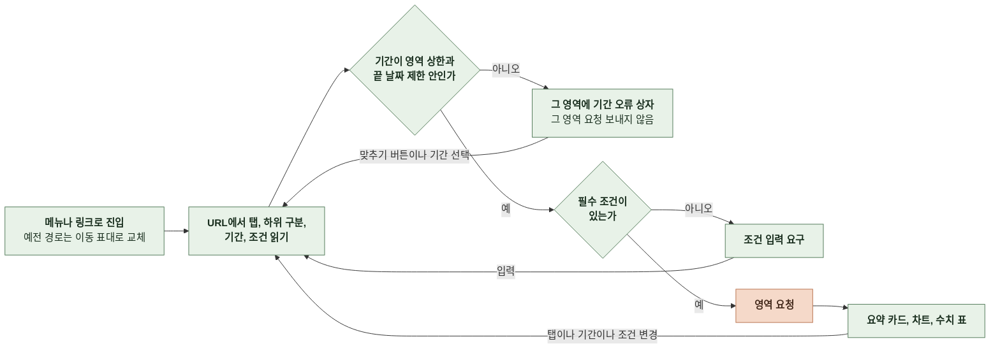
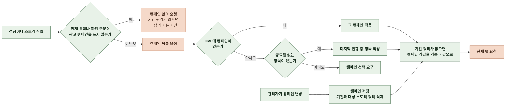
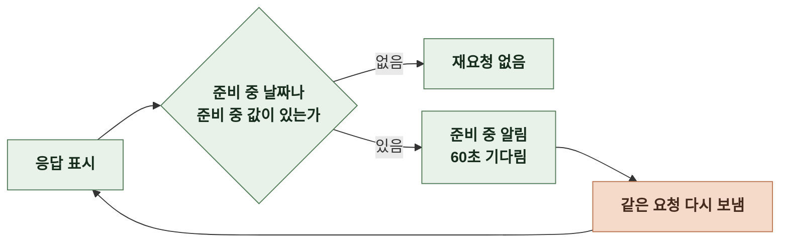
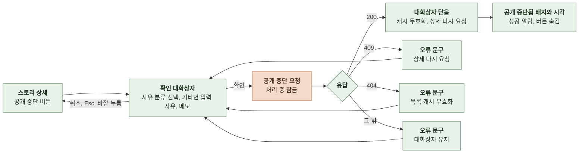
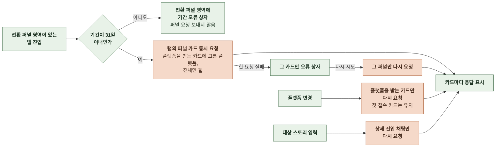

# 3-4 상호작용 흐름

이 문서는 관리자가 지표 화면에 들어와 탭과 기간과 조건을 바꾸고 준비 중 값을 기다리며 목록으로 이동하는 흐름, 전환 퍼널 카드를 불러오는 흐름, 스토리를 공개 중단하는 흐름과 분기를 정한다.

화면별 기본값과 상한은 정보 구조에, URL 쿼리의 변경 규칙은 상태 관리에, 상태별 문구는 오류 처리에 있다. ([2-1 정보 구조](2-1-INFORMATION-ARCHITECTURE.md), [2-5-1 URL 상태](2-5-STATE-MANAGEMENT.md#2-5-1-url-상태), [4-1 오류 처리](4-1-ERROR-HANDLING.md))

 

### 3-4-1 지표 화면 진입과 탭 전환

| 분기 | 처리 |
|---|---|
| 상한 초과의 맞추기 버튼 | 끝 날짜를 두고 시작 날짜를 상한에 맞춰 당김 |
| 리텐션의 끝 날짜가 오늘 | 맞추기 버튼이 끝 날짜를 어제로 바꾸고 상한 안으로 시작 날짜를 맞춤 |
| 영역마다 판정 | 기간 판정과 요청은 영역마다 하고 상한 안의 영역은 그대로 요청 |
| 필수 조건 | 캠페인 추이, 간편 제작 퍼널, 상세 진입 퍼널의 광고 캠페인과 상세 진입 퍼널의 대상 스토리 |
| 빈 대상 스토리 입력 | 채팅 참여의 상세 진입 채팅 카드는 모든 스토리로 요청 |
| 잘못된 스토리 공개 식별자 | 입력 칸 아래 오류 문구를 두고 요청하지 않음 |

 

### 3-4-2 광고 캠페인 선택

 

### 3-4-3 준비 중 값 기다리기

- 탭이나 화면을 떠나면 재요청을 멈춘다. 다시 돌아오면 같은 흐름으로 다시 시작한다.

 

### 3-4-4 목록으로 이동

| 출발 | 동작 | 도착 |
|---|---|---|
| 개요 요약 카드 | 카드를 누름 | 카드의 관련 목록 오늘 활성 사용자 카드는 성장 화면의 활동 탭 앱 설치 카드는 성장 화면의 앱 설치 탭 |
| 개요와 결제의 일별 추이 | 그래프의 점이나 수치 표의 링크 | 그 지표와 그날 조건의 관련 목록 |
| 분포 카드 | 막대, 점, 조각, 숫자 칸이나 수치 표의 링크 | 응답의 목록 조건으로 연 목록 |
| 신규 가입자 차트 | 점이나 수치 표의 링크 | 그날 가입한 회원 목록 |
| 이프 내역의 회원 | 닉네임 | 회원 상세 |
| 성장, 스토리, 채팅, 결제 화면 제목 옆 링크 | 링크를 누름 | 같은 도메인의 관리 목록, 쿼리 없음 |
| 회원, 스토리, 채팅, 결제 목록 제목 옆 링크 | 링크를 누름 | 같은 도메인의 지표 화면 기본 탭, 쿼리 없음 |

- 목록에서 뒤로 가기를 누르면 떠날 때의 탭, 기간, 조건으로 돌아온다.
- 요약 카드, 일별 추이, 분포 카드에서 연 목록에는 `deleted`를 넣지 않아 삭제 필터가 제외인 채로 열린다. 차트와 같은 대상을 보이기 위해서다.

 

### 3-4-5 스토리 공개 중단

| 분기 | 처리 |
|---|---|
| 409 뒤 | 다시 받은 상세가 공개 중단됐거나 삭제됐으면 버튼이 사라짐 대화상자는 열린 채 오류 문구를 보이고 관리자가 닫음 |
| 404 뒤 | 상세는 다시 요청하지 않고 대화상자에 오류 문구를 보임 관리자가 닫고 스토리 목록에서 다시 확인 |
| 사유 분류 변경 | 기타에서 다른 분류로 바꾸면 입력 사유 칸이 사라지고 값을 버림 기타로 다시 고르면 빈 칸 |
| 그 밖의 실패 | 고른 사유 분류, 입력 사유, 메모를 유지해 같은 내용으로 다시 확인할 수 있음 |
| 처리 중 | 취소, Esc, 바깥 누름으로 닫히지 않음 |

 

### 3-4-6 전환 퍼널 카드

| 분기 | 처리 |
|---|---|
| 기간 변경 | 탭의 퍼널 카드를 모두 다시 요청 |
| 플랫폼 전체와 웹 사이 변경 | 플랫폼을 받는 카드의 요청이 같아 다시 요청하지 않음 |
| 일부 카드 실패 | 받은 카드는 그대로 두고 실패한 카드만 오류 상자와 다시 시도 버튼 |
| 잘못된 대상 스토리 | 상세 진입 채팅 카드의 입력 칸 아래 오류 문구, 그 카드만 요청하지 않음 |
| 서버의 비용 예산 부족 | 그 카드만 분석 도구 사용 불가로 보이고 다시 시도로 다시 요청 |
