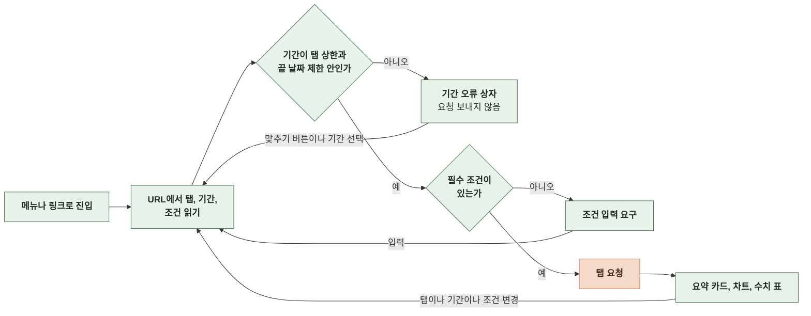
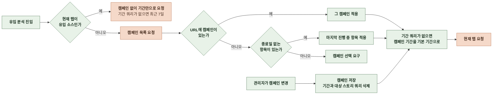
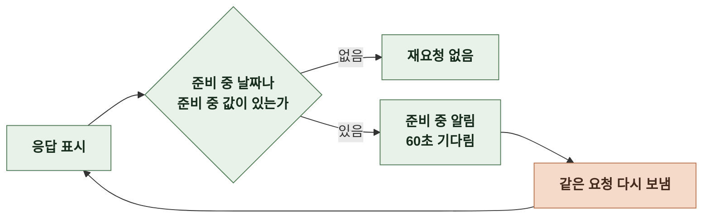

# 3-4 상호작용 흐름

이 문서는 관리자가 지표 화면에 들어와 탭과 기간과 조건을 바꾸고 준비 중 값을 기다리며 목록으로 이동하는 흐름과 분기를 정한다.

화면별 기본값과 상한은 정보 구조에, URL 쿼리의 변경 규칙은 상태 관리에, 상태별 문구는 오류 처리에 있다. ([2-1 정보 구조](2-1-INFORMATION-ARCHITECTURE.md), [2-5-1 URL 상태](2-5-STATE-MANAGEMENT.md#2-5-1-url-상태), [4-1 오류 처리](4-1-ERROR-HANDLING.md))

 

### 3-4-1 지표 화면 진입과 탭 전환

| 분기 | 처리 |
|---|---|
| 상한 초과의 맞추기 버튼 | 끝 날짜를 두고 시작 날짜를 상한에 맞춰 당김 |
| 리텐션의 끝 날짜가 오늘 | 맞추기 버튼이 끝 날짜를 어제로 바꾸고 상한 안으로 시작 날짜를 맞춤 |
| 필수 조건 | 유입 분석의 광고 캠페인과 상세 진입 퍼널의 대상 스토리 |
| 빈 대상 스토리 입력 | 전환의 상세 진입 채팅은 모든 스토리로 요청 |
| 잘못된 스토리 공개 식별자 | 입력 칸 아래 오류 문구를 두고 요청하지 않음 |

 

### 3-4-2 광고 캠페인 선택

 

### 3-4-3 준비 중 값 기다리기

- 탭이나 화면을 떠나면 재요청을 멈춘다. 다시 돌아오면 같은 흐름으로 다시 시작한다.

 

### 3-4-4 목록으로 이동

| 출발 | 동작 | 도착 |
|---|---|---|
| 개요 요약 카드 | 카드를 누름 | 카드의 관련 목록 |
| 개요 일별 추이 | 점이나 수치 표의 링크 | 그날 조건의 관련 목록 |
| 분석 분포 차트 | 막대, 점, 조각이나 수치 표의 링크 | 응답의 목록 조건으로 연 목록 |
| 신규 가입자 차트 | 점이나 수치 표의 링크 | 그날 가입한 회원 목록 |
| 이프 내역의 회원 | 닉네임 | 회원 상세 |

- 목록에서 뒤로 가기를 누르면 떠날 때의 탭, 기간, 조건으로 돌아온다.
