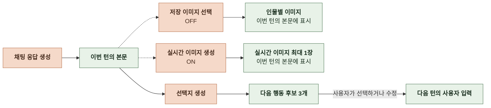
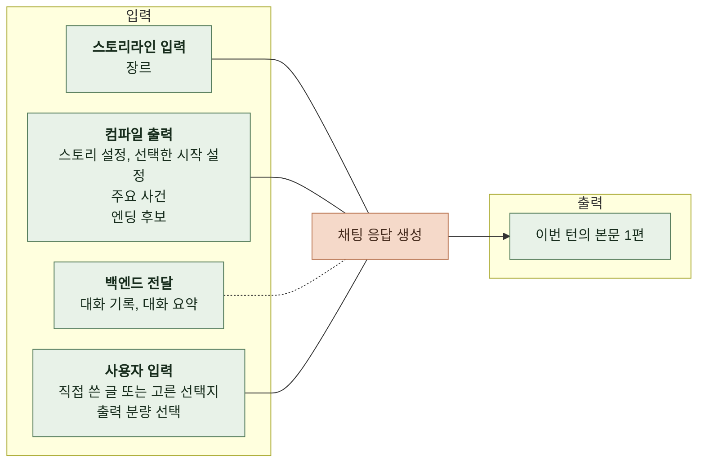
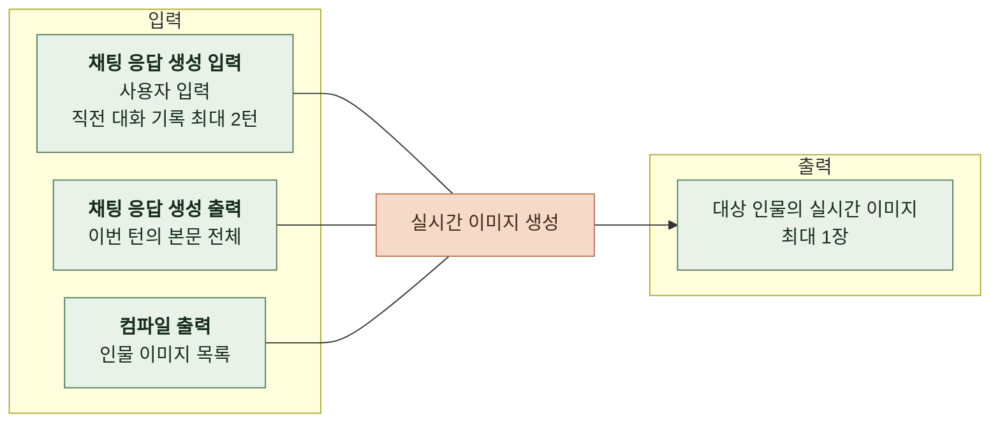
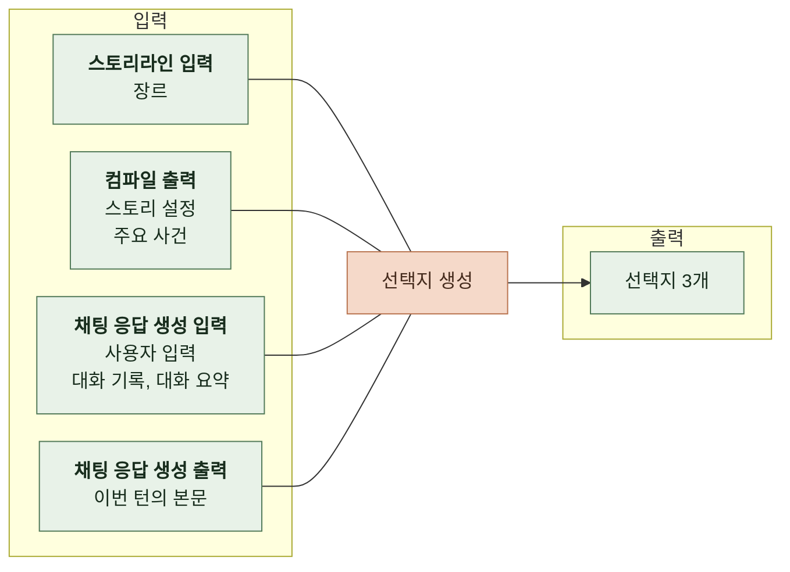
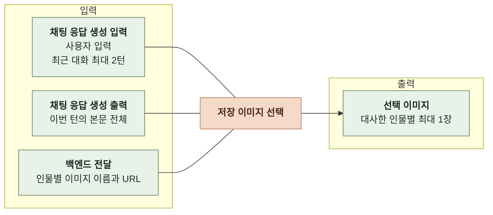
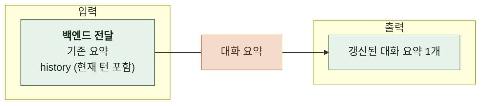

# 3. 태스크 정의

본 문서는 채팅의 사용자 기대와 운영 요구사항을 AI가 수행할 과제로 구체화한다.

본문 생성, 실시간 이미지 생성, 선택지 생성, 저장 이미지 선택과 대화 요약의 입력, 출력과 적용 조건을 정의한다.

 

### 3-1 전체 흐름

 

### 3-2 채팅 응답 생성

 

**1. 입력**

| 항목 | 출처 | 필수 여부 | 비어 있을 때 |
|---|---|---|---|
| 장르 | 스토리라인 생성 입력 | 필수 | - |
| 스토리 설정   세계관, 주변 인물, 주인공, 전개 규칙 | 스토리 컴파일 출력 | 필수 | - |
| 시작 설정   이름, 시작 상황, 프롤로그 | 스토리 컴파일 출력 중 사용자가 고른 시작 설정 | 필수 | - |
| 대화 기록 | 백엔드가 전달한 아직 요약하지 않은 이전 대화 원문 | 선택 | 원문 대화 기록 없이 나머지 입력을 사용함 |
| 대화 요약 | 백엔드가 전달한 완료된 기존 요약 | 선택 | 요약 없이 생성함 |
| 사용자 입력 | 사용자가 직접 쓴 글 또는 고른 선택지 | 필수 | - |
| 출력 분량 선택 | 사용자가 고른 짧은 응답 또는 긴 응답 | 선택 | 짧은 응답으로 생성함 |
| 주요 사건   이름, 설명, 키 문장 | 스토리 컴파일 출력 | 선택 | 주요 사건 없이 생성함 |
| 엔딩 후보   이름, 엔딩 조건, 엔딩 에필로그 | 스토리 컴파일 출력 중 백엔드가 전달한 후보 | 선택 | 엔딩 후보 없음 |

 

**2. 출력**

| 항목 | 설명 |
|---|---|
| 이번 턴의 본문 1편 | 사용자 입력에 이어지는 상황 설명과 주변 인물의 대사   모델이 엔딩 조건을 충족했다고 판단하면 해당 엔딩의 결말을 담음 |

 

### 3-3 실시간 이미지 생성

 

**1. 입력**

| 항목 | 출처 | 용도 |
|---|---|---|
| 이번 턴의 본문 전체 | 채팅 응답 생성 출력 | 대상 인물 선정 이미지 모델에는 본문 시작부터 대상 인물의 첫 대사 줄 끝까지 전달 |
| 사용자 입력 | 이번 턴의 채팅 응답 생성 입력 | 현재 장면의 맥락 |
| 직전 대화 기록 최대 2턴 | 이번 턴의 채팅 응답 생성 입력에 포함된 대화 기록 | 사용자 입력과 AI 본문이 짝을 이룬 최근 대화   짝이 없는 오프닝이나 메시지는 제외함 |
| 인물 이미지 목록 | 스토리 컴파일 출력의 인물 이미지 | 대상 인물의 기본 이미지를 골라 외형의 기준으로 사용함 |

 

**2. 출력**

| 항목 | 설명 |
|---|---|
| 대상 인물의 실시간 이미지 | 기본 이미지가 있는 인물 중 이번 본문에서 가장 먼저 말한 인물의 이미지   턴마다 최대 1장   해당 인물의 첫 대사 앞에 기본 이미지 대신 표시함 |

 

### 3-4 선택지 생성

 

**1. 입력**

| 항목 | 출처 | 필수 여부 | 비어 있을 때 |
|---|---|---|---|
| 장르 | 스토리라인 생성 입력 | 필수 | - |
| 스토리 설정   세계관, 주변 인물, 주인공, 전개 규칙 | 스토리 컴파일 출력 | 필수 | - |
| 대화 기록 | 백엔드가 전달한 아직 요약하지 않은 이번 턴 이전의 대화 원문 | 선택 | 원문 대화 기록 없이 나머지 입력을 사용함 |
| 대화 요약 | 백엔드가 전달한 완료된 기존 요약 | 선택 | 요약 없이 생성함 |
| 사용자 입력 | 이번 턴의 채팅 응답 생성 입력 | 필수 | - |
| 이번 턴의 본문 | 채팅 응답 생성 출력 | 필수 | - |
| 주요 사건 | 스토리 컴파일 출력 | 선택 | 특정 사건과 무관한 행동을 제안함 |

 

**2. 출력**

| 항목 | 설명 |
|---|---|
| 사건 진행 선택지 1개 | 주요 사건 중 지금 맥락에 가장 자연스러운 사건으로 이어지는 행동 |
| 다른 사건 선택지 1개 | 대화로 보아 아직 일어나지 않았고 사건 진행 선택지와 다른 주요 사건으로 이어지는 행동 |
| 자유 맥락 선택지 1개 | 현재 장면의 인물과 분위기에 맞는 행동   주요 사건과 무관해도 됨 |

 

### 3-5 저장 이미지 선택

실시간 이미지 OFF인 턴에 대화 상황과 인물의 표정에 맞는 저장 이미지를 고른다.

 

**1. 입력**

| 항목 | 출처 | 용도 |
|---|---|---|
| 이번 턴의 본문 전체 | 채팅 응답 생성 출력 | 대사한 인물과 현재 장면 판단 |
| 사용자 입력과 직전 대화 최대 2턴 | 채팅 응답 생성 입력 | 장면과 감정의 흐름 파악 |
| 인물별 이미지 이름과 URL | 백엔드가 전달한 저장 이미지 목록 | 이름으로 후보를 고르고 URL로 본문에 연결 |

 

**2. 출력**

| 항목 | 설명 |
|---|---|
| 대사한 인물별 이미지 최대 1장 | 각 인물의 첫 대사 앞에 표시 선택 실패 시 기본 이미지, 기본 이미지가 없으면 URL이 있는 해당 인물의 첫 이미지 사용 |

 

### 3-6 대화 요약

 

**1. 입력**

| 항목 | 출처 | 필수 여부 | 비어 있을 때 |
|---|---|---|---|
| 기존 대화 요약 | 백엔드가 전달한 이전 요약 | 선택 | 대화 원문만으로 요약함 |
| history | 백엔드가 전달한 아직 요약하지 않은 대화 원문 방금 완료한 턴의 사용자 입력과 AI 응답 포함 | 필수 | - |

 

**2. 출력**

| 항목 | 설명 |
|---|---|
| 대화 요약 1개 | 기존 요약과 대화 원문을 합쳐 스토리 전개, 단서와 사용자가 말한 내용을 정리 |
