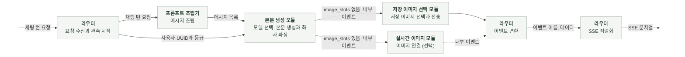
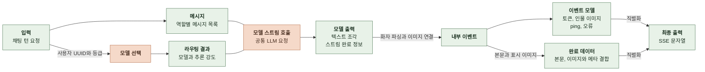
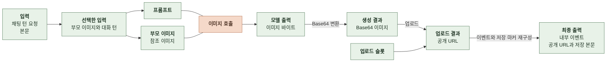
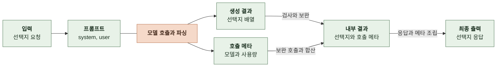
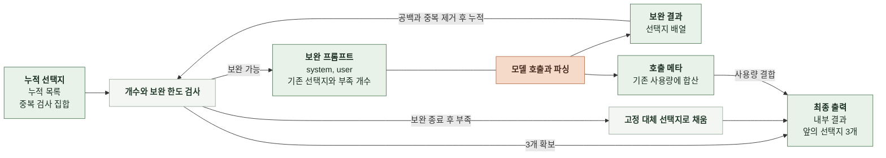

```mermaid
%%{init: {"themeVariables": {"fontSize": "18px"}, "flowchart": {"curve": "linear", "htmlLabels": true, "nodeSpacing": 24, "rankSpacing": 48}}}%%
flowchart LR
    I[" "] -->|"내부 이벤트, 채팅 턴 요청"| A["<b>실시간 이미지 연결</b><br/>본문 수집"]
    A -->|"요청 필드, 본문"| B["<b>이미지 입력 조립</b><br/>인물과 장면 선택"]
    B -->|이미지 입력| C["<b>이미지 생성</b><br/>프롬프트와<br/>부모 이미지 준비"]
    C -->|"프롬프트, 참조 이미지"| D["<b>공통 이미지 호출</b><br/>참조 이미지로 생성"]
    D -->|"이미지 결과 →<br/>생성 결과"| E["<b>업로드</b><br/>지정 슬롯에 업로드"]
    E -->|"업로드 결과 →<br/>이미지 매핑"| F["<b>표시 변환</b><br/>이벤트와 저장 마커 재구성"]
    F -->|"이벤트, 저장 본문, 표시 이미지"| O[" "]
    classDef code fill:#F4F6F4,stroke:#9BA99E,color:#253C2C
    class A,B,C,D,E,F code
    style I fill:none,stroke:none
    style O fill:none,stroke:none
```

```mermaid
%%{init: {"themeVariables": {"fontSize": "18px"}, "flowchart": {"curve": "linear", "htmlLabels": true, "nodeSpacing": 24, "rankSpacing": 48}}}%%
flowchart LR
    I[" "] -->|선택지 요청| A["<b>라우터, 선택지 서비스</b><br/>요청 수신과 생성 흐름 관리"]
    A -->|"채팅 턴 요청, 본문"| B["<b>선택지 서비스</b><br/>입력 조립"]
    B -->|"system, user"| C["<b>선택지 서비스</b><br/>모델 호출과 JSON 파싱"]
    C -->|선택지 배열| D["<b>선택지 서비스</b><br/>유효한 선택지 누적"]
    D -->|누적 선택지| E["<b>선택지 서비스</b><br/>보완과 결과 구성"]
    E -->|내부 결과| F["<b>라우터</b><br/>응답과 메타 조립"]
    F -->|선택지 응답| O[" "]
    classDef code fill:#F4F6F4,stroke:#9BA99E,color:#253C2C
    class A,B,C,D,E,F code
    style I fill:none,stroke:none
    style O fill:none,stroke:none
```

# 6-2 소프트웨어 구현

본 문서는 채팅의 생성을 구현하는 코드 구조와 구현 규칙을 정의한다.

태스크별 구성 요소, 데이터 모델과 변환 책임, 공통 모듈의 의존 관계를 정한다.

 

### 6-2-1 구성 요소

| 구성 요소 | 사용 범위 |
|---|---|
| API 라우터 | 채팅 턴과 선택지 요청, SSE 조립, 후속 작업 관리 |
| 입출력 스키마 | 채팅 요청, 이벤트와 선택지 응답 |
| 응답 메타 | 채팅과 스토리 공통 |
| 본문 프롬프트 조립 | 채팅 메시지 조립 |
| 본문 생성과 이미지 표시 | 요청별 모델 선택, 텍스트 스트림, 화자 파싱, 이미지 이벤트와 저장 마커 |
| 이미지 마커 제거 | 본문, 선택지와 이미지 입력 공통 |
| 저장 이미지 선택 | 화자별 후보 구성과 Jev 선택 |
| 저장 이미지 전송 | 본문 수집, 선택 이미지 연결과 순차 전송 |
| TypeSafe 어댑터 | 선택형 질문의 HTTP 호출과 응답 검증 |
| 실시간 이미지 연결 | 본문 수집, 이미지 생성과 업로드, 이벤트 재구성 |
| 이미지 입력과 프롬프트 | 부모 이미지와 장면 선택, 프롬프트 조립 |
| 이미지 생성과 업로드 | 부모 이미지 다운로드, 생성, 업로드 |
| 선택지 생성 | 선택지 호출, 보완과 결과 조립 |
| 프롬프트 | 채팅, 선택지, 실시간 이미지 |
| 공통 모델 호출 | 채팅과 스토리가 공급자 어댑터 재사용 |
| 설정과 관측 | 설정 로딩, 기동 검증, 요청 문맥과 호출 기록 공통 |

 

### 6-2-2 채팅 응답 생성

**처리 흐름**

 

**데이터 처리 흐름**

 

**1. 구성 요소와 역할**

| 구성 요소 | 역할 |
|---|---|
| 라우터 | 요청 문맥과 사용자 UUID, 등급을 스트림 서비스에 전달 이벤트 모델 변환 |
| 메시지 조립 | 템플릿과 요청을 `role`, `content` 메시지로 변환 |
| 스트림 서비스 | 본문 모델과 추론 강도 선택, 공통 LLM 스트림 소비, 화자 파싱과 이미지 표시 |
| 마커 정리 | 이전 응답의 저장용 이미지 문법 제거 |
| 공통 LLM 호출 | 선택된 모델을 등록부에서 조회해 공급자 어댑터 선택 요청별 추론 강도를 검증하고 공급자 호출 인자로 변환 |

 

**2. 데이터 모델**

| 데이터와 필드 | 타입 | 의미와 조건 |
|---|---|---|
| 입력 | 채팅 턴 요청 | 검증된 채팅 턴 요청 |
| 라우팅 입력 | 사용자 UUID 또는 없음, 등급 | 요청 스키마에서 검증한 값 ([5-2 채팅 턴 요청과 결과](5-CONTRACT.md#5-2-채팅-턴-요청과-결과)) |
| 라우팅 결과 | 모델과 추론 강도 문자열 | 본문 호출에 사용할 요청별 선택값 ([6-1-1 채팅 응답 생성](6-1-AI-EXECUTION.md#6-1-1-채팅-응답-생성)) |
| 모델 메시지 | 메시지 목록 | `role`, `content`로 구성한 모델 입력 |
| 텍스트 조각 | 문자열 | 공급자가 전달한 텍스트 조각 |
| 스트림 완료 정보 | 공통 스트림 완료 모델 | 실제 모델, 공급자와 사용량 |
| 내부 이벤트의 `event` | 문자열 | `token`, `character_image`, `completed`, `error` 등 이벤트 종류 |
| 토큰 이벤트의 `text` | 문자열 | 화자 문법을 정리한 텍스트 조각 |
| 이미지 이벤트의 `name`, `image_name`, `image_url` | 각각 문자열 | 표시할 인물과 이미지 |
| 완료 이벤트의 `ai_output` | 문자열 | 저장용 이미지 마커를 포함한 본문 |
| 완료 이벤트의 `character_images` | 목록 | 이번 응답에서 표시한 이미지 |
| 완료 이벤트의 `model`, `provider` | 각각 문자열 | 본문 호출의 모델과 공급자 |
| 완료 이벤트의 `input_tokens`, `output_tokens` | 각각 정수 또는 없음 | 본문 호출의 사용량 |
| 최종 출력 | 완료 데이터 | 본문, 이미지와 응답 메타 결합 |

 

**3. 처리 순서와 데이터 변환**

| 순서 | 담당 | 입력 → 출력 | 처리 |
|---|---|---|---|
| 1 | 라우터 | 요청 → 스트리밍 응답 | 연결 메타데이터를 복사해 응답 생성기에 전달 |
| 2 | 라우터 | 요청 → 관측 문맥 | 응답 생성기 내부에서 요청 관측 시작 |
| 3 | 메시지 조립 | 요청 → 메시지 목록 | 채팅 프롬프트에 요청값을 채우고 대화 기록을 배치 |
| 4 | 스트림 서비스 | 사용자 UUID와 등급 → 모델과 추론 강도 | 라우터가 전달한 값으로 본문 모델 선택 |
| 5 | 스트림 서비스 | 메시지 목록과 라우팅 결과 → 공통 LLM 요청 | 선택된 모델과 추론 강도로 스트림 호출 |
| 6 | 스트림 서비스 | 공통 스트림 → 내부 이벤트 | 텍스트 누적, 화자 파싱, 이미지 이벤트와 저장 마커 구성 |
| 7 | 실시간 이미지 연결 또는 저장 이미지 전송 | 내부 이벤트 → 재구성한 이벤트 | 슬롯이 있으면 생성과 업로드, 없으면 저장 이미지 선택과 순차 전송 |
| 8 | 라우터 | 내부 이벤트 → 이벤트 모델 | 본문 모델, 공급자와 사용량을 응답 메타에 반영 |
| 9 | 라우터 | 이벤트 데이터 → SSE | 외부 필드 별칭을 적용한 데이터 직렬화 |

 

**4. 구현 규칙과 의존성**

| 대상 | 적용 규칙 |
|---|---|
| 상태 소유 | 라우팅 결과, 텍스트 버퍼와 화자 파서는 요청별로 유지한다. 입력 요청과 이력을 수정하지 않는다. |
| 모델 선택 | 스트림 서비스 내부의 동기 함수로 계산한다. 모델 선택을 위해 전역 설정이나 공통 모델 등록부를 변경하지 않는다. |
| 호출 기록 | 성공 시 실제 응답 모델과 공급자를 사용한다. 응답 메타가 없는 경우와 호출 실패 시에는 해당 요청에서 선택한 모델과 등록부의 공급자를 사용한다. |
| 이벤트 경계 | 서비스는 내부 이벤트를 반환한다. 외부 스키마 변환과 SSE 직렬화는 라우터가 담당한다. |
| 완료 조립 | 선택지는 별도 요청으로 생성하므로 `choices`는 빈 목록이다. |
| 자원 해제 | LLM 스트림을 닫는다. 전송이 끝나면 응답 생성기를 닫는다. |

 

### 6-2-3 실시간 이미지

**처리 흐름**

 

**데이터 처리 흐름**

 

**1. 구성 요소와 역할**

| 구성 요소 | 역할 |
|---|---|
| 스트림 연결 | 본문 수집, 제한 시간 관리, ping, 이미지 결과 연결 |
| 입력 조립 | 부모 이미지와 대화 턴 선택 |
| 프롬프트 조립 | 선택한 입력을 템플릿에 삽입 |
| 이미지 생성 | 부모 다운로드, 공통 이미지 호출과 Base64 변환 |
| 업로드 | 업로드 주소 검증, PUT, 공개 URL 반환 |
| 표시 변환 | 이미지 이벤트와 저장 마커를 같은 매핑으로 구성 |

 

**2. 데이터 모델**

이미지 입력과 생성 결과는 변경하지 않는 값으로 다룬다. 업로드 결과는 새 객체로 만든다.

| 데이터와 필드 | 타입 | 의미와 조건 |
|---|---|---|
| 대화 턴의 사용자 입력, AI 응답 | 각각 문자열 | 이미지 입력으로 선택한 한 턴 |
| 이미지 입력의 부모 이미지 | 인물 이미지 매핑 | 선택한 인물의 부모 이미지 |
| 이미지 입력의 이전 대화 | 대화 턴 목록 | 이전 대화 턴 |
| 이미지 입력의 현재 턴 | 대화 턴 | 이번 사용자 입력과 선택한 장면 |
| 참조 이미지 | 바이트 | 다운로드한 부모 이미지 |
| 참조 이미지의 형식과 파일 이름 | 각각 문자열 | 공급자에게 전달할 파일 정보 |
| 모델 출력 이미지 | 바이트 | 생성한 이미지 |
| 생성 결과의 `name`, `image_name` | 각각 문자열 | 인물과 이미지 식별자 |
| 생성 결과의 Base64 이미지 | 문자열 또는 없음 | 생성한 이미지의 Base64 문자열 |
| 생성 결과의 형식 | 문자열 | 기본값 `image/webp` |
| 생성 결과의 `error` | 문자열 또는 없음 | 생성 또는 업로드 실패 사유 |
| 생성 결과의 `image_url` | 문자열 또는 없음 | 업로드 성공 시 공개 URL |
| 이미지 관측 상태 | 관측용 값 | `status`, `reason`, `duration_ms`, `parent_fallback`, `prompt_version` 기록 |

 

**3. 처리 순서와 데이터 변환**

| 순서 | 담당 | 입력 → 출력 | 처리 |
|---|---|---|---|
| 1 | 스트림 연결 | 본문 이벤트 → 완료 본문 | 본문 수집 |
| 2 | 입력 조립 | 요청과 본문 → 이미지 입력 | 부모가 있는 화자와 이미지 입력 장면 선택 |
| 3 | 업로드 | 슬롯 → 검증한 주소 | 생성에 앞서 업로드 주소 검증 |
| 4 | 이미지 생성 | 입력 → 프롬프트와 참조 이미지 | 템플릿 조립, 부모 이미지 다운로드 |
| 5 | 공통 이미지 호출 | 프롬프트와 참조 → 이미지 결과 | 공통 어댑터로 이미지 생성 |
| 6 | 이미지 생성 | 이미지 바이트 → 생성 결과 | Base64 변환과 인물 정보 결합 |
| 7 | 업로드 | 생성 결과와 슬롯 → 업로드 결과 | Base64 검증, PUT, 공개 URL 설정 |
| 8 | 스트림 연결 | 공개 URL → 내부 이벤트 | 대상 인물 매핑을 교체하고 표시 이벤트와 저장 본문 재구성 |

 

**4. 구현 규칙과 의존성**

| 대상 | 적용 규칙 |
|---|---|
| 시간 관리 | 단조 시계 기준 마감 시각을 전달한다. 생성과 업로드를 남은 시간 안에서 실행한다. |
| 입력 보존 | 요청의 이력과 이미지 매핑을 수정하지 않는다. 대상 인물의 매핑만 새 URL로 교체한다. |
| 프롬프트 삽입 | 대화 입력을 한 번 치환한다. 삽입한 사용자 문자열을 템플릿으로 다시 해석하지 않는다. |
| 업로드 클라이언트 | HTTP 전송 계층의 재시도를 끄고 환경 프록시를 사용하지 않는다. 응답과 클라이언트를 닫는다. |
| 취소 | 스트림 종료 시 생성 작업을 취소하고 회수한다. 대기 중에는 ping을 전송한다. |
| 관측 상태 | 요청별 이미지 관측 상태를 전달하고 이미지 연결 모듈이 갱신한다. 라우터가 종료 시 기록한다. |

 

### 6-2-4 선택지

**처리 흐름**

 

**데이터 처리 흐름**

 

**데이터 처리 흐름 (보완 생성)**

 

**1. 구성 요소와 역할**

| 구성 요소 | 역할 |
|---|---|
| 라우터 | 선택지 요청 관측과 응답 조립 |
| 입출력 모델 | 요청과 응답 정의 |
| 선택지 서비스 | 프롬프트 조립, 호출, 파싱, 누적과 보완 |

 

**2. 데이터 모델**

| 데이터와 필드 | 타입 | 의미와 조건 |
|---|---|---|
| 입력 | 선택지 요청 | 채팅 턴 요청을 확장하고 `ai_output` 추가 |
| `system`, `user` | 각각 문자열 | 선택지 전용 프롬프트 |
| 누적 목록 | 문자열 목록 | 검증을 통과한 선택지, 입력 순서 유지 |
| 중복 검사 집합 | 문자열 집합 | 중복 검사용 문자열 |
| 내부 결과의 선택지 | 문자열 목록 | 최종 선택지 3개 |
| 내부 결과의 입력, 출력 토큰 | 각각 정수 또는 없음 | 최초 호출과 보완 호출의 사용량 합계 |
| 내부 결과의 보완 횟수 | 정수 | 보완 호출 횟수 |
| 내부 결과의 모델과 공급자 | 각각 문자열 | 호출 모델과 공급자 |
| 최종 출력 | 선택지 응답 | 선택지와 응답 메타 |

 

**3. 처리 순서와 데이터 변환**

| 순서 | 담당 | 입력 → 출력 | 처리 |
|---|---|---|---|
| 1 | 선택지 서비스 | 요청과 본문 → 프롬프트 | 이미지 마커 제거 후 장면과 설정 조립 |
| 2 | 선택지 서비스 | 프롬프트 → 배열과 사용량 | 공통 LLM 호출, JSON 파싱, `choices` 배열 검사 |
| 3 | 선택지 서비스 | 원시 배열 → 누적 선택지 | 문자열만 선택, 양끝 공백과 중복 제거 |
| 4 | 선택지 서비스 | 누적 결과 → 보완 지시 | 기존 선택지와 부족 개수를 프롬프트에 추가 |
| 5 | 선택지 서비스 | 누적 결과 → 내부 결과 | 보완 후 부족분을 채우고 호출 사용량 합산 |
| 6 | 라우터 | 내부 결과 → 응답 모델 | 선택지, 프롬프트 버전과 호출 메타 조립 |

 

**4. 구현 규칙과 의존성**

| 대상 | 적용 규칙 |
|---|---|
| 상태 소유 | 누적 목록과 중복 검사 집합은 호출마다 생성한다. 누적 단계만 해당 값을 갱신한다. |
| 호출 분리 | 본문 생성과 별도 엔드포인트로 실행한다. 선택지 메타에 본문 사용량을 합산하지 않는다. |
| 모델 선택 | `CHAT_CHOICE_MODEL` 설정을 사용하고 공급자는 모델 등록부에서 확인한다. |
| 결과 구성 | 선택지 서비스는 내부 결과를 반환한다. 외부 메타와 JSON 응답은 라우터에서 구성한다. |

 

### 6-2-5 저장 이미지 선택

**처리 흐름**

 

**데이터 처리 흐름**

 

**1. 구성 요소와 역할**

| 구성 요소 | 역할 |
|---|---|
| 선택 서비스 | 화자별 후보, 질문과 선택 결과 구성 |
| 전송 서비스 | 본문 수집, 대체 이미지 적용과 순차 전송 |
| 공통 선택 호출 | HTTP 호출과 응답 검사 |
| 이미지 표시 | 화자 식별, 이미지 이벤트와 저장 마커 구성 |

 

**2. 데이터 모델**

| 모델 | 주요 필드 | 의미 |
|---|---|---|
| 선택 요청 | `model`, `state`, `questions`, `timeout` | 모델, 대화 맥락, 인물별 질문과 제한 시간 |
| 선택 질문 | `instructions`, `criteria` | 선택 지시와 후보 ID별 이미지 이름 |
| 선택 답변 | `choice`, `probabilities`, `confidence` | 선택 ID, 후보별 확률과 신뢰도 |
| 선택 호출 결과 | `answers`, `model`, `provider`, `usage` | 검증한 답변과 호출 정보 |
| 이미지 선택 결과 | `images`, `usage` | 선택된 원본 인물 이미지 매핑 목록과 사용량 |

 

**3. 처리 순서와 데이터 변환**

| 순서 | 담당 | 처리 |
|---|---|---|
| 1 | 전송 서비스 | 본문 수집, 이미지 마커 제거 |
| 2 | 선택 서비스 | 화자별 후보 분류, 단일 후보 선택과 복수 후보 질문 구성 |
| 3 | 공통 선택 호출 | TypeSafe 단발 호출과 검증, 선택 ID 반환 |
| 4 | 선택 서비스 | 선택 ID를 원본 이미지 매핑으로 변환 |
| 5 | 전송 서비스 | 선택 결과가 없는 인물에 대체 이미지 적용 |
| 6 | 이미지 표시 | 같은 매핑으로 이벤트, 저장 본문과 표시 목록 구성 |
| 7 | 전송 서비스 | 본문을 나눠 전송하고 완료 데이터 반환 |

 

**4. 구현 규칙과 의존성**

| 대상 | 적용 규칙 |
|---|---|
| 상태 | 요청과 이력을 수정하지 않고 호출별 후보와 선택 결과를 구성한다. |
| 별칭 | 전체 인물 이름 목록을 유지해 이미지 선택 전후의 별칭 충돌 판정이 달라지지 않게 한다. |
| 경계 | 선택 서비스는 원본 매핑을 반환하고 전송 서비스가 대체 이미지와 표시 순서를 정한다. |
| 취소 | 실시간 이미지 경로의 본문 수집과 ping 대기 처리를 재사용해 스트림과 대기 작업을 정리한다. |
| 테스트 대체 | 선택 서비스 테스트는 공통 선택 호출을, 전송 서비스 테스트는 선택 서비스를, 어댑터 테스트는 HTTP 전송을 대체한다. |

 

### 6-2-6 공통 구현 규칙

| 대상 | 규칙 |
|---|---|
| 역할 분리 | 라우터는 요청 문맥, 비동기 작업과 외부 출력을 관리한다. 서비스는 입력 조립, 모델 실행과 결과 변환을 담당한다. |
| 이름과 타입 | 구현 저장소의 스타일 가이드를 따른다. 입력과 반환 타입을 명시한다. |
| 모델 호출 | 텍스트, 스트림, 저장 이미지 선택과 이미지 생성은 공통 모델 호출 모듈을 사용한다. 공급자 SDK와 클라이언트 생성은 공통 어댑터에 둔다. |
| 설정 | 공통 설정 객체를 사용한다. 서비스에서 환경 변수를 직접 읽거나 비밀값을 하드코딩하지 않는다. |
| 비동기 | 외부 호출을 기다리는 함수는 비동기로, 입력 조립과 결과 검사는 동기로 작성한다. 취소를 일반 실패로 숨기지 않는다. |
| 호출 한도 | 호출마다 제한 시간을 지정한다. 보완은 정해진 횟수와 시간 안에서 수행한다. |
| 오류 | 호출 오류, 출력 형식 오류와 설정 오류를 구분한다. |
| 자원 해제 | 스트림, HTTP 응답과 클라이언트를 닫는다. 생성한 비동기 작업은 종료 시 취소하고 회수한다. |
| 사용량 | 실제 호출 결과로 합산한다. 사용량을 알 수 없는 값을 사용량 0과 구분한다. |
| 로그와 관측 | 공통 로그와 관측 함수를 사용한다. 비밀값과 업로드 서명 URL을 로그에 남기지 않는다. Sentry에 프롬프트와 출력 원문을 보내지 않는다. |
| 프롬프트 변경 | 템플릿은 LF로 저장한다. 내용 변경 시 `version`과 `updated`를 함께 갱신한다. |
| 실행 코드 공유 | 평가용 생성 로직을 복제하지 않고 운영의 조립, 실행과 검증 함수를 재사용한다. |
| 테스트 경계 | 라우터 테스트는 생성 함수와 관측 함수를 대체한다. 서비스 테스트는 공통 LLM 호출, 이미지 생성과 업로드를 대체한다. |

 

**공통 LLM 호출의 입력과 출력**

텍스트 호출은 결과를 한 번에 반환하고, 스트림 호출은 텍스트 조각과 완료 정보를 차례로 전달한다.

| 모델 | 필드 | 타입 | 채팅에서의 용도 |
|---|---|---|---|
| 호출 요청 | `model` | 문자열 | 호출할 모델 |
| | `reasoning_effort` | 문자열 또는 없음 | 본문 라우팅에서 선택한 추론 강도 |
| | `messages` | 메시지 목록 | `role`, `content`로 구성한 입력 |
| | `max_tokens` | 정수 또는 없음 | 출력 토큰 한도 |
| | `timeout` | 실수 또는 없음 | 호출 제한 시간(초) |
| | `json_mode` | 불리언 | 선택지의 JSON 출력 지정 |
| 호출 결과 | `text` | 문자열 | 선택지의 생성 문자열 |
| | `model`, `provider` | 각각 문자열 | 실제 모델과 공급자 |
| | `usage` | 사용량 | 호출 사용량 |
| | `finish_reason` | 문자열 또는 없음 | 공급자가 반환한 종료 사유 |
| 텍스트 조각 | `text` | 문자열 | 본문 스트림의 텍스트 조각 |
| 스트림 완료 | `model`, `provider` | 각각 문자열 | 본문 호출 모델과 공급자 |
| | `usage` | 사용량 | 본문 호출 사용량 |
| | `finish_reason` | 문자열 또는 없음 | 공급자가 반환한 종료 사유 |
| 사용량 | `input_tokens`, `output_tokens` | 각각 정수 또는 없음 | 입력과 출력 사용량 |
| | `cache_creation_input_tokens`, `cache_read_input_tokens` | 각각 정수 또는 없음 | 캐시 사용량. 전체 입력 토큰에 다시 더하지 않음 |

 

**외부 의존성**

의존성 선언과 테스트 실행 명령은 구현 저장소에서 관리한다.

| 의존성 | 사용 범위와 관리 |
|---|---|
| Python, FastAPI, Pydantic | Python 3.11 이상. FastAPI 라우터와 Pydantic 모델로 외부 입출력 검증 |
| 공급자 SDK | 공통 모델 호출과 이미지 어댑터에서 사용. 클라이언트 생성과 재사용은 어댑터가 관리 |
| HTTPX | 부모 이미지 다운로드, 생성 이미지 업로드와 TypeSafe 선택 호출 |
| 관측 도구 | 공통 설정과 관측 모듈에서 요청 문맥과 공통 관측 함수 제공. 라우터는 응답 생성기 안에서 관측 문맥을 열고 하위 호출에 전달 |
| 버전 관리 | 구현 저장소의 의존성 선언에서 범위 관리. 공통 어댑터 변경 시 채팅과 스토리 호출 테스트를 함께 확인 |
