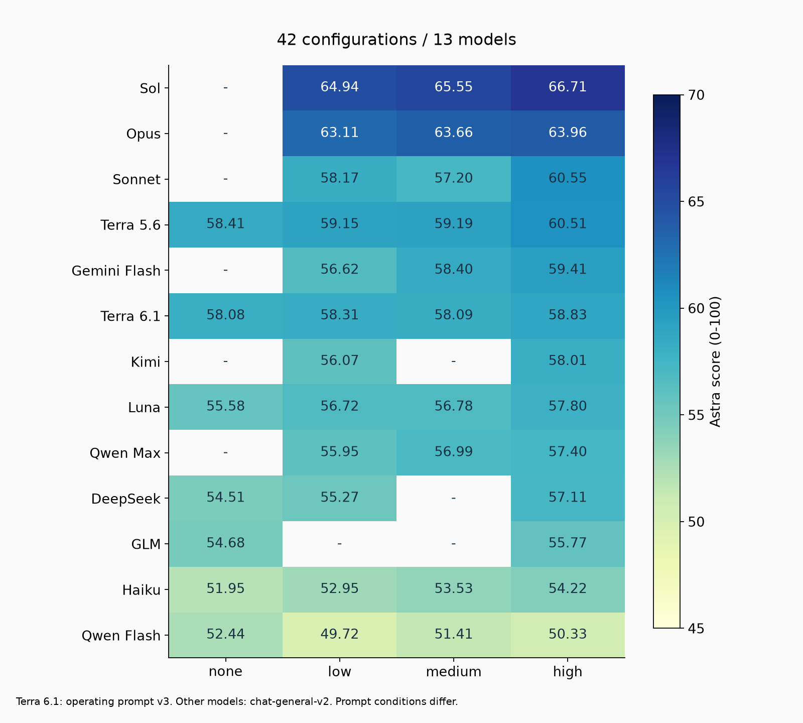
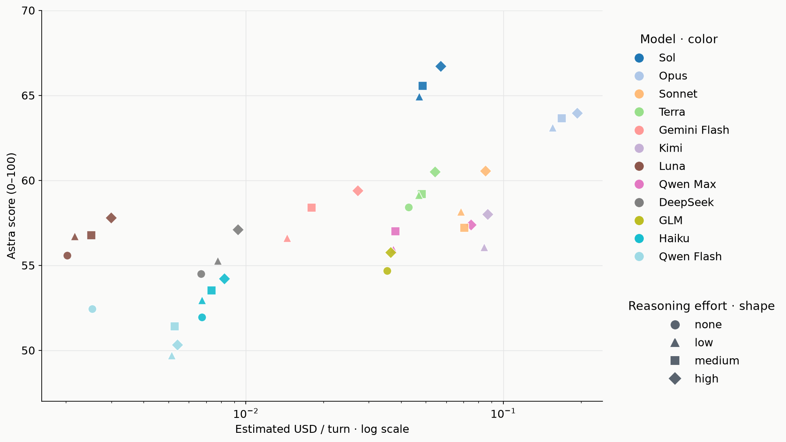
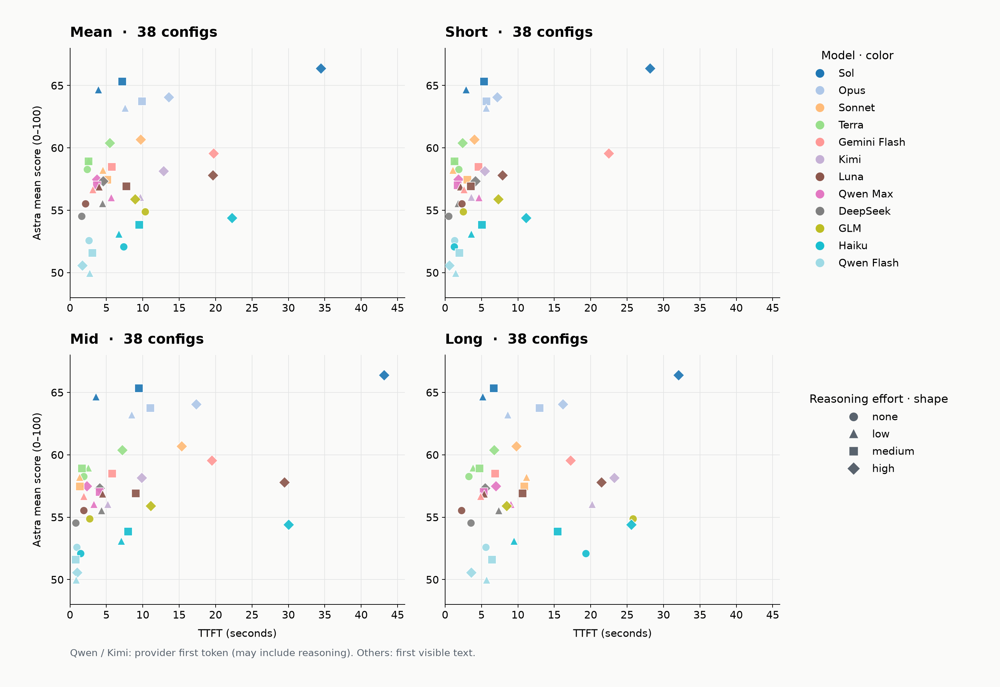
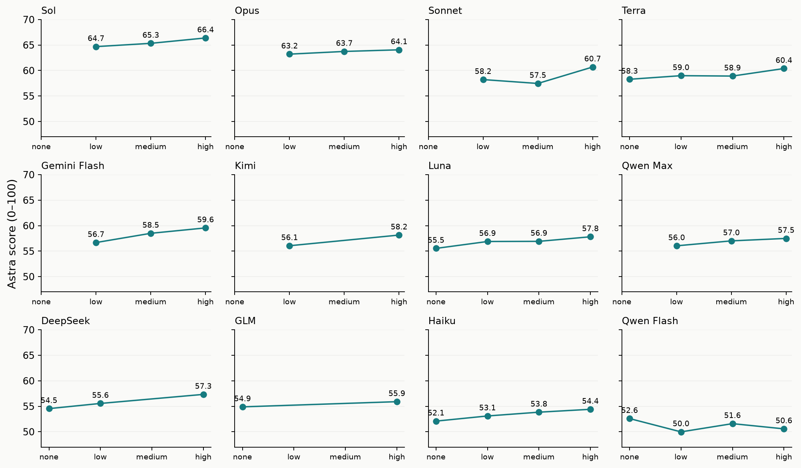

# 6-6 AI 성능 보고

채팅 AI의 실험 결과와 판단 근거를 기록한다. 이전 실행의 집계 시점과 결과를 보존한다.

 

### 6-6-1 그리드 서치(오프라인 테스트)

목적은 채팅 본문 생성에 사용할 기반 모델을 좁히는 것이다. configuration마다 점수가 얼마나 달라지는지, 그 차이를 위해 추가 비용과 생성 시간을 감수할 가치가 있는지 확인한다.

 

**grid-v2-r1: 모델과 추론 강도 그리드 서치**

| 항목 | 환경 |
| --- | --- |
| 모델·추론 강도 | 12종, 지원 조합 38개 |
| 고정 프롬프트 | `chat-general-v2` |
| 입력 데이터 | `test-exclude-s21-s49-s57-20261020`, 59개 샘플 |
| 생성 방식 | 기존 대화의 마지막 AI 답변 1개, 스트리밍 호출 |
| 평가자 | `gpt-6-astra / high` |
| 채점 방식 | 평가 모델 프롬프트 v0.3, `single-tail`, 오프라인 평가 |
| 집계 규모 | 생성 2,242건, 채점 6,726건 |

<b>데이터 출처</b>

 

| 데이터 | 출처 |
| --- | --- |
| 원본 실행 설정·코드 버전 | `evaluation/chat/runs/grid-v2-r1/run.json` |
| 현재 집계 설정·응답 교체 목록 | `evaluation/chat/runs/grid-v2-r1-filtered59-r1-20261020/run.json` |
| 평가 입력 | `evaluation/chat/datasets/test-exclude-s21-s49-s57-20261020/*.json` — 원본 `test`에서 S21, S49, S57 제외 |
| 분량 지시 | `prompt/chat/general/CHAT-TEMPLATE-v2.md` 6절 |
| 생성 결과·시간·토큰·비용 | `evaluation/chat/runs/grid-v2-r1-filtered59-r1-20261020/<config>/*.gen.json` |
| Astra 3회 채점 결과 | `evaluation/chat/runs/grid-v2-r1-filtered59-r1-20261020/<config>/*.judge-astra.json` — 기존 6,714회와 재생성 응답 4건의 신규 12회 |
| 채택한 1차 재생성 3건·코드 버전 | `evaluation/chat/runs/grid-v2-r1-remaining-refusals-retry-20261020-143836/`의 `run.json`과 `<config>/<sample>.gen.json` — Terra low의 S38, Luna none의 S33, Haiku none의 S11 |
| 채택한 2차 재생성 1건·코드 버전 | `evaluation/chat/runs/grid-v2-r1-terra-medium-s33-retry2-20261020-144056/`의 `run.json`과 `general-v2__gpt-5.6-terra__medium/S33.gen.json` — Terra medium의 S33 |
| 복구한 첫 토큰 시간 | `evaluation/chat/runs/grid-v2-r1/ttft-recovery/qwen-matched.json`·`openrouter-matched.json` |
| GLM·DeepSeek TTFT 실측 | `evaluation/chat/runs/grid-v2-r1-ttft/grid-v2-r1-ttft-glm-deepseek-20261018/results.json` |
| GLM TTFT 재측정 | `evaluation/chat/runs/grid-v2-r1-ttft/grid-v2-r1-ttft-glm-repeat-20261018/results.json` |
| Kimi 길이별 TTFT 선정 | high: 전체 62개 입력의 최소·중앙·최대(S24·S07·S62), low: 복구된 18개 입력의 최소·중앙·최대(S57·S58·S62). 평균은 선택한 3건의 산술평균이며 공급자 첫 토큰 기준 |
| Gemini TTFT 실측 | `evaluation/chat/runs/grid-v2-r1-ttft/grid-v2-r1-ttft-gemini-20261018/results.json` |
| GPT Luna TTFT 실측 | `evaluation/chat/runs/grid-v2-r1-ttft/grid-v2-r1-ttft-luna-20261018/results.json` |
| Haiku·Sonnet TTFT 실측 | `evaluation/chat/runs/grid-v2-r1-ttft/grid-v2-r1-ttft-haiku-sonnet-20261018/results.json` |
| Sol low TTFT 실측 | `evaluation/chat/runs/grid-v2-r1-ttft/grid-v2-r1-ttft-sol-low-openrouter-20261018/results.json` — OpenRouter → OpenAI 경로, 길이별 1건의 첫 본문 도착 시간 |
| Sol medium TTFT 실측 | `evaluation/chat/runs/grid-v2-r1-ttft/grid-v2-r1-ttft-sol-medium-openrouter-retry-20261018/results.json` — 짧음·중간은 OpenRouter → OpenAI, 긴 입력은 아래 OpenAI 직접 API 실측값 사용 |
| Opus TTFT 실측 | `evaluation/chat/runs/grid-v2-r1-ttft/grid-v2-r1-ttft-opus-20261018/results.json` |
| Terra none TTFT 실측 | `evaluation/chat/runs/grid-v2-r1-ttft/grid-v2-r1-ttft-terra-none-openrouter-20261018/results.json` — 짧음·중간은 OpenRouter → OpenAI, 긴 입력은 아래 OpenAI 직접 API 실측값 사용 |
| GPT 잔여 TTFT 실측 | `evaluation/chat/runs/grid-v2-r1-ttft/grid-v2-r1-ttft-gpt-direct-remaining-20261019/results.json` — OpenAI 직접 API, 14건 |
| 집계 기준 시점 | 2026-10-20 KST |

 

**1. 결론**

 

**2. 결과와 패턴**

- Qwen 413건과 Kimi 59건은 OpenRouter 경로로 생성되었다.
- 환율은 1$ = 1,345원으로 계산했다.
- Haiku는 입력 10만 토큰 초과 요청 8건에 입력·출력 단가 5배를 적용했다.
- DeepSeek 비용은 동일 토큰 사용량에 피크시간과 비피크시간 단가를 각각 적용했다.
- TTFT 측정에는 벤치마크에서 제외한 S57 샘플이 포함되어 있다.
- short·mid·long은 조합별 입력 토큰 수가 최소·중앙·최대인 각 1건이다. 모델별 토큰 수가 달라 범위로 표기했다.
  - short: 4,343~8,436토큰
  - mid: 9,046~22,139토큰
  - long: 149,875~276,231토큰

<b>short, mid, long 측정 샘플</b>

 

| 모델 공급사 | 적용 조합 | short | mid | long |
| --- | --- | --- | --- | --- |
| OpenAI | GPT 전체 | S14 | S06 | S62 |
| Google | Gemini 전체 | S24 | S06 | S62 |
| DeepSeek | DeepSeek 전체 | S57 | S06 | S62 |
| Alibaba | Qwen 전체 | S57 | S06 | S62 |
| Z.ai | GLM 전체 | S57 | S07 | S62 |
| Anthropic | Opus, Sonnet 전체와 Haiku low, medium, high | S57 | S07 | S62 |
| Anthropic | Haiku none | S24 | S07 | S62 |
| Moonshot AI | Kimi high | S24 | S07 | S62 |
| Moonshot AI | Kimi low | S57 | S58 | S62 |

 

| id | configuration | 평균 점수 | 3회 점수 | TTFT 평균 (초) | TTFT short (초) | TTFT mid (초) | TTFT long (초) | 비용(달러/턴) | 비용(원/턴) |
| ---: | --- | ---: | --- | ---: | ---: | ---: | ---: | ---: | ---: |
| 1 | `gpt-6.1-sol / high` | 66.71 | 67.08 66.68 66.37 | 34.45 | 28.15 | 43.15 | 32.04 | $0.05697 | 76.63원 |
| 2 | `gpt-6.1-sol / medium` | 65.55 | 65.68 65.69 65.29 | 7.16 | 5.33 | 9.47 | 6.67 | $0.04863 | 65.40원 |
| 3 | `gpt-6.1-sol / low` | 64.94 | 65.08 64.93 64.80 | 3.86 | 2.88 | 3.54 | 5.15 | $0.04701 | 63.22원 |
| 4 | `claude-opus-5-5 / high` | 63.96 | 64.19 63.83 63.86 | 13.55 | 7.16 | 17.31 | 16.17 | $0.19328 | 259.97원 |
| 5 | `claude-opus-5-5 / medium` | 63.66 | 63.51 63.25 64.20 | 9.90 | 5.70 | 11.03 | 12.98 | $0.16879 | 227.03원 |
| 6 | `claude-opus-5-5 / low` | 63.11 | 63.07 63.27 62.98 | 7.57 | 5.65 | 8.47 | 8.58 | $0.15514 | 208.66원 |
| 7 | `claude-sonnet-5-5 / high` | 60.55 | 60.75 60.51 60.39 | 9.71 | 4.02 | 15.31 | 9.79 | $0.08513 | 114.51원 |
| 8 | `gpt-5.6-terra / high` | 60.51 | 60.56 60.53 60.46 | 5.44 | 2.41 | 7.16 | 6.73 | $0.05424 | 72.95원 |
| 9 | `gemini-3.8-flash / high` | 59.41 | 59.53 59.47 59.22 | 19.73 | 22.48 | 19.50 | 17.22 | $0.02715 | 36.52원 |
| 10 | `gpt-5.6-terra / medium` | 59.19 | 59.25 58.90 59.41 | 2.54 | 1.28 | 1.64 | 4.71 | $0.04811 | 64.71원 |
| 11 | `gpt-5.6-terra / low` | 59.15 | 59.42 58.95 59.08 | 2.53 | 1.28 | 2.51 | 3.81 | $0.04687 | 63.04원 |
| 12 | `gpt-5.6-terra / none` | 58.41 | 58.05 58.86 58.32 | 2.34 | 1.88 | 1.87 | 3.26 | $0.04282 | 57.59원 |
| 13 | `gemini-3.8-flash / medium` | 58.40 | 58.25 58.71 58.24 | 5.75 | 4.60 | 5.79 | 6.87 | $0.01802 | 24.24원 |
| 14 | `claude-sonnet-5-5 / low` | 58.17 | 58.03 58.08 58.39 | 4.50 | 1.05 | 1.32 | 11.15 | $0.06825 | 91.79원 |
| 15 | `kimi-k3 / high` | 58.01 | 57.73 58.15 58.15 | 12.83 | 5.42 | 9.84 | 23.24 | $0.08675 | 116.68원 |
| 16 | `gpt-6-luna / high` | 57.80 | 57.61 57.92 57.88 | 19.60 | 7.86 | 29.46 | 21.48 | $0.00299 | 4.02원 |
| 17 | `qwen3.8-max / high` | 57.40 | 57.32 57.25 57.63 | 3.69 | 1.83 | 2.29 | 6.95 | $0.07490 | 100.74원 |
| 18 | `claude-sonnet-5-5 / medium` | 57.20 | 57.02 57.20 57.37 | 5.11 | 3.06 | 1.35 | 10.90 | $0.07044 | 94.74원 |
| 19 | `deepseek-flash / high` | 57.11 | 57.25 57.19 56.88 | 4.56 | 4.15 | 4.05 | 5.47 | $0.00930 $0.00465 | 12.51원 6.25원 |
| 20 | `qwen3.8-max / medium` | 56.99 | 56.97 57.02 57.00 | 3.70 | 1.70 | 4.07 | 5.32 | $0.03808 | 51.22원 |
| 21 | `gpt-6-luna / medium` | 56.78 | 56.83 56.95 56.56 | 7.75 | 3.55 | 9.04 | 10.65 | $0.00251 | 3.37원 |
| 22 | `gpt-6-luna / low` | 56.72 | 56.88 56.44 56.83 | 3.98 | 2.12 | 4.47 | 5.36 | $0.00216 | 2.90원 |
| 23 | `gemini-3.8-flash / low` | 56.62 | 56.76 56.49 56.59 | 3.10 | 2.60 | 1.86 | 4.86 | $0.01443 | 19.41원 |
| 24 | `kimi-k3 / low` | 56.07 | 56.19 55.88 56.15 | 9.64 | 3.59 | 5.18 | 20.16 | $0.08412 | 113.14원 |
| 25 | `qwen3.8-max / low` | 55.95 | 56.17 56.24 55.44 | 5.64 | 4.63 | 3.27 | 9.01 | $0.03728 | 50.15원 |
| 26 | `glm-5.2 / high` | 55.77 | 55.92 55.51 55.88 | 8.95 | 7.32 | 11.08 | 8.46 | $0.03644 | 49.01원 |
| 27 | `gpt-6-luna / none` | 55.58 | 55.64 55.47 55.63 | 2.14 | 2.31 | 1.87 | 2.23 | $0.00202 | 2.72원 |
| 28 | `deepseek-flash / low` | 55.27 | 55.14 55.49 55.19 | 4.46 | 1.75 | 4.30 | 7.33 | $0.00775 $0.00387 | 10.42원 5.21원 |
| 29 | `glm-5.2 / none` | 54.68 | 54.54 54.88 54.63 | 10.34 | 2.50 | 2.71 | 25.81 | $0.03531 | 47.49원 |
| 30 | `deepseek-flash / none` | 54.51 | 54.37 54.22 54.95 | 1.60 | 0.50 | 0.78 | 3.53 | $0.00669 $0.00334 | 8.99원 4.50원 |
| 31 | `claude-haiku-5-5 / high` | 54.22 | 54.39 54.12 54.15 | 22.24 | 11.11 | 30.04 | 25.58 | $0.00823 | 11.07원 |
| 32 | `claude-haiku-5-5 / medium` | 53.53 | 53.54 53.58 53.47 | 9.50 | 5.06 | 7.97 | 15.46 | $0.00735 | 9.89원 |
| 33 | `claude-haiku-5-5 / low` | 52.95 | 53.25 52.92 52.69 | 6.68 | 3.59 | 7.01 | 9.45 | $0.00673 | 9.06원 |
| 34 | `qwen3.8-flash / none` | 52.44 | 52.39 52.53 52.39 | 2.59 | 1.28 | 0.93 | 5.57 | $0.00253 | 3.41원 |
| 35 | `claude-haiku-5-5 / none` | 51.95 | 51.80 52.02 52.03 | 7.34 | 1.24 | 1.44 | 19.33 | $0.00674 | 9.06원 |
| 36 | `qwen3.8-flash / medium` | 51.41 | 51.22 51.49 51.51 | 3.06 | 1.96 | 0.78 | 6.44 | $0.00528 | 7.11원 |
| 37 | `qwen3.8-flash / high` | 50.33 | 49.92 50.66 50.42 | 1.71 | 0.57 | 0.97 | 3.60 | $0.00541 | 7.27원 |
| 38 | `qwen3.8-flash / low` | 49.72 | 49.73 49.75 49.68 | 2.67 | 1.45 | 0.85 | 5.70 | $0.00515 | 6.92원 |

 

**Configuration에 대한 Astra 평균 점수**

 

**턴당 비용과 점수 비교**

- DeepSeek은 피크시간 기준이다.

 

**첫 토큰 시간과 점수 비교: mean·short·mid·long**

 

**추론 강도에 따른 점수 변화**

 

**3. 한계**

1) 전체 대화를 채점하므로 거절 응답도 높은 점수를 받는다. 평균 점수만으로 마지막 답변의 품질과 거절 여부를 구분하기 어렵다.
2) 사람의 선호를 검증하지 않았다.
3) 모델 선택과 평가에 같은 데이터를 사용했다.
4) 응답을 한 번만 생성해 반복 생성의 편차와 장기 대화 성능을 측정하지 않았다.
5) 운영 기준 조합과 비교하지 않아 운영 대비 개선율은 없다.
6) TTFT는 길이별 1건이다. GLM의 긴 입력은 high에서 221,376토큰, none에서 0토큰이 캐시 처리되어 조건이 다르다.
7) 분량 준수율은 엔딩 장면의 초과 허용 예외를 구분하지 않았다. 2200자 초과 답변에 엔딩 장면이 섞여 있을 수 있다.

 

### 6-6-2 A/B 테스트(온라인 테스트)

**1. 가설과 실험 조건**

| 항목 | 내용 |
|---|---|
| 가설 | 동일한 50이프 조건에서 Sol low가 Gemini medium보다 사용자당 고급 신규 진행 턴 수를 증가시킴 |
| 대상 | 고급 등급을 이용하는 회원 |
| 기간 | 2026년 11월 초 |
| 배정 단위 | 회원 공개 UUID 기준, 같은 회원은 같은 그룹 유지 별도 배정 저장 없음 |

| 그룹 | 모델 | 추론 강도 | 회원 UUID 마지막 자리 |
|---|---|---|---|
| Sol | `gpt-6.1-sol` | `low` | 짝수 |
| Gemini | `gemini-3.8-flash` | `medium` | 홀수 |

 

**2. 주요 지표**

| 항목 | 집계 기준 |
|---|---|
| 사용자당 고급 신규 진행 턴 수 | 실험 기간 누적 고급 신규 진행 턴 합계 ÷ 해당 그룹의 고급 이용 사용자 수 |
| 제외 | 기본 등급, 게스트, 재생성 |

 

**3. 결과**

| 그룹 | 사용자당 고급 신규 진행 턴 수 |
|---|---|
| Sol | |
| Gemini | |
