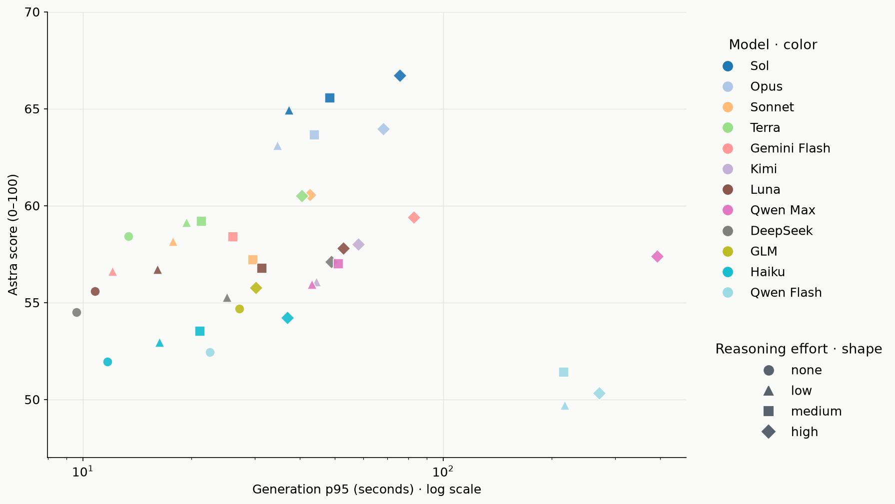

# 6-6 AI 성능 보고

채팅 AI의 실험 결과와 판단 근거를 기록한다. 이전 실행의 집계 시점과 결과를 보존한다.

 

### 6-6-1 채팅 응답 생성

목적은 채팅 본문 생성에 사용할 기반 모델을 좁히는 것이다. configuration마다 점수가 얼마나 달라지는지, 그 차이를 위해 추가 비용과 생성 시간을 감수할 가치가 있는지 확인한다.

 

**grid-v2-r1: 모델과 추론 강도 그리드 서치**

| 항목 | 환경 |
| --- | --- |
| 모델·추론 강도 | 12종, 지원 조합 38개 |
| 고정 프롬프트 | `chat-general-v2` |
| 입력 데이터 | `test` |
| 생성 방식 | 기존 대화의 마지막 AI 답변 1개, 스트리밍 호출 |
| 평가자 | `gpt-6-astra / high` |
| 채점 방식 | 평가 모델 프롬프트 v0.3, `single-tail`, 오프라인 평가 |
| 집계 규모 | 생성 2,356건, 채점 7,068건 |

<b>데이터 출처</b>

 

| 데이터 | 출처 |
| --- | --- |
| 실행 설정·코드 버전 | `evaluation/runs/grid-v2-r1/run.json` |
| 평가 입력 | `evaluation/datasets/test/*.json` |
| 분량 지시 | `prompt/chat/general/CHAT-TEMPLATE-v2.md` 6절 |
| 생성 결과·시간·토큰·비용 | `evaluation/runs/grid-v2-r1/<config>/*.gen.json` |
| Astra 3회 채점 결과 | `evaluation/runs/grid-v2-r1/<config>/*.judge-astra.json` |
| 복구한 첫 토큰 시간 | `evaluation/runs/grid-v2-r1/ttft-recovery/qwen-matched.json`·`openrouter-matched.json` |
| GLM·DeepSeek TTFT 실측 | `evaluation/runs/grid-v2-r1-ttft/grid-v2-r1-ttft-glm-deepseek-20261018/results.json` |
| GLM TTFT 재측정 | `evaluation/runs/grid-v2-r1-ttft/grid-v2-r1-ttft-glm-repeat-20261018/results.json` |
| Kimi 길이별 TTFT 선정 | high: 전체 62개 입력의 최소·중앙·최대(S24·S07·S62), low: 복구된 18개 입력의 최소·중앙·최대(S57·S58·S62). 평균은 선택한 3건의 산술평균이며 공급자 첫 토큰 기준 |
| Gemini TTFT 실측 | `evaluation/runs/grid-v2-r1-ttft/grid-v2-r1-ttft-gemini-20261018/results.json` |
| GPT Luna TTFT 실측 | `evaluation/runs/grid-v2-r1-ttft/grid-v2-r1-ttft-luna-20261018/results.json` |
| Haiku·Sonnet TTFT 실측 | `evaluation/runs/grid-v2-r1-ttft/grid-v2-r1-ttft-haiku-sonnet-20261018/results.json` |
| Sol low TTFT 실측 | `evaluation/runs/grid-v2-r1-ttft/grid-v2-r1-ttft-sol-low-openrouter-20261018/results.json` — OpenRouter → OpenAI 경로, 길이별 1건의 첫 본문 도착 시간 |
| Sol medium TTFT 실측 | `evaluation/runs/grid-v2-r1-ttft/grid-v2-r1-ttft-sol-medium-openrouter-retry-20261018/results.json` — 짧음·중간은 OpenRouter → OpenAI, 긴 입력은 아래 OpenAI 직접 API 실측값 사용 |
| Opus TTFT 실측 | `evaluation/runs/grid-v2-r1-ttft/grid-v2-r1-ttft-opus-20261018/results.json` |
| Terra none TTFT 실측 | `evaluation/runs/grid-v2-r1-ttft/grid-v2-r1-ttft-terra-none-openrouter-20261018/results.json` — 짧음·중간은 OpenRouter → OpenAI, 긴 입력은 아래 OpenAI 직접 API 실측값 사용 |
| GPT 잔여 TTFT 실측 | `evaluation/runs/grid-v2-r1-ttft/grid-v2-r1-ttft-gpt-direct-remaining-20261019/results.json` — OpenAI 직접 API, 14건 |
| 집계 기준 시점 | 2026-10-19 KST |

 

**1. 결론**

 

**2. 결과와 패턴**

- Qwen 434건과 Kimi 63건은 OpenRouter 경로로 생성되었다.
- 환율은 1$ = 1,345원으로 계산했다.
- short·mid·long은 조합별 입력 토큰 수가 최소·중앙·최대인 각 1건이다. 모델별 토큰 수가 달라 범위로 표기했다(Kimi low는 복구된 18건 기준).
  - short: 4,343~8,436토큰
  - mid: 9,046~22,139토큰
  - long: 149,875~276,231토큰
- Haiku는 입력 10만 토큰 초과 요청 8건에 입력·출력 단가 5배를 적용했다.
- DeepSeek 비용은 동일 토큰 사용량에 피크시간과 비피크시간 단가를 각각 적용했다.

| id | configuration | 평균 점수 | 3회 점수 | TTFT 평균 (초) | TTFT short (초) | TTFT mid (초) | TTFT long (초) | 생성 p95 (초) | 비용(달러/턴) | 비용(원/턴) |
| ---: | --- | ---: | --- | ---: | ---: | ---: | ---: | ---: | ---: | ---: |
| 1 | `gpt-6.1-sol / high` | 66.38 | 66.73 66.23 66.19 | 34.45 | 28.15 | 43.15 | 32.04 | 75.2 | $0.05550 | 74.65원 |
| 2 | `gpt-6.1-sol / medium` | 65.33 | 65.40 65.48 65.10 | 7.16 | 5.33 | 9.47 | 6.67 | 47.8 | $0.04754 | 63.94원 |
| 3 | `gpt-6.1-sol / low` | 64.68 | 64.73 64.65 64.68 | 3.86 | 2.88 | 3.54 | 5.15 | 37.2 | $0.04578 | 61.57원 |
| 4 | `claude-opus-5-5 / high` | 64.06 | 64.24 63.95 63.98 | 13.55 | 7.16 | 17.31 | 16.17 | 66.7 | $0.18849 | 253.52원 |
| 5 | `claude-opus-5-5 / medium` | 63.74 | 63.55 63.44 64.23 | 9.90 | 5.70 | 11.03 | 12.98 | 43.8 | $0.16511 | 222.08원 |
| 6 | `claude-opus-5-5 / low` | 63.21 | 63.19 63.35 63.08 | 7.57 | 5.65 | 8.47 | 8.58 | 33.1 | $0.15169 | 204.02원 |
| 7 | `claude-sonnet-5-5 / high` | 60.68 | 60.84 60.68 60.53 | 9.71 | 4.02 | 15.31 | 9.79 | 38.0 | $0.08326 | 111.99원 |
| 8 | `gpt-5.6-terra / high` | 60.39 | 60.37 60.39 60.40 | 5.44 | 2.41 | 7.16 | 6.73 | 40.0 | $0.05274 | 70.94원 |
| 9 | `gemini-3.8-flash / high` | 59.55 | 59.71 59.61 59.34 | 19.73 | 22.48 | 19.50 | 17.22 | 75.2 | $0.02703 | 36.35원 |
| 10 | `gpt-5.6-terra / low` | 58.98 | 59.24 58.77 58.94 | 2.53 | 1.28 | 2.51 | 3.81 | 18.9 | $0.04554 | 61.25원 |
| 11 | `gpt-5.6-terra / medium` | 58.91 | 59.03 58.68 59.02 | 2.54 | 1.28 | 1.64 | 4.71 | 19.3 | $0.04670 | 62.81원 |
| 12 | `gemini-3.8-flash / medium` | 58.49 | 58.35 58.82 58.31 | 5.75 | 4.60 | 5.79 | 6.87 | 25.9 | $0.01774 | 23.86원 |
| 13 | `gpt-5.6-terra / none` | 58.28 | 57.94 58.69 58.21 | 2.34 | 1.88 | 1.87 | 3.26 | 13.4 | $0.04160 | 55.95원 |
| 14 | `claude-sonnet-5-5 / low` | 58.22 | 58.08 58.18 58.40 | 4.50 | 1.05 | 1.32 | 11.15 | 17.8 | $0.06678 | 89.82원 |
| 15 | `kimi-k3 / high` | 58.15 | 57.90 58.23 58.32 | 12.83 | 5.42 | 9.84 | 23.24 | 50.6 | $0.09508 | 127.88원 |
| 16 | `gpt-6-luna / high` | 57.81 | 57.65 57.95 57.84 | 19.60 | 7.86 | 29.46 | 21.48 | 47.2 | $0.00292 | 3.93원 |
| 17 | `qwen3.8-max / high` | 57.49 | 57.44 57.31 57.74 | 3.69 | 1.83 | 2.29 | 6.95 | 362.5 | $0.07696 | 103.51원 |
| 18 | `claude-sonnet-5-5 / medium` | 57.46 | 57.19 57.47 57.71 | 5.11 | 3.06 | 1.35 | 10.90 | 23.7 | $0.06935 | 93.27원 |
| 19 | `deepseek-flash / high` | 57.33 | 57.50 57.40 57.08 | 4.56 | 4.15 | 4.05 | 5.47 | 38.4 | $0.00915 $0.00457 | 12.30원 6.15원 |
| 20 | `qwen3.8-max / medium` | 57.01 | 56.98 57.03 57.02 | 3.70 | 1.70 | 4.07 | 5.32 | 49.5 | $0.03729 | 50.16원 |
| 21 | `gpt-6-luna / medium` | 56.92 | 57.05 57.11 56.60 | 7.75 | 3.55 | 9.04 | 10.65 | 31.4 | $0.00260 | 3.50원 |
| 22 | `gpt-6-luna / low` | 56.89 | 57.05 56.65 56.97 | 3.98 | 2.12 | 4.47 | 5.36 | 15.9 | $0.00211 | 2.83원 |
| 23 | `gemini-3.8-flash / low` | 56.68 | 56.89 56.53 56.63 | 3.10 | 2.60 | 1.86 | 4.86 | 11.9 | $0.01411 | 18.98원 |
| 24 | `kimi-k3 / low` | 56.06 | 56.16 55.87 56.15 | 9.64 | 3.59 | 5.18 | 20.16 | 41.8 | $0.08767 | 117.92원 |
| 25 | `qwen3.8-max / low` | 56.04 | 56.18 56.37 55.58 | 5.64 | 4.63 | 3.27 | 9.01 | 39.0 | $0.03634 | 48.88원 |
| 26 | `glm-5.2 / high` | 55.90 | 56.06 55.65 55.98 | 8.95 | 7.32 | 11.08 | 8.46 | 29.7 | $0.03564 | 47.93원 |
| 27 | `deepseek-flash / low` | 55.55 | 55.42 55.76 55.48 | 4.46 | 1.75 | 4.30 | 7.33 | 21.9 | $0.00765 $0.00383 | 10.30원 5.15원 |
| 28 | `gpt-6-luna / none` | 55.54 | 55.53 55.44 55.65 | 2.14 | 2.31 | 1.87 | 2.23 | 10.6 | $0.00196 | 2.64원 |
| 29 | `glm-5.2 / none` | 54.88 | 54.76 55.05 54.84 | 10.34 | 2.50 | 2.71 | 25.81 | 25.3 | $0.03449 | 46.39원 |
| 30 | `deepseek-flash / none` | 54.54 | 54.37 54.32 54.92 | 1.60 | 0.50 | 0.78 | 3.53 | 9.5 | $0.00653 $0.00327 | 8.79원 4.39원 |
| 31 | `claude-haiku-5-5 / high` | 54.40 | 54.53 54.34 54.34 | 22.24 | 11.11 | 30.04 | 25.58 | 32.1 | $0.00795 | 10.70원 |
| 32 | `claude-haiku-5-5 / medium` | 53.84 | 53.90 53.89 53.73 | 9.50 | 5.06 | 7.97 | 15.46 | 20.9 | $0.00711 | 9.56원 |
| 33 | `claude-haiku-5-5 / low` | 53.10 | 53.42 53.05 52.82 | 6.68 | 3.59 | 7.01 | 9.45 | 15.8 | $0.00652 | 8.77원 |
| 34 | `qwen3.8-flash / none` | 52.59 | 52.55 52.69 52.52 | 2.59 | 1.28 | 0.93 | 5.57 | 19.9 | $0.00247 | 3.32원 |
| 35 | `claude-haiku-5-5 / none` | 52.09 | 51.94 52.19 52.13 | 7.34 | 1.24 | 1.44 | 19.33 | 10.2 | $0.00649 | 8.72원 |
| 36 | `qwen3.8-flash / medium` | 51.59 | 51.37 51.60 51.81 | 3.06 | 1.96 | 0.78 | 6.44 | 215.9 | $0.00533 | 7.17원 |
| 37 | `qwen3.8-flash / high` | 50.57 | 50.24 50.84 50.63 | 1.71 | 0.57 | 0.97 | 3.60 | 258.1 | $0.00532 | 7.15원 |
| 38 | `qwen3.8-flash / low` | 49.98 | 49.97 50.05 49.92 | 2.67 | 1.45 | 0.85 | 5.70 | 202.3 | $0.00506 | 6.81원 |

 

**Configuration에 대한 Astra 평균 점수**

 

**턴당 비용과 점수 비교**

- DeepSeek은 피크시간 기준이다.

 

**전체 생성 시간 p95와 점수 비교**

 

**첫 토큰 시간과 점수 비교: mean·short·mid·long**

 

**추론 강도에 따른 점수 변화**

 

**거절 응답이 확인된 config별 점수**

28개 config에서 명시적 거절이 확인되었다. 등장인물의 거절 대사는 제외했다.

| configuration | 전체 평균 점수 | 거절 응답 평균 점수 | 거절 건수 / 전체 |
| --- | ---: | ---: | ---: |
| `gpt-6.1-sol / high` | 66.38 | 51.00 | 2 / 62 |
| `gpt-6.1-sol / medium` | 65.33 | 34.33 | 1 / 62 |
| `gpt-6.1-sol / low` | 64.68 | 52.83 | 2 / 62 |
| `claude-opus-5-5 / high` | 64.06 | 68.33 | 1 / 62 |
| `claude-opus-5-5 / medium` | 63.74 | 69.67 | 1 / 62 |
| `claude-opus-5-5 / low` | 63.21 | 69.00 | 1 / 62 |
| `claude-sonnet-5-5 / high` | 60.68 | 68.67 | 1 / 62 |
| `gpt-5.6-terra / high` | 60.39 | 51.83 | 2 / 62 |
| `gemini-3.8-flash / high` | 59.55 | 68.33 | 1 / 62 |
| `gpt-5.6-terra / low` | 58.98 | 48.44 | 3 / 62 |
| `gpt-5.6-terra / medium` | 58.91 | 45.44 | 3 / 62 |
| `gemini-3.8-flash / medium` | 58.49 | 68.00 | 1 / 62 |
| `gpt-5.6-terra / none` | 58.28 | 55.67 | 3 / 62 |
| `claude-sonnet-5-5 / low` | 58.22 | 36.00 | 1 / 62 |
| `kimi-k3 / high` | 58.15 | 68.33 | 1 / 62 |
| `gpt-6-luna / high` | 57.81 | 67.33 | 1 / 62 |
| `gpt-6-luna / medium` | 56.92 | 68.67 | 1 / 62 |
| `gpt-6-luna / low` | 56.89 | 52.83 | 2 / 62 |
| `gemini-3.8-flash / low` | 56.68 | 68.00 | 1 / 62 |
| `qwen3.8-max / low` | 56.04 | 67.00 | 2 / 62 |
| `gpt-6-luna / none` | 55.54 | 51.08 | 4 / 62 |
| `claude-haiku-5-5 / high` | 54.40 | 69.33 | 1 / 62 |
| `claude-haiku-5-5 / medium` | 53.84 | 71.00 | 1 / 62 |
| `qwen3.8-flash / none` | 52.59 | 65.00 | 1 / 62 |
| `claude-haiku-5-5 / none` | 52.09 | 35.17 | 2 / 62 |
| `qwen3.8-flash / medium` | 51.59 | 65.00 | 1 / 62 |
| `qwen3.8-flash / high` | 50.57 | 64.67 | 1 / 62 |
| `qwen3.8-flash / low` | 49.98 | 62.67 | 1 / 62 |

 

**3. 한계**

1) 전체 대화를 채점하므로 거절 응답도 높은 점수를 받는다. 평균 점수만으로 마지막 답변의 품질과 거절 여부를 구분하기 어렵다.
2) 사람의 선호를 검증하지 않았다.
3) 모델 선택과 평가에 같은 데이터를 사용했다.
4) 응답을 한 번만 생성해 반복 생성의 편차와 장기 대화 성능을 측정하지 않았다.
5) 운영 기준 조합과 비교하지 않아 운영 대비 개선율은 없다.
6) TTFT는 길이별 1건이다. GLM의 긴 입력은 high에서 221,376토큰, none에서 0토큰이 캐시 처리되어 조건이 다르다.
7) 분량 준수율은 엔딩 장면의 초과 허용 예외를 구분하지 않았다. 2200자 초과 답변에 엔딩 장면이 섞여 있을 수 있다.
