# AI 평가 방법

채팅 AI의 성능, 시간과 비용을 평가하는 데이터와 채점 방법을 정한다.

 

### 채팅 응답 생성

평가 데이터와 채점 장치는 `manyak-ai/evaluation/`에 있다. ([채팅 응답 생성](AI-EVALUATION-IMPLEMENTATION.md#채팅-응답-생성))

 

**1. 평가 범위**

| 항목 | 내용 |
|---|---|
| 평가 대상 | 고정한 프롬프트 버전에서 configuration(모델, 추론 강도)의 출력 |
| 평가 단위 | 채팅 1개의 마지막 AI 답변 1개 |
| 생성 입력 | 1~N−1턴 대화 N번째 사용자 입력 응답 직전의 생성 설정 |
| 실행 경로 | 기준 AI 레포의 프롬프트 조립, 모델 호출과 출력 파서를 그대로 사용 선택지와 이미지 호출 제외 |
| 생성 설정 | 프롬프트 버전, 모델과 추론 강도는 6-3-1의 configuration을 따름 |
| 채점 대상 | 생성한 답변을 붙인 N턴 대화 전체 |

 

**2. 데이터셋 샘플링**

| 제외 조건 |
|---|
| 일반 제작 스토리의 채팅 |
| 삭제된 채팅이나 스토리 |
| 제외 요청이 있는 채팅 |
| 1~2턴 채팅 |
| 평가 모델 개발에 쓴 채팅 |
| 개발자 채팅 |
| 엔딩에 도달한 채팅 |
| 스토리 태그에 성인·가학 태그가 있는 채팅 |
| 생성 입력이 남아 있지 않거나 손상된 레거시 채팅(보존 기한이 지난 채팅 포함) |
| 안전성 문제가 있는 채팅 |
| 서비스 취지에서 벗어난 입력(탈옥, 현실 정치 등)이 있는 채팅 |
| 마지막 사용자 입력이 대화를 끝내는 채팅 |

 

**3. 평가 데이터**

| 항목 | train | test |
|---|---|---|
| 용도 | 프롬프트를 고칠 때 사례 확인 | grid search와 configuration 비교의 점수 |
| 위치 | `evaluation/datasets/train/` | `evaluation/datasets/test/` |
| 규모 | test에 넣지 않은 운영 수집본 계속 추가 | 62개 |
| 사례 열람 | 허용 | 점수와 집계만 확인 사례 원문은 보지 않음 |
| 변경 | 추가 가능 | 고정 입력 해시로 변경 여부 검사 새로 뽑으면 새 버전으로 만들고 이전 버전 결과와 비교하지 않음 |

<b>test 데이터셋 분포</b>

<table>
<tr>
<td>

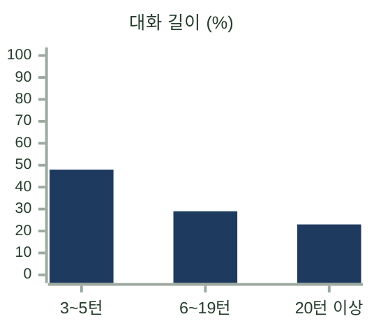

</td>
<td>

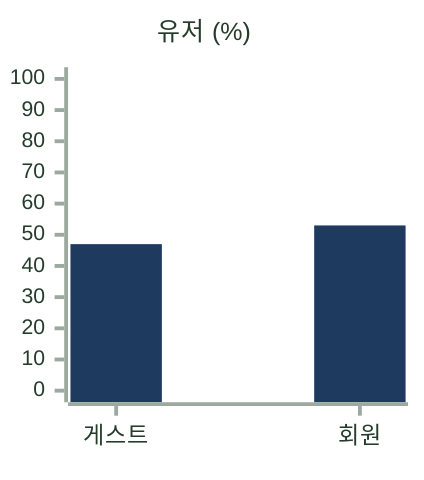

</td>
</tr>
<tr>
<td>

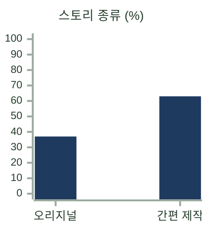

</td>
<td>

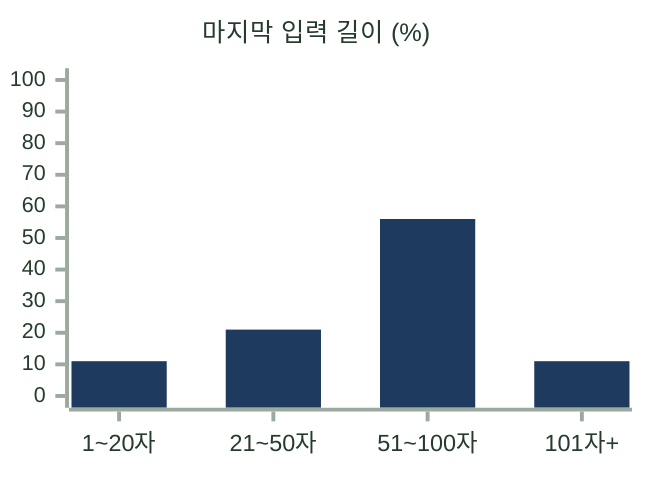

</td>
</tr>
<tr>
<td>

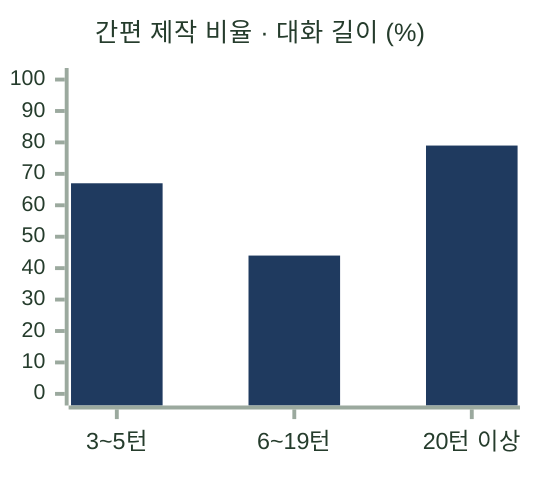

</td>
<td>

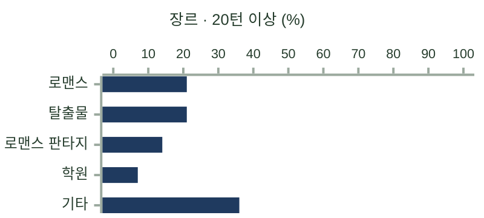

</td>
</tr>
<tr>
<td>

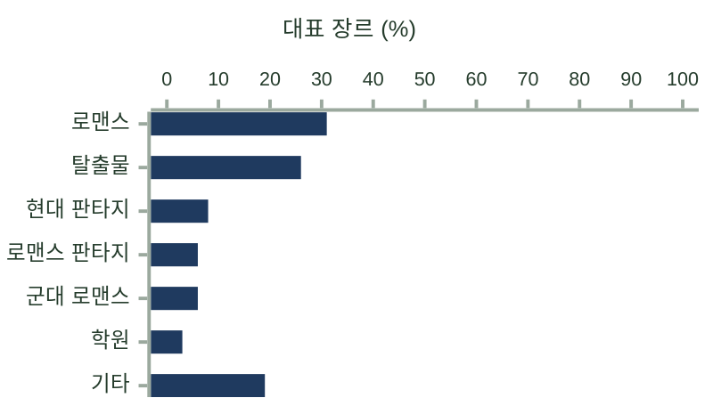

</td>
<td>

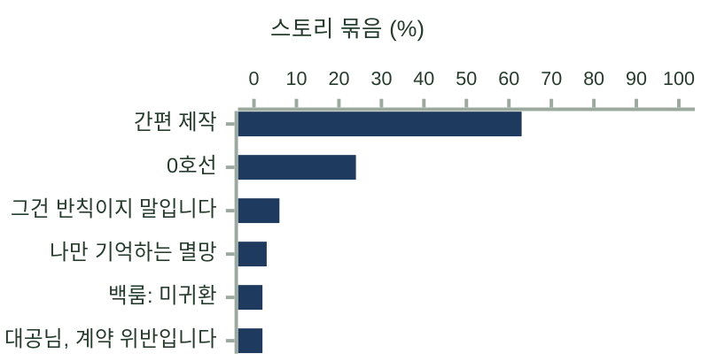

</td>
</tr>
<tr>
<td>

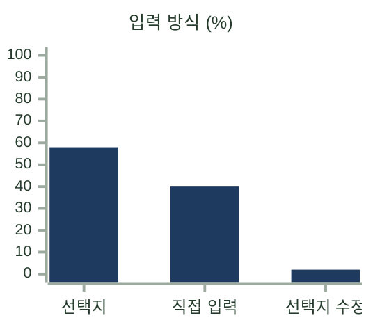

</td>
<td>

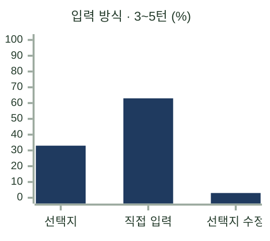

</td>
</tr>
<tr>
<td>

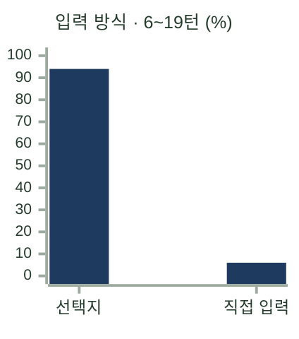

</td>
<td>

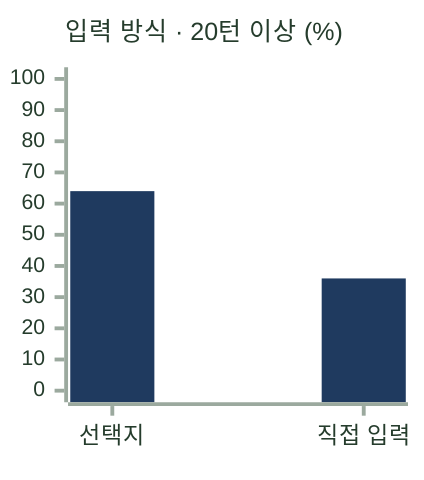

</td>
</tr>
<tr>
<td>

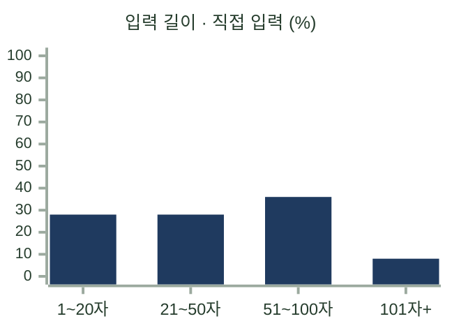

</td>
<td>

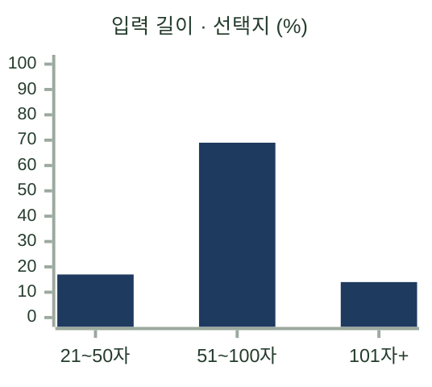

</td>
</tr>
<tr>
<td>

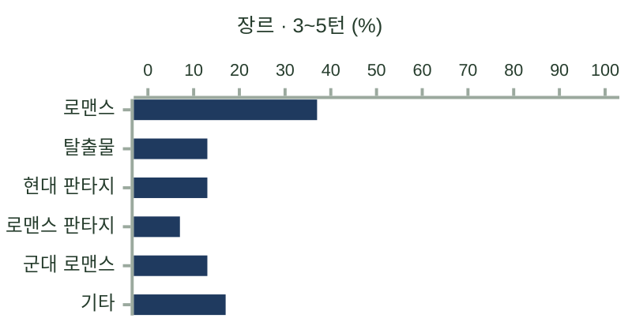

</td>
<td>

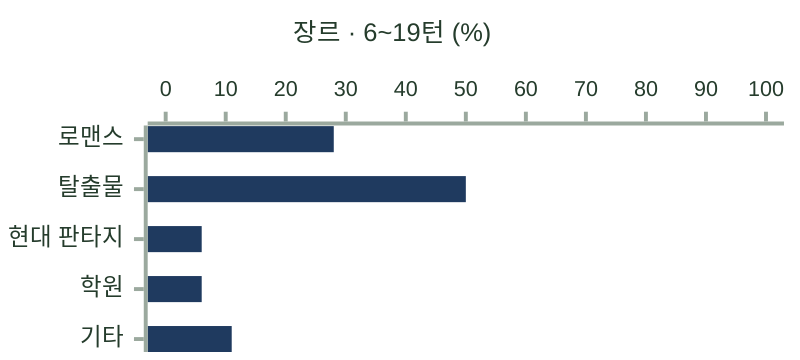

</td>
</tr>
</table>

 

**4. 평가 모델**

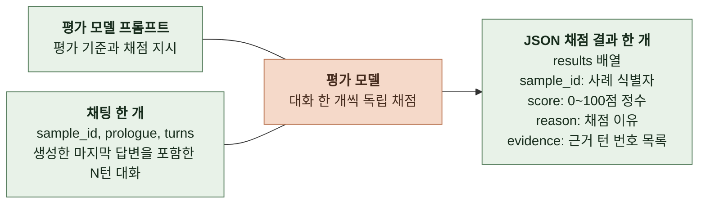

| 항목 | 내용 |
|---|---|
| 주 평가 모델 | `gpt-6-astra`, 추론 강도 `high` 답변당 독립 채점 3회 |
| 교차 확인 모델 | `claude-fable-5-1`, 추론 강도 `medium` 답변당 독립 채점 2회로 Astra와 순위 비교 평가 모델별 결과는 별도 집계 |
| 생성 모델과의 관계 | 생성 모델과 다른 모델 사용 |
| 평가 모델 프롬프트 | Astra용 v0.3 고정본 `evaluation/judge-prompt/astra-prompt.md`에 보관 Fable은 `evaluation/judge-prompt/fable-prompt.md` 사용 |
| 채점 질문 | 마지막 정상 AI 응답까지 읽은 사용자가 다음 행동이나 대사를 이어가고 싶은 정도 완결된 이야기는 처음부터 결말까지의 재미와 여운 |
| 채점 입력 | `sample_id`, `prologue`, `turns` 태그와 인물 정보는 전달하지 않음 |
| 출력 | JSON의 `results` 배열에 채점 결과 1개 `sample_id`, `score`(0~100점 정수), `reason`(채점 이유), `evidence`(근거 턴 번호 목록) |
| 호출 방식 | 대화 1개당 별도 호출 다른 답변과 점수는 전달하지 않음 |
| 개선 방식 | 사람 선호와의 일치율을 기준으로 평가 모델 프롬프트 개선 |
| 사람 평가와의 비교 | 사람이 두 채팅 중 고른 쪽에 더 높은 점수를 준 쌍의 비율 v0.2는 72쌍에서 6회 평균 70.4% (2026-09-07, `gpt-5.6-sol`, 추론 강도 `medium`) |

 

**평가 모델 개선과 검증**

사람이 더 이어가고 싶다고 고른 채팅에 높은 점수를 주도록 평가 모델 프롬프트를 개선한다. 모델 가중치는 학습하지 않는다.

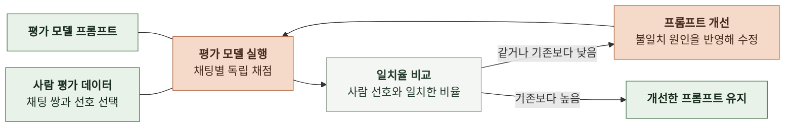

| 항목 | 기준 |
| --- | --- |
| 사람 평가 | 채팅 두 편 중 더 이어가고 싶은 쪽을 선택 |
| 모델 입력 | 채팅 한 편씩 독립 채점 상대 채팅, 사람 선택과 선택 이유는 채점 모델에 전달하지 않음 |
| 일치율 | 사람이 고른 쪽에 더 높은 점수를 준 쌍 수 ÷ 전체 쌍 수 동점은 불일치 |
| 수정 범위 | 모델과 추론 강도를 고정하고 평가 모델 프롬프트 한 곳만 수정 특정 표본의 인물이나 장면을 외우는 문구 제외 |
| 비교 조건 | 입력, 사람 선택과 반복 횟수 고정 조건이 바뀌면 기준부터 다시 측정 |
| 채택 조건 | 후보 3회와 재평가 3회 모두 기준 평균 이상이며 6회 평균은 기준 평균 초과 |
| 기존 정답 유지 | 기준에서 3회 모두 맞힌 쌍을 후보의 첫 평가 또는 재평가에서 3회 모두 틀리면 탈락 6회 평균이 기준보다 10%p 이상 높으면 이 조건만 예외로 하고 해당 쌍 기록 |
| 재평가 예외 | 재평가 3회 중 한 회만 기준 미달이고 차이가 한 쌍 이내이면 추가 3회 평가를 한 번만 허용 추가 3회는 모두 기준 이상 |
| 최종 판단 | 사람이 쌍별 결과와 판단 근거 확인 일치율이 올라도 의도와 다른 근거로 맞혔으면 폐기 |
| 결과 기록 | 변경 이유, 프롬프트 버전, 평가 모델과 강도, 입력 해시, 반복별 일치율, 채택 여부 |

 

**5. 평가 지표**

채팅 응답 실패율과 본문 재생성률은 오프라인 평가에서 계산하지 않고 운영 기록으로 확인한다. ([운영 요구사항](OPERATION-REQUIREMENTS.md), [관측](OBSERVABILITY.md))

| 지표 | 계산 방법 | 2-2 목표 |
|---|---|---|
| 채팅 재미 점수 | 평가 모델별 반복 채점의 평균을 답변마다 구한 뒤 데이터셋 전체 입력의 평균 | 없음 |
| 턴당 본문 생성 비용 | 입력별 최초 호출과 재생성의 API 비용 `cost_usd`를 합산한 뒤 평균 캐시 미스 단가 적용, 입력 토큰 수가 모델별 기준을 초과하면 해당 요청 전체의 입력과 출력에 각각 할증 적용 호출 비용이 하나라도 미측정이면 해당 입력의 총비용은 평균에서 빼고 개수를 함께 기록 | 목표 $0.01 이하   상한 $0.03 |
| 본문 생성 시간 | 입력별 최초 호출과 재생성의 소요 시간을 합산한 값의 p95 동시 호출을 기다리는 대기 시간 제외 | 기록만 함 채팅 응답 완료 시간은 운영 기록으로 판정 |
| 첫 토큰 시간(TTFT)   평균, short, mid, long | short, mid, long 각 1건의 첫 토큰 시간(초) 평균은 선택한 3건의 산술평균 | 기록만 함 |

 

**TTFT 측정 기준**

| 항목 | 기준 |
|---|---|
| 입력 선정 | configuration별 원래 생성 입력의 토큰 수 오름차순으로 최소, 중앙, 최대 각 1건 개수가 짝수이면 중앙 두 건 중 뒤의 입력 선택, 토큰 수가 같으면 입력 ID 순 |
| 직접 측정 | 같은 configuration과 입력으로 길이별 1회 재생성 호출 시작부터 공백을 제외한 첫 본문 도착까지 측정 |
| 공급자 로그 | Qwen과 Kimi는 공급자가 기록한 첫 토큰 시간 사용 첫 본문 도착 기준과 구분해 출처 기록 |
| 복구 범위 예외 | grid-v2-r1의 Kimi low는 복구된 18건에서 최소, 중앙, 최대 선정 |
| 기록 | 평균, short, mid, long 순서로 표시 선정한 입력 ID, 입력 토큰 수, 호출 경로와 측정 출처 보관 |

 

**6. 반복과 실패 처리**

| 항목 | 처리 |
|---|---|
| 채점 변동 | 같은 답변을 Astra 3회, Fable 2회 채점해 점수의 변동만 확인 답변을 다시 생성했을 때의 편차는 측정하지 않음 |
| 생성 오류, 빈 본문, 잘림 종료 | 최초 호출 이후 같은 입력으로 최대 3회 재생성해 채점 configuration별 재생성 횟수 기록 재생성 후에도 같으면 해당 입력은 실패로 처리 |
| 채점 오류, 무효 출력 | 새 세션에서 1회 재시도 |
| 실패 | 재시도 후에도 생성이나 채점이 실패하면 해당 configuration의 평가 전체를 실패로 처리 성공한 입력만 모아 평균을 내지 않음 |
| 비교 조건 | 데이터셋, 평가 모델 프롬프트, 채점 입력과 반복 횟수가 같은 결과끼리만 비교 |
