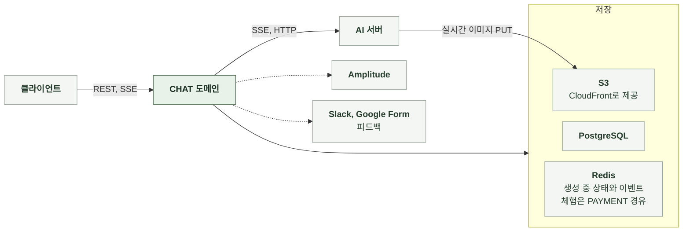

# 3-1 소프트웨어 구조

이 문서는 CHAT 도메인 백엔드의 개요, 배경과 목표, 품질 속성, 배포 단위, 모듈 구조, 의존 방향, 도메인 모델을 정한다.

테이블과 컬럼은 DB 스키마에, 코딩 규칙은 컨벤션에, 엔드포인트별 처리 순서는 처리 흐름에, 수신 연결 상한과 이벤트 보관 기간은 배포에 있다. ([3-2 DB 스키마](3-2-DB-SCHEMA.md), [3-3 컨벤션](3-3-CONVENTIONS.md), [4-1 처리 흐름](4-1-PIPELINES.md), [6-3 환경 변수와 시크릿](6-DEPLOYMENT.md#6-3-환경-변수와-시크릿))

 

### 3-1-1 개요

CHAT 도메인은 서버 애플리케이션 내부 패키지로 구성된다. 별도 프로세스로 실행하지 않는다. 같은 서버의 다른 도메인과는 서비스 호출로 연결한다.

| 외부 시스템 | 역할 | 연결 방식 |
|---|---|---|
| 클라이언트 | 입력 전송과 스트림 표시 | REST, SSE |
| AI 서버 | 턴 본문, 판정, 이미지, 선택지 생성 | SSE 수신, 동기 HTTP |
| PostgreSQL | 채팅, 메시지, 선택지, 이력, 공유, 피드백 저장 | JDBC |
| S3 | 실시간 이미지 저장 | AWS SDK, presigned URL |
| CloudFront | 이미지 제공 | 응답의 CDN URL |
| Redis | 생성 중 상태와 생성 이벤트 보관 체험 카운터 | 생성 중 키와 Redis Streams는 CHAT이 직접 접근 체험 카운터는 PAYMENT 도메인 경유 |
| Amplitude | 서버 분석 이벤트 | HTTP API |
| Slack, Google Form | 피드백 전달 | 웹훅, 폼 응답 |

 

### 3-1-2 배경과 목표

| 배경 | 설계 목표 |
|---|---|
| AI 응답 생성에 수십 초가 걸림 클라이언트는 생성 중인 글을 바로 보고 싶어 함 | 토큰을 받는 즉시 중계하고 완료 시점에만 저장 스트리밍 동안 DB 연결과 트랜잭션을 점유하지 않음 |
| 먼저 차감하고 실패하면 돌려주는 과금 구조 | 턴 저장 전에 끝난 요청은 반드시 환불 환불은 차감 건마다 정확히 1회 |
| AI 서버는 상태를 저장하지 않음 | 목표 사건, 거쳐온 사건, 도달 엔딩을 채팅에 보관하고 매 턴 다시 전달 |
| 제작자가 스토리를 수정하거나 비공개로 바꿀 수 있음 | 읽을 수 있으면 현재 값, 아니면 마지막 공개본으로 AI 입력을 구성 원본 행이 바뀌어도 도달 기록과 프롤로그는 채팅에 보관한 값으로 복구 |
| 같은 채팅에 이어쓰기와 재생성이 동시에 올 수 있음 | Redis 선점으로 생성 작업을 하나로 제한 저장은 채팅 행 잠금 안에서 시작 시점 상태를 재확인 |
| 생성 중 사용자가 채팅 화면을 나갈 수 있음 | 생성 작업과 연결의 수명을 분리 생성 중 상태를 조회하고 이벤트를 다시 수신 |
| 이미지 생성은 비용이 큼 | 턴당 1장으로 제한 체험 횟수와 비용을 턴과 분리해 관리 |
| AI 서버가 모델마다 다른 LLM을 쓰고 LLM 비용이 다름 모델과 가격은 앞으로 바뀔 수 있음 | 모델을 채팅 단위로 보관하고 턴마다 AI에 전달 모델 목록과 가격을 DB 표로 두어 가격 조정과 노출 변경에 배포가 필요 없게 함 |

 

### 3-1-3 품질 속성

| 속성 | 기준 | 보장 방법 |
|---|---|---|
| 접근 안전 | 채팅 기록은 소유자만 읽음 공유는 별도 토큰으로만 열림 턴 ID 외에는 자동 증가 키를 외부에 노출하지 않음 | 존재 판정 뒤 소유 판정 공개 UUID 공유 토큰은 채팅 식별자와 무관한 값 |
| 과금 정확성 | 저장된 턴만 과금 실패한 턴은 환불 모델을 바꿔도 진행 중인 턴의 가격은 변하지 않음 | 저장 확정 시점에 과금 확정 백그라운드 작업 종료 시 단일 판정으로 환불 차감 건별 멱등 키 모델과 가격은 턴 시작 시 한 번 읽어 차감과 AI 요청에 같은 값 사용 |
| 정합성 | 저장 시점에 마지막 턴이 바뀌었으면 결과를 폐기 | 채팅 행 잠금 안에서 마지막 턴 재확인 |
| 유출 방지 | 비공개로 전환한 뒤 고친 내용이 다른 독자의 턴에 실리지 않음 | AI 입력 데이터를 하나의 스냅샷에서 읽고 스토리를 읽을 수 없으면 마지막 공개본 사용 |
| 관측 작업의 실패 격리 | 지표, 분석 이벤트, 선택 기록 생략, 도달 집계의 중복 기록이 턴을 실패시키지 않음 AI 호출 기록의 DB 저장과 그 밖의 DB 오류는 예외 저장 실패는 요청에 전파됨 | 예외를 요청에 전파하지 않음 도달 집계는 독립 트랜잭션 |
| 이미지 신뢰 | 발급한 위치에 업로드된 이미지만 기록 | 발급 URL 일치와 객체 존재 확인 그 외 실시간 URL은 본문에서 제거 |
| 원문 보존 | 주인공 이름 토큰을 저장 원문에 유지 | 치환은 응답과 AI 요청에서만 수행 |

 

### 3-1-4 배포 단위

CHAT은 다른 도메인의 백엔드와 하나의 서버 이미지에 포함된다. 따로 배포하지 않는다.

 

### 3-1-5 모듈 구조

턴 진행의 전체 순서는 채팅 서비스가 관리한다. 저장은 별도 구성 요소가 트랜잭션 하나로 처리한다.

| 구성 요소 | 입력 | 출력 | 책임 |
|---|---|---|---|
| API 계층 | HTTP 요청 | HTTP 응답, SSE 스트림 | 형식 검증, 요청자 식별, 상태 코드, 스트림 문자 집합 지정, 잔액 부족 예외의 거절 응답 변환 |
| 채팅 서비스 | 생성, 조회, 삭제, 공유, 모델 변경, 턴 요청 | 응답과 SSE 이벤트 | 소유권과 읽기 판정, 유효 모델과 청구 모델 판정, 과금과 한도 관리, AI 요청 구성, 스트림 중계, 환불 판정, 지표 |
| 모델 목록 | 조회 요청 | 노출 중인 모델 목록 | 모델 표 조회, 기본 모델 제공, 코드 검증 |
| 턴 저장 | AI 결과, 판정, 선택 기록 | 저장된 턴 | 채팅 행 잠금, 메시지와 선택지 저장, 판정 반영, 재생성 교체, 선택지 채우기 |
| 실시간 이미지 | 이미지 사용 여부, 요청자 | 업로드 위치, 검증 결과 | 체험 예약, 업로드 위치 발급, 발급 URL 대조와 객체 확인, 체험 복원 |
| 도달 집계 | 회원, 스토리, 엔딩 이름 | 집계 행 | 독립 트랜잭션에서 중복 없이 기록 |
| 후보 이름 구분 | 후보 이름 목록, 플레이 이름 | AI 전달 이름과 원문 이름의 대응표 | 치환 뒤 중복되는 이름에 구분 표시 |
| AI 호출 | 구성된 요청, 트레이스 헤더 | 토큰 콜백, 완료 결과, 선택지 | SSE 수신, 역직렬화, 대기 시간 관리, 오류 변환 |
| 스트림 실행기 | 턴 작업 | 비동기 실행 | 전용 스레드 풀, 큐, MDC 전파 클라이언트 연결과 독립된 작업 수명 |
| 생성 중 상태와 이벤트 보관 | 생성 요청과 SSE 이벤트 | 생성 중 상태와 재수신할 이벤트 | 채팅별 생성 중 키 획득과 해제 Redis Streams 기록 수신 연결마다 수신 스레드 1개와 전용 Redis 연결 1개로 읽기 상한을 넘으면 즉시 거부 |
| 피드백 서비스 | 제보 요청 | 저장 결과 | 저장, 커밋 후 전달 이벤트 |
| 공통 | 모든 요청 | 요청자 식별자, 상관관계 식별자, 오류 응답 본문, 로그와 분석 이벤트 | 오류 응답, 인증, 상관관계 식별자, 구조화 로그, 분석 이벤트 |

 

### 3-1-6 의존 방향

| 방향 | 규칙 |
|---|---|
| API 계층 → 서비스 | API 계층은 서비스만 호출 저장 계층과 외부 시스템을 직접 호출하지 않음 |
| 서비스 → 다른 도메인 | 이프 차감과 환불, 체험 한도, 계정 상태 검사, 페르소나 스냅샷, 이미지 비용 정책값은 해당 도메인의 서비스 호출 턴 가격은 CHAT의 모델 표에서 읽음 |
| PAYMENT → CHAT | 정책값 응답의 턴 가격은 CHAT의 라이트(`BASIC`) 가격을 조회 |
| CHAT → STORY | 스토리 읽기 판정, 공개본 데이터, 시작 설정, 엔딩, 주요 사건, 인물 이미지, 표지 URL, 토큰 치환을 사용 도달 집계 행을 STORY 테이블에 기록 |
| ACCOUNT → CHAT | 내 채팅 목록 조회와 게스트 이관이 채팅 서비스와 저장 계층을 호출 |
| 서비스 → 피드백 전달 | 이벤트로만 연결 커밋 후 리스너가 비동기 발송 |
| 외부 시스템 | AI 서버와 S3는 인터페이스로 분리 스텁과 미구성 저장소로 대체 가능 |

 

### 3-1-7 도메인 모델

| 모델 | 하위 데이터 | 설계 의도 |
|---|---|---|
| 채팅 | 메시지, 선택지, 메시지 버전, 거쳐온 사건, 공유 | 하위 데이터의 수명은 채팅과 같음 진행 상태, 스냅샷, 선택한 모델을 채팅 행에 둠 |
| 모델 | 없음 | 코드가 AI 계약값인 문자열 PK 이름, 턴당 가격, 노출 순서, 노출 여부, 새 채팅 기본 여부를 행으로 보관 노출 중단만 하고 삭제하지 않음 |
| 메시지 | 선택지, 버전 이력 | 사용자 입력과 AI 응답을 순서 번호로 나열 AI 응답은 재생성으로 제자리 교체 |
| 공유 | 없음 | 발급 시점의 턴 수만 기록 메시지를 복사하지 않음 |
| 피드백 | 없음 | 제보 한 건 |

 

| 채팅의 판정 | 의미 |
|---|---|
| 소유 | 회원 소유 채팅은 그 회원, 소유자 없는 채팅은 익명 요청 |
| 마지막 턴 | 순서 번호가 가장 큰 AI 응답 메시지 |
| 진행 중 | 도달 엔딩이 없음 도달하면 `ENDED` 도달 후에도 이어쓰기는 계속 가능하고 재생성은 불가 |
| AI 입력 데이터 출처 | 채팅 소유자가 스토리를 읽을 수 있으면 현재 값, 아니면 마지막 공개본 |
| 유효 모델 | 채팅에 보관한 모델이 노출 중이면 그 모델, 아니면 기본 모델 |
| 청구 모델 | 게스트와 회원 체험 턴은 라이트(`BASIC`), 그 외는 턴 시작 시점의 유효 모델 AI 요청의 `model_tier`와 차감 가격의 기준 |
