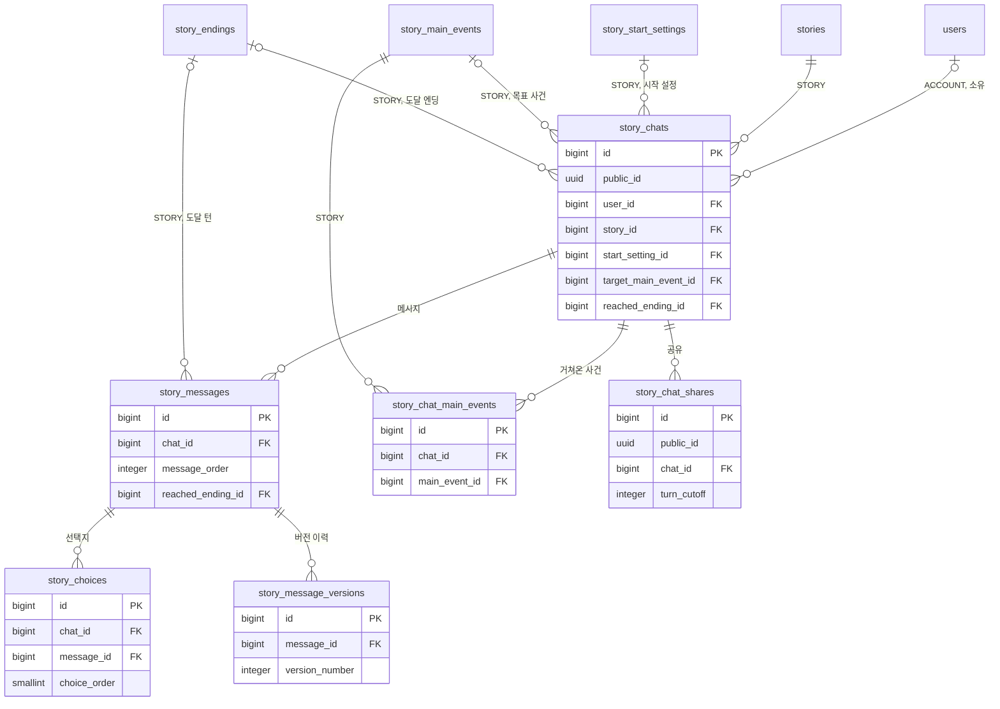
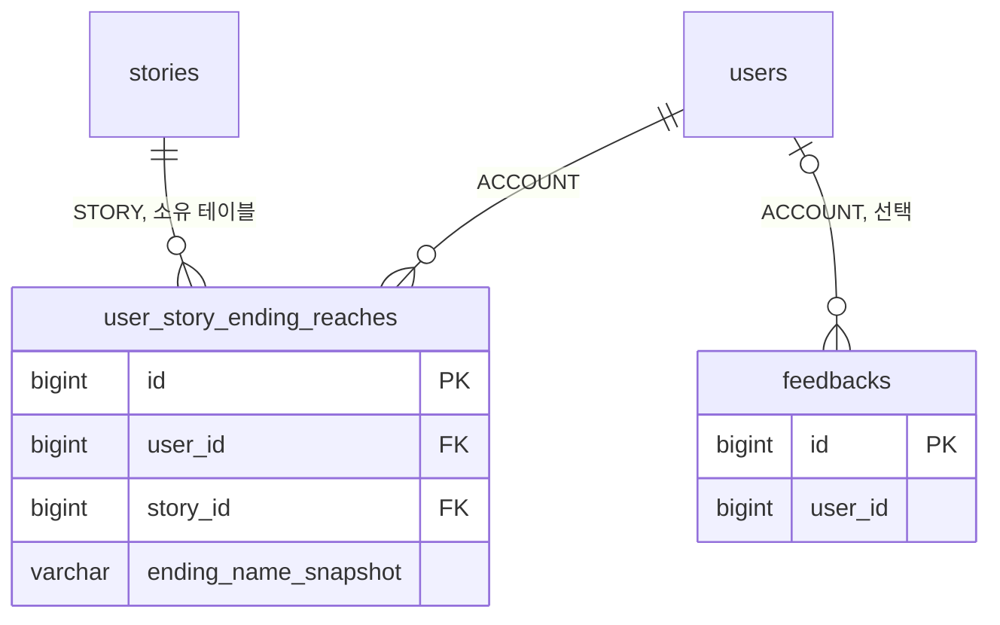

# 3-2 DB 스키마

이 문서는 CHAT 도메인이 관리하는 PostgreSQL 테이블의 컬럼, 제약, 인덱스와 데이터 수명을 정한다.

다른 도메인의 테이블은 이 도메인이 참조하거나 기록하는 컬럼만 적는다.

입력값의 검증 규칙은 보안에, 저장과 교체의 처리 순서는 처리 흐름에 있다. ([5-1-4 입력 검증](5-1-SECURITY.md#5-1-4-입력-검증), [4-1-12 턴 저장과 판정 반영](4-1-PIPELINES.md#4-1-12-턴-저장과-판정-반영))

 

### 3-2-1 공통 규칙

| 규칙 | 내용 |
|---|---|
| 식별자 | 내부 PK는 `bigint` 자동 증가 외부에 노출하는 리소스는 `public_id uuid`를 따로 두고 API는 이 값만 사용: 채팅, 공유 턴 ID는 AI 응답 메시지의 `bigint` PK를 그대로 노출 |
| 시각 | `timestamp with time zone` 모든 테이블에 `created_at`이 있으며 기본값은 `now()` 갱신하는 테이블에는 `updated_at`이 있음 아래 표에서는 생략 |
| 삭제 | 채팅 삭제 시 `story_chats.deleted_at` 기록 하위 테이블의 행은 유지하고 조회 시 채팅의 삭제 여부로 제외 |
| FK | 채팅을 물리 삭제하면 하위 테이블의 행도 함께 삭제(`ON DELETE CASCADE`) 채팅이 참조하는 시작 설정, 목표 사건, 도달 엔딩이 삭제되면 값만 비움(`ON DELETE SET NULL`) 거쳐온 사건의 조인 행은 주요 사건 삭제 시 함께 삭제 |
| 순서 | 메시지는 채팅 안에서 `message_order` 1부터 선택지는 메시지 안에서 `choice_order` 1부터 |
| 글 | 메시지 본문은 AI 응답 원문을 이미지 마커와 함께 보존 프롤로그 스냅샷은 플레이 이름으로 치환한 값 |
| 이름 스냅샷 | 도달 엔딩과 거쳐온 사건은 FK와 별도로 토큰 원문 이름을 보관 원본 행이 교체돼도 기록이 남음 |

 

### 3-2-2 관계도

관계도는 데이터 묶음별 소유 관계를 보여준다. 각 상자에는 식별과 연결에 쓰는 컬럼만 표시한다. 전체 컬럼은 아래 표에서 정의한다. 다른 도메인의 테이블은 관계 라벨에 도메인을 적고 컬럼을 생략한다.

**1. 채팅**

 

**2. 도달 집계와 피드백**

 

### 3-2-3 채팅

**`story_chats`**

| 컬럼 | 타입 | 제약 | 의미 |
|---|---|---|---|
| `id` | bigint | PK | |
| `public_id` | uuid | NOT NULL, UNIQUE, 기본 `gen_random_uuid()` | |
| `user_id` | bigint | | 게스트 채팅은 `NULL` 이관 시 채워짐 |
| `story_id` | bigint | NOT NULL, FK `stories.id` | |
| `start_setting_id` | bigint | FK `story_start_settings.id` SET NULL | |
| `persona_name_snapshot` | text | | 시작 시 선택한 페르소나 이름 |
| `persona_description_snapshot` | text | | 시작 시 선택한 페르소나 설명 |
| `creation_id` | uuid | | 간편 제작 스토리의 스토리라인 생성 요청 ID 일반 제작 스토리는 `NULL` |
| `story_prologue_snapshot` | text | | 시작 시점의 프롤로그 시작 설정 참조가 끊겼을 때 표시 |
| `title` | varchar(100) | | 사용하지 않음 |
| `summary` | text | | 사용하지 않음 |
| `current_turn` | integer | NOT NULL, 기본 0 | 완료된 턴 수 |
| `regenerated_count` | integer | NOT NULL, 기본 0 | 재생성 완료 횟수 |
| `target_main_event_id` | bigint | FK `story_main_events.id` SET NULL | 목표 사건 |
| `target_progress_turns` | integer | NOT NULL, 기본 0 | 목표 사건 진행 턴 수 |
| `occurred_main_event_names_snapshot` | jsonb | | 거쳐온 사건 이름 배열 |
| `reached_ending_id` | bigint | FK `story_endings.id` SET NULL | 최초 도달 엔딩 |
| `reached_ending_name_snapshot` | varchar(100) | | 도달 시점의 엔딩 이름 |
| `status` | varchar(20) | NOT NULL, 기본 `ACTIVE` | `ACTIVE`, `ENDED` |
| `deleted_at` | timestamptz | | |

| 인덱스 | 컬럼 |
|---|---|
| `idx_story_chats_story` | `story_id` |
| `idx_story_chats_user_updated` | `(user_id, updated_at DESC, id DESC)` WHERE `deleted_at IS NULL` |

 

### 3-2-4 메시지와 선택지

**`story_messages`**

| 컬럼 | 타입 | 제약 | 의미 |
|---|---|---|---|
| `id` | bigint | PK | 턴 ID는 AI 응답 행의 값 |
| `chat_id` | bigint | NOT NULL, FK `story_chats.id` | |
| `role` | varchar(16) | NOT NULL | `USER`, `ASSISTANT`, `SYSTEM` |
| `content` | text | NOT NULL | AI 응답은 재생성으로 교체됨 |
| `message_order` | integer | NOT NULL, UNIQUE `(chat_id, message_order)` | |
| `reached_ending_id` | bigint | FK `story_endings.id` SET NULL | 도달 턴의 AI 응답에만 |
| `reached_ending_name_snapshot` | varchar(100) | | 도달 턴 표식 FK가 비워져도 남음 |

 

**`story_choices`**

| 컬럼 | 타입 | 제약 | 의미 |
|---|---|---|---|
| `id` | bigint | PK | |
| `chat_id` | bigint | NOT NULL, FK `story_chats.id` | |
| `message_id` | bigint | NOT NULL, FK `story_messages.id` | AI 응답 메시지 |
| `choice_text` | text | NOT NULL | |
| `choice_order` | smallint | NOT NULL, UNIQUE `(message_id, choice_order)` | |
| `is_selected` | boolean | NOT NULL, 기본 `false` | 다음 턴 저장 시 기록 |
| `selected_at` | timestamptz | | |
| `is_edited` | boolean | | `NULL`은 선택 기록 없음 `false`는 그대로 보냄, `true`는 고쳐 보냄 |

| 인덱스 | 컬럼 |
|---|---|
| `idx_story_choices_message` | `message_id` |
| `idx_story_choices_chat` | `chat_id` |

 

**`story_message_versions`**

| 컬럼 | 타입 | 제약 | 의미 |
|---|---|---|---|
| `id` | bigint | PK | |
| `message_id` | bigint | NOT NULL, FK `story_messages.id` | |
| `version_number` | integer | NOT NULL, UNIQUE `(message_id, version_number)` | 1부터, 보관 순서 |
| `content` | text | NOT NULL | 교체 직전 AI 응답 |
| `choices` | text | NOT NULL | 교체 직전 선택지의 JSON 배열 |

| 인덱스 | 컬럼 |
|---|---|
| `idx_story_message_versions_message_id` | `message_id` |

 

### 3-2-5 거쳐온 사건과 공유

**`story_chat_main_events`**

| 컬럼 | 타입 | 제약 | 의미 |
|---|---|---|---|
| `id` | bigint | PK | |
| `chat_id` | bigint | NOT NULL, FK `story_chats.id` | |
| `main_event_id` | bigint | NOT NULL, FK `story_main_events.id` CASCADE, UNIQUE `(chat_id, main_event_id)` | |

| 인덱스 | 컬럼 |
|---|---|
| `idx_story_chat_main_events_chat` | `chat_id` |

 

**`story_chat_shares`**

| 컬럼 | 타입 | 제약 | 의미 |
|---|---|---|---|
| `id` | bigint | PK | |
| `public_id` | uuid | NOT NULL, UNIQUE | 열람 토큰 |
| `chat_id` | bigint | NOT NULL, FK `story_chats.id` | |
| `turn_cutoff` | integer | NOT NULL, UNIQUE `(chat_id, turn_cutoff)` | 발급 시점의 `current_turn` |

 

### 3-2-6 피드백

**`feedbacks`**

| 컬럼 | 타입 | 제약 | 의미 |
|---|---|---|---|
| `id` | bigint | PK | |
| `user_id` | bigint | | 회원이면 기록 |
| `body` | text | NOT NULL | |
| `email` | varchar(320) | | |
| `platform` | varchar(20) | | `IOS`, `ANDROID`, `WEB` |
| `app_version` | varchar(50) | | |
| `user_agent` | varchar(512) | | 요청 헤더 원문을 512자로 잘라 저장 |

| 인덱스 | 컬럼 |
|---|---|
| `idx_feedbacks_created_at` | `created_at DESC` |

 

### 3-2-7 다른 도메인의 테이블

**`user_story_ending_reaches`** (STORY 소유, CHAT이 기록)

| 컬럼 | 타입 | 제약 | 의미 |
|---|---|---|---|
| `user_id` | bigint | NOT NULL, FK `users.id` | 회원만 |
| `story_id` | bigint | NOT NULL, FK `stories.id` | |
| `ending_name_snapshot` | varchar(100) | NOT NULL, UNIQUE `(user_id, story_id, ending_name_snapshot)` | 집계 식별자 |
| `ending_id` | bigint | FK `story_endings.id` | 도달 시점에 찾은 행 교체되면 비워짐 |

| 테이블 | 참조하는 컬럼 |
|---|---|
| `stories` | `id`, `public_id`, `user_id`, `title`, `protagonist_name`, 표지 컬럼, 발행과 공개 상태, `deleted_at` |
| `story_public_snapshots` | 마지막 공개본의 설정, 시작 설정, 엔딩, 주요 사건, 인물 이미지 |
| `story_start_settings` | `id`, `public_id`, `prologue`, `name`, `start_situation` |
| `story_suggested_inputs` | 시작 설정의 추천 입력 |
| `story_endings` | `id`, `name`, `min_turns`, `achievement_condition`, `epilogue`, `enabled` |
| `story_main_events` | `id`, `name`, `description`, `key_sentence`, `sort_order` |
| `story_character_images` | 인물 이름, 이미지 이름, URL |
| `story_creation_sessions` | `storyline_request_id` |
| `users` | `id`, 계정 상태 |
| `user_personas` | 이름, 설명 |
| `credit_transactions` | `CHAT_TURN`, `CHAT_IMAGE`, `REFUND` 행의 `ref_type`과 `ref_id` |

 

### 3-2-8 데이터 수명

| 데이터 | 삭제 |
|---|---|
| 채팅과 하위 데이터 | `deleted_at` 기록 물리 삭제 없음 |
| 메시지 버전 이력 | 삭제 없음 |
| 선택지 | 재생성 시 활성 선택지만 교체 이전 값은 버전 이력에 남음 |
| 실시간 이미지 객체 | 삭제 없음 |
| 공유 | 삭제 없음 원본 채팅의 `deleted_at`으로 열람 차단 |
| 도달 집계 | 삭제 없음 |
| 피드백 | 삭제 없음 |
