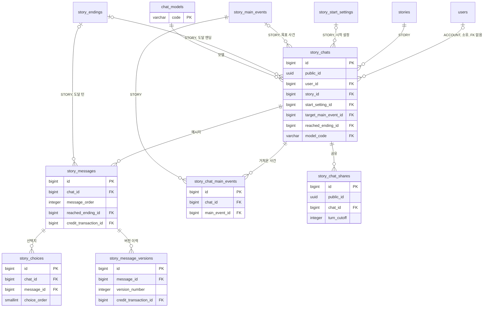
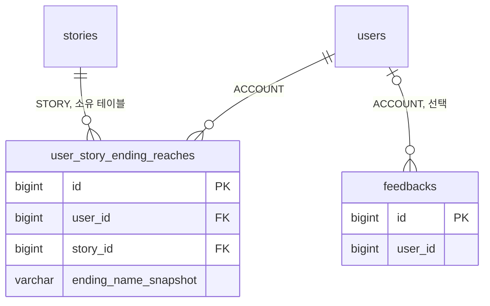

# 3-2 DB 스키마

이 문서는 CHAT 도메인이 관리하는 PostgreSQL 테이블의 컬럼, 제약, 인덱스와 데이터 수명을 정한다.

다른 도메인의 테이블에서는 CHAT 도메인이 참조하거나 기록하는 컬럼만 설명한다.

입력값의 검증 규칙은 보안에, 저장과 교체의 처리 순서는 처리 흐름에 있다. ([5-1-4 입력 검증](5-1-SECURITY.md#5-1-4-입력-검증), [4-1-12 턴 저장과 판정 반영](4-1-PIPELINES.md#4-1-12-턴-저장과-판정-반영))

 

### 3-2-1 공통 규칙

| 규칙 | 내용 |
|---|---|
| 식별자 | 내부 PK는 `bigint` 자동 증가 채팅과 공유는 외부 노출용으로 `public_id uuid`를 따로 둠 채팅과 공유를 식별하는 API는 공개 식별자만 사용 턴 ID는 AI 응답 메시지의 `bigint` PK를 그대로 노출 |
| 시각 | `timestamp with time zone` 모든 테이블에 `created_at`이 있으며 기본값은 `now()` `updated_at`은 채팅과 모델에만 있음 아래 표에서는 생략 |
| 삭제 | 채팅 삭제 시 `story_chats.deleted_at` 기록 하위 테이블의 행은 유지하고 조회 시 채팅의 삭제 여부로 제외 |
| FK | 채팅을 물리 삭제하면 하위 테이블의 행도 함께 삭제(`ON DELETE CASCADE`) 채팅이 참조하는 시작 설정, 목표 사건, 도달 엔딩이 삭제되면 값만 비움(`ON DELETE SET NULL`) 거쳐온 사건의 조인 행은 주요 사건 삭제 시 함께 삭제 모델과 원장 행은 삭제하지 않으므로 모델 참조와 차감 행 참조는 삭제 동작 없음 |
| 순서 | 메시지는 채팅 안에서 `message_order`를 1부터 부여 선택지는 메시지 안에서 `choice_order`를 1부터 부여 |
| 글 | 메시지 본문은 AI 응답 원문을 이미지 마커와 함께 보존 프롤로그 스냅샷은 플레이 이름으로 치환한 값 |
| 이름 스냅샷 | 도달 엔딩과 거쳐온 사건은 FK와 별도로 토큰 원문 이름을 보관 원본 행이 교체돼도 기록이 남음 |

 

### 3-2-2 관계도

관계도는 데이터 묶음별 소유 관계를 보여준다. 각 상자에는 식별과 연결에 쓰는 컬럼만 표시한다. 전체 컬럼은 아래 표에서 정의한다. 다른 도메인의 테이블은 관계 라벨에 도메인을 적고 컬럼을 생략한다.

**1. 채팅**

 

**2. 도달 집계와 피드백**

 

### 3-2-3 채팅

**`story_chats`**

| 컬럼 | 타입 | 제약 | 의미 |
|---|---|---|---|
| `id` | bigint | PK | |
| `public_id` | uuid | NOT NULL, UNIQUE, 기본 `gen_random_uuid()` | |
| `user_id` | bigint | | 게스트 채팅은 `NULL` 이관 시 채워짐 |
| `story_id` | bigint | NOT NULL, FK `stories.id` | |
| `start_setting_id` | bigint | FK `story_start_settings.id` SET NULL | |
| `persona_name_snapshot` | text | CHECK 1~20자 설명과 함께 있거나 함께 없음 | 시작 시 선택한 페르소나 이름 |
| `persona_description_snapshot` | text | CHECK 1~1,000자 | 시작 시 선택한 페르소나 설명 |
| `creation_id` | uuid | | 간편 제작 스토리의 스토리라인 생성 요청 ID 일반 제작 스토리는 `NULL` |
| `story_prologue_snapshot` | text | | 시작 시점의 프롤로그 읽을 수 없는 스토리에서 시작 설정 참조가 끊겼을 때 표시 |
| `title` | varchar(100) | | 사용하지 않음 |
| `summary` | text | | 대화 요약 `summary_through_turn`이 0이면 값과 무관하게 요약 없음 |
| `summary_through_turn` | integer | NOT NULL, 기본 0, CHECK `>= 0` | 요약 끝 턴 0은 요약 없음 |
| `current_turn` | integer | NOT NULL, 기본 0, CHECK `>= 0` | 완료된 턴 수 |
| `regenerated_count` | integer | NOT NULL, 기본 0, CHECK `>= 0` | 재생성 완료 횟수 |
| `target_main_event_id` | bigint | FK `story_main_events.id` SET NULL | 목표 사건 |
| `target_progress_turns` | integer | NOT NULL, 기본 0 | 목표 사건 진행 턴 수 |
| `occurred_main_event_names_snapshot` | jsonb | | 거쳐온 사건 이름 배열 |
| `reached_ending_id` | bigint | FK `story_endings.id` SET NULL | 최초 도달 엔딩 |
| `reached_ending_name_snapshot` | varchar(100) | | 도달 시점의 엔딩 이름 |
| `status` | varchar(20) | NOT NULL, 기본 `ACTIVE`, CHECK `ACTIVE` `ENDED` | |
| `model_code` | varchar(20) | NOT NULL, FK `chat_models.code`, 기본 `LITE` | 선택한 모델 DB 기본값은 컬럼 추가 시 기존 행을 채우고 컬럼을 모르는 구버전 코드의 삽입을 받기 위한 값 새 채팅의 값은 앱이 기본 모델(`is_default`)로 명시해 저장 |
| `long_response` | boolean | NOT NULL, 기본 `false` | 출력 분량 `false`는 짧은 응답, `true`는 긴 응답 |
| `deleted_at` | timestamptz | | |

| 인덱스 | 컬럼 |
|---|---|
| `idx_story_chats_story` | `story_id` |
| `idx_story_chats_user_updated` | `(user_id, updated_at DESC, id DESC)` WHERE `deleted_at IS NULL` |

 

**`chat_models`**

턴 본문을 생성할 모델의 목록이다. 운영자가 직접 기록한다.

| 컬럼 | 타입 | 제약 | 의미 |
|---|---|---|---|
| `code` | varchar(20) | PK | AI 턴 요청의 `model_tier` 계약값 |
| `name` | varchar(30) | NOT NULL | 표시 이름 |
| `turn_cost` | bigint | NOT NULL, CHECK `1 이상 10000 이하` | 턴당 소모 이프 재생성 포함 상한으로 자릿수 오타 방지 |
| `sort_order` | integer | NOT NULL, CHECK `>= 1` | 노출 순서 |
| `is_active` | boolean | NOT NULL, 기본 `true` | 목록 노출과 선택 허용 여부 |
| `is_default` | boolean | NOT NULL, 기본 `false`, CHECK `is_active OR NOT is_default` | 새 채팅과 비활성 모델 대체에 쓰는 기본 모델 노출 중인 행만 가능 |

| 인덱스 | 컬럼 |
|---|---|
| `uq_chat_models_default` | `(is_default)` UNIQUE WHERE `is_default` |

| `code` | `name` | `turn_cost` | `sort_order` | `is_default` |
|---|---|---|---|---|
| `LITE` | 라이트 | 20 | 1 | `false` |
| `AURORA` | 오로라 | 50 | 2 | `true` |

새 모델 코드를 추가하려면 AI 서버의 라우팅이 그 코드를 먼저 알아야 한다. ([6-4 배포 조건](6-DEPLOYMENT.md#6-4-배포-조건))

 

### 3-2-4 메시지와 선택지

**`story_messages`**

| 컬럼 | 타입 | 제약 | 의미 |
|---|---|---|---|
| `id` | bigint | PK | 턴 ID는 AI 응답 행의 값 |
| `chat_id` | bigint | NOT NULL, FK `story_chats.id` | |
| `role` | varchar(16) | NOT NULL, CHECK `USER` `ASSISTANT` `SYSTEM` | |
| `content` | text | NOT NULL | AI 응답은 재생성으로 교체됨 |
| `message_order` | integer | NOT NULL, CHECK `> 0`, UNIQUE `(chat_id, message_order)` | |
| `reached_ending_id` | bigint | FK `story_endings.id` SET NULL | 도달 턴의 AI 응답에만 기록 |
| `reached_ending_name_snapshot` | varchar(100) | | 도달 턴 표식 FK가 비워져도 남음 |
| `credit_transaction_id` | bigint | FK `credit_transactions.id` | 활성본을 생성한 턴의 `CHAT_TURN` 차감 행 체험 턴, 게스트 턴, 사용자 입력 행은 `NULL` 선차감 대사가 저장 여부를 판정하는 연결 |

| 인덱스 | 컬럼 |
|---|---|
| `uq_story_messages_credit_transaction` | `credit_transaction_id` UNIQUE WHERE `credit_transaction_id IS NOT NULL` |

 

**`story_choices`**

| 컬럼 | 타입 | 제약 | 의미 |
|---|---|---|---|
| `id` | bigint | PK | |
| `chat_id` | bigint | NOT NULL, FK `story_chats.id` | |
| `message_id` | bigint | NOT NULL, FK `story_messages.id` | AI 응답 메시지 |
| `choice_text` | text | NOT NULL | |
| `choice_order` | smallint | NOT NULL, CHECK `> 0`, UNIQUE `(message_id, choice_order)` | |
| `is_selected` | boolean | NOT NULL, 기본 `false` | 다음 턴 저장 시 기록 |
| `selected_at` | timestamptz | | |
| `is_edited` | boolean | | `NULL`은 선택 기록 없음 `false`는 그대로 보냄, `true`는 고쳐 보냄 |

| 인덱스 | 컬럼 |
|---|---|
| `idx_story_choices_message` | `message_id` |
| `idx_story_choices_chat` | `chat_id` |

 

**`story_message_versions`**

| 컬럼 | 타입 | 제약 | 의미 |
|---|---|---|---|
| `id` | bigint | PK | |
| `message_id` | bigint | NOT NULL, FK `story_messages.id` | |
| `version_number` | integer | NOT NULL, UNIQUE `(message_id, version_number)` | 보관 순서에 따라 1부터 부여 |
| `content` | text | NOT NULL | 교체 직전 AI 응답 |
| `choices` | text | NOT NULL | 교체 직전 선택지의 JSON 배열 |
| `credit_transaction_id` | bigint | FK `credit_transactions.id` | 교체 직전 활성본을 생성한 차감 행 교체 시 메시지 행의 값을 옮겨 보관 체험 턴과 게스트 턴은 `NULL` |

| 인덱스 | 컬럼 |
|---|---|
| `idx_story_message_versions_message_id` | `message_id` |
| `uq_story_message_versions_credit_transaction` | `credit_transaction_id` UNIQUE WHERE `credit_transaction_id IS NOT NULL` |

 

### 3-2-5 거쳐온 사건과 공유

**`story_chat_main_events`**

| 컬럼 | 타입 | 제약 | 의미 |
|---|---|---|---|
| `id` | bigint | PK | |
| `chat_id` | bigint | NOT NULL, FK `story_chats.id` | |
| `main_event_id` | bigint | NOT NULL, FK `story_main_events.id` CASCADE, UNIQUE `(chat_id, main_event_id)` | |

| 인덱스 | 컬럼 |
|---|---|
| `idx_story_chat_main_events_chat` | `chat_id` |

 

**`story_chat_shares`**

| 컬럼 | 타입 | 제약 | 의미 |
|---|---|---|---|
| `id` | bigint | PK | |
| `public_id` | uuid | NOT NULL, UNIQUE | 열람 토큰 |
| `chat_id` | bigint | NOT NULL, FK `story_chats.id` | |
| `turn_cutoff` | integer | NOT NULL, UNIQUE `(chat_id, turn_cutoff)` | 발급 시점의 `current_turn` |

 

### 3-2-6 피드백

**`feedbacks`**

| 컬럼 | 타입 | 제약 | 의미 |
|---|---|---|---|
| `id` | bigint | PK | |
| `user_id` | bigint | | 회원이면 기록 |
| `body` | text | NOT NULL, CHECK 공백만은 불가 | |
| `email` | varchar(320) | | |
| `platform` | varchar(20) | CHECK `IOS` `ANDROID` `WEB` | |
| `app_version` | varchar(50) | | |
| `user_agent` | varchar(512) | | 요청 헤더 원문을 512자로 잘라 저장 |

| 인덱스 | 컬럼 |
|---|---|
| `idx_feedbacks_created_at` | `created_at DESC` |

 

### 3-2-7 다른 도메인의 테이블

**`user_story_ending_reaches`** (STORY 소유, CHAT이 기록)

| 컬럼 | 타입 | 제약 | 의미 |
|---|---|---|---|
| `user_id` | bigint | NOT NULL, FK `users.id` | 회원만 기록 |
| `story_id` | bigint | NOT NULL, FK `stories.id` | |
| `ending_name_snapshot` | varchar(100) | NOT NULL, UNIQUE `(user_id, story_id, ending_name_snapshot)` | 집계 식별자 |
| `ending_id` | bigint | FK `story_endings.id` | 도달 시점에 찾은 행 교체되면 비워짐 |

| 테이블 | 참조하는 컬럼 |
|---|---|
| `stories` | `id`, `public_id`, `user_id`, `title`, `protagonist_name`, 표지 컬럼, 발행과 공개 상태, `deleted_at` |
| `story_public_snapshots` | 마지막 공개본의 설정, 시작 설정, 엔딩, 주요 사건, 인물 이미지 |
| `story_start_settings` | `id`, `public_id`, `prologue`, `name`, `start_situation` |
| `story_suggested_inputs` | 시작 설정의 추천 입력 |
| `story_endings` | `id`, `name`, `min_turns`, `achievement_condition`, `epilogue`, `enabled` |
| `story_main_events` | `id`, `name`, `description`, `key_sentence`, `sort_order` |
| `story_character_images` | 인물 이름, 이미지 이름, URL |
| `story_creation_sessions` | `storyline_request_id` |
| `users` | `id`, 계정 상태 |
| `user_personas` | 이름, 설명 |
| `credit_transactions` | `CHAT_TURN`, `CHAT_IMAGE`, `REFUND` 행의 `ref_type`과 `ref_id` 턴 소모와 그 환불의 `ref_type`은 `CHAT_TURN`, 이미지는 `CHAT_IMAGE` `CHAT_TURN` 소모 행의 `id`를 메시지와 버전 이력에 연결 `CHAT_TURN` 행의 `amount`는 청구 모델의 가격이라 같은 채팅 안에서 섞일 수 있음 |

 

### 3-2-8 데이터 수명

| 데이터 | 삭제 |
|---|---|
| 채팅과 하위 데이터 | `deleted_at` 기록 물리 삭제 없음 |
| 메시지 버전 이력 | 삭제 없음 |
| 선택지 | 재생성 시 활성 선택지만 교체 이전 값은 버전 이력에 남음 |
| 대화 요약 | 새 요약이 덮어씀 재생성이 요약 범위의 턴을 바꾸면 비움 |
| 실시간 이미지 객체 | 삭제 없음 |
| 공유 | 삭제 없음 원본 채팅의 `deleted_at`으로 열람 차단 |
| 모델 | 노출 중단만 수행 물리 삭제 없음 |
| 도달 집계 | 삭제 없음 |
| 피드백 | 삭제 없음 |
