# 4-1 처리 흐름

이 문서는 CHAT 도메인의 요청 수신부터 응답까지의 처리 단계를 정한다.

요청 필드, 응답 필드와 실패 응답은 계약에, 대기 한도와 복구 규칙은 오류 처리에, 멱등과 잠금은 동시성에 있다. ([4-2 계약](4-2-CONTRACT.md), [5-3 오류 처리](5-3-ERROR-HANDLING.md), [5-2 동시성](5-2-CONCURRENCY.md))

<br>

### 4-1-1 공통 처리

모든 요청은 상관관계 필터에서 요청 ID를 받는다. 이어서 보안 필터가 인증 수준을 판정한다. 검사를 마친 요청을 API 계층으로 전달한다.

채팅을 식별자로 찾을 때 식별자 형식이 잘못됐거나 채팅이 없거나 삭제됐으면 같은 결과로 처리한다. 존재를 확인한 뒤 소유권을 판정한다. 회원 소유 채팅은 그 회원만, 소유자 없는 채팅은 익명 요청만 통과한다.

응답과 AI 요청에 포함할 스토리 데이터는 요청자가 스토리를 읽을 수 있으면 현재 값을 쓴다. 턴 요청의 요청자는 채팅 소유자이고 공유 열람의 요청자는 열람자다. 읽을 수 없으면 그 스토리의 마지막 공개본을 쓴다. 두 경우 모두 같은 형식으로 변환해 동일한 방식으로 응답과 AI 요청을 구성한다. 이름 토큰은 플레이 이름으로 치환한다.

흐름도에서 AI 서버나 외부 저장소를 호출하는 단계는 주황색이다.

<br>

**AI 호출**

턴 본문은 SSE로 받고 선택지는 동기 HTTP로 받는다. 백엔드는 재시도하지 않는다. 요청 필드 이름은 snake_case이고 완료 이벤트의 필드 이름은 camelCase다. 스텁 설정이 켜진 환경에서는 AI를 호출하지 않고 정해진 더미 응답을 반환한다.

| 요청 | 방식 | 성공 | 실패 |
|---|---|---|---|
| 턴 | `POST /api/v1/chat/turns` | 200, SSE<br>`token`, `character_image`, `ping`, `completed` | 4xx, 5xx, SSE `error`, 시간 초과 |
| 선택지 | `POST /api/v1/chat/choices` | 200, JSON<br>선택지 3개 | 4xx, 5xx, 시간 초과 |

요청 헤더는 값이 없으면 생략한다.

| 요청 헤더 | 값 | 턴 | 선택지 |
|---|---|---|---|
| `X-Manyak-Request-Id`, `X-Manyak-Session-Id` | 클라이언트 요청 헤더를 전달<br>`unknown`이면 생략 | 보냄 | 보냄 |
| `X-Manyak-Device-Id-Hash` | `X-Manyak-Device-Id`의 해시 | 보냄 | 보냄 |
| `X-Manyak-Creation-Id` | 채팅에 저장한 간편 제작의 스토리라인 생성 요청 ID<br>일반 제작 스토리는 생략 | 보냄 | 보냄 |
| `X-Manyak-Story-Id` | 스토리 공개 ID | 보냄 | 보냄 |
| `X-Manyak-Chat-Id` | 채팅 공개 ID | 보냄 | 보냄 |
| `X-Manyak-Start-Setting-Id` | 시작 설정 공개 ID<br>참조가 끊겼으면 생략 | 보냄 | 보냄 |
| `X-Manyak-Turn-Number` | 이어쓰기는 `current_turn + 1`의 예측치<br>재생성과 선택지는 `current_turn` | 보냄 | 보냄 |
| `X-Manyak-Is-Regenerated` | 재생성이면 `true`, 그 외 `false` | 보냄 | 보냄 |
| `traceparent` | 추적이 켜진 환경의 현재 스팬 | 보냄 | 보냄 |

응답의 `meta`는 AI 호출 기록에 적재한다. 턴은 완료 이벤트의 camelCase 필드, 선택지는 응답 본문의 snake_case 필드다.

| `meta` 필드명 | 타입 | 처리 |
|---|---|---|
| `model`, `provider` | `string` | 실제 모델과 공급자<br>스텁 환경은 둘 다 `stub` |
| `promptVersions` | `map<string, integer>` | 템플릿별 버전 |
| `inputTokenCount`, `outputTokenCount` | `integer / null` | 이미지 호출을 제외한 토큰 합계 |
| `retryCount` | `integer` | AI 내부 보완 호출 횟수 |

<br>

### 4-1-2 채팅 생성

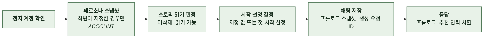

- 게스트가 페르소나를 지정하면 스토리를 조회하기 전에 거절한다.
- 소유자 없는 스토리에는 회원이 채팅을 시작할 수 없다.
- 지정한 시작 설정이 이 스토리에 속하지 않으면 거절한다. 임의로 첫 시작 설정으로 바꾸지 않는다.
- 시작 설정이 없는 스토리는 프롤로그와 추천 입력이 빈 값이다.
- 스토리가 간편 제작으로 만들어졌으면 그 스토리라인 생성 요청 ID를 채팅에 저장한다. 이후 턴마다 AI 호출 헤더로 보낸다.
- 페르소나 이름과 설명은 같은 시점에 함께 복사한다. 이후 원본이 바뀌어도 채팅에는 반영하지 않는다.

<br>

### 4-1-3 일괄 조회

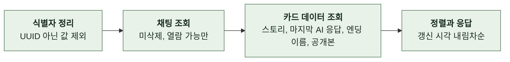

- 유효한 식별자가 없으면 DB를 조회하지 않고 빈 배열을 반환한다.
- 열람할 수 없는 채팅은 오류 없이 제외한다.
- 갱신 시각이 같으면 내부 ID 내림차순으로 정렬한다.
- 스토리 제목, 표지, 도달 엔딩 이름은 요청자가 스토리를 읽을 수 있으면 현재 값, 아니면 마지막 공개본이다. 공개본은 읽을 수 없는 스토리에 대해서만 조회한다.
- 마지막 AI 응답은 채팅당 최신 1건을 한 번의 쿼리로 가져온다.
- 도달 엔딩 이름은 현재 행이나 공개본에서 찾는다. 참조가 끊겼으면 채팅에 보관한 이름을 쓴다.
- 전체 조회를 하나의 `REPEATABLE_READ` 읽기 전용 트랜잭션에서 수행한다.

<br>

### 4-1-4 상세

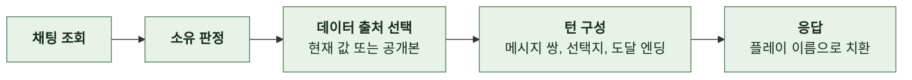

- 턴은 사용자 입력 직후의 AI 응답을 짝지어 만든다. 짝이 없는 사용자 입력과 시스템 메시지는 제외한다.
- 추천 입력은 턴이 없을 때만 채운다. 턴이 있으면 빈 배열이다.
- 스토리를 읽을 수 없으면 제목, 프롤로그, 추천 입력을 마지막 공개본에서 가져온다. 시작 설정 참조가 끊겼으면 프롤로그는 채팅에 보관한 값이고 추천 입력은 빈 배열이다.
- 턴의 도달 엔딩 이름은 현재 행이나 공개본에서 찾는다. 참조가 끊겼으면 메시지에 보관한 이름을 쓴다.
- 조회는 `REPEATABLE_READ` 읽기 전용 트랜잭션에서 수행한다.

<br>

### 4-1-5 삭제


- 하위 데이터는 지우지 않는다. 공유는 원본 삭제로 열람이 막힌다.

<br>

### 4-1-6 이어쓰기

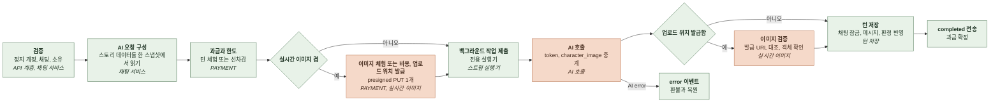

- 요청 진입 시각을 기록한다. 선택 기록의 세대 판정 기준이다.
- 검증과 AI 요청 구성은 요청 스레드에서 동기로 완료한다. AI 요청을 구성할 때는 짧은 `REPEATABLE_READ` 읽기 전용 트랜잭션에서 스토리와 하위 데이터를 하나의 스냅샷으로 읽는다. 커밋 후 AI를 호출한다.
- 회원은 턴 체험 잔여가 있으면 체험으로 처리한다. 체험 잔여가 없으면 턴 비용을 선차감한다. 이미지는 별도 체험 잔여를 먼저 쓴다. 이미지 체험 잔여가 없으면 이미지 비용을 더한다. 유료 항목은 한 트랜잭션에서 지갑을 한 번 잠그고 합계로 잔액을 판정한 뒤 항목별 원장 행을 만든다. 부족하면 요청 전체를 거절하고 예약한 체험을 복원한다.
- 게스트는 디바이스 헤더가 필수다. 턴 체험이 소진되면 거절한다. 이미지 체험이 소진되면 업로드 위치 발급만 생략하고 턴은 진행한다.
- 이미지 업로드 위치는 과금이 끝난 뒤 발급한다. 발급에 실패하면 업로드 위치 없이 진행하고 이미지 체험을 복원한다.
- 백그라운드 작업 제출이 거부되면 즉시 환불과 복원을 하고 스트림을 열지 않은 채 서버 오류로 응답한다.
- 백그라운드 작업은 `started`를 보낸 뒤 AI 스트림을 소비한다. 토큰과 인물 이미지 이벤트는 가공 없이 중계한다. `ping`은 중계하지 않는다.
- 완료 결과의 선택지는 항상 비운다. 선택지는 별도 요청으로 생성한다.
- 이미지 검증과 턴 저장은 같은 트랜잭션에서 수행한다. 검증에 실패하면 이미지 비용만 환불하고 턴은 저장한다.
- 저장이 확정되면 과금을 확정한다. 이후 `completed` 전송이 실패하거나 연결이 끊겨도 환불하지 않는다.
- 저장 전에 어떤 이유로든 백그라운드 작업이 끝나면 턴과 이미지의 차감을 환불하고 체험을 복원한다. 판정은 백그라운드 작업 종료 시 한 번만 한다.
- 스트림 전체 시간 한도에 도달하면 백그라운드 작업을 취소하고 이벤트 없이 스트림을 닫는다. 큐에서 시작 전 취소된 작업은 AI를 호출하지 않고 환불한다.

`realtimeImage`에 따라 다음이 달라진다.

| 단계 | `true` | `false` |
|---|---|---|
| 과금과 한도 | 이미지 체험 예약, 소진 시 회원은 이미지 비용 합산 차감 | 턴 체험과 턴 비용만 |
| 업로드 위치 발급 | 1개 발급해 AI 요청의 `image_slots`에 실음 | 빈 배열 |
| AI 처리 | 첫 화자의 실시간 이미지를 생성해 업로드<br>실패하면 저장된 인물 이미지로 대체 | 저장된 인물 이미지 중 선택만 |
| 이미지 검증 | 발급 URL 대조와 객체 확인<br>탈락하면 이미지 비용 환불과 체험 복원 | 실시간 URL이 있으면 전부 제거 |
| 실패 시 환불 | 턴과 이미지 모두 | 턴만 |

**1. AI 요청 구성**

| 요청 필드명 | 타입 | 출처 |
|---|---|---|
| `genre` | `string` | 스토리 데이터의 장르 |
| `story_settings` | `object` | 세계관, 주변 인물, 주인공, 규칙 본문을 플레이 이름으로 치환<br>주인공 본문은 페르소나 설명이 있으면 그 값으로 대체 |
| `story_settings.protagonist_name` | `string` | 플레이 이름<br>없으면 빈 문자열 |
| `start_settings` | `object` | 선택한 시작 설정의 이름, 프롤로그, 시작 상황을 치환<br>읽을 수 없는 스토리에서 참조가 끊겼으면 프롤로그만 채팅에 보관한 값 |
| `history` | `object[]` | 이 채팅의 사용자 입력과 AI 응답 전체를 순서대로 전달<br>시스템 메시지 제외, 이번 입력 제외 |
| `user_input` | `string` | 요청의 `userInput` |
| `summary` | `string` | 빈 문자열 |
| `user_source` | `string` | 요청의 `userSource`<br>없으면 필드 생략 |
| `character_images` | `object[]` | 스토리 데이터의 인물 이미지 전체<br>`name`, `image_name`, `image_url` |
| `main_events` | `object[]` | 스토리 데이터의 주요 사건 전체<br>이름은 AI 전달 이름, 설명과 핵심 문장은 치환 |
| `target_main_event` | `object / null` | 채팅의 목표 사건과 진행 턴 수<br>스토리 데이터에서 ID로 찾고 없으면 현재 행의 이름으로 찾음 |
| `occurred_main_event_names` | `string[]` | 거쳐온 사건 조인 행과 채팅에 저장된 이름 스냅샷의 합집합<br>스토리 데이터에 있는 이름만 표시 순서대로 전달 |
| `endings` | `object[]` | 선택한 시작 설정의 활성 엔딩 중 `min_turns`가 이번 턴 번호 이하인 것<br>이미 도달했으면 빈 배열<br>이름은 AI 전달 이름, 조건과 에필로그는 치환 |
| `image_slots` | `object[]` | 발급한 업로드 위치 1개<br>없으면 빈 배열 |

<br>

**2. AI 응답 처리**

| 응답 필드명 | 타입 | 처리 |
|---|---|---|
| `token.text` | `string` | 그대로 중계 |
| `character_image` | `object` | `name`, `imageUrl`을 그대로 중계<br>이미지 이름은 중계하지 않음 |
| `completed.aiOutput` | `string` | 실시간 이미지 검증 뒤 AI 응답 메시지로 저장<br>`completed` 이벤트에 전체 전달 |
| `completed.choices` | `string[]` | 무시하고 빈 배열로 처리 |
| `completed.characterImages` | `object[]` | 실시간 이미지 검증에만 사용<br>저장하거나 중계하지 않음 |
| `completed.targetMainEvent` | `object / null` | AI 전달 이름을 원문 이름으로 복원해 목표 사건 갱신 |
| `completed.occurredMainEventName` | `string / null` | 원문 이름으로 복원해 거쳐온 사건에 추가 |
| `completed.endingName` | `string / null` | 원문 이름으로 복원해 도달 엔딩 판정 |
| `completed.meta` | `object` | AI 호출 기록에 적재 |
| `error` | `object` | `code`와 `message`를 그대로 `error` 이벤트로 중계 |

<details>
<summary><b>AI 턴 호출 예시</b></summary>

<br>

**1) Request**

```text
POST /api/v1/chat/turns
Accept: text/event-stream
X-Manyak-Request-Id: req_9e8d7c6b5a4f4e3d2c1b0a9f8e7d6c5b
X-Manyak-Session-Id: s_8f2d1c
X-Manyak-Device-Id-Hash: device_hash_3a7bd3e2360a3d29
X-Manyak-Creation-Id: 6d0f4a2e-1b7c-4e2a-9f11-2a4d1c9e8b10
X-Manyak-Story-Id: 3f2504e0-4f89-41d3-9a0c-0305e82c3301
X-Manyak-Chat-Id: 7a1d3c5e-9b2f-4e6a-8c0d-1f2e3a4b5c6d
X-Manyak-Start-Setting-Id: 0b7c9d1e-3f4a-4b5c-8d6e-7f8091a2b3c4
X-Manyak-Turn-Number: 3
X-Manyak-Is-Regenerated: false
```

```json
{
  "genre": "판타지",
  "story_settings": {
    "world_setting": "# 세계관\n왕립 마법 도서관은 도시의 과거와 미래를 기록한다.",
    "character_setting": "# 도윤\n과묵한 남성 사서. 서린의 조사 능력을 인정한다.",
    "user_role_setting": "# 주인공\n서린은 꼼꼼한 여성 신입 기록관이다.",
    "rule_setting": "# 전개 규칙\n사용자의 선택에 따라 단서를 공개한다.",
    "protagonist_name": "서린"
  },
  "start_settings": {
    "name": "폐관 뒤의 도서관",
    "prologue": "*마지막 종이 울린다.*",
    "start_situation": "폐관 직후 기록 열람실에서 서린과 도윤이 빛나는 기록장을 살핀다."
  },
  "history": [
    { "role": "USER", "content": "기록장을 펼친다." },
    { "role": "ASSISTANT", "content": "*기록장 가장자리에 푸른 흔적이 떠오른다.*" }
  ],
  "user_input": "흔적을 따라 지하 보관실로 내려간다.",
  "summary": "",
  "user_source": "typed",
  "character_images": [
    { "name": "도윤", "image_name": "도윤_기본", "image_url": "https://cdn.example.com/characters/generated/3f2504e0/doyun.webp" }
  ],
  "main_events": [
    { "name": "원본 발견", "description": "사라진 기록의 원본을 찾는다.", "key_sentence": "기록의 흔적을 추적한다." }
  ],
  "target_main_event": { "name": "원본 발견", "progress_turns": 1 },
  "occurred_main_event_names": [],
  "endings": [],
  "image_slots": [
    {
      "key": "chat-images/7a1d3c5e-9b2f-4e6a-8c0d-1f2e3a4b5c6d/3-4c9e2b7a-1d3f-4a5b-8c6d-9e0f1a2b3c4d.webp",
      "upload_url": "https://assets.example.com/chat-images/7a1d3c5e-9b2f-4e6a-8c0d-1f2e3a4b5c6d/3-4c9e2b7a-1d3f-4a5b-8c6d-9e0f1a2b3c4d.webp?X-Amz-Signature=...",
      "public_url": "https://cdn.example.com/chat-images/7a1d3c5e-9b2f-4e6a-8c0d-1f2e3a4b5c6d/3-4c9e2b7a-1d3f-4a5b-8c6d-9e0f1a2b3c4d.webp"
    }
  ]
}
```

<br>

**2) 200 Response stream**

```text
event: token
data: {"text":"*계단 아래로 "}

event: character_image
data: {"name":"도윤","imageName":"도윤_실시간_4c9e2b7a","imageUrl":"https://cdn.example.com/chat-images/7a1d3c5e-9b2f-4e6a-8c0d-1f2e3a4b5c6d/3-4c9e2b7a-1d3f-4a5b-8c6d-9e0f1a2b3c4d.webp"}

event: token
data: {"text":"도윤: 여기부터는 "}

event: ping
data: {}

event: completed
data: {"aiOutput":"*계단 아래로 푸른 빛이 이어진다.*\n[[https://cdn.example.com/chat-images/7a1d3c5e-9b2f-4e6a-8c0d-1f2e3a4b5c6d/3-4c9e2b7a-1d3f-4a5b-8c6d-9e0f1a2b3c4d.webp]]\n\n도윤: 여기부터는 기록이 지워진 구역입니다.","choices":[],"characterImages":[{"name":"도윤","imageName":"도윤_실시간_4c9e2b7a","imageUrl":"https://cdn.example.com/chat-images/7a1d3c5e-9b2f-4e6a-8c0d-1f2e3a4b5c6d/3-4c9e2b7a-1d3f-4a5b-8c6d-9e0f1a2b3c4d.webp"}],"targetMainEvent":{"name":"원본 발견","progressTurns":2},"occurredMainEventName":null,"endingName":null,"meta":{"model":"gpt-6-luna","provider":"openai","promptVersions":{"CORE":1,"SAFETY":1},"inputTokenCount":1200,"outputTokenCount":300,"retryCount":0}}
```

</details>

<br>

### 4-1-7 재생성

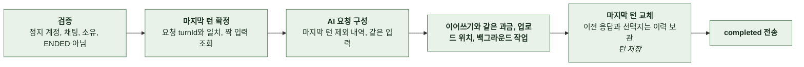

- 동기 검증 순서는 정지 계정, 채팅 존재, 소유, 엔딩 도달 여부, 턴 존재, `turnId` 일치, 과금이다. 실패가 확정된 요청에는 선차감과 환불을 수행하지 않는다.
- `history`는 마지막 턴의 사용자 입력과 AI 응답을 제외한 1번째부터 N-1번째 턴이다. `user_input`은 마지막 턴의 입력을 그대로 보낸다. 턴 번호는 `current_turn`이다.
- 판정 결과는 반영하지 않는다. 목표 사건, 거쳐온 사건, 도달 엔딩은 직전 상태를 유지한다.
- 저장 시 마지막 턴이 여전히 같은 메시지인지 재확인한다. 다르면 결과를 폐기하고 `error`로 끝내며 환불한다.
- 성공하면 재생성 횟수를 1 올린다. 턴 수는 올리지 않는다.
- 이미지 업로드 위치는 새로 발급한다. 객체 키의 UUID로 이전 파일과 구분한다. 이전 본문의 마커는 이력에 남고 객체는 삭제하지 않는다.

<br>

### 4-1-8 선택지 생성

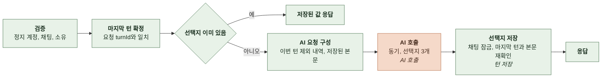

- 마지막 턴 검증을 멱등 검사보다 먼저 한다. 다른 채팅의 턴이나 마지막이 아닌 턴에 대한 선택지 요청이 성공하지 않도록 한다.
- 요청 본문은 턴 요청과 같은 데이터에 저장된 AI 응답을 `ai_output`으로 더한 것이다. `history`는 이번 턴을 제외해 같은 장면이 두 번 실리지 않게 한다.
- 비용을 부과하거나 체험 한도를 소모하지 않는다.
- 저장 시 마지막 턴이 바뀌었거나 본문이 재생성으로 달라졌으면 결과를 폐기하고 충돌로 응답한다. 그 사이 다른 요청이 선택지를 채웠으면 저장된 값을 반환한다.
- AI 호출 기록의 턴 번호는 저장 시 확정된 값으로 기록해 턴 본문 기록과 조인할 수 있게 한다.
- AI 호출 실패는 AI 실패로 응답한다. 본문과 판정은 이미 저장돼 있어 영향이 없다.

<br>

### 4-1-9 공유 발급

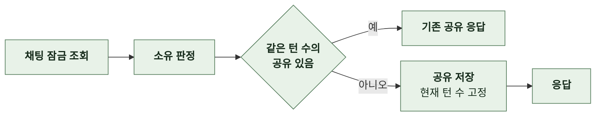

- 소유권 검사와 저장을 하나의 트랜잭션에서 채팅 행을 잠근 상태로 수행한다.

<br>

### 4-1-10 공유 열람

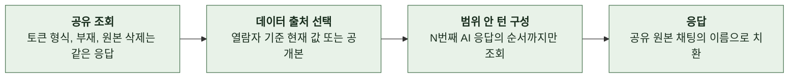

- 인증은 필요 없지만 토큰이 있으면 토큰으로 식별한 요청자의 스토리 읽기 권한을 판정한다. 익명 열람자는 공개 스토리의 현재 제목만 볼 수 있다.
- 턴 범위는 순서 번호를 계산해서 정하지 않고 N번째 AI 응답의 순서 번호로 정한다. 시스템 메시지가 끼어 있어도 결과가 같다.
- 선택지, 추천 입력, 원본 채팅 식별자, 페르소나는 싣지 않는다.

<br>

### 4-1-11 피드백 등록

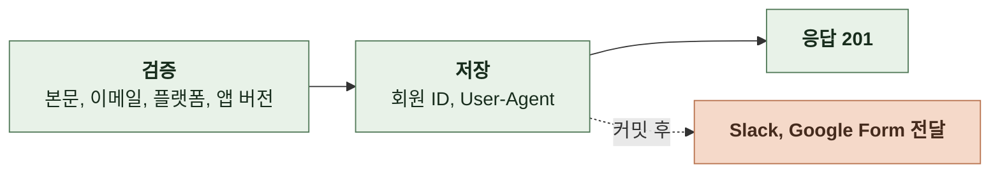

- 비어 있는 이메일과 앱 버전은 `null`로 저장한다.
- 전달은 커밋 후 비동기로 한다. 저장이 롤백되면 전달하지 않는다. 웹훅이나 폼 ID가 없으면 해당 전달을 건너뛴다.
- 분석 이벤트는 커밋 결과에 따라 결정한다. 커밋되면 성공, 롤백되면 실패 이벤트다.

<br>

### 4-1-12 턴 저장과 판정 반영

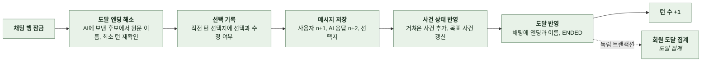

- 이어쓰기와 재생성은 같은 채팅 행 잠금을 쓴다. 두 경로가 채팅 단위로 직렬화된다.
- 판정 후보는 AI에 실제로 보낸 목록이다. 목록에 없는 이름은 무시한다. 현재 행은 FK 값을 얻을 때만 이름으로 다시 찾는다.
- 이미 엔딩에 도달한 채팅이면 도달 엔딩 판정을 무시한다. 후보의 최소 턴 수가 이번 턴 번호보다 크면 무시한다. 현재 행이 없으면 ID 없이 이름만 기록한다.
- 선택 기록은 새 메시지를 넣기 전에 한다. `sourceTurnId`가 현재 마지막 턴을 가리키고 `choiceOrder`가 그 턴의 선택지에 있으며 그 선택지가 요청 진입 시각 이전에 만들어졌을 때만 기록한다. 조건이 맞지 않으면 건너뛰고 `sourceTurnId`를 보낸 요청만 사유를 WARN으로 남긴다. 수정 여부는 선택지 원문과 입력에 NFC 정규화, 앞뒤 공백 제거, 내부 공백 축약을 적용한 뒤 비교해 정한다. 구두점은 보존한다.
- 거쳐온 사건은 이름 스냅샷에 먼저 추가한다. 현재 행이 있으면 조인 행도 만든다. 목표 사건은 현재 행이 있을 때만 FK로 저장하고 없으면 해제한다.
- 도달하면 채팅에 엔딩 ID와 이름을 기록하고 상태를 `ENDED`로 바꾼다. 회원이면 도달 집계를 독립 트랜잭션에서 기록한다. 유니크 위반은 이미 기록된 것으로 보고 무시한다.
- 재생성으로 교체할 때는 같은 잠금 안에서 마지막 턴을 재확인한 뒤 이전 응답과 선택지를 버전 이력으로 보관한다. 기존 선택지를 지우고 새 선택지를 넣는다. 재생성 횟수를 1 올린다.
- 선택지를 채울 때는 같은 잠금 안에서 마지막 턴과 본문이 일치하는지 재확인한다. 이미 선택지가 있으면 저장된 값을 반환한다.

<br>

### 4-1-13 실시간 이미지

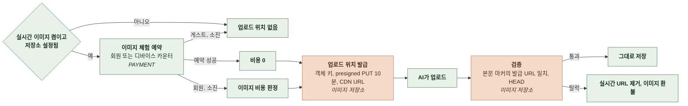

- 객체 키는 `chat-images/{채팅 공개 ID}/{턴 번호}-{UUID}.webp`다. 업로드 URL과 공개 URL은 HTTPS이고 443 이외 포트, 사용자 정보, fragment, 공백이 없어야 한다. 어기면 AI가 요청 자체를 거절한다. 재생성 턴은 UUID로 이전 파일과 구분한다.
- 본문 마커에 발급한 CDN URL이 있고 객체가 존재할 때 성공으로 판정한다. 완료 이벤트의 이미지 목록에만 있는 URL은 성공이 아니다.
- 실시간 경로의 URL 중 발급한 URL과 다르거나 객체가 없는 것은 본문 마커와 이미지 목록에서 제거한다. 인물 이미지 URL은 그대로 통과한다.
- 이미지 환불은 턴 저장과 같은 트랜잭션에서 기록한다. 체험 복원은 요청당 한 번만 한다.
- 이미지 비용이 0이면 체험 소진 뒤에도 업로드 위치를 발급하고 원장 행을 만들지 않는다.

<br>

### 4-1-14 후보 이름 구분

엔딩과 주요 사건의 이름은 플레이 이름으로 치환한 뒤 AI에 보낸다. 치환 결과가 같은 후보가 생기면 AI가 구분할 수 없으므로 전달 이름을 유일하게 만든다.

- 후보 배열 순서에서 같은 치환 이름의 첫 후보는 그대로 쓰고 두 번째부터 ` (2)`, ` (3)` 순으로 구분 표시를 붙인다.
- 붙인 이름이 다른 후보의 치환 이름이나 이미 배정한 전달 이름과 같으면 번호를 올려 유일해질 때까지 반복한다. 아직 처리하지 않은 후보의 치환 이름도 충돌 검사에 포함한다.
- 대응표는 AI에 전달한 이름과 토큰 원문 이름을 연결한다. 목표 사건과 거쳐온 사건 이름에도 같은 대응표를 쓴다. 턴, 재생성, 선택지 요청에 같은 규칙을 적용한다.
- AI가 돌려준 이름은 대응표에서 그대로 찾는다. 찾지 못하면 무시한다. 구분 표시는 저장값과 표시값에 넣지 않는다.

<details>
<summary><b>구분 표시 예시</b></summary>

<br>

플레이 이름이 `민우`일 때 후보 `{username}의 귀환`과 `민우의 귀환`은 치환하면 둘 다 `민우의 귀환`이다. 첫 후보를 `민우의 귀환`으로, 두 번째를 `민우의 귀환 (2)`로 보낸다. 다른 후보에 이미 `민우의 귀환 (2)`가 있으면 두 번째 후보는 `민우의 귀환 (3)`이 된다.

</details>
