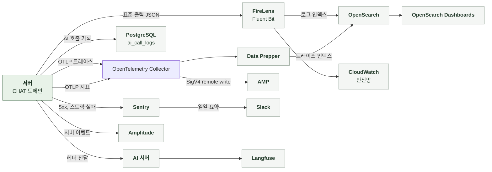

# 5-4 관측

이 문서는 CHAT 도메인의 관측 스택, 요청을 추적할 식별자, AI 서버에 전달하는 헤더, AI 호출 기록, 구조화 로그 이벤트, 오류 확인 위치, 지표, 트레이스, 알림, 수집 조건, 분석 이벤트를 정한다.

AI 서버로 보내는 헤더 목록은 처리 흐름의 공통 처리에, 개인정보 취급 규칙은 보안에 있다. ([4-1-1 공통 처리](4-1-PIPELINES.md#4-1-1-공통-처리), [5-1-6 식별자와 개인정보](5-1-SECURITY.md#5-1-6-식별자와-개인정보))

<br>

### 5-4-1 관측 스택



운영 전송 경로는 Terraform 선언 기준이다. 공통 로그의 추가 OTLP 경로와 수신 확인 기준은 [백엔드 운영 관측](../../../platform/BACKEND/2-OBSERVABILITY.md#2-1-메트릭과-운영-연동)을 따른다. 위 그림은 도메인별 신호를 중심으로 표시한다.

<br>

### 5-4-2 상관관계 식별자

상관관계 필터는 모든 요청의 MDC에 다음 값을 기록한다. 로그, Sentry, `ai_call_logs`는 같은 식별자 값을 사용한다. 스트림 실행기는 MDC와 현재 스팬을 백그라운드 작업 스레드에 복사한다. 대화 요약은 요약을 일으킨 이어쓰기 요청의 MDC를 이어받는다.

| MDC 필드 | 값 | 규칙 |
|---|---|---|
| `request_id` | `req_` + UUID | 요청 헤더 값을 쓰고 없으면 생성<br>응답 헤더로 반환 |
| `session_id` | `X-Manyak-Session-Id` | 없으면 `unknown` |
| `device_id_hash` | `device_hash_` + SHA-256(pepper + 원본) 앞 16자 | 원본은 저장하지 않음 |
| `sentry_event_id` | Sentry 이벤트 ID | 5xx를 Sentry로 보낸 요청만 |
| `traceId`, `spanId` | 현재 스팬 | 트레이스 전송이 비활성화되어도 생성해 로그에 포함 |

| 식별자 | 기록 위치 | 연결 대상 |
|---|---|---|
| `request_id` | 로그 MDC, Sentry 태그, `ai_call_logs.request_id`, AI 서버 Langfuse metadata | 백엔드 요청과 AI 호출 |
| `chat_id`(공개 ID), `turn_number` | 턴 로그, `ai_call_logs`, Sentry 태그, 분석 이벤트, AI 서버 Langfuse metadata | 같은 턴의 본문 호출과 선택지 호출 |
| `story_id`(공개 ID) | 턴 로그, `ai_call_logs`, Sentry 태그 | 스토리 |
| `creation_id` | AI 호출 헤더 | 간편 제작부터 채팅까지의 과정 |
| `ai_call_log_id` | `ai_response_saved`, `ai_response_regenerated`, `ai_stream_failed`, `chat_compact_saved`, `chat_compact_discarded`, `chat_compact_failed` 로그 | `ai_call_logs` 행 |
| `model_code` | 턴 저장과 재생성 로그, 결과 지표 태그, 분석 이벤트 | 청구 모델의 코드<br>AI 요청 필드 `model_tier`와 같은 값<br>실제 LLM은 `ai_call_logs.model` |
| `long_response` | 턴 저장과 재생성 로그, 분석 이벤트 | 턴 시작 시점의 출력 분량<br>AI 요청 필드 `long_response`와 같은 값<br>A/B 비교에서 짧은 응답 턴만 고르는 기준 |

<br>

### 5-4-3 AI 서버로 전달하는 헤더

| 항목 | 내용 |
|---|---|
| 연결 방식 | AI는 헤더 값을 Langfuse 메타데이터에 기록하며 트레이스를 자동으로 합치지는 않음<br>채팅 계열은 `X-Manyak-Creation-Id`, `X-Manyak-Chat-Id`, `X-Manyak-Turn-Number`로 검색해 연결 |
| 재생성 여부 | 선택지 호출의 `X-Manyak-Is-Regenerated`는 항상 `false`<br>그 턴이 재생성됐는지는 같은 채팅과 턴 번호의 본문 호출 값으로 판단 |
| `traceparent` | AI 호출 클라이언트가 현재 스팬을 전파 |

<br>

### 5-4-4 AI 호출 기록

AI 호출 1회마다 1행을 남긴다. 호출 전 `STARTED`로 적재하고 종료 시 `SUCCEEDED` 또는 `FAILED`로 바꾼다. `SUCCEEDED`는 AI 호출 성공만 의미한다. 본문 호출의 턴 저장 완료는 `turn_number IS NOT NULL`로 판정한다. 대화 요약의 저장과 폐기는 로그 이벤트로 확인한다.

| 필드 | CHAT 도메인의 값 |
|---|---|
| `feature` | `chat_response`, `choice_generation`, `chat_compact` |
| `caller_service` | `manyak-server` |
| `request_id` | MDC 값, 없으면 `unknown`<br>128자로 자름 |
| `session_id`, `device_id_hash` | MDC 값, `unknown`이면 `null`<br>128자로 자름 |
| `story_id` | 스토리 내부 ID |
| `chat_id` | 채팅 공개 ID |
| `turn_number` | 본문과 선택지는 저장이 확정된 뒤 반영<br>저장 전 실패는 `null`<br>요약은 호출 시작 때 이번 요약 범위의 끝 턴 기록 |
| `provider`, `model` | AI 응답 `meta`, 컬럼 길이 상한에 맞춰 자름<br>요약은 응답에 `meta`가 없어 `null` |
| `input_token_count`, `output_token_count`, `retry_count` | AI 응답 `meta`, 음수는 0<br>`null`이면 덮어쓰지 않음 |
| `prompt_versions` | AI 응답 `meta`<br>`null`이면 덮어쓰지 않음 |
| `latency_ms` | 호출 시작부터 `completed` 수신까지<br>선택지와 요약은 응답 수신까지 |
| `error_code` | AI 구조화 오류는 AI 코드<br>그 외 본문은 `AI_STREAM_FAILED`, 선택지는 `AI_CHOICE_FAILED`<br>요약은 AI 호출 실패에만 `AI_COMPACT_FAILED`<br>공백만 있는 요약은 AI 호출 실패 |
| `sentry_event_id` | 본문 호출의 스트림 실패만 |

<br>

### 5-4-5 구조화 로그 이벤트

구조화 로그는 `event_name`을 맨 앞에 둔 JSON 형식으로 INFO 수준에 기록한다. 이벤트 이름은 snake_case다. `prod`, `dev`, `jsonlog` 프로파일만 JSON이다. 그 외는 콘솔 패턴이다. JSON에는 `service=manyak-server`가 붙는다. MDC 값은 인코더가 최상위 필드로 싣는다.

| 단위 | 기록 시점과 이름 | 기록 내용 |
|---|---|---|
| 모든 API 요청 | 응답 종료<br>`api_request_completed`, 5xx는 `api_request_failed` | `endpoint`, `http_method`, `status_code`, `duration_ms`<br>SSE는 요청 디스패치가 끝나는 시점이라 스트림 전체 시간이 아님 |
| AI 호출 | 호출 직전 `ai_call_started`, 종료 시 `ai_call_completed` | `feature`, `ai_call_log_id`<br>종료 시 `outcome`(`success`, `failure`), `duration_ms` |
| 채팅 생성 | 저장 후<br>`chat_started` | `story_id`, `chat_id` |
| 턴 저장 | 저장 확정 직후<br>`user_message_saved`, `ai_response_saved` | `chat_id`, `story_id`, `turn_number`<br>`message_length_bucket`, `ai_call_log_id`<br>`ai_response_saved`에는 `model_code`, `turn_cost`(차감한 이프, 체험과 게스트는 0), `long_response` |
| 재생성 저장 | 교체 확정 직후<br>`ai_response_regenerated` | `chat_id`, `story_id`, `turn_number`, `ai_call_log_id`, `model_code`, `turn_cost`, `long_response` |
| 스트림 실패 | AI 스트림 오류나 저장 오류<br>`ai_stream_failed` | `chat_id`, `story_id`, `ai_call_log_id`, `sentry_event_id` |
| 생성 마감 | 연결과 무관한 생성 마감 도달<br>`chat_turn_timeout` | `chat_id`와 `worker_state`<br>`PENDING`, `RUNNING`, `SAVING`, `CANCELLED`, `FINISHED` 유지<br>`CANCELLED`는 생성 마감으로 종료<br>연결 종료로는 상태 전이 없음 |
| 생성 중 상태 읽기 실패 | 상세 조회 중 생성 중 키 읽기 또는 저장된 값 해석 실패<br>`chat_generation_read_failed` | `chat_id`와 `error`<br>`error`는 예외 클래스 이름 |
| 생성 중 키 해제 실패 | 생성 종료 시 생성 중 키 해제 실패<br>`chat_generation_release_failed`<br>키는 TTL로 해제 | `chat_id`와 `error`<br>`error`는 예외 클래스 이름 |
| 이벤트 기록 실패 | 생성 도중 Redis Streams 기록 실패<br>`chat_generation_event_write_failed`<br>생성당 한 번만 기록 | `chat_id`와 `error`<br>`error`는 예외 클래스 이름 |
| 실행기 거부 | 백그라운드 작업 제출 실패나 첫 POST의 수신 연결 거부<br>`chat_turn_schedule_rejected` | `chat_id`, `story_id`, `error` |
| 환불 실패 | 턴 환불 실패 `chat_turn_refund_failed`<br>이미지 환불 실패 `chat_image_refund_failed` | 턴은 `chat_pk`, `idempotency_key`, `error`<br>이미지는 `chat_pk`, `error` |
| 선택 기록 생략 | `sourceTurnId`를 보냈는데 기록하지 못할 때 WARN<br>평문 로그 | `reason`(`LAST_TURN_MISMATCH`, `CHOICE_NOT_FOUND`, `STALE_CHOICE`), 채팅 PK, 턴 ID, 순번 |
| 대화 요약 저장 | 저장 확정 직후<br>`chat_compact_saved` | `chat_id`, `story_id`, `summary_through_turn`, `ai_call_log_id`<br>`summary_length`(요약 글자 수) |
| 대화 요약 폐기 | 저장 조건을 통과하지 못함<br>`chat_compact_discarded` | `chat_id`, `story_id`, `summary_through_turn`, `ai_call_log_id`<br>`reason`(`CHAT_DELETED`, `REGENERATED`, `SUPERSEDED`) |
| 대화 요약 실패 | 요약 시작 실패, 호출 기록 실패, AI 호출 실패, 요약 저장 실패<br>`chat_compact_failed` | `chat_id`, `story_id`, `summary_through_turn`, `ai_call_log_id`<br>호출 기록이 없으면 `ai_call_log_id`는 `null`<br>`reason`(`START_FAILED`, `CALL_LOG_FAILED`, `AI_FAILED`, `SAVE_FAILED`)<br>`error`는 예외 클래스 이름 |
| 대화 요약 무효화 | 재생성 저장이 저장된 요약을 비움<br>`chat_compact_invalidated` | `chat_id`, `story_id`, `turn_number`<br>`summary_through_turn`은 비운 요약의 끝 턴 |
| 피드백 | 저장 후<br>`feedback_submitted` | `content_length`, `has_email` |
| 피드백 전달 실패 | WARN과 Sentry 메시지 | 예외 클래스 이름만 |

<details>
<summary><b>예시: 턴 저장 로그 1줄</b></summary>

<br>

예시는 가상 값이다. 로그 프레임워크가 붙이는 필드는 생략했다. `request_id`, `session_id`, `device_id_hash`, `traceId`, `spanId`는 MDC에서 인코더가 붙인다.

```json
{"@timestamp":"2026-10-12T01:23:45.678Z","message":"event_name=ai_response_saved, chat_id=7a1d3c5e-9b2f-4e6a-8c0d-1f2e3a4b5c6d, story_id=3f2504e0-4f89-41d3-9a0c-0305e82c3301, turn_number=3, ai_call_log_id=48213, model_code=AURORA, turn_cost=50, long_response=true","level":"INFO","request_id":"req_0f1e2d3c4b5a69788796a5b4c3d2e1f0","session_id":"sess_7c1d9e2b","device_id_hash":"device_hash_9a8b7c6d5e4f3a2b","traceId":"4bf92f3577b34da6a3ce929d0e0e4736","spanId":"00f067aa0ba902b7","event_name":"ai_response_saved","chat_id":"7a1d3c5e-9b2f-4e6a-8c0d-1f2e3a4b5c6d","story_id":"3f2504e0-4f89-41d3-9a0c-0305e82c3301","turn_number":3,"ai_call_log_id":48213,"model_code":"AURORA","turn_cost":50,"long_response":true,"service":"manyak-server"}
```

</details>

<br>

### 5-4-6 오류 확인

| 기능 | 오류 조회 위치 |
|---|---|
| 턴 본문 | `ai_call_logs` `feature=chat_response`, 로그 `ai_stream_failed`<br>Sentry 태그 `chat_id` |
| 선택지 | `ai_call_logs` `feature=choice_generation`<br>Sentry `endpoint=/api/v1/chats/{chatId}/turns/{turnId}/choices` |
| 환불 | 로그 `chat_turn_refund_failed`, `chat_image_refund_failed`<br>지표 `manyak.chat.turn.refund` |
| 실행기 포화 | 로그 `chat_turn_schedule_rejected`, `chat_turn_timeout`<br>스팬 `chat.turn.queue` |
| 실시간 이미지 | 턴은 성공으로 끝나 Sentry와 `ai_call_logs`에 남지 않음<br>업로드 위치 발급과 객체 확인 실패는 WARN 평문 로그 |
| 피드백 전달 | WARN 평문 로그와 Sentry 메시지 |
| 대화 요약 | `ai_call_logs` `feature=chat_compact`, 로그 `chat_compact_failed`, `chat_compact_discarded`<br>턴과 무관해 Sentry에 남지 않음 |

<br>

### 5-4-7 지표

연결 종료 자체는 턴 결과를 만들지 않는다. 이탈 후에도 저장되면 `success`다. 저장 진입 전에 생성 마감을 넘기거나 저장 전에 실패하면 `failure`다. 저장에 먼저 진입했다면 마감이 지나도 저장 결과로 집계한다. 연결 종료로 인한 `cancelled` 결과는 더 이상 기록하지 않는다. 기존 `cancelled` 값은 과거 조회용으로 유지한다.

지표 태그에는 값의 종류가 제한된 enum만 사용한다. 모델 코드는 모델 표의 행 수만큼만 생기므로 태그로 쓴다.

| 지표 | 종류와 태그 | 의미 |
|---|---|---|
| `manyak.chat.turn.result` | Counter<br>`outcome`(`success`, `failure`, `rejected`)<br>`model_code`(청구 모델 코드, 스트림을 열기 전 거부는 `none`) | 이어쓰기와 재생성의 결과 분포<br>기존 `cancelled`는 과거 조회용 |
| `manyak.chat.turn.refund` | Counter<br>`outcome`(`success`, `failure`) | 환불과 복원 결과<br>기동 시 두 시계열을 0으로 등록 |
| `manyak.ai.call.duration` | Timer<br>`feature`, `outcome`(`success`, `failure`) | AI 호출 지연과 실패율<br>본문은 스트림 전체 시간을 측정 |
| `chat.turn.queue` | 관측 스팬<br>기존 `outcome=cancelled`는 과거 조회용으로 유지<br>생성 마감 초과는 `failure`로 집계 | 백그라운드 작업 제출부터 시작까지의 대기 시간 |
| `http.server.requests` | Timer<br>`uri`, `method`, `status`, `outcome` | 요청률, 오류율, 응답 시간 |

| 기준 | 내용 |
|---|---|
| `success` | 턴 저장이 확정된 호출 |
| `failure` | 저장에 도달하지 못하고 끝난 호출<br>AI 실패, 생성 마감 초과, 저장 오류, 시작 상태 불일치, 실행기 거부, Redis 오류로 생성 중 키 획득 실패<br>키 획득 실패는 과금이 없어도 채팅 생성 전체를 막는 장애이므로 `failure` 알림 대상 |
| `rejected` | 스트림을 열기 전의 4xx 거부<br>잔액 부족, 한도 소진, 디바이스 헤더 누락, 생성 중, 마지막 턴 불일치, 엔딩 도달 재생성<br>알림은 `failure`만 사용 |
| 환불 `failure` | 선차감을 되돌리지 못한 호출<br>관측 지표가 아니라 정산 정확성 신호 |

<br>

**집계 조건**

| 항목 | 기준과 제한 |
|---|---|
| 전송 여부 | 지표 전송을 켠 환경에서만 AMP로 전송 |
| 전송 주기 | 60초 간격 |
| 인스턴스 | 리소스 속성 `service.instance.id`가 기동마다 바뀜<br>여러 태스크의 누적 건수는 인스턴스별로 합산 |
| 스텁 환경 | AI를 호출하지 않아 지연이 실제와 다름 |
| 턴 수 | 지표의 `success`는 이어쓰기와 재생성을 합산<br>턴 수 증가는 이어쓰기만 |

<br>

### 5-4-8 트레이스

| 항목 | 내용 |
|---|---|
| 활성화와 표본 | 환경 변수로 켜며 기본값은 비활성 |
| 스팬 | HTTP 요청 아래에 큐 대기, AI 호출(`traceparent` 전파), JDBC(QUERY만, 바인딩 값 제외), Redis 스팬<br>백그라운드 스레드에서 실행한 작업도 요청 트레이스 아래에 연결 |
| 제외 | actuator 요청, Spring Security 내부 관측, 요청 밖 루트 DB와 Redis 관측은 노이즈 필터가 제외 |

<br>

### 5-4-9 알림

아래 임계값은 기존 Grafana 알림 기준을 보존한 것이다. 현재 AMP 경로에서 규칙 실행과 Slack 전달이 유지되는지는 배포 검수로 확인하며, Terraform의 수집 설정만으로 알림 연동 완료를 판단하지 않는다.

| 항목 | 기준 |
|---|---|
| 환불 실패 | `manyak.chat.turn.refund`의 `failure`가 10분 안에 1건이라도 늘면 알림 대상<br>첫 실패부터 감지하도록 시계열을 기동 시 0으로 등록 <br>이미지 환불과 이미지 체험 복원 실패는 지표에 없어 알림 대상이 아님 |
| AI 실패 급증 | `manyak.ai.call.duration`의 `failure`가 10분 안에 5건을 넘으면 알림 대상<br>턴 본문, 선택지, 대화 요약 호출이 모두 포함됨 |
| 정기 보고 | 매일 오전 10시(KST), 지난 24시간의 운영 Sentry 오류 요약 |
| CHAT에서 수집하는 오류 | 500 예상하지 못한 예외, 502 선택지 실패, 백그라운드 작업에서 보낸 스트림 실패<br>AI 구조화 오류, 4xx 거부, 이미지 누락, 대화 요약 실패, `STARTED` 잔존은 Sentry에 없어 보고에 포함되지 않음 |

<br>

### 5-4-10 수집 조건과 실패 처리

**1. 데이터 범위**

| 데이터 | 현재 기록 방식 |
|---|---|
| 사용자 입력 원문, 프롬프트, AI 응답 본문, 대화 요약 | 로그, Sentry, `ai_call_logs`에 싣지 않음<br>입력은 길이 구간만 기록<br>요약은 글자 수만 기록<br>원문은 AI 서버의 Langfuse에서 관리 |
| 선택지 원문 | 로그에 싣지 않음 |
| 실시간 이미지 | URL과 바이너리를 로그에 싣지 않음 |
| 공유 토큰 | 분석 이벤트에 싣지 않음<br>요청 로그의 `endpoint`와 Sentry의 경로에는 열람 요청 경로가 그대로 남음 |
| 피드백 본문, 이메일 | 로그에 싣지 않음<br>Slack과 Google Form에는 본문과 메타 전달 |
| Sentry 이벤트 | 5xx와 스트림 실패를 캡처<br>기본 개인정보 수집 끔<br>`request_id`는 태그, `session_id`와 `device_id_hash`는 `identity` 컨텍스트, `unknown`은 제외 |
| JDBC 스팬 | placeholder SQL만 수집<br>바인딩 값 제외 |

<br>

**2. 수집 실패**

| 상황 | 처리 |
|---|---|
| `ai_call_logs` `STARTED` 적재 실패 | 예외가 전파되어 AI 호출을 시작하지 않음<br>환불 처리<br>대화 요약은 그 요약을 건너뛰고 `chat_compact_failed`(`CALL_LOG_FAILED`) 로그만 남김<br>대화 요약의 실패는 턴, 과금, 클라이언트 응답에 영향 없음 |
| `ai_call_logs` 전이 저장 실패 | 예외가 전파됨<br>성공한 AI 호출도 스트림 실패로 끝남<br>대화 요약은 요약을 저장하지 않고 `chat_compact_failed`(`CALL_LOG_FAILED`) 로그를 남김 |
| AI 호출 성공 뒤 대화 요약 저장 실패 | 호출 기록은 `SUCCEEDED` 유지<br>`chat_compact_failed`(`SAVE_FAILED`) 로그로 구분 |
| 응답 `meta` 반영, 지표 기록 실패 | 무시하고 호출 결과 유지 |
| 턴 번호 사후 반영 실패 | 예외가 전파됨<br>저장된 턴은 유지되고 스트림은 `error`로 끝남 |
| Sentry 캡처 실패 | SDK 내부에서 처리<br>DSN 없는 환경은 no-op |
| OTLP 트레이스와 지표 전송 실패 | SDK로 배치 전송<br>실패분은 유실 |
| Amplitude 전송 실패 | 비동기 호출 뒤 WARN 로그만 남기고 재시도 없음 |
| 미수집과 누락 | 수집 비활성화, 표본 제외, 기록 실패, 전송 유실을 구분<br>기록이 없다는 이유만으로 요청이 없었다고 판단하지 않음 |

<br>

### 5-4-11 분석 이벤트

**서버 이벤트**

Amplitude HTTP API로 비동기 발행한다. 분석 전송을 켜고 API 키가 있는 환경에서만 전송한다. 재생성은 별도 이벤트 없이 `is_regenerated`로 구분한다. 엔딩 도달은 `ending_id`로 구분한다.

| 이벤트 | 시점 | 프로퍼티 |
|---|---|---|
| `server_chat_aiMessage_processed_succeeded` | 턴 저장 확정 | `chat_id`, `turn_number`, `is_regenerated`, `model_code`, `turn_cost`, `long_response`<br>`ending_id`는 도달 턴이고 현재 엔딩 행이 있을 때만 |
| `server_chat_aiMessage_processed_failed` | 저장 전 실패 | `chat_id`, `error_type`, `is_regenerated`, `model_code`, `long_response`<br>`turn_number`는 없음 |
| `server_feedback_submission_processed_succeeded` | 피드백 커밋 | 없음 |
| `server_feedback_submission_processed_failed` | 피드백 롤백 | `error_type` |

| 공통 프로퍼티 | 값 |
|---|---|
| `user_id` | 회원이면 공개 식별자 |
| `device_id` | 요청 헤더 `X-Manyak-Device-Id` 원본<br>헤더가 없으면 게스트는 `unknown`, 회원은 생략 |
| `session_id`, `request_id`, `is_logged_in` | 요청 문맥 |
| `insert_id` | `{request_id}:{eventType}`<br>재시도 중복 제거 |
| `error_type` | `network`, `validation`, `server`<br>AI 오류 코드에 따라 변환 |
| `model_code` | 청구 모델 코드 |
| `long_response` | 턴 시작 시점의 출력 분량 |
| `turn_cost` | 차감한 턴 이프<br>체험과 게스트는 0 |

저장 성공 뒤 전송에 실패해도 이미 성공 이벤트를 발행했으므로 실패 이벤트를 발행하지 않는다.
