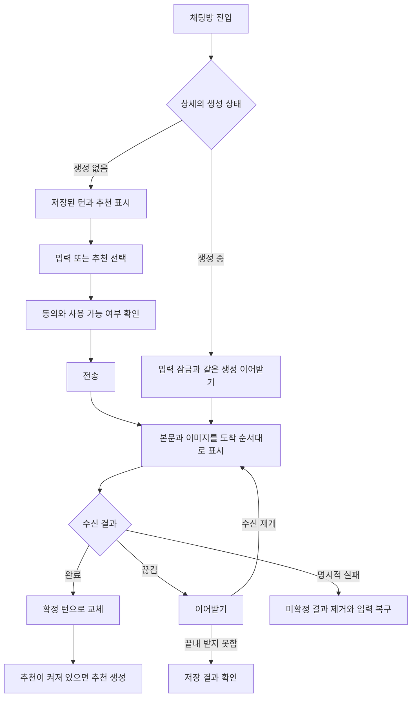

# 3-2 화면 흐름

 

### 3-2-1 입력과 응답

| 조작 | 결과 |
|---|---|
| 추천의 편집 버튼 | 현재 입력에 채워 수정 가능 |
| 추천 본문 또는 빈 입력의 전송 | 추천을 바로 전송 |
| 상황 또는 대사 추가 | 새 블럭 표시. 내부 스크롤 중이면 새 칸까지 이동 |
| 모드 전환, 추천 채우기, 전송 뒤 초기화 | 입력 목록을 한 번에 교체 |
| 잠긴 입력 탭 | 응답 생성 중 안내 |
| 다시 생성 | 사용자 버블 유지, 마지막 AI 본문과 추천을 진행 블록으로 교체 |
| 이미지 탭 | 전체 화면 뷰어. X, 이미지 밖 배경 또는 뒤로가기로 뷰어만 닫기 |
| 본문 빈 곳 탭 | 헤더 표시 전환. 조작 대상, 텍스트 선택과 키보드 닫기 탭은 제외 |

복구 결과와 입력 보존은 요구사항을 따른다. ([2-2-3](2-2-REQUIREMENTS.md#2-2-3-생성-실패와-복구))

 

### 3-2-2 설정, 안내와 메뉴

| 시작 | 조작과 전환 |
|---|---|
| 모델 버튼 | 채팅 응답 시트 열기. 모델 선택은 닫기, 긴 응답은 열린 채 변경 |
| 설정 버튼 | 채팅 설정 시트 열기. 스위치 변경은 시트를 유지하고 다음 요청에 적용 |
| 첫 채팅 투어 | 상황과 대사 추가 → 채팅 설정 → 전송 버튼. 다음 또는 건너뛰기 |
| 이미지 안내 | 설정 시트가 펼쳐진 뒤 스위치 강조. 안내 종료 후 설정 시트 유지 |
| 메뉴의 새 채팅 | 같은 스토리의 기본 시작 설정과 기본 주인공으로 새 채팅. 현재 방 교체 |
| 메뉴의 신고 | 메뉴 닫기 후 참조 스토리 신고 시트 |
| 메뉴의 삭제 | 메뉴 닫기 후 확인. 요청 중 잠금, 성공 시 목록 이동 |
| 카드의 삭제 | 같은 확인 절차, 성공 시 카드만 제거 |
| 공유 | 즉시 발급, 성공하면 플랫폼별 전달과 메뉴 닫기, 실패하면 메뉴 유지 |
| 피드백 | 검증 → 제출 중 잠금 → 성공 시 폼 초기화 또는 실패 시 입력 유지 |

 

### 3-2-3 공유본 열람

공유 링크를 열면 프롤로그부터 읽는다. 헤더와 제작 CTA는 계속 보이며 본문을 눌러 숨기지 않는다. 하단 이동 버튼과 이미지 뷰어는 채팅과 같다. 제작 CTA를 선택하면 제작 퍼널로 이동한다. 조회 실패는 안내와 홈 이동을 제공한다. ([2-2-7](2-2-REQUIREMENTS.md#2-2-7-공유와-피드백))
