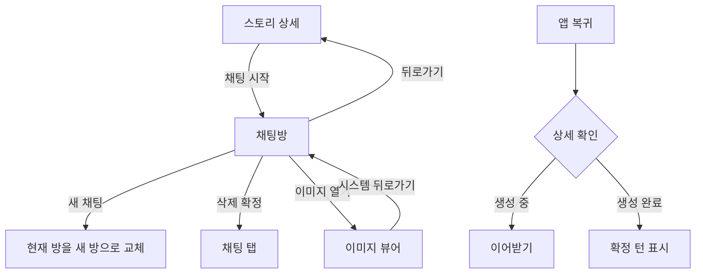

# 3-2 화면 흐름: 안드로이드

 

### 3-2-1 방과 오버레이

| 시작 | 조작 | 결과 |
|---|---|---|
| 스토리 상세 | 채팅 시작 | 상세 위 채팅방, 뒤로가기는 상세 |
| 채팅방 | 새 채팅 | 기본 주인공과 기본 시작 설정으로 현재 방 교체 |
| 채팅방 | 삭제 확정 | 채팅 탭 복귀. 삭제한 방은 복원하지 않음 |
| 목록 카드 | 더보기 또는 길게 누르기 | 공유, 회원 신고, 삭제 옵션 시트 |
| 이미지 뷰어 | 시스템 뒤로가기 | 뷰어만 닫기 |
| 투어 | 시스템 뒤로가기 | 건너뛰기와 같은 종료 및 계측. 방 유지 |
| 이미지 안내 | 켜기 또는 뒤로가기 | 안내만 닫고 설정 시트 유지 |
| 설정 시트 | 안내 종료 후 뒤로가기 | 시트 닫기 |
| 앱 복귀 | 상세 확인 | 생성 중이면 이어받고, 끝났으면 확정 턴 |

신고와 새 채팅은 참조 스토리 ID와 공백이 아닌 제목이 있을 때만 제공한다. ([공통 2-2-1](../2-2-REQUIREMENTS.md#2-2-1-적용-범위와-목록))
