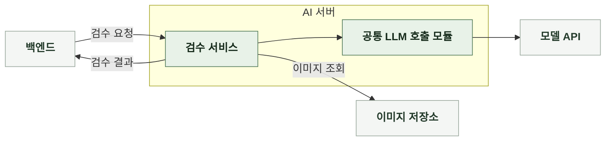

# 4-2 소프트웨어 구조 설계

 

### 4-2-1 시스템 경계

| 구성 | 책임 |
|---|---|
| 백엔드 | 제출본과 검수 상태 저장, 검수 요청, 결과에 따른 게시 반영 |
| AI 서버 | 전달받은 게시물 검수, 결과 반환 요청 간 검수 상태를 저장하지 않음 |
| 이미지 저장소 | 검수할 실제 이미지 제공 |
| 모델 API | 텍스트와 이미지의 내용 판정 |

 

### 4-2-2 구성 요소

검수 서비스가 입력 준비부터 결과 반환까지 전체 순서를 관리한다. 외부 모델 호출은 공통 LLM 호출 모듈로 분리한다.

| 구성 요소 | 책임 |
|---|---|
| 라우터 | 요청 형식 검증, 검수 서비스 호출, HTTP 응답 반환 |
| 검수 서비스 | 검수 실행 조율, 최종 결과 구성 |
| 입력 준비 모듈 | 검수 대상 텍스트 추출, 실제 이미지 준비 |
| 프롬프트 조립기 | 검수 기준과 게시물 입력을 모델 메시지로 구성 |
| 공통 LLM 호출 모듈 | 공급자 연동과 모델 호출 |
| 응답 검증 모듈 | 모델 응답의 유효성 확인, 검수 결과로 변환 |
