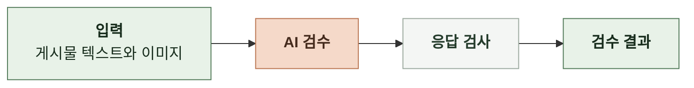

# 인지 구조 설계

 

### 서브태스크의 인지 구조

**1. 게시물 검수**

텍스트와 이미지를 하나의 맥락으로 묶어 모델이 함께 판단한다. 모델의 판정은 코드가 형식과 일관성을 확인한 뒤 결과로 반환한다.

 

### 모델과 코드의 책임

| 맡는 쪽 | 맡는 일 |
|---|---|
| 모델 | 표현과 맥락을 해석해 서비스 기준 위반 여부 판단 |
| 코드 | 모델이 검사할 입력 준비, 응답 유효성 확인, 최종 결과 구성 |
