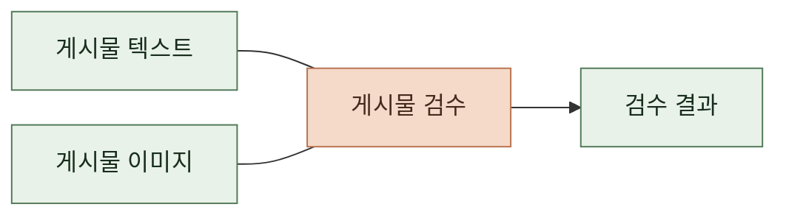

# 태스크 정의

 

### 게시물 검수

 

**1. 입력**

| 항목 | 내용 |
|---|---|
| 기본 정보 | 제목, 한 줄 소개, 상세 소개, 장르 |
| 스토리 설정 | 세계관, 주변 인물 설정, 주인공 설정, 전개 규칙 |
| 시작 설정 | 이름, 시작 상황, 프롤로그, 첫 선택지 |
| 엔딩 | 이름, 달성 조건, 에필로그 |
| 주요 사건 | 이름, 설명, 키 문장 |
| 인물 정보 | 기본 주인공 이름, 주변 인물의 이름과 설명, 인물 이미지 이름 |
| 게시물 이미지 | 썸네일과 인물 이미지 백엔드가 전달한 주소에서 실제 이미지를 가져와 검사 |
| 식별자 | 검수 제출본 식별자와 선택적인 스토리 식별자 검수 기록 연결에 사용하며 판정 대상에서는 제외 |

 

**2. 출력**

| 항목 | 내용 |
|---|---|
| 승인 여부 | 게시물의 승인 또는 반려 판정 검수 실패 시에도 반려로 반환하며 실행 오류로 구분 |
| 위반 목록 | 위반한 글이나 이미지의 위치, 텍스트 또는 이미지 구분, 위반 기준과 이유 확인한 위반이 없으면 빈 목록 |
| 실행 오류 | 검수를 완료하지 못한 원인 정상적으로 검수를 마쳤으면 없음 |
| 이미지 오류 목록 | 가져오거나 읽지 못한 이미지의 위치와 원인 이미지 오류가 없으면 빈 목록 |
