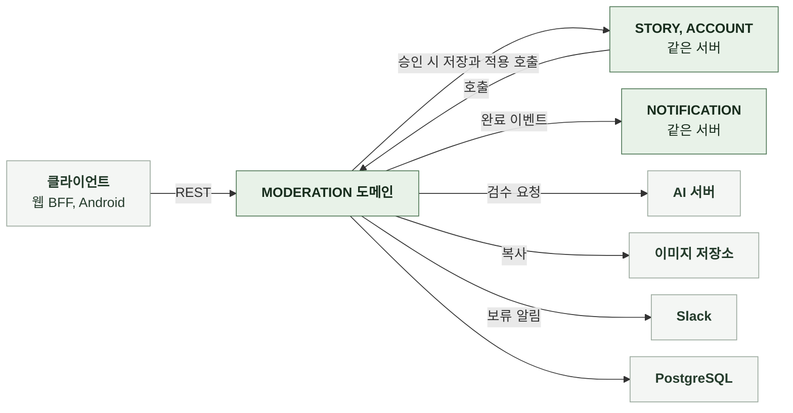

# 3-1 소프트웨어 구조

이 문서는 MODERATION 도메인 백엔드의 개요, 배경과 목표, 품질 속성, 배포 단위, 모듈 구조, 의존 방향, 도메인 모델을 정한다.

테이블과 컬럼은 DB 스키마에, 코딩 규칙은 컨벤션에, 흐름별 처리 순서는 처리 흐름에 있다. ([3-2 DB 스키마](3-2-DB-SCHEMA.md), [3-3 컨벤션](3-3-CONVENTIONS.md), [4-1 처리 흐름](4-1-PIPELINES.md))

 

### 3-1-1 개요

MODERATION 도메인은 서버 애플리케이션의 내부 패키지다. 별도 프로세스로 실행하지 않는다. 같은 서버의 다른 도메인과는 서비스 호출과 이벤트로 연결한다. 접수는 스토리 도메인의 등록과 수정 요청에서 시작하며 실행은 요청과 분리된 폴러가 맡는다.

| 외부 시스템 | 역할 | 연결 방식 |
|---|---|---|
| 클라이언트 | 제출본 조회, 재제출, 취소 | REST |
| AI 서버 | 검수 입력 판정 | HTTP, 검수 요청 1회 |
| PostgreSQL | 제출본 | JDBC |
| 이미지 저장소 | 업로드 원본과 검수용 복사본 | S3 복사와 서빙 URL |
| Slack | 보류 알림 | Incoming Webhook |

 

### 3-1-2 배경과 목표

| 배경 | 설계 목표 |
|---|---|
| 판정에 텍스트와 이미지가 함께 필요하고 한 번에 2분 넘게 걸릴 수 있음 | 접수와 판정을 분리하고 결과는 알림과 조회로 전달 |
| 미승인 데이터가 현재 스토리에 섞이면 목록, 검색, 상세, 공개 스냅샷, 채팅의 읽기 규칙을 모두 바꿔야 함 | 제출본을 현재 스토리와 분리하고 승인된 것만 반영 기존 읽기 계약은 그대로 |
| 반려된 입력은 사용자가 고쳐서 다시 제출해야 함 | 입력 전체와 위반 위치를 보존하고 같은 식별자로 재제출 |
| 업로드 원본은 서명 URL로 다시 덮어쓸 수 있어 검수한 이미지와 저장된 이미지가 달라질 수 있음 | 검수 직전에 서버 전용 복사본을 만들고 승인 저장도 같은 복사본을 사용 |
| 인스턴스가 여러 개이고 배포 중 교체됨 늦게 도착한 결과가 새 제출을 덮어쓸 수 있음 | DB 선점과 임대, 회차 번호로 한 번에 한 인스턴스만 실행하고 같은 회차에만 반영 |
| 다운로드와 모델 호출은 일시적으로 실패하며 그때마다 사용자에게 실패를 돌려주면 안 됨 | 사용자가 고칠 사유가 없는 실패만 정해진 횟수만큼 재시도하고 재시도 예산이 소진되면 보류 |
| AI 서버의 요청 본문 상한을 넘기면 검수 자체가 실패함 | 접수 전에 예상 용량을 검사해 고칠 수 있는 오류로 거절 |

 

### 3-1-3 품질 속성

| 속성 | 기준 | 보장 방법 |
|---|---|---|
| 현재 스토리 보호 | 승인 전 데이터가 현재 스토리에 나타나지 않음 | 제출본 테이블 분리 승인 트랜잭션에서만 현재 스토리 변경 |
| 결과 정합성 | 같은 제출본에 결과가 한 번만, 최신 회차에만 반영됨 | 대기 상태와 회차 일치 조건으로 반영 승인 적용과 승인 표시는 한 트랜잭션 |
| 복구 가능성 | 인스턴스 종료, DB 장애, 일시 실패에서 제출본이 사라지지 않음 | 대기 상태 유지, 임대 만료 재선점, 재시도 예약, 보류 |
| 실행 격리 | 검수 실행 실패가 접수 응답과 다른 요청을 바꾸지 않음 | 접수는 대기 행만 커밋 실행은 전용 스레드 풀 |
| 입력 보호 | 사용자 입력 원문과 이미지 URL이 로그와 알림에 남지 않음 | 로그에는 식별자와 예외 종류만 기록 보류 알림은 식별자, 종류, 사유, 횟수만 |
| 관측 작업의 실패 격리 | 보류 알림 전송 실패가 보류 기록을 바꾸지 않음 | 커밋 후 전송, 실패는 경고만 |

 

### 3-1-4 배포 단위

MODERATION은 다른 도메인의 백엔드와 하나의 서버 이미지에 포함된다. 따로 배포하지 않는다. 폴러와 실행기는 같은 프로세스에서 실행된다.

 

### 3-1-5 모듈 구조

| 구성 요소 | 입력 | 출력 | 책임 |
|---|---|---|---|
| API 계층 | HTTP 요청 | HTTP 응답 | 형식 검증, 요청자 식별, 상태 코드 |
| 제출 서비스 | 등록 또는 수정 입력, 요청자 | 접수 응답, 제출본 응답 | 계정 상태와 소유권 판정, 대기 중 제한, 접수, 재제출, 취소, 조회 응답 조립 |
| 폼 조립기 | 입력, 현재 스토리 | 검수 폼, 검수 입력 | 검증, 수정 결과 전체 조립, AI 입력 추림, 위치 재대응 |
| 용량 검사 | 검수 폼, 검증된 이미지 크기 | 통과 또는 거절 | 이미지 base64 예상 크기와 입력 JSON 합계 검사 |
| 폴러 | 없음 | 없음 | 빈 슬롯만큼 선점하고 실행기에 전달 |
| 선점 저장소 | 현재 시각, 임대, 건수 | 선점한 제출본과 회차 | 잠긴 행을 건너뛰며 선점, 회차 증가, 임대 반환 |
| 실행기 | 제출본, 회차 | 없음 | 이미지 복사, AI 호출, 결과 검증, 종료 처리 호출 |
| 이미지 복사 | 검수 폼, 복사 매핑 | 검수 입력 | 새 이미지를 복사본 키로 복사하고 URL 교체 |
| AI 클라이언트 | 검수 입력 | 판정 결과 | 검수 요청, 응답 형식 검증 |
| 종료 처리 | 제출본, 회차, 판정 결과 | 없음 | 회차 확인, 승인 적용, 반려와 실패 기록, 재시도 예약, 보류, 완료 이벤트 발행 |
| 재시도 정책 | 오류 코드, 위반 항목, 이미지 오류 | 일시 실패 여부 | 재시도 대상 판정과 간격 |
| 보류 알림 | 보류 이벤트 | 없음 | 커밋 후 Slack 전송 |

 

### 3-1-6 의존 방향

| 방향 | 규칙 |
|---|---|
| API 계층 → 제출 서비스 | API 계층은 서비스만 호출 저장 계층을 직접 호출하지 않음 |
| STORY → MODERATION | 등록과 수정 요청이 제출 서비스로 접수 이미지 삭제와 수정 전에 대기 중 제출본 존재 확인 |
| MODERATION → STORY | 승인 시 등록 저장과 수정 적용 호출 폼 조립에 수정 폼 조회와 이미지 객체 검증 사용 |
| MODERATION → NOTIFICATION | 종료 트랜잭션에서 완료 이벤트 발행 |
| ACCOUNT → MODERATION | 탈퇴 시 회원 제출본 삭제 호출 |
| MODERATION → ACCOUNT | 회원 상태 조회와 사용자 행 잠금 |
| 실행기 → AI 클라이언트, 이미지 복사 | 트랜잭션 밖에서 호출 |
| 외부 시스템 | AI 클라이언트와 이미지 저장소는 주입으로 분리 테스트는 고정 응답 구현과 가짜 서버로 대체 |

 

### 3-1-7 도메인 모델

| 모델 | 하위 데이터 | 설계 의도 |
|---|---|---|
| 제출본 | 요청 원본, 검수 폼, 이미지 복사 매핑, 위반 항목, 이미지 오류 | 현재 스토리와 분리된 한 행에 입력과 판정을 함께 보존 스토리당 대기 1건, 미승인 수정 1건 |
| 회차 | 없음 | 선점과 재제출마다 증가하는 번호 늦은 결과를 차단하는 토큰 |
| 재시도 상태 | 재시도 횟수, 다음 시도 시각, 보류 시각과 사유 | 대기 상태를 유지한 채 재시도와 보류를 표현 |
| 판정 결과 | 결정, 위반 항목, 오류 코드, 이미지 오류 | 형식 검증을 통과한 AI 응답 검증에 실패하면 채택하지 않음 |

 

| 판정 | 의미 |
|---|---|
| 제출본 상태 | `PENDING`, `APPROVED`, `REJECTED`, `FAILED` 대기는 실행 중, 재시도 예약, 보류를 모두 포함 |
| 종류 | `CREATE`, `UPDATE` 신규 등록은 승인 전까지 스토리가 없음 |
| 일시 실패 | 오류 코드가 `IMAGE_DOWNLOAD_FAILED`, `MODEL_CALL_FAILED`, `MODERATION_UNAVAILABLE`이고 위반 항목이 없으며 이미지 오류에 `IMAGE_INVALID`, `IMAGE_UNREADABLE`이 없음 |
| 결과 반영 조건 | 대기 상태, 같은 회차, 재시도 예약 아님, 보류 아님 회원이 탈퇴했거나 스토리가 삭제됐으면 반영하지 않음 |
