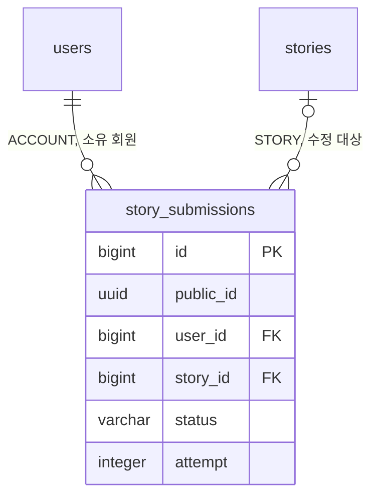

# 3-2 DB 스키마

이 문서는 MODERATION 도메인이 관리하는 PostgreSQL 테이블의 컬럼, 제약, 인덱스와 데이터 수명을 정한다.

다른 도메인의 테이블에서는 MODERATION 도메인이 참조하는 컬럼만 설명한다.

입력값의 검증 규칙은 보안에, 잠금 순서와 회차 규칙은 동시성에, 임대와 재시도 간격은 오류 처리에 있다. ([5-1-4 입력 검증](5-1-SECURITY.md#5-1-4-입력-검증), [5-2 동시성](5-2-CONCURRENCY.md), [5-3-5 재시도와 시간 한도](5-3-ERROR-HANDLING.md#5-3-5-재시도와-시간-한도))

 

### 3-2-1 공통 규칙

| 규칙 | 내용 |
|---|---|
| 식별자 | 내부 PK는 `bigint` 자동 증가 외부 노출용 `public_id uuid`를 따로 둠 |
| 시각 | `timestamp with time zone` `created_at`의 기본값은 `now()`이며 아래 표에서는 표시하지 않음 |
| 삭제 | 물리 삭제 제출본 취소, 스토리 삭제, 회원 탈퇴 시 삭제 |
| FK | 회원과 스토리 삭제 시 함께 삭제(`ON DELETE CASCADE`) 회원 행과 스토리 행은 소프트 삭제라 실제 연쇄 삭제는 일어나지 않음 |

 

### 3-2-2 관계도

관계도는 데이터 묶음별 소유 관계를 보여준다. 각 상자에는 식별과 연결에 쓰는 컬럼만 표시한다. 전체 컬럼은 아래 표에서 정의한다. 다른 도메인의 테이블은 관계 라벨에 도메인을 적고 컬럼을 생략한다.

 

### 3-2-3 제출본

**`story_submissions`**

일반 제작 등록 또는 수정 1건의 검수 제출본을 한 행에 저장한다. 승인 전에는 현재 스토리와 분리한다.

| 컬럼 | 타입 | 제약 | 의미 |
|---|---|---|---|
| `id` | bigint | PK | 선점 순서 |
| `public_id` | uuid | NOT NULL, UNIQUE | 외부 식별자 |
| `user_id` | bigint | NOT NULL, FK `users.id` CASCADE | 소유 회원 |
| `story_id` | bigint | FK `stories.id` CASCADE, CHECK 종류가 `CREATE`이거나 NOT NULL | 수정 대상 스토리 신규 등록은 승인 시 생성한 스토리로 설정 |
| `kind` | varchar(10) | NOT NULL, CHECK `CREATE` `UPDATE` | |
| `payload` | jsonb | NOT NULL, CHECK 객체 | 요청 본문 원본 수정은 부분 요청 그대로 |
| `input_form` | jsonb | NOT NULL | 접수 시점의 전체 폼 검수 입력 조립과 위치 재대응의 기준 |
| `image_copies` | jsonb | NOT NULL, 기본 `{}`, CHECK 객체 | 원본 객체 키와 복사본 키의 매핑 재선점 시 재사용, 재제출 시 비움 |
| `status` | varchar(10) | NOT NULL, CHECK `PENDING` `APPROVED` `REJECTED` `FAILED` | |
| `issues` | jsonb | NOT NULL, 기본 `[]`, CHECK 배열 | 위반 항목 목록 위치는 검수 입력 원본 기준 |
| `image_errors` | jsonb | NOT NULL, 기본 `[]`, CHECK 배열 | 이미지 오류 목록 위치는 검수 입력 원본 기준 |
| `error_code` | varchar(40) | CHECK `FAILED`일 때만 NOT NULL | 실행 실패 코드 |
| `attempt` | integer | NOT NULL, 기본 1, CHECK 양수 | 회차 선점과 재제출마다 증가 |
| `retry_count` | integer | NOT NULL, 기본 0, CHECK 0~2 | 예약한 자동 재시도 횟수 재제출 시 0 |
| `next_attempt_at` | timestamptz | | 다음 자동 재시도 가능 시각 선점 시 NULL |
| `held_at` | timestamptz | CHECK 보류 두 컬럼이 함께 NULL이거나 함께 NOT NULL이면서 `PENDING`이고 `next_attempt_at`이 NULL | 보류 시각 |
| `hold_reason` | text | | 보류 원인 코드 마지막 실행 실패의 오류 코드 회원 응답에는 노출하지 않고 관리자 보류 목록과 관리자 제출본 목록, 상세에만 |
| `dispatched_at` | timestamptz | | NULL은 미선점 값은 마지막 선점의 임대 시작 시각 |
| `created_at` | timestamptz | NOT NULL, 기본 `now()` | 접수 시각 목록 정렬 기준 |
| `updated_at` | timestamptz | NOT NULL, 기본 `now()` | |
| `decided_at` | timestamptz | CHECK `PENDING`이면 NULL, 아니면 NOT NULL | 판정 시각 |

| 인덱스 | 컬럼 |
|---|---|
| `uq_story_submissions_pending` | `story_id` WHERE `story_id IS NOT NULL AND status = 'PENDING'` |
| `uq_story_submissions_unapproved` | `story_id` WHERE `story_id IS NOT NULL AND status <> 'APPROVED'` |
| `ix_story_submissions_owner` | `user_id`, `created_at DESC`, `id DESC` |
| `ix_story_submissions_claim` | `id`, `next_attempt_at`, `dispatched_at` WHERE `status = 'PENDING' AND held_at IS NULL` |

- 승인본은 `story_id`가 NOT NULL이어야 한다.
- 두 부분 유니크 인덱스로 스토리별 대기 1건, 미승인 수정 1건을 제한한다. 신규 등록은 승인 전 `story_id`가 없어 대상이 아니다.

 

### 3-2-4 참조하는 다른 도메인의 컬럼

| 테이블 | 컬럼 | MODERATION이 하는 일 |
|---|---|---|
| `users` | `status` | 접수와 결과 반영 전 계정 상태 확인 공개 중단 알림 전 소유 회원의 탈퇴 확인 |
| `stories` | `public_id`, `user_id`, `deleted_at`, `visibility`, `status` | 소유 판정, 삭제 확인, 수정 폼 조립, 공개 범위 변경 허용 판정 |
| `stories` | `thumbnail_image_url` | 수정 폼의 표지 URL |
| `stories` | `taken_down_at`, `takedown_reason`, `takedown_reason_detail` | 공개 중단 기록과 승인 시 해제 공개 범위 단독 변경의 검수 여부 판정 |
| `story_characters` | `public_id`, `name` | 수정 폼 조립과 인물 대응 |
| `story_character_images` | `public_id`, `image_name`, `image_url` | 수정 폼 조립과 유지 이미지 대응 |

 

### 3-2-5 데이터 수명

| 데이터 | 삭제 |
|---|---|
| 승인본 | 스토리 삭제, 회원 탈퇴 |
| 대기본, 반려본, 실패본 | 제출본 취소, 스토리 삭제, 회원 탈퇴 |
| 재제출 전 판정 | 재제출 시 덮어씀 |
| 이미지 복사본 객체 | 없음 |
