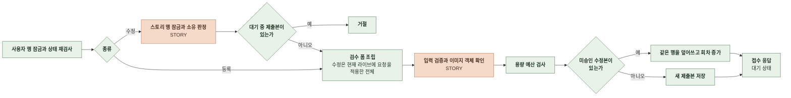
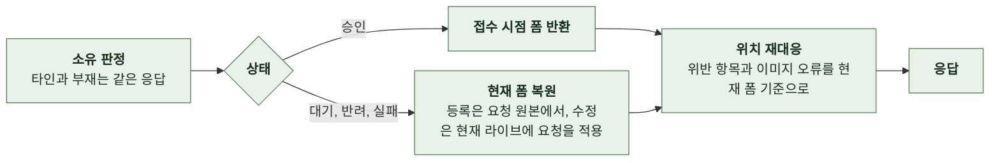
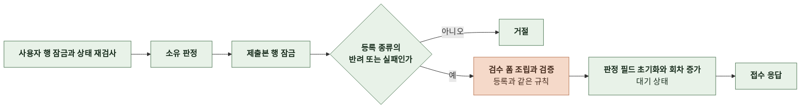
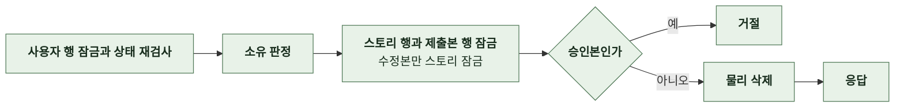
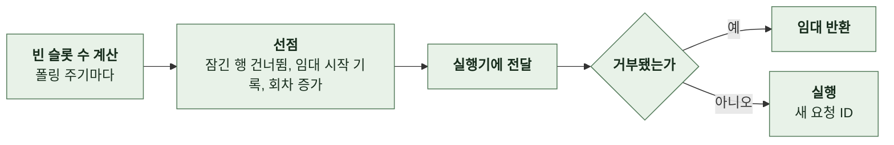
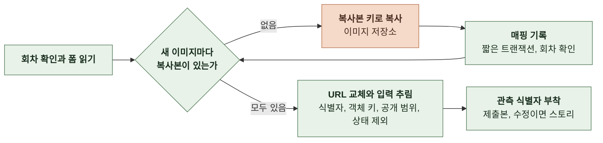
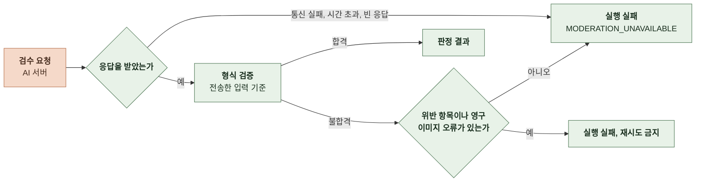
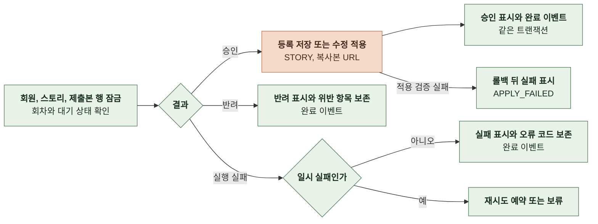
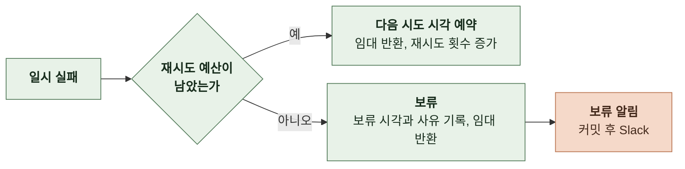

# 4-1 처리 흐름

이 문서는 MODERATION 도메인의 접수부터 응답까지의 처리 단계, 제출본이 선점되어 판정과 반영에 이르기까지의 단계를 정한다.

요청 필드와 응답 필드는 계약에, 재시도 간격과 시간 한도, 복구 규칙은 오류 처리에, 잠금과 선점, 회차는 동시성에 있다. ([4-2 계약](4-2-CONTRACT.md), [5-3 오류 처리](5-3-ERROR-HANDLING.md), [5-2 동시성](5-2-CONCURRENCY.md))

<br>

### 4-1-1 공통 처리

모든 요청은 상관관계 필터에서 요청 ID를 받는다. 이어서 보안 필터가 경로의 인증 수준에 따라 요청자를 정한다. 제출본 경로는 모두 인증 필수이며 토큰이 없거나 무효이면 거절한다.

접수, 재제출, 취소는 사용자 행에 비관적 잠금을 건 뒤 계정 상태를 다시 검사한다. 정지 계정은 거절하고 탈퇴 계정은 인증 실패로 응답한다. 조회는 계정 상태를 검사하지 않는다.

접수는 대기 상태의 제출본 행만 커밋한다. 실행은 요청과 분리된 폴러가 빈 슬롯만큼 선점해서 시작한다. 이미지 복사, AI 호출, 보류 알림은 DB 트랜잭션 밖에서 수행한다.

흐름도에서 AI 서버, 이미지 저장소, Slack, 다른 도메인을 호출하는 단계는 주황색이다.

<br>

### 4-1-2 접수

일반 제작 등록과 공개 범위 외 필드가 포함된 수정이 들어온다. 공개 범위만 담은 수정은 검수 없이 즉시 반영하며 그 처리는 STORY 세트에 있다.



- 검증 순서는 인증, 소유와 존재, 대기 중 거절, 입력 검증, 용량 예산이다. JSON 파싱과 타입 변환 실패는 서비스에 들어오기 전에 거절된다.
- 기본 주인공 이름과 장르는 접수 시점에 정규화해 요청 원본에 저장한다. 승인 적용은 이 원본을 다시 검증하지 않는다.
- 수정은 현재 라이브에 요청의 부분 갱신과 컬렉션 동기화를 적용한 전체 결과를 검수 폼으로 만든다. 반려 뒤 라이브에서 삭제된 기존 이미지는 이전 검수 폼에 있던 식별자에 한해 검증에서 제외한다.
- 용량 예산은 새 이미지의 검증 때 받은 크기와 유지 이미지의 저장소 조회 크기를 base64로 환산한 값에 검수 입력 JSON 크기를 더해 판정한다. 크기를 알 수 없는 유지 이미지는 장당 상한값으로 계산한다.
- 등록 요청의 초안 식별자는 접수 트랜잭션에서 요청자 소유 초안을 삭제한다. 그 규칙은 STORY 세트에 있다.
- 등록에는 멱등 키가 없어 중복 제출이 허용된다. 사용자는 미승인 목록에서 확인하고 취소한다.

<br>

### 4-1-3 제출본 조회



- 응답의 폼은 DB의 요청 원본이 아니라 복원한 전체 폼이다. 새 이미지는 식별자 없이 객체 키와 미리보기 URL을 가진다.
- 위치 재대응은 기존 이미지는 식별자, 새 이미지는 객체 키, 인물은 식별자 또는 이름으로 원본 폼의 항목을 현재 폼에서 찾아 인덱스를 바꾼다. 대상이 사라진 항목과 표지 URL이 바뀐 표지 항목은 응답에서 뺀다.
- 미승인 목록은 승인본을 제외하고 생성 시각 내림차순, 같으면 내부 PK 내림차순이다. 신규 등록본은 라이브가 없으므로 내 스토리 화면이 이 목록으로 구성된다.
- 수정 폼의 제출본 메타데이터는 같은 재대응 규칙으로 만들며 그 계약은 STORY 세트에 있다.

<br>

### 4-1-4 재제출



- 재제출은 요청 원본과 검수 폼을 덮어쓰고 위반 항목, 이미지 오류, 오류 코드, 판정 시각, 이미지 복사 매핑, 재시도 상태를 비운다. 이전 판정의 이력은 남기지 않는다.
- 수정본의 반려와 실패는 이 경로가 아니라 수정 요청으로 같은 행을 덮어쓴다.

<br>

### 4-1-5 취소



- 대기 중인 제출본도 삭제한다. 실행 중이던 결과는 행이 없어 반영 조건을 만족하지 못하고 무시된다.
- 중복 등록 정리와 수정 취소가 같은 경로를 쓴다.

<br>

### 4-1-6 선점과 실행



- 선점 대상은 대기 상태이고 보류가 아니며 다음 시도 시각이 없거나 지났고 임대가 없거나 만료된 행이다. 같은 트랜잭션에서 임대 시작 시각을 기록하고 회차를 올리고 다음 시도 시각을 비운다.
- 슬롯은 실행기 제출 직전부터 실행 종료까지 점유하므로 실행기에 대기 큐가 없다. 슬롯이 없으면 선점하지 않는다.
- 선점마다 새 요청 ID를 발급해 AI 호출과 완료 이벤트까지 전파한다. 접수 요청의 상관 식별자는 저장하지 않는다.
- 임대 반환에 실패하면 임대가 만료된 뒤 다시 선점된다.

<br>

### 4-1-7 검수 입력 조립과 이미지 복사



- 새 표지와 인물 이미지만 복사한다. 라이브의 기존 이미지는 복사하지 않는다. 복사본 키는 업로드 접두어 아래의 검수 전용 경로이며 서명 URL 발급 대상이 아니다.
- 재선점은 기록된 매핑을 재사용한다. 매핑 기록 때 회차가 바뀌었으면 실행을 중단한다.
- 저장된 검수 폼은 원본 식별자를 유지하고 AI에 보낼 사본만 복사본 URL로 바꾼다. 승인 저장도 같은 복사본 URL을 쓰며 매핑이 없으면 원본으로 대체하지 않는다.
- 검수 입력은 기본 주인공 이름을 토큰 없는 원문으로 싣고 페르소나는 넣지 않는다.

<br>

### 4-1-8 AI 호출과 응답 검증



| 요청 필드 | 출처 |
|---|---|
| `submissionId` | 제출본 공개 식별자 |
| `storyId` | 수정일 때만 스토리 공개 식별자 |
| `protagonist_name` | 폼의 기본 주인공 이름 원문<br>없으면 생략 |
| 제목, 한 줄 소개, 소개, 장르, 설정, 시작 설정, 주요 사건, 인물 이름과 소개, 이미지 이름 | 검수 폼의 같은 이름 필드 |
| `thumbnailUrl`, `characters[].images[].imageUrl` | 새 이미지는 복사본 URL, 기존 이미지는 라이브 URL |

| 응답 조건 | 처리 |
|---|---|
| 결정이 승인이고 위반 항목, 오류 코드, 이미지 오류가 모두 없음 | 승인 |
| 결정이 반려이고 오류 코드가 없으며 위반 항목이 하나 이상 | 반려 |
| 이미지 오류가 있고 오류 코드가 그 목록의 우선순위 코드와 같음 | 오류 코드에 따라 실패 또는 재시도<br>위반 항목은 함께 보존 |
| 오류 코드가 모델 호출 실패이고 위반 항목과 이미지 오류가 없음 | 재시도 판정 |
| 위반 항목의 위치가 전송한 문자열 경로가 아니거나 종류, 기준, 이유가 규칙에 어긋남 | 형식 불합격 |
| 이미지 오류의 위치가 이미지 경로가 아니거나 코드가 세 가지 밖이거나 같은 위치가 중복 | 형식 불합격 |

- 검수 기준과 응답 의미는 AI 서버가 소유한다. 백엔드는 형식만 검증하고 기준을 중복 정의하지 않는다.
- 이미지 오류의 우선순위는 `IMAGE_INVALID`, `IMAGE_UNREADABLE`, `IMAGE_DOWNLOAD_FAILED` 순서다.
- 알 수 없는 필드는 무시한다. 이미지 오류 생략은 빈 배열로 읽는다.

<br>

### 4-1-9 결과 반영



- 반영 조건은 대기 상태, 같은 회차, 재시도 예약과 보류가 아님이다. 회원이 탈퇴했거나 스토리가 삭제됐으면 반영하지 않는다.
- 신규 등록의 승인은 제출본 행을 잠근 채 스토리를 만들고 제출본에 스토리를 연결한다. 수정의 승인은 반려 뒤 삭제된 기존 이미지를 제외한 집합으로 적용한다.
- 승인은 라이브 반영, 공개 스냅샷 갱신, 승인 표시를 한 트랜잭션으로 커밋한다. 검색 색인은 커밋 후 STORY의 경로를 따른다.
- 적용 검증 실패는 라이브 변경을 롤백한 뒤 새 트랜잭션에서 반영 조건을 다시 확인하고 실패로 기록한다.
- 완료 이벤트의 발송은 NOTIFICATION 세트에 있다.

<br>

### 4-1-10 재시도와 보류



- 예약과 보류는 대기 상태를 유지하고 회차는 바꾸지 않는다. 다음 선점이 새 회차를 받는다.
- 예약과 보류 상태에서 도착한 같은 회차의 늦은 결과는 무시한다.
- 보류 알림에는 제출본 공개 식별자, 종류, 사유 코드, 시도 횟수만 싣는다. 웹훅이 없으면 경고 로그만 남긴다.
- 보류는 완료가 아니므로 완료 이벤트를 발행하지 않는다. 사용자에게는 대기 상태로 보인다.

<br>

### 4-1-11 보류 해제

운영자가 원인을 조치한 뒤 대상 제출본의 보류 시각과 사유를 비우고 재시도 횟수를 0으로, 다음 시도 시각과 임대 시작 시각을 NULL로 되돌린다. 별도 해제 API는 없으며 SQL로 한 건씩 바꾼다.

```sql
UPDATE story_submissions
SET held_at = NULL, hold_reason = NULL, retry_count = 0,
    next_attempt_at = NULL, dispatched_at = NULL
WHERE public_id = '<submission UUID>'::uuid
  AND status = 'PENDING' AND held_at IS NOT NULL;
```

- 영향 행이 한 건인지 확인한다. 다음 폴링에서 새 회차로 선점되며 재시도 예산도 초기화된다.
