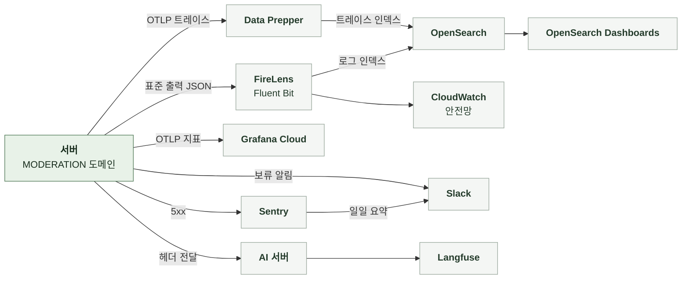

# 5-4 관측

이 문서는 MODERATION 도메인의 관측 스택, 요청과 실행을 추적할 식별자, 구조화 로그 이벤트, 오류 확인 위치, 지표, 트레이스, 알림, 수집 조건을 정한다.

입력 원문과 식별자 취급 규칙은 보안에, 오류 로그 수준은 오류 처리에 있다. ([5-1-7 식별자와 개인정보](5-1-SECURITY.md#5-1-7-식별자와-개인정보), [5-3-8 로그와 Sentry](5-3-ERROR-HANDLING.md#5-3-8-로그와-sentry))

 

### 5-4-1 관측 스택

 

### 5-4-2 상관관계 식별자

상관관계 필터는 모든 요청의 MDC에 다음 값을 기록한다. 로그와 Sentry는 같은 식별자를 사용한다. 실행기는 요청과 분리되어 있으므로 선점마다 새 요청 ID를 만들어 워커 스레드의 MDC에 넣고 AI 호출 헤더와 완료 이벤트까지 전파한다.

| MDC 필드 | 값 | 규칙 |
|---|---|---|
| `request_id` | 요청 헤더 값, 없으면 `req_` + UUID 실행은 선점마다 새 UUID | 생성한 값은 응답 헤더로 반환 접수 요청의 값은 제출본에 저장하지 않음 |
| `session_id` | `X-Manyak-Session-Id` | 없으면 `unknown` 실행에는 없음 |
| `device_id_hash` | `device_hash_` + SHA-256(pepper + 원본) 앞 16자 | 원본은 저장하지 않음 실행에는 없음 |
| `sentry_event_id` | Sentry 이벤트 ID | 5xx를 Sentry로 보낸 요청만 |
| `traceId`, `spanId` | 현재 스팬 | 트레이스 전송을 비활성화해도 생성 |

| 식별자 | 기록 위치 | 연결 대상 |
|---|---|---|
| `request_id` | 로그 MDC, Sentry 태그, AI 서버 Langfuse 메타데이터 | 한 실행의 서버 로그와 AI 판정 기록 |
| 제출본 공개 식별자 | AI 요청 본문, Langfuse 메타데이터, 보류 알림, 완료 이벤트 | 제출본 |
| 제출본 내부 ID와 회차 | 실행 WARN 로그 | 실행 1회 |
| 스토리 공개 식별자 | 수정 검수의 AI 요청 본문, Langfuse 메타데이터 | 스토리 |

 

### 5-4-3 구조화 로그 이벤트

구조화 로그는 `event_name`을 맨 앞에 둔 JSON 형식으로 INFO 수준에 기록한다. 이벤트 이름은 snake_case다. `prod`, `dev`, `jsonlog` 프로파일에서만 JSON 형식을 쓴다. 그 외에는 콘솔 패턴을 쓴다. JSON의 `service`는 `manyak-server`다. 인코더는 MDC 값을 최상위 필드에 기록한다.

| 단위 | 기록 시점과 이름 | 기록 내용 |
|---|---|---|
| 모든 API 요청 | 응답 종료 `api_request_completed`, 5xx는 `api_request_failed` | `endpoint`, `http_method`, `status_code`, `duration_ms` 실패 시 예외 클래스 이름 또는 상태 이름을 `error_code`로 추가 |
| 실행 실패 | AI 호출, 이미지 복사, 응답 검증 실패 평문 WARN `moderation_execution_failed` | 제출본 내부 ID, 회차, 예외 클래스, HTTP 상태 |
| 실행 지연 | 회차 확인과 결과 기록의 DB 장애 평문 WARN `moderation_execution_deferred` | 제출본 내부 ID, 회차, 예외 클래스 |
| 전달 지연 | 실행기 거부 평문 WARN `moderation_dispatch_deferred` | 제출본 내부 ID, 회차, 예외 클래스 |
| 보류 | 웹훅 미설정으로 전송하지 않을 때 평문 WARN `moderation_held` | 제출본 공개 식별자, 종류, 사유 코드, 시도 횟수 |
| 보류 알림 실패 | Slack 전송 실패 평문 WARN `moderation_hold_notification_failed` | 제출본 공개 식별자, 예외 클래스 |

- 판정 결과 자체는 로그에 남기지 않는다. 결과는 제출본 행과 AI 서버의 Langfuse 기록에 있다.
- 검수 완료 알림의 발송 로그는 NOTIFICATION 세트에 있다.

 

### 5-4-4 오류 확인

| 기능 | 오류 조회 위치 |
|---|---|
| 접수, 조회, 재제출, 취소 | 요청 로그의 `/api/v1/stories/general`, `/api/v1/stories/{storyId}`, `/api/v1/stories/submissions` 상태 분포 Sentry `endpoint` 태그 |
| 실행 | 로그 `moderation_execution_failed`의 예외 클래스와 HTTP 상태, 트레이스 `story.moderation.run` |
| 판정 내용 | AI 서버 Langfuse의 제출본 식별자 검색 |
| 재시도와 보류 | 제출본 행의 재시도 횟수, 다음 시도 시각, 보류 시각과 사유 보류 알림 Slack 메시지 |
| 임대 복구 | 제출본 행의 임대 시작 시각과 회차 로그 `moderation_execution_deferred`, `moderation_dispatch_deferred` |
| 승인 적용 실패 | 제출본 `errorCode` `APPLY_FAILED` |

 

### 5-4-5 지표

| 지표 | 종류와 태그 | 의미 |
|---|---|---|
| `story.moderation.run` | 관측 스팬 `attempt` = 회차 | 선점 1회의 실행 시간 이미지 복사, AI 호출, 결과 기록 포함 |
| `http.server.requests` | Timer `uri`, `method`, `status`, `outcome` | 접수와 제출본 API의 요청률과 오류율 |

| 항목 | 기준과 제한 |
|---|---|
| 전송 여부 | 지표 전송을 켠 환경에서만 Grafana Cloud로 전송 |
| 전송 주기 | 60초 간격 |
| 인스턴스 | 리소스 속성 `service.instance.id`가 기동마다 바뀜 여러 태스크의 누적 건수는 인스턴스별로 합산 |
| 결과 분포 | 승인, 반려, 실패의 건수 지표는 없음 제출본 테이블의 상태로 집계 |
| 스텁 환경 | AI를 호출하지 않아 실행 시간이 실제와 다름 |

 

### 5-4-6 트레이스

| 항목 | 내용 |
|---|---|
| 활성화와 표본 | 환경 변수로 켜며 기본값은 비활성 |
| 접수 스팬 | HTTP 요청 아래에 JDBC(QUERY만, 바인딩 값 제외) 스팬 |
| 실행 스팬 | 선점마다 `story.moderation.run` 루트 스팬 아래에 AI 호출(`traceparent` 전파)과 JDBC 스팬 |
| 제외 | 폴러의 주기 실행 자체, actuator 요청, Spring Security 내부 관측, 요청 밖 루트 DB와 Redis 관측은 노이즈 필터가 제외 |

 

### 5-4-7 알림

| 항목 | 기준 |
|---|---|
| 보류 알림 | 보류 전환 커밋 후 Slack Incoming Webhook으로 1회 전용 웹훅을 설정하지 않으면 신고 웹훅 사용, 둘 다 없으면 경고 로그 |
| 정기 보고 | 매일 오전 10시(KST), 지난 24시간 동안 발생한 운영 Sentry 오류 요약 |
| MODERATION에서 수집하는 오류 | 500 예상하지 못한 예외 4xx 거절, 반려, 실행 실패, 재시도와 보류는 Sentry에 없어 보고에 포함되지 않음 |
| 지표 기반 알림 | MODERATION 전용 알림 규칙 없음 |

 

### 5-4-8 수집 조건과 실패 처리

**1. 데이터 범위**

| 데이터 | 현재 기록 방식 |
|---|---|
| 입력 원문, 검수 입력, AI 응답 본문 | 로그와 Sentry에 싣지 않음 원문과 판정은 AI 서버의 Langfuse에서 관리 |
| 이미지 URL과 객체 키 | 로그에 싣지 않음 |
| 보류 알림 | 제출본 공개 식별자, 종류, 사유 코드, 시도 횟수만 |
| 웹훅 주소와 응답 | 로그에 싣지 않음 |
| Sentry 요청 필드 | 기본 수집 |
| Sentry 이벤트 | 5xx를 전부 캡처 기본 개인정보 수집 비활성화 |
| 로그 `message` | 실행 로그는 예외 클래스 이름만 예외 메시지와 스택트레이스는 기록하지 않음 |

 

**2. 수집 실패**

| 상황 | 처리 |
|---|---|
| 지표 전송 실패 | SDK로 배치 전송 전송에 실패한 지표는 유실 |
| Sentry 캡처 실패 | SDK 내부에서 처리 DSN 없는 환경은 no-op |
| 보류 알림 전송 실패 | 경고 로그만 재전송 없음 |
| 실행 로그 부재 | 성공한 실행은 WARN을 남기지 않음 기록이 없다는 이유만으로 실행되지 않았다고 판단하지 않음 |
