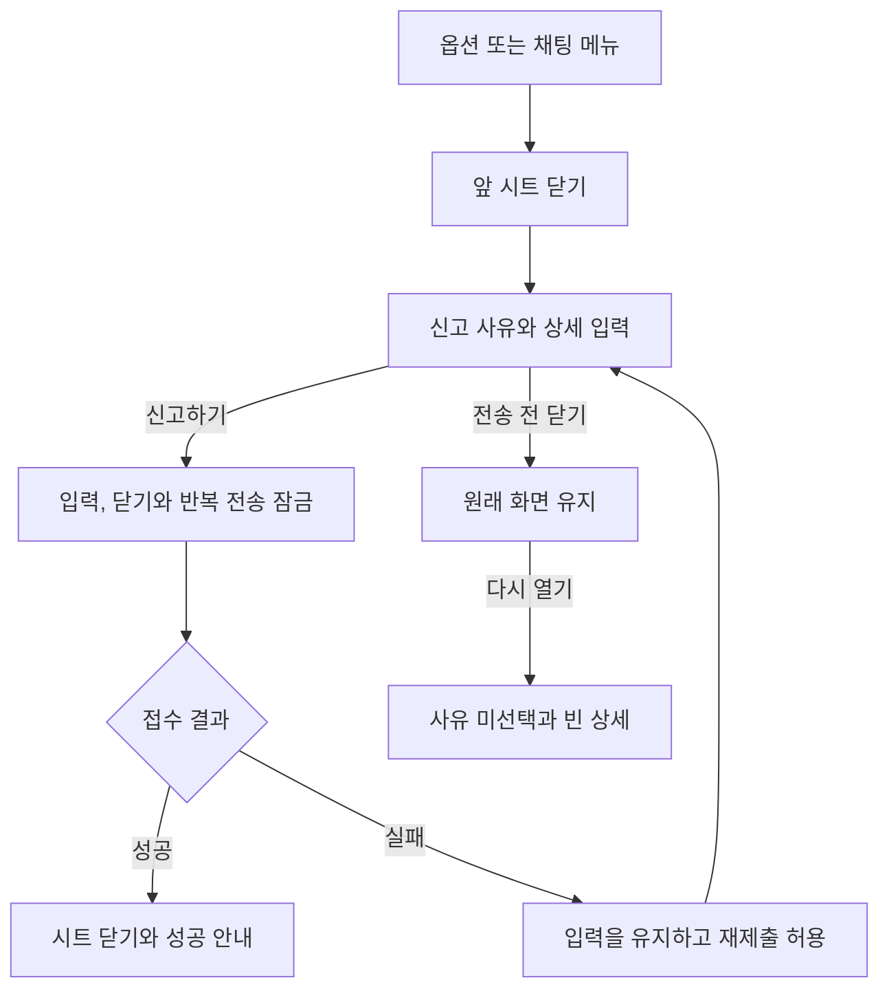

# 3-2 화면 흐름

기준: [화면 구성](3-1-INFORMATION-ARCHITECTURE.md).

 

### 3-2-1 신고

1. 사용자가 옵션이나 채팅 메뉴에서 신고하기를 누르면 앞 시트를 닫고 신고 시트를 연다.
2. 사유를 선택하고 필요하면 상세를 작성한다. 신고하기를 누르면 입력과 닫기, 반복 전송을 잠근다.
3. 접수에 성공하면 시트를 닫고 성공을 알린다. 실패하면 같은 입력을 남겨 다시 제출할 수 있게 한다.
4. 전송하지 않고 닫으면 원래 화면을 유지한다. 다시 열면 사유 미선택과 빈 상세로 시작한다.

전송 중 바깥 탭이나 닫기 조작으로 시트를 닫지 않는다. 뒤로가기의 공용 오버레이 처리는 플랫폼 셸 규칙을 따른다.
