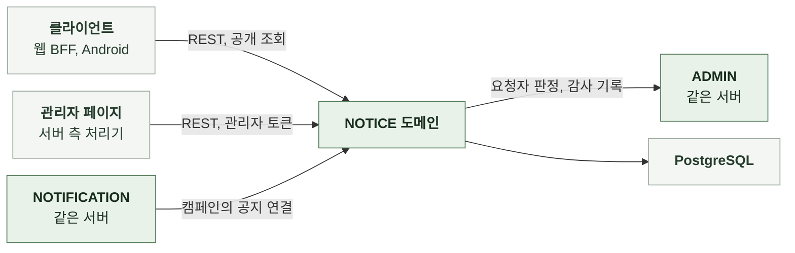

# 3-1 소프트웨어 구조

이 문서는 NOTICE 도메인 백엔드의 개요, 배경과 목표, 품질 속성, 배포 단위, 모듈 구조, 의존 방향, 도메인 모델을 정한다.

테이블과 컬럼은 DB 스키마에, 코딩 규칙은 컨벤션에, 엔드포인트별 처리 순서는 처리 흐름에 있다. ([3-2 DB 스키마](3-2-DB-SCHEMA.md), [3-3 컨벤션](3-3-CONVENTIONS.md), [4-1 처리 흐름](4-1-PIPELINES.md))

 

### 3-1-1 개요

NOTICE 도메인은 서버 애플리케이션의 내부 패키지다. 별도 프로세스로 실행하지 않는다. 공개 조회는 클라이언트가 호출하고 관리자 작업은 관리자 페이지의 서버 측 처리기가 호출한다. 알림 도메인과는 서비스 호출로 연결한다.

| 외부 시스템 | 역할 | 연결 방식 |
|---|---|---|
| 클라이언트 | 공지 목록과 상세 조회 | REST |
| 관리자 페이지 | 작성, 수정, 게시, 게시 해제, 삭제 | 관리자 토큰을 사용한 서버 측 처리기의 REST 호출 |
| PostgreSQL | 공지 | JDBC |

 

### 3-1-2 배경과 목표

| 배경 | 설계 목표 |
|---|---|
| 알림을 놓친 사용자도 소식을 읽을 수 있어야 함 | 공지를 서비스 안에 보관하고 공개 조회로 제공 |
| 작성 중인 글이 사용자에게 보이면 안 됨 | 초안과 게시의 두 상태만 두고 공개 조회는 게시만 읽음 |
| 광고성 소식은 동의와 표기 규칙이 있고 정보성은 없음 | 관리자가 고른 태그가 알림 종류를 정하고 알림 도메인이 종류별 규칙을 적용 캠페인에서 종류를 따로 고르지 않아 광고성 공지가 정보성 알림으로 나가지 않음 |
| 알림 시각을 고르고 같은 공지를 다시 알릴 수 있어야 함 | 게시는 공지만 공개하고 알림은 캠페인이 게시된 공지를 연결해 보냄 |
| 게시되지 않은 공지를 가리키는 알림이 새로 생기면 안 됨 | 캠페인 생성 트랜잭션에서 공지 행을 잠그고 게시 상태를 확인 |
| 알림이 가리키는 공지가 사라지면 딥링크가 깨짐 | 알림 캠페인에 연결한 공지는 삭제하지 않음 |

 

### 3-1-3 품질 속성

| 속성 | 기준 | 보장 방법 |
|---|---|---|
| 공개 범위 | 초안이 공개 조회에 나타나지 않음 | 공개 조회 쿼리에 게시 상태 조건 |
| 연결 시점의 게시 상태 | 게시되지 않은 공지에 새 캠페인이 연결되지 않음 | 캠페인 생성 트랜잭션에서 공지 행 잠금과 상태 확인 게시 해제와 삭제도 같은 행을 잠금 |
| 감사 완전성 | 감사 로그 없는 관리자 변경이 없음 | 관리자 도메인의 감사 기록 연산을 같은 트랜잭션에서 호출 |
| 관측 작업의 실패 격리 | 없음 알림 요청 시각 기록 실패는 캠페인 생성도 되돌림 | 같은 트랜잭션 |

 

### 3-1-4 배포 단위

NOTICE는 다른 도메인의 백엔드와 하나의 서버 이미지에 포함된다. 따로 배포하지 않는다.

 

### 3-1-5 모듈 구조

| 구성 요소 | 입력 | 출력 | 책임 |
|---|---|---|---|
| 공개 API 계층 | HTTP 요청 | HTTP 응답 | 형식 검증과 상태 코드 |
| 관리자 API 계층 | HTTP 요청 | HTTP 응답 | 형식 검증, 관리자 요청자 식별, 상태 코드 |
| 공지 조회 | 커서 공개 식별자 | 공지 목록과 상세 | 게시 조건 적용 페이지 조회 |
| 공지 서비스 | 관리자, 제목, 본문, 사유 | 공지 | 생성, 수정, 상태 전이, 삭제 가능 판정, 감사 기록 호출 |
| 게시 | 관리자, 공지 | 공지 | 공지 행 잠금, 상태 전이 |
| 알림 연결 | 공지 공개 식별자 | 공지 참조와 태그 또는 연결 불가 | 공지 행 잠금, 게시 상태 판정, 처음 연결의 알림 요청 시각 기록 |
| 저장 계층 | 쿼리 | 행 | 잠금 조회 페이지 조회 |

 

### 3-1-6 의존 방향

| 방향 | 규칙 |
|---|---|
| API 계층 → 서비스 | API 계층은 서비스만 호출 저장 계층을 직접 호출하지 않음 |
| NOTICE → NOTIFICATION | 없음 알림 도메인의 테이블을 읽거나 쓰지 않음 |
| NOTICE → ADMIN | 관리자 요청자와 변경 감사 기록 |
| NOTIFICATION → NOTICE | 캠페인 생성 트랜잭션에서 알림 연결 연산 호출 회차는 캠페인의 공지 참조로 공지 공개 식별자를 읽음 공지 테이블을 직접 쓰지 않음 |
| 그 밖의 도메인 → NOTICE | 없음 |

 

### 3-1-7 도메인 모델

| 모델 | 하위 데이터 | 설계 의도 |
|---|---|---|
| 공지 | 없음 | 제목, 본문, 태그, 상태, 게시 시각, 알림 요청 시각을 한 행에 외부에는 공개 식별자만 노출 |

 

| 판정 | 의미 |
|---|---|
| 상태 | `DRAFT` `PUBLISHED` 게시 해제는 `DRAFT`로 복귀 |
| 알림 요청됨 | 알림 요청 시각이 있음 알림 캠페인에 연결한 적이 있어 삭제 불가 |
| 공개 | 상태가 `PUBLISHED` |
| 태그 | `SERVICE`, `UPDATE`, `MAINTENANCE`, `EVENT`, `PROMOTION` 연결한 알림 캠페인의 종류를 정함 |
