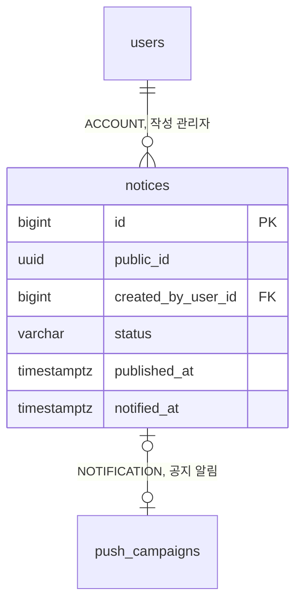

# 3-2 DB 스키마

이 문서는 NOTICE 도메인이 관리하는 PostgreSQL 테이블의 컬럼, 제약, 인덱스와 데이터 수명을 정한다.

다른 도메인의 테이블에서는 NOTICE 도메인이 참조하는 컬럼만 설명한다.

입력값의 검증 규칙은 보안에 있으며 잠금과 알림 1회성은 동시성에 있다. ([5-1-4 입력 검증](5-1-SECURITY.md#5-1-4-입력-검증), [5-2 동시성](5-2-CONCURRENCY.md))

 

### 3-2-1 공통 규칙

| 규칙 | 내용 |
|---|---|
| 식별자 | 내부 PK는 `bigint` 자동 증가 외부 노출용 `public_id uuid`를 따로 둠 |
| 시각 | `timestamp with time zone` `created_at`의 기본값은 `now()`이며 아래 표에서는 표시하지 않음 |
| 삭제 | 알림을 요청한 적 없는 초안만 물리 삭제 |
| FK | 작성자는 연쇄 삭제 없음 회원 행은 탈퇴해도 남으므로 실제 연쇄 삭제는 일어나지 않음 |

 

### 3-2-2 관계도

관계도는 데이터 묶음별 소유 관계를 보여준다. 각 상자에는 식별과 연결에 쓰는 컬럼만 표시한다. 전체 컬럼은 아래 표에서 정의한다. 다른 도메인의 테이블은 관계 라벨에 도메인을 적고 컬럼을 생략한다.

 

### 3-2-3 공지

**`notices`**

공지 1건이 1행이다. 관리자 API로만 기록한다.

| 컬럼 | 타입 | 제약 | 의미 |
|---|---|---|---|
| `id` | bigint | PK | 목록 정렬의 2차 키 |
| `public_id` | uuid | NOT NULL, UNIQUE | 외부 노출 식별자 딥링크의 경로값 |
| `title` | varchar(100) | NOT NULL | |
| `body` | text | NOT NULL, CHECK 길이 1~5000 | 줄바꿈이 있는 평문 |
| `status` | varchar(10) | NOT NULL, 기본 `DRAFT`, CHECK `DRAFT` `PUBLISHED` | |
| `published_at` | timestamptz | CHECK `PUBLISHED`이면 NOT NULL | 마지막 게시 시각 게시 해제해도 남고 다시 게시하면 갱신 |
| `notified_at` | timestamptz | | 알림을 요청한 시각 NULL이면 요청한 적 없음 |
| `created_by_user_id` | bigint | NOT NULL, FK `users.id` | 작성 관리자 |
| `updated_at` | timestamptz | NOT NULL | |

| 인덱스 | 컬럼 |
|---|---|
| `idx_notices_published` | `published_at DESC` `id DESC` WHERE `status = 'PUBLISHED'` |
| `idx_notices_created` | `created_at DESC` `id DESC` |

 

### 3-2-4 참조하는 다른 도메인의 컬럼

| 테이블 | 컬럼 | NOTICE가 하는 일 |
|---|---|---|
| `users` | `id`, `public_id`, `nickname` | 작성 관리자 기록과 관리자 목록의 작성자 표시 |
| `push_campaigns` | `notice_id` | 알림 도메인이 공지 알림 캠페인에 기록 NOTICE는 읽지 않음 |

 

### 3-2-5 데이터 수명

| 데이터 | 삭제 |
|---|---|
| 알림을 요청한 적 없는 초안 | 관리자가 삭제 |
| 그 밖의 공지 | 없음 |
