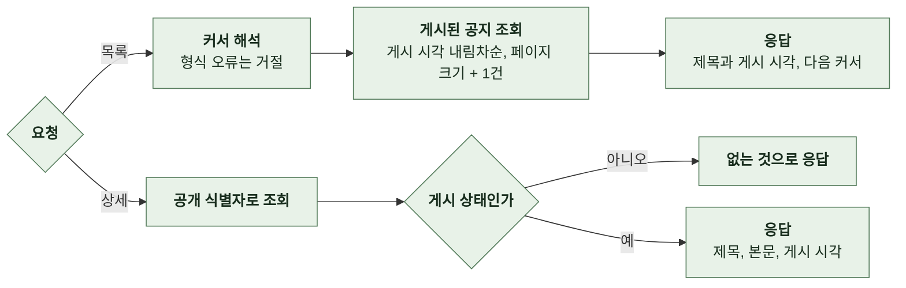
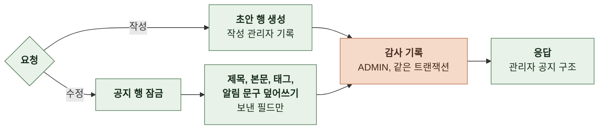
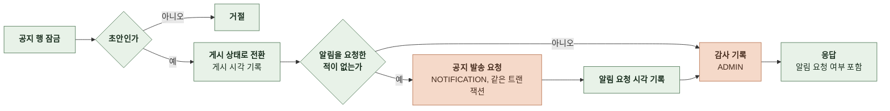
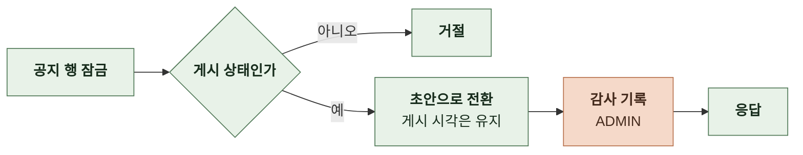
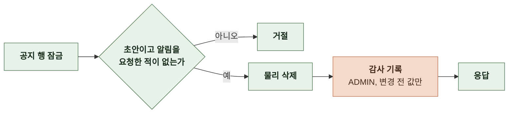

# 4-1 처리 흐름

이 문서는 NOTICE 도메인의 요청 수신부터 응답까지의 처리 단계를 정한다.

요청 필드, 응답 필드와 실패 응답은 계약에, 복구 규칙은 오류 처리에, 잠금과 알림 1회성은 동시성에 있다. ([4-2 계약](4-2-CONTRACT.md), [5-3 오류 처리](5-3-ERROR-HANDLING.md), [5-2 동시성](5-2-CONCURRENCY.md))

 

### 4-1-1 공통 처리

모든 요청은 상관관계 필터에서 요청 ID를 받는다. 공개 조회는 토큰을 읽지 않는다. 관리자 경로는 관리자 판정 필터가 요청자를 정하고 통과하지 못하면 거절한다.

상태를 바꾸는 관리자 작업은 공지 행에 비관적 잠금을 건 뒤 상태를 다시 확인한다. 변경을 적용한 뒤 같은 트랜잭션에서 감사 기록을 호출한다.

흐름도에서 다른 도메인을 호출하는 단계는 주황색이다.

 

### 4-1-2 공개 목록과 상세

- 목록은 본문을 싣지 않는다. 태그를 지정하면 그 태그의 공지만 준다. 정렬은 게시 시각 내림차순이며 같으면 내부 ID 내림차순이다. 커서는 마지막 항목의 게시 시각과 내부 ID를 담은 불투명 문자열이다.
- 상세는 없는 공지와 초안을 같은 결과로 응답한다.

 

### 4-1-3 작성과 수정

- 수정은 상태와 무관하게 허용한다. 게시된 공지의 수정은 공개 조회에 바로 반영되고 알림을 다시 보내지 않는다.
- 알림 제목과 본문은 알림 요청 시각이 비어 있을 때만 바꾼다. 알림을 요청한 공지에 알림 문구를 보내면 거절한다.
- 이미 요청한 알림의 캠페인과 알림 내역은 요청 시점의 사본이다. 게시 뒤 공지 제목, 본문, 태그를 바꿔도 알림의 유형, 푸시, 알림 내역은 바뀌지 않는다.
- 감사 기록의 변경 전후 값은 제목, 태그, 알림 제목, 상태다. 본문은 변경 전후 값의 길이 상한을 넘을 수 있어 넣지 않는다.

 

### 4-1-4 게시

| 항목 | 규칙 |
|---|---|
| 알림 여부 | 게시하면 항상 알림을 요청 알림 없이 게시하는 경로는 없음 |
| 알림 요청 입력 | 공지 공개 식별자, 알림 제목, 알림 본문, 유형, 태그, 딥링크 공지 원문 제목과 본문은 쓰지 않음 |
| 알림 문구 | 알림을 요청할 게시인데 알림 제목이 없으면 게시를 거절 이 열을 더하기 전에 만든 공지는 알림 문구를 입력한 뒤 게시 |
| 딥링크 | 운영 웹 주소에 `/notices/{공지 공개 식별자}`를 붙인 값 |
| 유형 | 게시 시점의 태그에서 정함 `SERVICE`는 정보성, `MARKETING`은 광고성 알림 도메인이 유형별 대상, 광고 표기, 야간 규칙을 정함 |
| 1회성 | 알림 요청 시각이 이미 있으면 알림을 요청하지 않고 응답의 알림 요청 여부를 `false`로 함 게시 뒤 수정과 게시 해제 뒤 재게시는 알림을 다시 보내지 않음 알림 없이 게시하던 때의 공지는 알림 요청 시각이 비어 있어 다시 게시할 때 처음 알림을 요청 |
| 실패 | 알림 요청 기록에 실패하면 게시도 롤백 |

| 태그 | 표시 이름 | 알림 성격 | 알림 유형 |
|---|---|---|---|
| `SERVICE` | 공지사항 | 정보성 | `SERVICE` |
| `UPDATE` | 업데이트 | 정보성 | `SERVICE` |
| `MAINTENANCE` | 점검 | 정보성 | `SERVICE` |
| `EVENT` | 이벤트 | 광고성 | `MARKETING` |
| `PROMOTION` | 홍보 | 광고성 | `MARKETING` |

- 광고성 태그는 영리 목적의 광고성 정보라 정보통신망법 제50조에 따라 사전 동의자에게만 보내고 야간에는 별도 동의자에게만 보내며 제목 앞에 `(광고)`를 붙인다. 이 판정과 표기는 알림 도메인이 하며 관리자가 제목에 `(광고)`를 직접 쓰지 않아도 된다. 공지 원문 제목은 공개 목록과 상세에 표기 없이 그대로 보인다.
- 점검은 서버 점검 예고, 장애, 오류, 복구 안내를 모두 포함한다.
- 표의 순서가 선택과 필터의 표시 순서다. 태그를 새로 더할 때는 이 표에 알림 성격을 함께 정한다.

 

### 4-1-5 게시 해제

- 이미 기록된 알림 요청은 취소하지 않는다. 캠페인의 취소는 알림 도메인의 캠페인 취소로 한다.

 

### 4-1-6 초안 삭제

 

### 4-1-7 관리자 목록과 상세

- 관리자 목록은 상태와 무관하게 조회하고 요청한 열로 정렬한다. 같은 값은 공지 공개 식별자 오름차순이다. 관리자 조회는 감사 로그에 남기지 않는다.
