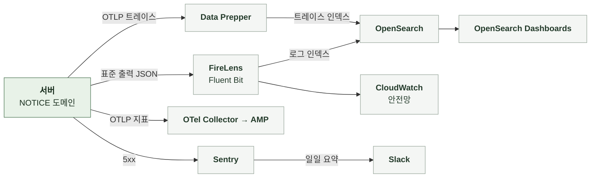

# 5-4 관측

이 문서는 NOTICE 도메인의 관측 스택, 요청을 추적할 식별자, 구조화 로그 이벤트, 오류 확인 위치, 지표, 트레이스, 알림, 수집 조건을 정한다.

개인정보 취급 규칙은 보안에 있으며 오류 로그 수준은 오류 처리에 있다. ([5-1-5 식별자와 개인정보](5-1-SECURITY.md#5-1-5-식별자와-개인정보), [5-3-8 로그와 Sentry](5-3-ERROR-HANDLING.md#5-3-8-로그와-sentry))

 

### 5-4-1 관측 스택

관리자의 작성, 수정, 게시 이력은 관리자 도메인의 감사 로그가 원본이다.

 

### 5-4-2 상관관계 식별자

상관관계 필터는 모든 요청의 MDC에 다음 값을 기록한다. 로그와 Sentry는 같은 식별자 값을 사용한다.

| MDC 필드 | 값 | 규칙 |
|---|---|---|
| `request_id` | `req_` + UUID | 요청 헤더 값을 쓰고 없으면 생성 응답 헤더로 반환 |
| `session_id` | `X-Manyak-Session-Id` | 없으면 `unknown` |
| `device_id_hash` | `device_hash_` + SHA-256(pepper + 원본) 앞 16자 | 원본은 저장하지 않음 |
| `sentry_event_id` | Sentry 이벤트 ID | 5xx를 Sentry로 보낸 요청만 |
| `traceId` `spanId` | 현재 스팬 | 트레이스 전송을 비활성화해도 생성해 로그에 포함 |

| 식별자 | 기록 위치 | 연결 대상 |
|---|---|---|
| `request_id` | 로그 MDC, Sentry 태그, 감사 로그 | 한 요청의 로그와 감사 로그 |
| 공지 공개 식별자 | 게시 로그, 감사 로그 대상, 캠페인의 공지 식별자 | 공지와 그 알림 캠페인 |

 

### 5-4-3 구조화 로그 이벤트

구조화 로그는 `event_name`을 맨 앞에 둔 JSON 형식으로 INFO 수준에 기록한다. 이벤트 이름은 snake_case다. `prod`, `dev`, `jsonlog` 프로파일에서만 JSON 형식을 쓴다. 그 외에는 콘솔 패턴을 쓴다. JSON에는 `service=manyak-server`가 포함된다. 인코더는 MDC 값을 최상위 필드에 기록한다.

| 단위 | 기록 시점과 이름 | 기록 내용 |
|---|---|---|
| 모든 API 요청 | 응답 종료 `api_request_completed` 5xx는 `api_request_failed` | `endpoint`, `http_method`, `status_code`, `duration_ms` 실패 시 예외 클래스 이름 또는 상태 이름을 `error_code`로 추가 |
| 게시 | 게시 커밋 뒤 `notice_published` | `notice_id`, `notified`, `notification_kind` 재게시로 알림을 요청하지 않으면 `notification_kind` 없음 |

 

### 5-4-4 오류 확인

| 기능 | 오류 조회 위치 |
|---|---|
| 공개 조회 | 요청 로그의 `/api/v1/notices` 상태 분포 |
| 관리자 작업 | 요청 로그의 `/api/v1/admin/notices` 상태 분포 감사 로그 조회 |
| 게시와 알림 | 로그 `notice_published`의 `notified` 발송 결과는 알림 도메인의 캠페인 행과 지표 |

 

### 5-4-5 지표

NOTICE 전용 지표는 없다. 요청률, 오류율, 응답 시간은 공통 HTTP 지표로 본다.

| 지표 | 종류와 태그 | 의미 |
|---|---|---|
| `http.server.requests` | Timer `uri`, `method`, `status`, `outcome` | 공지 경로의 요청률과 오류율 |

| 항목 | 기준과 제한 |
|---|---|
| 전송 여부 | 지표 전송을 켠 환경에서만 내부 OTel Collector를 거쳐 AMP로 전송 |
| 전송 주기 | 60초 간격 |

 

### 5-4-6 트레이스

| 항목 | 내용 |
|---|---|
| 활성화와 표본 | 환경 변수로 켜며 기본값은 비활성 |
| 스팬 | HTTP 요청 아래에 JDBC(QUERY만 포함하며 바인딩 값 제외) 스팬 |
| 제외 | actuator 요청, Spring Security 내부 관측, 요청 밖 루트 DB 관측은 노이즈 필터가 제외 |

 

### 5-4-7 알림

| 항목 | 기준 |
|---|---|
| 정기 보고 | 매일 오전 10시(KST) 지난 24시간 동안 발생한 운영 Sentry 오류 요약 |
| NOTICE에서 수집하는 오류 | 500 예상하지 못한 예외 4xx 거절은 Sentry에 없어 보고에 포함되지 않음 |
| 지표 기반 알림 | NOTICE 전용 규칙 없음 |

 

### 5-4-8 수집 조건과 실패 처리

**1. 데이터 범위**

| 데이터 | 현재 기록 방식 |
|---|---|
| 제목, 본문, 사유 | 로그와 Sentry에 기록하지 않음 감사 로그에만 |
| 공지 식별자 | 로그에 기록 |
| Sentry 요청 필드 | 기본 수집 |
| Sentry 이벤트 | 5xx만 캡처 기본 개인정보 수집 비활성화 |

 

**2. 수집 실패**

| 상황 | 처리 |
|---|---|
| 게시 로그 | 커밋 뒤 기록 롤백되면 기록하지 않음 |
| 지표 전송 실패 | SDK로 배치 전송 실패분은 유실 |
| Sentry 캡처 실패 | SDK 내부에서 처리 DSN 없는 환경은 no-op |
| 미수집과 누락 | 수집 비활성화, 기록 실패, 전송 유실을 구분 기록이 없다는 이유만으로 게시가 없었다고 판단하지 않고 공지 행과 감사 로그를 봄 |
