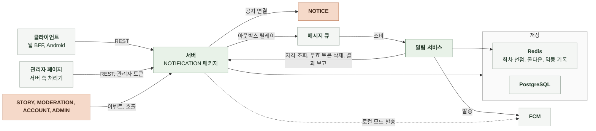

# 3-1 소프트웨어 구조

이 문서는 NOTIFICATION 도메인 백엔드의 개요, 배경과 목표, 품질 속성, 배포 단위, 모듈 구조, 의존 방향, 도메인 모델을 정한다.

테이블과 컬럼은 DB 스키마에, 코딩 규칙은 컨벤션에, 흐름별 처리 순서는 처리 흐름에 있다. ([3-2 DB 스키마](3-2-DB-SCHEMA.md), [3-3 컨벤션](3-3-CONVENTIONS.md), [4-1 처리 흐름](4-1-PIPELINES.md))

 

### 3-1-1 개요

NOTIFICATION 도메인은 서버 애플리케이션의 내부 패키지와 별도 프로세스인 알림 서비스로 이루어진다. 같은 서버의 다른 도메인과는 서비스 호출과 이벤트로 연결한다. 서버는 토큰과 동의를 관리하고 발송 요청을 만든다. 알림 서비스는 메시지 큐에서 요청을 받아 서버 내부 API로 자격을 확인한 뒤 FCM으로 보낸다. 출석 리마인드, 이프 만료 예정 알림, 캠페인도 같은 경로로 간다. 서버 안 발송기는 로컬 모드의 롤백 경로다.

| 외부 시스템 | 역할 | 연결 방식 |
|---|---|---|
| 클라이언트 | 토큰 등록과 삭제, 수신 동의 설정 | REST |
| 관리자 페이지 | 캠페인 예약, 취소, 재실행, 문구 변경, 대상 수 미리보기 | 관리자 토큰을 사용한 서버 측 처리기의 REST 호출 |
| FCM | 기기로 메시지 전달 | HTTPS, 서비스 계정 인증 |
| 메시지 큐 | 서버의 발송 요청을 알림 서비스로 전달 | SQS 표준 큐 |
| PostgreSQL | 토큰, 동의, 문구 템플릿, 캠페인, 아웃박스 | JDBC |
| Redis | 서버의 회차 선점과 이프 만료 예정 알림 쿨다운, 알림 서비스의 멱등 기록 | Lettuce |

 

### 3-1-2 배경과 목표

| 배경 | 설계 목표 |
|---|---|
| 푸시는 회원이 아니라 기기로 도착하고 한 기기에서 계정이 바뀔 수 있음 | 토큰을 전역 유일로 두고 소유자를 옮김 모든 푸시에 수신자 식별자를 실어 앱이 대조 |
| 광고성 알림은 사전 동의, 야간 별도 동의, 광고 표기, 수신거부 안내가 법적 요건임 | 동의 시각을 증빙으로 저장하고 발송 직전에 다시 확인 광고 표기와 수신거부 안내는 서버가 붙임 |
| 발송은 외부 호출이라 도메인 트랜잭션 안에서 할 수 없음 커밋 후 발송이 실패하면 복구할 근거가 남지 않음 | 발송 요청을 도메인 커밋과 같은 트랜잭션에 기록하고 메시지 큐로 중계 소비자가 멱등하게 처리 |
| 알림 서비스가 회원 데이터를 복제하면 동의 철회가 늦게 반영됨 | 알림 서비스는 회원 데이터를 갖지 않고 발송 직전에 서버 내부 API로 자격과 토큰을 받음 |
| 배포 교체 중 두 인스턴스가 같은 회차를 실행하면 광고가 두 번 발송됨 | 출석은 날짜 키 선점, 캠페인은 캠페인 행 선점으로 한 인스턴스만 실행 메시지 식별자의 유니크 제약으로 회원당 한 건만 기록 |
| 이벤트 문구를 바꿀 때마다 릴리스할 수 없음 | 적용 기간이 있는 문구 오버라이드와 예약 캠페인 |
| 이프는 적립 시각부터 수명이 있어 자정이 아니라 하루 중 아무 때나 만료됨 출석만 하고 쓰지 않는 회원은 매일 만료 로트가 생김 | 실행 시각 이후 24시간 창으로 대상을 고르고 회원별 7일 쿨다운으로 매일 받지 않게 함 |
| 캠페인과 문구를 저장소에서 직접 고치면 DB 접근자 한 명만 할 수 있고 전체 발송 사고를 막을 장치가 없음 | 관리자 API로 바꾸고 확정 전에 대상 수를 미리 보여 줌 모든 변경을 감사 로그에 남김 |
| 광고가 아닌 공지도 광고 동의자에게만 갈 수 있는 경로뿐임 | 캠페인에 종류를 두어 서비스 알림을 켠 회원에게 가는 정보성 경로 추가 |
| 운영자가 종류를 고르면 광고성 공지를 정보성 알림으로 보낼 수 있음 | 종류를 요청으로 받지 않고 연결한 공지의 태그로 정함 |
| 캠페인에 기록된 요청 수만으로는 실제 도달 회원 수를 알 수 없고 성공 기기 기록은 멱등 기록의 수명이 지나면 사라짐 | 알림 서비스가 처리를 마칠 때 결과를 서버 내부 API로 보고하고 서버가 메시지별로 한 행씩 영구 보존 보고 실패는 발송에 영향을 주지 않음 |
| 토큰은 기기로 푸시를 보낼 수 있는 주소라 로그에 남으면 안 됨 | 토큰을 경로와 큐 메시지에 싣지 않고 로그에는 앞 12자만 |

 

### 3-1-3 품질 속성

| 속성 | 기준 | 보장 방법 |
|---|---|---|
| 동의 준수 | 동의 없는 회원과 정지, 탈퇴 계정에 보내지 않음 | 요청 생성 시점이 아니라 발송 직전에 자격 판정 광고는 판정 시각으로 야간 확인 |
| 요청 보존 | 도메인 커밋이 되면 발송 요청이 남음 | 같은 트랜잭션의 아웃박스 기록 |
| 중복 억제 | 같은 발송 요청을 두 번 처리하지 않음 선점 수명 초과와 멱등 기록 제거에 따른 드문 중복은 수용 | 메시지 식별자의 아웃박스 유니크와 소비자 멱등 기록 회차 선점 |
| 발송 실패 격리 | 발송 실패가 제작과 검수 응답을 바꾸지 않음 원격 모드의 아웃박스 기록은 예외 기록 실패는 도메인 트랜잭션과 함께 롤백됨 | 커밋 후 발송 발송 실패는 로그와 지표만 |
| 가용성 | FCM 자격 증명이 비어 있어도 서버는 기동 개발과 운영 프로파일의 원격 모드에서 메시지 큐 주소는 예외 | 비어 있으면 발송만 비활성 해석할 수 없는 값은 기동 실패 |
| 수신자 안전 | 기기를 공유해도 다른 회원의 알림이 보이지 않음 웹 백그라운드 수신은 대조할 수 없어 로그아웃 시 토큰 삭제로 보호 | 수신자 식별자 부착과 소유자 이동 |
| 비밀값 격리 | 토큰, FCM 자격 증명, 공유 시크릿을 로그와 저장소에 남기지 않음 | 토큰 마스킹, 본문 전달, 설정 주입 |

 

### 3-1-4 배포 단위

NOTIFICATION 패키지는 다른 도메인의 백엔드와 하나의 서버 이미지에 포함된다. 토큰과 동의 API, 내부 API, 아웃박스 릴레이, 출석, 이프 만료 예정, 캠페인 스케줄러가 같은 프로세스에서 실행된다. 알림 서비스는 별도 이미지로 따로 배포한다.

 

### 3-1-5 모듈 구조

서버는 요청을 만들고 알림 서비스는 요청을 실행한다. 발송기는 두 곳에 있으며 플랫폼별 메시지 구성이 같다.

| 구성 요소 | 입력 | 출력 | 책임 |
|---|---|---|---|
| API 계층 | HTTP 요청 | HTTP 응답 | 형식 검증, 요청자 식별, 상태 코드 |
| 토큰 서비스 | 회원, 토큰, 플랫폼 | 없음 | 사용자 행과 토큰 행 잠금, 소유자 이동, 기기 상한 초과 삭제, 조건부 삭제 |
| 동의 서비스 | 회원, 세 값 | 동의 상태 | 사용자 행 잠금, 동의 시각 기록과 철회, 야간 단독 거절 |
| 발송 자격 | 회원 공개 식별자, 종류, 시각 | 허용 여부와 토큰 목록 | 계정 상태, 종류별 동의, 야간, 토큰 보유 판정 |
| 내부 토큰 삭제 | 토큰 | 없음 | 무효 토큰 삭제 |
| 내부 인증 필터 | 내부 경로 요청 | 통과 또는 거절 | 공유 시크릿 비교, 미설정 시 숨김 |
| 완성, 검수, 공개 중단 리스너 | 도메인 이벤트 | 없음 | 로컬 모드는 커밋 후 서버 발송기 호출, 원격 모드는 같은 트랜잭션에 아웃박스 기록 |
| 아웃박스 저장소 | 발송 요청 | 행 | 유니크 삽입, 선점과 임대, 결과 기록 |
| 릴레이 | 없음 | 없음 | 주기 선점, 일괄 발행, 백오프와 포기 |
| 발행 어댑터 | 발송 요청 | 발행 완료 | 큐 발행, 추적 헤더 |
| 서버 발송기 | 회원, 데이터, 우선순위, 유효 기한 | 없음 | 로컬 모드 전용 계정 상태 확인, 토큰 조회, 플랫폼별 FCM 발송, 무효 토큰 삭제 |
| 출석 리마인드 | 없음 | 회차 결과 | 대상 조회, 문구 해석, 회원별 발송 요청 기록 |
| 이프 만료 예정 알림 | 없음 | 회차 결과 | 만료 예정 로트 보유 회원 조회, 쿨다운 제외, 문구 해석, 회원별 알림 내역과 발송 요청 기록, 쿨다운 기록 |
| 캠페인 실행 | 현재 시각 | 캠페인별 결과 | 도래 캠페인 선점, 종류별 대상 조회, 회원별 발송 요청 기록, 결과 기록 |
| 캠페인 관리 | 관리자, 문구, 이동 대상, 예약 시각, 사유 | 캠페인 | 이동 대상 판정과 종류 결정, 예약 생성, 선점 전 취소, 실패 재실행, 감사 기록 호출 |
| 대상 수 미리보기 | 종류 현재 시각 | 대상 수 | 종류별 대상 조건으로 회원 수와 야간 동의자 수 집계 |
| 문구 템플릿 | 템플릿 키 | 제목과 본문 | 오버라이드 스냅샷 보관과 기간 판정 관리자 API의 행 추가 |
| 결과 기록 | 메시지 식별자, 시나리오, 종류, 수신자, 캠페인, 결과, 기기 수, 완료 시각 | 결과 행 | 캠페인과 회원 참조 해석 및 충돌을 무시한 삽입 |
| 알림 내역 | 시나리오별 기록 입력 회원, 분류, 커서 | 내역 행 목록과 안 읽은 수 | 충돌을 무시한 기록, 분류 결정, 커서 목록, 읽음 처리, 탈퇴 시 전부 삭제 |
| 알림 통계 | 캠페인 또는 시나리오와 KST 기간 | 집계값 | 결과 행의 캠페인별 집계와 시나리오별 날짜별 집계 |
| 스케줄러 | 없음 | 없음 | 출석과 이프 만료 예정 회차 선점과 실행, 캠페인 폴링, 템플릿 갱신 |
| 메시지 큐 소비자 | 큐 메시지 | 처리 결과 | 본문 검증, 멱등 선점, 처리 예산, 결과별 확인 또는 재전달 |
| 멱등 저장소 | 메시지 식별자, 소유자 | 선점 결과 | 처리 중 선점, 완료 기록, 성공 기기 기록 |
| 알림 서비스 | 발송 요청 | 발송 결과 | 만료 확인, 자격 조회, 발송기 호출 |
| 자격 클라이언트 | 회원 공개 식별자, 종류, 시각 | 자격 응답 | 서버 내부 API 호출, 상관 헤더 전달 |
| 알림 발송기 | 수신자, 토큰 목록, 데이터 | 발송 결과 | 플랫폼별 FCM 발송, 결과 분류, 무효 토큰 삭제 요청 |
| 결과 보고 클라이언트 | 메시지 처리 결과 | 없음 | 서버 내부 API 호출 실패 시 경고만 기록 |
| 동기 발송 API | HTTP 요청 | 발송 결과 | 검증 경로용 직접 발송 |

 

### 3-1-6 의존 방향

| 방향 | 규칙 |
|---|---|
| API 계층 → 서비스 | API 계층은 서비스만 호출 저장 계층을 직접 호출하지 않음 |
| 리스너 → 아웃박스 저장소 | 원격 모드의 리스너는 도메인 트랜잭션에 참여하고 트랜잭션이 없으면 거부 |
| 릴레이 → 발행 어댑터 | 릴레이는 발행 포트만 알고 브로커 종류를 모름 |
| 알림 서비스 → 서버 | 내부 API만 HTTP로 호출하고 공유 시크릿으로 인증 자격 조회, 무효 토큰 삭제, 발송 결과 보고 서버 DB와 토큰 테이블에 직접 접근하지 않음 |
| 서버 → 알림 서비스 | 메시지 큐로만 전달 동기 발송 API는 검증용이며 서비스 경로에서 호출하지 않음 |
| STORY, MODERATION → NOTIFICATION | 도메인 이벤트로만 연결 |
| ACCOUNT → NOTIFICATION | 탈퇴 시 토큰과 알림 내역 삭제 호출 |
| NOTIFICATION → NOTICE | 캠페인 예약 트랜잭션에서 알림 연결 연산 호출 공지 테이블을 직접 쓰지 않음 |
| NOTIFICATION → ADMIN | 관리자 요청자와 변경 감사 기록 |
| ADMIN → NOTIFICATION | 푸시 열람 지표의 도달 집계 읽기 조회 |
| NOTIFICATION → ACCOUNT | 회원 상태와 공개 식별자 조회 |
| NOTIFICATION → PAYMENT | 출석 멱등 키 존재 판정, 만료 예정 로트 보유 회원 조회 |
| 외부 시스템 | FCM 클라이언트와 발행 포트는 주입으로 분리 테스트는 고정 응답 구현으로 대체 |

 

### 3-1-7 도메인 모델

| 모델 | 하위 데이터 | 설계 의도 |
|---|---|---|
| 푸시 토큰 | 없음 | 토큰이 유일 키이고 소유 회원은 바뀔 수 있음 갱신 시각을 기준으로 상한 초과 시 삭제할 토큰과 발송 대상 선택 |
| 수신 동의 | 없음 | 회원 행의 세 컬럼 광고와 야간은 최초 동의 시각 |
| 문구 템플릿 | 없음 | 키별로 적용 기간이 있는 여러 행 예약 교체 가능 |
| 캠페인 | 없음 | 예약과 이력을 한 행에 기록 종류가 대상 조건을 정하고 공지 알림은 공지를 참조 상태로 선점 |
| 발송 요청 | 메시지 식별자, 수신자, 종류, 시나리오, 데이터, 상관 식별자 | 동의와 토큰을 담지 않음 아웃박스 행과 큐 메시지의 본문 |
| 멱등 기록 | 처리 중 소유자, 완료 표시, 성공 기기 집합 | 알림 서비스의 유일한 상태 Redis에 수명을 두고 보관 |
| 알림 내역 | 없음 | 회원이 받은 알림의 사본 회원과 메시지 키로 유일하고 종류에서 분류가 정해짐 읽음 시각만 갱신 푸시 발송 여부와 무관하게 기록 |
| 발송 결과 | 없음 | 메시지 식별자별 최종 결과 메시지 식별자가 유일 키이며 수정하지 않음 알림 서비스의 보고와 로컬 모드 발송기가 기록 캠페인 집계와 알림 통계의 원본 |

 

| 판정 | 의미 |
|---|---|
| 발송 모드 | `local`, `remote` 로컬은 서버 안 발송기, 원격은 아웃박스와 메시지 큐를 거쳐 알림 서비스 설정으로 하나만 활성 |
| 발송 자격 | 활성 계정이고 종류별 동의가 있으며 등록 토큰이 있음 광고는 야간이면 야간 동의까지 |
| 캠페인 종류 | `SERVICE`와 `MARKETING` 프로모션은 광고 공지 알림은 연결할 때의 공지 태그가 정한 종류 |
| 캠페인 상태 | `SCHEDULED`, `SENDING`, `SENT`, `CANCELED`, `FAILED` 취소는 선점 전에만 가능 재실행은 실패 상태에서만 가능 전송 중은 선점 시각부터 시간 한도를 넘기면 스케줄러가 실패로 전환 |
| 소비 결과 | `SUCCESS`, `RETRY`, `DISCARD` 성공은 확인, 재시도는 재전달, 폐기는 발송 없이 확인 |
| 발송 결과 | `DELIVERED`, `UNDELIVERED`, `DISCARDED` 도달은 FCM이 받아들인 기기가 하나 이상 미도달은 발송했으나 도달 기기 수가 0 폐기는 발송 없이 종료 |
| 알림 분류 | `NEWS`, `ACTIVITY` 종류마다 하나로 정해져 기록 시 저장 |
| 야간 | KST 21:00부터 08:00 전까지 |
