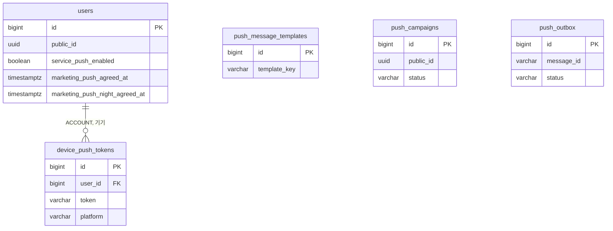

# 3-2 DB 스키마

이 문서는 NOTIFICATION 도메인이 관리하는 PostgreSQL 테이블의 컬럼, 제약, 인덱스, Redis 키, 큐와 데이터 수명을 정한다.

다른 도메인의 테이블에서는 NOTIFICATION 도메인이 소유하거나 참조하는 컬럼만 설명한다.

입력값의 검증 규칙은 보안에, 잠금 순서와 멱등 규칙은 동시성에, 수명과 주기는 오류 처리에 있다. ([5-1-5 입력 검증](5-1-SECURITY.md#5-1-5-입력-검증), [5-2 동시성](5-2-CONCURRENCY.md), [5-3-5 재시도와 시간 한도](5-3-ERROR-HANDLING.md#5-3-5-재시도와-시간-한도))

 

### 3-2-1 공통 규칙

| 규칙 | 내용 |
|---|---|
| 식별자 | 내부 PK는 `bigint` 자동 증가 캠페인은 외부 노출용 `public_id uuid`를 따로 둠 토큰 행 ID는 노출하지 않음 |
| 시각 | `timestamp with time zone` `created_at`의 기본값은 `now()`이며 아래 표에서는 표시하지 않음 |
| 삭제 | 토큰은 물리 삭제 템플릿, 캠페인, 아웃박스는 삭제 경로 없음 |
| FK | 토큰은 회원 삭제 시 함께 삭제(`ON DELETE CASCADE`) 회원 행은 탈퇴해도 남으므로 실제 연쇄 삭제는 일어나지 않음 |

 

### 3-2-2 관계도

관계도는 데이터 묶음별 소유 관계를 보여준다. 각 상자에는 식별과 연결에 쓰는 컬럼만 표시한다. 전체 컬럼은 아래 표에서 정의한다. 다른 도메인의 테이블은 관계 라벨에 도메인을 적고 컬럼을 생략한다.

 

### 3-2-3 푸시 토큰

**`device_push_tokens`**

회원 기기의 설치본 하나가 한 행이다. 게스트 기기는 저장하지 않는다.

| 컬럼 | 타입 | 제약 | 의미 |
|---|---|---|---|
| `id` | bigint | PK | |
| `user_id` | bigint | NOT NULL, FK `users.id` CASCADE | 소유 회원 같은 기기에서 계정이 바뀌면 바뀜 |
| `token` | varchar(512) | NOT NULL, UNIQUE | FCM 등록 토큰 |
| `platform` | varchar(16) | NOT NULL, CHECK `ANDROID` `WEB` | |
| `updated_at` | timestamptz | NOT NULL | 마지막 등록 시각 값이 같아도 재등록마다 갱신 |

| 인덱스 | 컬럼 |
|---|---|
| `idx_device_push_tokens_user` | `user_id` |

 

### 3-2-4 수신 동의

**`users`**

회원 행의 세 컬럼을 이 도메인이 소유한다. 다른 컬럼은 계정 도메인이 정한다.

| 컬럼 | 타입 | 제약 | 의미 |
|---|---|---|---|
| `service_push_enabled` | boolean | NOT NULL, 기본 `true` | 서비스 알림 수신 여부 |
| `marketing_push_agreed_at` | timestamptz | | 광고 알림 최초 동의 시각 `NULL`이면 미동의 또는 철회 |
| `marketing_push_night_agreed_at` | timestamptz | | 야간 광고 알림 최초 동의 시각 광고 동의 없이 단독으로 값이 있을 수 없음 |

 

### 3-2-5 문구 템플릿

**`push_message_templates`**

출석 리마인드 문구의 오버라이드 1건이 한 행이다. 행이 없으면 기본 문구를 쓴다. 운영자가 직접 기록한다.

| 컬럼 | 타입 | 제약 | 의미 |
|---|---|---|---|
| `id` | bigint | PK | |
| `template_key` | varchar(64) | NOT NULL | 템플릿 키 현재 `attendance_reminder` 하나 |
| `title` | varchar(100) | NOT NULL | 광고 표기 없는 제목 |
| `body` | varchar(300) | NOT NULL | |
| `effective_from` | timestamptz | NOT NULL, 기본 `now()` | 적용 시작 유효한 행이 여럿이면 가장 늦게 시작한 행 |
| `effective_until` | timestamptz | | 적용 종료 `NULL`은 상시 적용 |

| 인덱스 | 컬럼 |
|---|---|
| `idx_push_message_templates_key` | `template_key` |

 

### 3-2-6 캠페인

**`push_campaigns`**

프로모션 푸시 1건의 예약과 결과가 한 행이다. 운영자가 예약 행을 넣고 스케줄러가 결과를 적는다.

| 컬럼 | 타입 | 제약 | 의미 |
|---|---|---|---|
| `id` | bigint | PK | |
| `public_id` | uuid | NOT NULL, UNIQUE | 푸시 데이터의 캠페인 식별자 |
| `title` | varchar(100) | NOT NULL | 광고 표기 없는 제목 |
| `body` | varchar(300) | NOT NULL | |
| `scheduled_at` | timestamptz | NOT NULL | 발송 예약 시각 |
| `status` | varchar(20) | NOT NULL, CHECK `SCHEDULED` `SENDING` `SENT` `CANCELED` `FAILED` | 취소는 선점 전에만 가능 |
| `target_count` | integer | | 조회된 대상 수 |
| `sent_count` | integer | | 발송기를 부른 수 |
| `skipped_count` | integer | | 발송 직전 재확인에서 제외된 수 |
| `started_at` | timestamptz | | 선점 시각 |
| `finished_at` | timestamptz | | 회차 종료 시각 |

| 인덱스 | 컬럼 |
|---|---|
| `idx_push_campaigns_status_scheduled_at` | `status`, `scheduled_at` |

 

### 3-2-7 아웃박스

**`push_outbox`**

원격 모드에서 발송 요청 1건이 한 행이다. 도메인 커밋과 같은 트랜잭션에 기록한다.

| 컬럼 | 타입 | 제약 | 의미 |
|---|---|---|---|
| `id` | bigint | PK | 선점 순서 |
| `message_id` | varchar(255) | NOT NULL, UNIQUE | 메시지 식별자 |
| `payload` | jsonb | NOT NULL | 큐 메시지 본문 |
| `status` | varchar(16) | NOT NULL, 기본 `PENDING`, CHECK `PENDING` `PUBLISHED` `FAILED` | |
| `attempts` | integer | NOT NULL, 기본 0 | 발행 실패 횟수 관찰용이며 포기 판정에 쓰지 않음 |
| `next_attempt_at` | timestamptz | NOT NULL | 다음 선점 가능 시각 선점 중에는 임대 만료 시각 |
| `created_at` | timestamptz | NOT NULL | 포기 판정의 기준 |
| `published_at` | timestamptz | | |

| 인덱스 | 컬럼 |
|---|---|
| `idx_push_outbox_pending` | `next_attempt_at` WHERE `status = 'PENDING'` |

 

### 3-2-8 참조하는 다른 도메인의 컬럼

| 테이블 | 컬럼 | NOTIFICATION이 하는 일 |
|---|---|---|
| `users` | `status`, `public_id`, `reward_identity_user_id` | 발송 자격 판정, 수신자 식별자, 출석 미수령 판정 |
| `credit_transactions` | `idempotency_key` | 당일 출석 보상 키의 존재로 미수령 판정 |

 

### 3-2-9 Redis 키

| 키 | 값 | 소유 | 삭제 |
|---|---|---|---|
| `push:attendance-reminder:{KST 날짜}` | `1` | 서버 | 24시간 |
| `notification:processed:{메시지 식별자}` | 처리 중이면 소유자 값, 완료면 `done` | 알림 서비스 | 처리 중 2분, 완료 7일 |
| `notification:sent:{메시지 식별자}` | 성공한 토큰의 SHA-256 해시 집합 | 알림 서비스 | 7일 |

 

### 3-2-10 큐

| 큐 | 내용 | 설정 |
|---|---|---|
| `push-requested` | 발송 요청 | SQS 표준 큐, 가시성 60초, 수신 5회 초과 시 실패 메시지 큐로 이동 |
| `push-requested-dlq` | 재전달 상한을 넘긴 메시지 | 보존 14일 |
| `push.requested`, `.retry`, `.dlq` | 로컬 Kafka 토픽 | 로컬 프로파일 전용 |

 

### 3-2-11 데이터 수명

| 데이터 | 삭제 |
|---|---|
| 푸시 토큰 | 삭제 요청, 탈퇴, 무효 통지, 기기 상한 축출 |
| 수신 동의 | 없음 철회는 값을 비움 |
| 문구 템플릿, 캠페인, 아웃박스 | 없음 |
| 출석 회차 선점 키 | 24시간 |
| 멱등 기록 | 처리 중 2분, 완료 7일 |
| 실패 메시지 | 14일 |
