# 4-1 처리 흐름

이 문서는 NOTIFICATION 도메인의 요청 수신부터 응답까지의 처리 단계, 발송 요청이 생겨서 기기에 도착하기까지의 단계를 정한다.

요청 필드, 응답 필드, 푸시 데이터는 계약에, 재시도와 시간 한도, 복구 규칙은 오류 처리에, 잠금과 선점, 멱등은 동시성에 있다. ([4-2 계약](4-2-CONTRACT.md), [5-3 오류 처리](5-3-ERROR-HANDLING.md), [5-2 동시성](5-2-CONCURRENCY.md))

 

### 4-1-1 공통 처리

모든 요청은 상관관계 필터에서 요청 ID를 받는다. 이어서 보안 필터가 경로의 인증 수준에 따라 요청자를 정한다. 내부 API는 토큰을 읽지 않고 공유 시크릿 헤더로 인증한다. 시크릿이 설정되지 않은 환경에서는 내부 API 경로가 없는 것처럼 응답한다. 관리자 경로는 관리자 판정 필터가 요청자를 정하고 통과하지 못하면 거절한다. 그 외 경로는 토큰이 없거나 무효이면 거절한다.

관리자 경로의 변경은 적용 뒤 같은 트랜잭션에서 감사 기록을 호출한다.

토큰 등록과 삭제, 동의 조회와 변경은 사용자 행에 비관적 잠금을 건 뒤 상태를 다시 검사한다. 정지 계정은 거절하고 탈퇴 계정은 인증 실패로 응답한다.

발송 모드는 설정으로 하나만 활성화한다. 원격 모드에서는 모든 시나리오의 발송 요청이 아웃박스와 메시지 큐를 거쳐 알림 서비스로 간다. 로컬 모드에서는 서버 안 발송기가 아웃박스 기록 없이 직접 보내므로 기록 기반 중복 방지와 재발행 보장이 없다. 발송 직전에 원격 모드에서는 소비자가, 로컬 모드에서는 서버 안 발송기가 자격을 다시 확인한다.

딥링크는 운영 웹 주소, 시나리오 경로, UTM 쿼리를 차례로 이어 만든다. UTM 값과 결합 규칙은 푸시 데이터 계약에 있다. ([4-2-10 푸시 데이터](4-2-CONTRACT.md#4-2-10-푸시-데이터))

흐름도에서 FCM, 메시지 큐, Redis, 서버 내부 API, 다른 도메인을 호출하는 단계는 주황색이다.

 

### 4-1-2 토큰 등록

```mermaid
%%{init: {"flowchart": {"curve": "basis", "nodeSpacing": 24, "rankSpacing": 40}}}%%
flowchart LR
    A["`**사용자 행 잠금과 상태 재검사**`"] --> B["`**토큰 행 잠금 조회**`"]
    B --> C{"`**같은 토큰이 있는가**`"}
    C -->|없음| D["`**기기 상한 초과 삭제**
가장 오래 갱신되지 않은 것부터`"]
    D --> E["`**토큰 행 삽입**`"]
    C -->|있음| F["`**소유자, 플랫폼, 갱신 시각 덮어쓰기**`"]
    F --> G{"`**소유자가 바뀌었는가**`"}
    G -->|예| H["`**기기 상한 초과 삭제**
이번 행 제외`"]
    G -->|아니오| I["`**응답**`"]
    E --> I
    H --> I
    classDef comp fill:#E8F2E8,stroke:#527A59,color:#182D1D
    class A,B,C,D,E,F,G,H,I comp
```

- 토큰 행도 잠그고 읽는다. 커밋 전 삭제 중인 행을 읽으면 갱신이 0건이 되어 요청이 실패한다.
- 삽입이나 소유권 이전으로 기기가 하나 늘어나기 전에 기존 기기 수가 상한보다 하나 적어지도록 토큰을 삭제한다. 같은 소유자의 재등록은 개수가 그대로라 삭제하지 않는다.
- 갱신 시각은 값이 그대로여도 재등록마다 갱신한다. 상한 초과 삭제와 발송 대상 선택의 근거다.

 

### 4-1-3 토큰 삭제와 무효 토큰 삭제

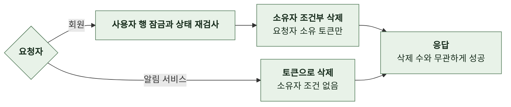

- 삭제 조건을 삭제문 안에 둔다. 조회 뒤 ID로 지우면 그 사이 소유자가 바뀐 행까지 지운다.
- 탈퇴 시 계정 도메인이 회원의 토큰을 전부 삭제하는 연산을 호출한다.
- 로그아웃 처리는 토큰을 직접 지우지 않는다. 기기가 여러 대일 수 있어 클라이언트가 그 기기의 토큰으로 삭제를 호출한다.

 

### 4-1-4 수신 동의 조회와 변경

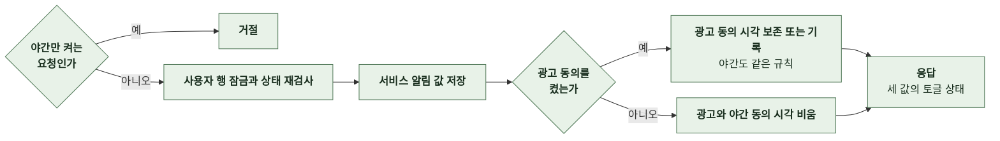

- 정지 계정은 설정 화면 자체를 쓸 수 없으므로 조회도 거절한다.
- 광고 동의가 이미 있으면 시각을 바꾸지 않는다. 증빙은 최초 동의 시점이다.
- 응답에는 동의 시각을 싣지 않는다.

 

### 4-1-5 발송 자격 판정

알림 서비스와 서버 안 발송기가 발송 직전에 같은 기준으로 판정한다.

| 종류 | 조건 |
|---|---|
| 서비스 알림 | 서비스 알림 수신이 켜짐 정보성 공지도 같은 조건 |
| 광고 알림 | 광고 동의가 있음 판정 시각이 KST 야간이면 야간 동의까지 있음 |

- 판정 시각은 발송 요청을 만든 시각, 예약 시각, 회차 시작 시각이 아니라 그 회원에게 보내기 직전의 시각이다.
- 모든 푸시 데이터에는 수신자 식별자를 덧붙인다.

 

### 4-1-6 스토리 완성 알림

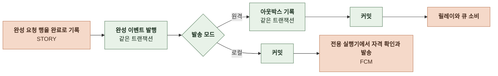

- 스토리 저장이 아니라 완성 요청 행을 완료로 표시하는 트랜잭션에서 발행한다. 저장은 됐지만 완료 표시에 실패한 경우 알림이 먼저 발송되지 않는다.
- 게스트 제작은 발행하지 않는다. 같은 요청 ID의 재처리는 완료 표시에 이르지 않아 다시 발행하지 않는다.
- 원격 모드의 아웃박스 기록 실패는 완료 표시도 되돌린다. 로컬 모드의 발송 실패와 실행기 포화는 로그만 남기고 제작 응답을 바꾸지 않는다.
- 메시지 식별자는 `story-completed:{완성 요청 ID}`다.

 

### 4-1-7 검수 완료 알림

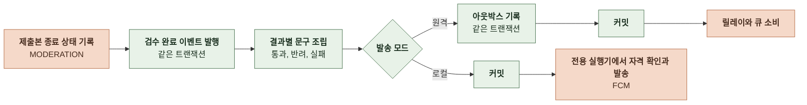

- 결과와 무관하게 딥링크는 내 제작 목록이다. 반려 사유는 푸시에 싣지 않는다.
- 메시지 식별자는 `story-moderation:{제출본 ID}:{회차}`다. 같은 제출본의 재검수와 재제출은 회차가 달라 따로 보낸다.

 

### 4-1-8 출석 리마인드

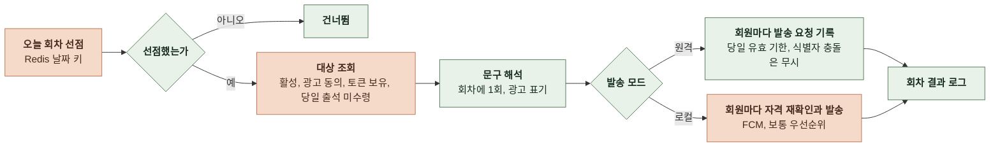

- 매일 정해진 시각에 실행한다. 선점 키는 날짜별이며 Redis 장애로 선점 여부를 알 수 없으면 그날은 건너뛴다. 광고성이라 중복보다 누락이 낫다.
- 출석 미수령은 이프 원장에 `attendance:{보상 신원}:{KST 날짜}` 키가 없는 것으로 판정한다. 출석 보상이 쓰는 키와 같다.
- 대상은 회원 ID만 조회한다. 활성 상태, 광고 동의, 야간 동의는 발송 직전에 소비자가 자격 조회로 다시 확인한다.
- 메시지 식별자는 회원과 날짜로 구성되므로 같은 회원의 요청은 하루에 두 번 기록되지 않는다. 발송 요청의 유효 기한은 당일 KST 자정이다.
- 회차의 발송 요청은 한 트랜잭션으로 기록하고 커밋한다. 기록에 실패하거나 커밋 전에 인스턴스가 종료되면 그날 요청은 남지 않으며 회차를 실패로 기록하고 다음 날 회차로 넘어간다.
- 로컬 모드는 회원마다 자격을 다시 확인한 뒤 기기마다 발송 직전에 유효 기한을 검사하고 남은 TTL을 다시 계산한다. 자정이 지나면 남은 회원과 기기에 보내지 않는다.

 

### 4-1-9 캠페인

프로모션과 공지 알림이 같은 회차 처리를 쓴다. 캠페인의 종류가 대상 조건과 시나리오를 정한다.

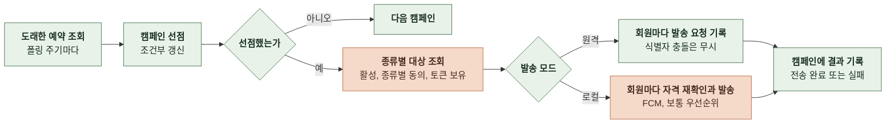

| 종류 | 대상 조건 | 시나리오와 데이터 |
|---|---|---|
| `MARKETING` | 활성, 광고 동의, 토큰 보유 | `PROMOTION` 제목에 광고 표기 공지 알림이면 공지 식별자와 딥링크, 이동 대상 스토리가 있으면 스토리 식별자와 딥링크 포함 발송 시점에 스토리가 비공개나 삭제면 딥링크 없이 발송 |
| `SERVICE` | 활성, 서비스 알림 켜짐, 토큰 보유 | `NOTICE` 광고 표기 없음 공지 식별자와 딥링크 포함 |

- 예약, 취소, 재실행은 관리자 API로 한다. ([4-1-15 캠페인 관리](#4-1-15-캠페인-관리)) 공지 알림 캠페인은 공지 게시가 만든다.
- 야간에 도래한 광고 캠페인은 연기하지 않고 야간 동의자에게만 보낸다. 야간 여부는 회차 시작 시각이 아니라 소비자가 보내기 직전의 시각으로 판정한다. 서비스 종류는 야간 제한이 없다.
- 회차의 발송 요청은 한 트랜잭션으로 기록하고 커밋한다. 기록에 실패하면 캠페인을 실패로 기록하고 요청은 남지 않는다.
- 회차 종료의 결과 기록은 캠페인 내부 ID, 전송 중 상태, 그 회차가 선점할 때 기록한 선점 시각이 모두 일치할 때만 반영하는 조건부 갱신이다. 0행이면 다른 회차가 소유권을 가져간 것이라 결과를 버리고 로그만 남긴다.
- 캠페인에는 마지막 회차의 대상 수와 기록한 요청 수를 남긴다. 회원별 도달 결과는 발송 결과 행에 남고 캠페인별 도달 수는 발송 결과 행에서 집계한다. ([4-1-17 발송 결과 기록과 통계](#4-1-17-발송-결과-기록과-통계))
- 회차가 예외로 끝나면 실패 상태로 기록하고 자동으로 재실행하지 않는다. 관리자가 원인을 확인한 뒤 재실행하면 예약 상태로 돌아가 다시 실행한다. 메시지 식별자는 캠페인과 회원으로 구성되므로 이미 기록한 요청은 중복 기록되지 않는다.
- 폴링마다 도래한 예약을 조회하기 전에 선점 시각부터 전송 중 시간 한도가 지난 전송 중 캠페인을 조건부 갱신으로 실패로 바꾸고 로그를 남긴다. 인스턴스가 회차 도중 종료돼 전송 중으로 멈춘 행이 대상이다. 자동으로 재실행하지 않으며 관리자 재실행으로 이어서 보낸다. 회차의 요청은 한 트랜잭션으로 기록되므로 커밋 전에 종료되면 요청이 없고 커밋 후에 종료되면 식별자 유니크가 이미 받은 회원을 걸러 재실행해도 중복 발송이 없다.

 

### 4-1-10 문구 템플릿 갱신

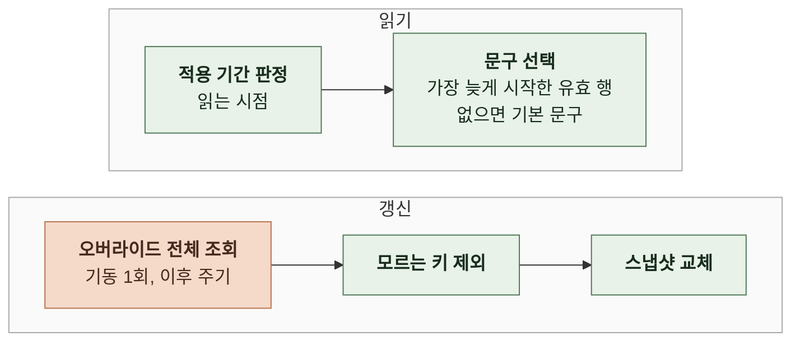

- 갱신 주기를 기다리지 않고 시작과 종료가 반영된다.
- 갱신에 실패하면 직전 스냅샷을 유지한다. 기본 문구가 설정에 없으면 기동에 실패한다.

 

### 4-1-11 아웃박스 중계

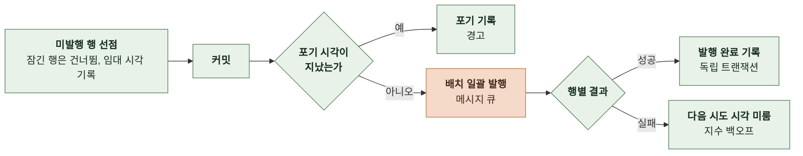

- 선점한 행을 커밋한 뒤 트랜잭션 밖에서 발행한다. 임대, 늦은 결과, 중복 발행 규칙은 [5-2-4 발송 요청의 선점과 임대](5-2-CONCURRENCY.md#5-2-4-발송-요청의-선점과-임대)에 있다.
- 선점한 행 가운데 포기 시각이 지난 행은 발행하지 않고 포기로 기록한다. 포기 기준은 [5-3-6 최종 실패와 부분 완료](5-3-ERROR-HANDLING.md#5-3-6-최종-실패와-부분-완료)에 있다.
- 발행마다 릴레이 스팬을 열고 추적 헤더를 큐 메시지 속성에 싣는다. 연결 범위는 [5-4-6 트레이스](5-4-OBSERVABILITY.md#5-4-6-트레이스)에 있다.

 

### 4-1-12 큐 소비

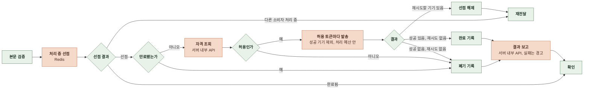

| 단계 | 처리 |
|---|---|
| 본문 검증 | 스키마 버전, 필수 필드, 시나리오와 종류의 대응 실패는 확인하지 않고 메시지 큐의 재전달과 실패 메시지 큐 이동에 맡김 |
| 처리 중 선점 | 메시지 식별자 키를 소유자 값과 선점 수명으로 선점 |
| 자격 조회 | 조회 시각을 넘겨 판정 조회 실패는 허용으로 대체하지 않고 재전달 |
| 발송 | 성공 기기 집합에 있는 토큰은 건너뜀 한 기기라도 재시도 대상이면 성공한 기기가 있어도 재전달 처리 예산이 지나면 새 기기 발송을 시작하지 않고 재전달에서 이어감 |
| 완료 기록 | 성공과 폐기는 완료 표시로 바꾸고 멱등 기록 수명 동안 보존 |
| 결과 보고 | 완료 기록 뒤 결과를 서버에 보고 도달 기기 수는 성공 기기 집합의 크기이고 실패 기기 수는 마지막 처리의 영구 실패 수 보고 실패 시 경고만 남기고 확인 여부를 바꾸지 않음 이미 완료된 메시지의 재수신과 재전달은 보고하지 않음 |
| Redis 장애 | 발송을 계속하지 않고 재전달 자기 선점만 해제 |

 

### 4-1-13 발송과 무효 토큰 정리

서버 안 발송기와 알림 서비스 발송기가 같은 메시지 구성을 쓴다. 서버 안 발송기는 로컬 모드에서만 쓴다.

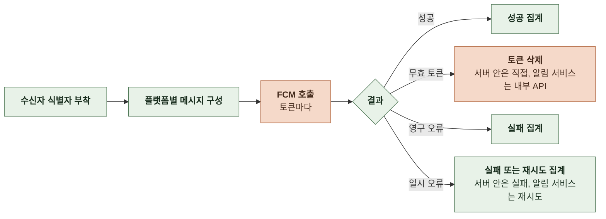

- 유효 기한이 있으면 Android 메시지의 TTL을 남은 시간으로 정한다.
- 무효 토큰만 삭제한다. 잘못된 인자 오류는 서버가 만든 페이로드 오류일 수 있어 삭제 신호로 쓰지 않는다.
- 한 기기의 실패나 삭제 실패가 다른 기기 발송을 막지 않는다.
- 서버 안 발송기는 FCM 자격 증명이 없으면 발송하지 않는다. 알림 서비스는 자격 허용 뒤에도 발송 0건으로 건너뛴다.
- 서버 안 발송기는 회원 발송을 마치면 발송 결과 행을 직접 기록한다. 결과 분류와 기기 수에는 알림 서비스의 보고와 같은 규칙을 적용한다.

 

### 4-1-14 알림 발송

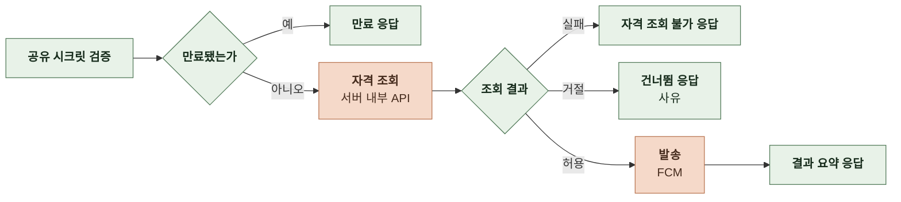

- 수동 검증용 경로다. 서비스 경로는 이 API를 호출하지 않는다. 애플리케이션 재시도는 없다.

 

### 4-1-15 캠페인 관리

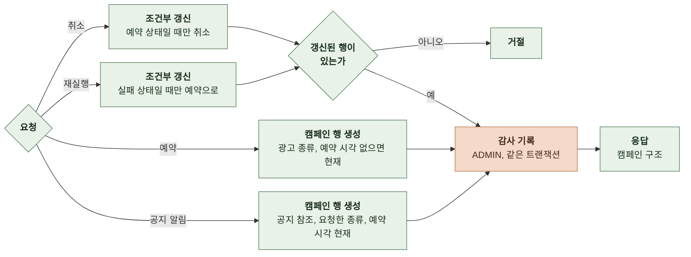

| 작업 | 규칙 |
|---|---|
| 예약 | 관리자 API의 예약은 광고 종류만 예약 시각이 없으면 현재 시각으로 두어 다음 폴링에서 즉시 처리 과거 시각은 거절 이동 대상 스토리는 STORY의 읽기 판정으로 공개 스토리인지 확인한 뒤 내부 ID로 저장 |
| 공지 알림 | 공지 도메인의 연산으로 생성하며 호출자의 트랜잭션에 참여 종류는 요청대로, 예약 시각은 현재, 공지당 한 건 |
| 취소 | 예약 상태일 때만 취소 상태로 즉시 발송도 선점 전이면 취소됨 선점 뒤에는 거절하고 발송은 멈추지 않음 |
| 재실행 | 실패 상태일 때만 예약 상태로 되돌리고 결과 컬럼은 유지 다음 회차가 덮어씀 원격 모드는 이미 기록된 회원의 요청이 메시지 식별자 유니크로 중복 기록되지 않음 로컬 모드는 회원별 기록이 없어 중복 발송이 가능 |
| 감사 기록 | 예약은 변경 후 값 취소와 재실행은 전후 상태 공지 알림 캠페인의 감사 기록은 공지 도메인의 게시 기록에 포함되므로 따로 남기지 않음 |

**대상 수 미리보기**

| 항목 | 규칙 |
|---|---|
| 집계 조건 | 종류별 대상 조건을 현재 시각으로 집계 광고 종류는 전체 대상 수와 그중 야간 동의자 수 서비스 종류는 대상 수 |
| 토큰 보유 | 등록 토큰이 하나 이상인 회원만 |
| 성격 | 조회 전용이며 저장하지 않음 확정 시점의 대상은 회차가 다시 조회하므로 미리보기 수와 다를 수 있음 |

 

### 4-1-16 문구 템플릿 변경

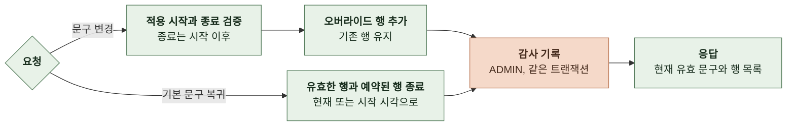

- 문구 변경은 행 추가다. 적용 시작은 현재 이후만 받고 없으면 현재 시각이다. 같은 시점에 유효한 행이 여럿이면 적용 시작이 가장 늦은 행, 그것도 같으면 나중에 추가된 행을 쓴다. 과거 시작을 막아 새 행이 기존 유효 행보다 뒤에 시작하게 하므로 새 행이 적용된다.
- 기본 문구 복귀는 현재 유효한 행의 종료 시각을 현재로, 아직 시작하지 않은 행의 종료 시각을 그 행의 시작 시각으로 바꾼다. 종료가 시작보다 앞서는 행은 만들지 않는다. 행을 지우지 않으며 종료할 행이 없어도 성공으로 응답한다.
- 감사 기록의 변경 후 값은 문구 변경이 추가한 행이고, 기본 문구 복귀의 변경 전 값은 종료한 행 목록이다.
- 관리자 조회의 현재 문구는 저장소의 행으로 계산한다. 발송기가 쓰는 스냅샷에는 갱신 주기 안에 반영되며 시작과 종료 판정은 읽는 시점에 한다. 그 사이 조회 응답과 실제 발송 문구가 다를 수 있다.

 

### 4-1-17 발송 결과 기록과 통계

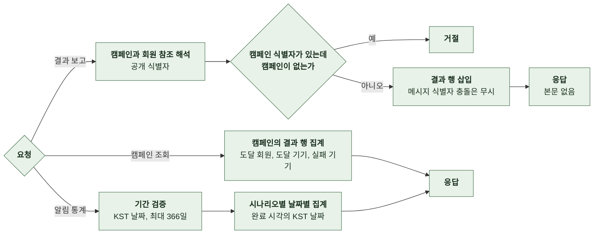

| 항목 | 규칙 |
|---|---|
| 결과 분류 | 도달은 FCM이 받아들인 기기가 하나 이상 미도달은 발송했으나 도달 기기 수가 0 폐기는 만료, 자격 거절, FCM 미설정으로 발송 없이 종료 |
| 재보고 | 같은 메시지 식별자로 재보고하면 처음 행을 유지하고 성공으로 응답 |
| 회원 없음 | 수신자 공개 식별자에 해당하는 회원이 없으면 회원 참조를 비우고 기록 |
| 캠페인 집계 | 도달 회원 수는 도달 기기가 하나 이상인 행 수 도달 기기 수와 실패 기기 수는 각각 합산 메시지 식별자가 회원당 하나이므로 재실행으로 회차가 여러 번이어도 중복 없음 |
| 통계 집계 | 요청 수는 결과 행 수이며 처리가 끝난 메시지만 포함 날짜는 완료 시각의 KST 날짜 결과 행이 없는 날과 시나리오는 응답에 없음 |
| 팀 계정 | 제외하지 않음 |
