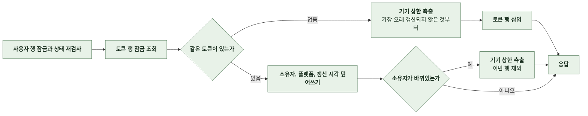
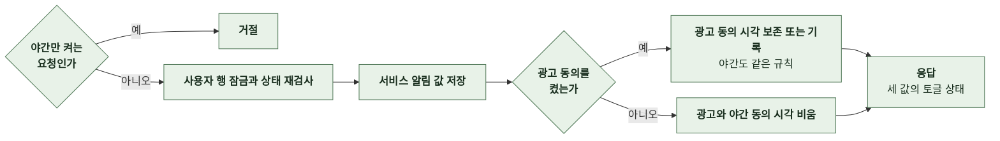
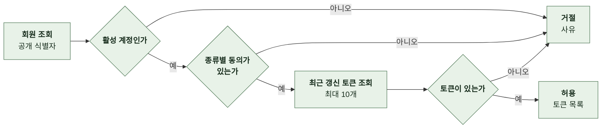
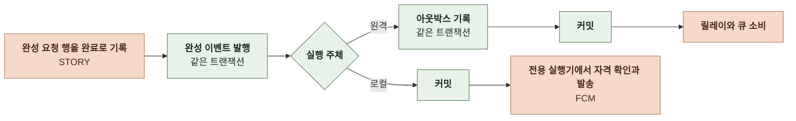
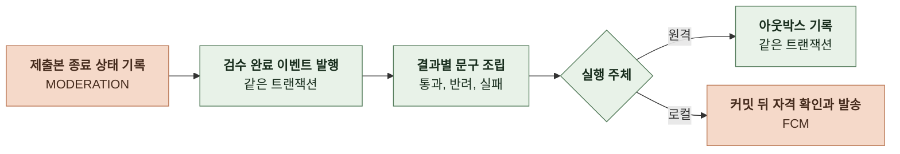
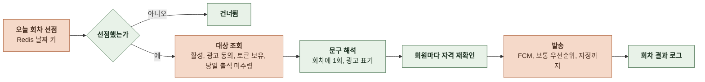
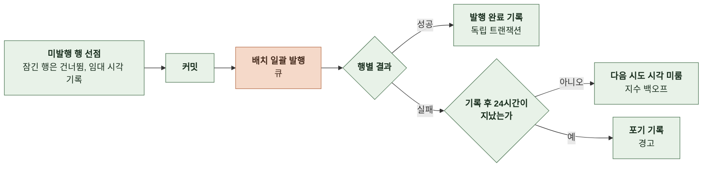
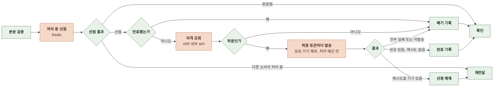
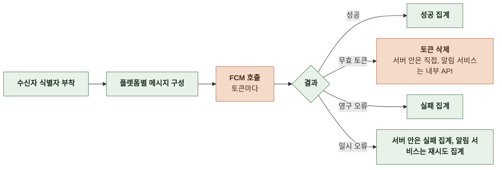
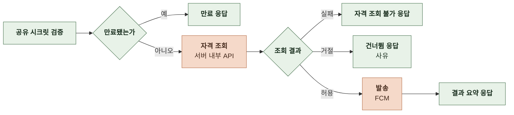

# 4-1 처리 흐름

이 문서는 NOTIFICATION 도메인의 요청 수신부터 응답까지의 처리 단계, 발송 요청이 생겨서 기기에 도착하기까지의 단계를 정한다.

요청 필드, 응답 필드, 푸시 데이터는 계약에, 재시도와 시간 한도, 복구 규칙은 오류 처리에, 잠금과 선점, 멱등은 동시성에 있다. ([4-2 계약](4-2-CONTRACT.md), [5-3 오류 처리](5-3-ERROR-HANDLING.md), [5-2 동시성](5-2-CONCURRENCY.md))

 

### 4-1-1 공통 처리

회원 API는 상관관계 필터에서 요청 ID를 받고 보안 필터가 토큰으로 요청자를 정한다. 토큰이 없거나 무효이면 거절한다. 내부 API는 공유 시크릿 헤더로 인증하며 시크릿이 설정되지 않은 환경에서는 경로가 없는 것처럼 응답한다.

토큰 등록과 삭제, 동의 조회와 변경은 사용자 행에 비관적 잠금을 건 뒤 상태를 다시 검사한다. 정지 계정은 거절하고 탈퇴 계정은 인증 실패로 응답한다.

발송 실행 주체는 설정으로 하나만 활성화한다. 원격 모드에서는 스토리 완성과 검수 완료가 아웃박스와 큐를 거쳐 알림 서비스로 간다. 로컬 모드에서는 서버 안 발송기가 커밋 뒤에 보낸다. 출석 리마인드와 프로모션은 모드와 무관하게 서버 안 발송기가 보낸다.

발송 자격은 요청을 만들 때가 아니라 발송 직전에 판정한다. 어느 경로든 회원 상태, 종류별 동의, 토큰을 다시 읽는다. 모든 푸시 데이터에는 수신자 식별자를 덧붙인다.

흐름도에서 FCM, 큐, Redis, 다른 도메인을 호출하는 단계는 주황색이다.

 

### 4-1-2 토큰 등록

- 토큰 행도 잠그고 읽는다. 커밋 전 삭제 중인 행을 읽으면 갱신이 0건이 되어 요청이 실패한다.
- 삽입이나 소유권 이전으로 기기가 하나 늘어나기 전에 기존 기기 수를 상한보다 하나 적게 맞추도록 축출한다. 같은 소유자의 재등록은 개수가 그대로라 축출하지 않는다.
- 갱신 시각은 값이 그대로여도 재등록마다 갱신한다. 상한 축출과 발송 대상 선택의 근거다.

 

### 4-1-3 토큰 삭제

- 삭제 조건을 삭제문 안에 둔다. 조회 뒤 ID로 지우면 그 사이 소유자가 바뀐 행까지 지운다.
- 탈퇴 시 계정 도메인이 회원의 토큰을 전부 삭제하는 연산을 호출한다. 무효 토큰 삭제는 내부 API가 소유자 조건 없이 토큰으로 지운다.
- 로그아웃 처리는 토큰을 직접 지우지 않는다. 기기가 여러 대일 수 있어 클라이언트가 그 기기의 토큰으로 삭제를 호출한다.

 

### 4-1-4 수신 동의 조회와 변경

- 조회도 사용자 행을 잠근다. 정지 계정은 설정 화면 자체를 쓸 수 없으므로 조회도 거절한다.
- 광고 동의가 이미 있으면 시각을 바꾸지 않는다. 증빙은 최초 동의 시점이다.
- 응답에는 동의 시각을 싣지 않는다.

 

### 4-1-5 발송 자격 판정

알림 서비스와 서버 안 발송기가 발송 직전에 같은 기준으로 판정한다.

| 판정 | 조건 |
|---|---|
| 활성 계정 | 상태가 활성 정지와 탈퇴는 거절 |
| 서비스 알림 | 서비스 알림 수신이 켜짐 |
| 광고 알림 | 광고 동의가 있음 판정 시각이 KST 야간이면 야간 동의까지 있음 |
| 토큰 | 거절된 회원의 토큰은 조회하지 않음 |

- 판정 시각은 예약 시각이나 회차 시작 시각이 아니라 그 회원에게 보내기 직전의 시각이다.

 

### 4-1-6 스토리 완성 알림

- 스토리 저장이 아니라 완성 요청 행을 완료로 표시하는 트랜잭션에서 발행한다. 저장은 됐지만 완료 표시에 실패한 경우 알림이 먼저 발송되지 않는다.
- 게스트 제작은 발행하지 않는다. 같은 요청 ID의 재처리는 완료 표시에 이르지 않아 다시 발행하지 않는다.
- 원격 모드의 아웃박스 기록 실패는 완료 표시도 되돌린다. 로컬 모드의 발송 실패와 실행기 포화는 로그만 남기고 제작 응답을 바꾸지 않는다.
- 메시지 식별자는 `story-completed:{완성 요청 ID}`다.

 

### 4-1-7 검수 완료 알림

- 결과와 무관하게 딥링크는 내 제작 목록이다. 반려 사유는 푸시에 싣지 않는다.
- 메시지 식별자는 `story-moderation:{제출본 ID}:{회차}`다. 같은 제출본의 재검수와 재제출은 회차가 달라 따로 보낸다.

 

### 4-1-8 출석 리마인드

- 매일 09:00 KST에 실행한다. 선점 키는 날짜별이며 Redis 장애로 선점 여부를 알 수 없으면 그날은 건너뛴다. 광고성이라 중복보다 누락이 낫다.
- 출석 미수령은 이프 원장에 `attendance:{보상 신원}:{KST 날짜}` 키가 없는 것으로 판정한다. 출석 보상이 쓰는 키와 같다.
- 대상은 회원 ID만 조회하고 회원마다 발송 직전에 다시 읽어 활성 상태, 광고 동의, 야간 동의를 확인한다. 제외한 수는 회차 결과에 남긴다.
- 회원별 발송 기록은 두지 않는다. 회차 도중 인스턴스가 종료되면 그날 남은 회원은 받지 못하고 다음 날 회차로 넘어간다.

 

### 4-1-9 프로모션

- 운영자가 예약 행을 추가하면 발송이 예약되고 선점 전에 취소 상태로 바꾸면 취소된다.
- 야간에 도래한 캠페인은 연기하지 않고 야간 동의자에게만 보낸다. 야간 판정은 회차 시작이 아니라 회원별 발송 시점이다.
- 회차가 예외로 끝나면 실패 상태로 기록하고 예약 상태로 되돌리지 않는다. 운영자가 원인을 확인하고 새 행을 추가한다.

 

### 4-1-10 문구 템플릿 갱신

- 적용 기간은 읽는 시점에 판정한다. 갱신 주기를 기다리지 않고 시작과 종료가 반영된다.
- 갱신에 실패하면 직전 스냅샷을 유지한다. 기본 문구가 설정에 없으면 기동에 실패한다.

 

### 4-1-11 아웃박스 중계

- 선점한 행의 다음 시도 시각을 임대 만료 시각으로 옮겨 커밋한 뒤 트랜잭션 밖에서 발행한다. 발행 중 릴레이가 종료되면 임대가 끝난 뒤 다른 릴레이가 다시 선점한다.
- 결과 기록은 다음 시도 시각이 자기 임대 시각일 때만 갱신한다. 임대가 이전된 뒤 늦게 도착한 결과가 새 시도의 결과를 덮어쓰지 않는다.
- 발행 성공과 완료 기록 사이에 장애가 나면 재발행한다. 소비자의 멱등 처리가 중복 처리를 막는다.

 

### 4-1-12 큐 소비와 멱등

| 단계 | 규칙 |
|---|---|
| 본문 검증 | 스키마 버전, 필수 필드, 시나리오와 종류의 대응 실패는 확인하지 않고 큐의 재전달과 실패 큐 이동에 맡김 |
| 처리 중 선점 | 메시지 식별자 키를 소유자 값과 2분 수명으로 선점 완료 표시가 있으면 발송 없이 확인, 다른 소유자가 있으면 재전달 |
| 자격 조회 | 조회 시각을 넘겨 판정 조회 실패는 허용으로 대체하지 않고 재전달 |
| 발송 | 성공 기기 집합에 있는 토큰은 건너뜀 처리 예산 10초가 지나면 새 기기 발송을 시작하지 않고 재전달에서 이어감 |
| 완료 기록 | 성공과 폐기는 완료 표시로 바꾸고 7일 보존 재전달은 선점을 해제 |
| Redis 장애 | 발송을 계속하지 않고 재전달 자기 선점만 해제 |

 

### 4-1-13 발송과 무효 토큰 정리

서버 안 발송기와 알림 서비스 발송기가 같은 메시지 구성을 쓴다.

| 플랫폼 | 메시지 |
|---|---|
| Android | 데이터만 보내고 앱이 문구를 조립 서비스 알림은 높은 우선순위, 광고 알림은 보통 유효 기한이 있으면 남은 시간을 TTL로, 상한은 4주 |
| 웹 | 데이터와 함께 제목, 본문, 아이콘, 클릭 링크를 실어 브라우저가 표시 스토리 완성은 제목을 고정 문구로 두고 본문에 스토리 제목 |

- 무효 토큰만 삭제한다. 잘못된 인자 오류는 서버가 만든 페이로드 오류일 수 있어 삭제 신호로 쓰지 않는다.
- 한 기기의 실패나 삭제 실패가 다른 기기 발송을 막지 않는다.
- 서버 안 발송기는 FCM 자격 증명이 없으면 발송하지 않는다. 알림 서비스는 자격 허용 뒤에도 발송 0건으로 건너뛴다.

 

### 4-1-14 동기 발송 API

- 큐 전환 전의 검증 경로다. 서비스 경로는 이 API를 호출하지 않는다. 애플리케이션 재시도는 없다.
