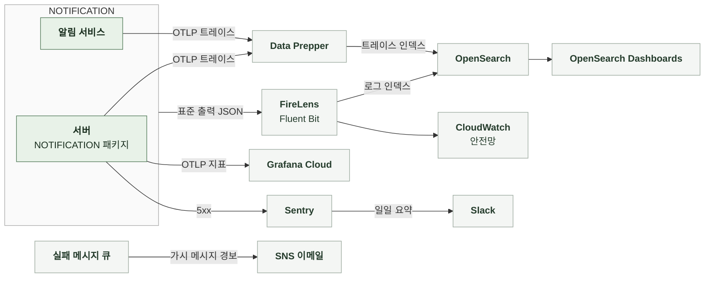

# 5-4 관측

이 문서는 NOTIFICATION 도메인의 관측 스택, 요청과 메시지를 추적할 식별자, 구조화 로그 이벤트, 오류 확인 위치, 지표, 트레이스, 알림, 수집 조건을 정한다.

비밀값과 개인정보 취급 규칙은 보안에, 오류 로그 수준은 오류 처리에 있다. ([5-1-7 비밀값과 개인정보](5-1-SECURITY.md#5-1-7-비밀값과-개인정보), [5-3-8 로그와 Sentry](5-3-ERROR-HANDLING.md#5-3-8-로그와-sentry))

<br>

### 5-4-1 관측 스택



<br>

### 5-4-2 상관관계 식별자

서버의 상관관계 필터는 모든 요청의 MDC에 다음 값을 기록한다. 서버의 로그와 Sentry는 같은 식별자 값을 사용한다. 알림 서비스는 `request_id`와 `session_id`를 큐 메시지 본문과 내부 API 헤더에서 받는다. 기기 해시는 내부 API 헤더에서만 받는다. 받은 식별자는 MDC에 기록한다. 큐 소비로 시작한 자격 조회에는 기기 해시가 없다. 이때 서버 MDC의 `device_id_hash`는 `unknown`으로 남는다. 원인 요청의 로그는 `request_id`로 연결한다.

| MDC 필드 | 값 | 규칙 |
|---|---|---|
| `request_id` | 요청 헤더 값<br>없으면 `req_` + UUID | 생성한 값은 응답 헤더로 반환 |
| `session_id` | `X-Manyak-Session-Id` | 없으면 `unknown` |
| `device_id_hash` | `device_hash_` + SHA-256(pepper + 원본) 앞 16자 | 서버에서 계산<br>알림 서비스는 내부 API 헤더로만 전달 |
| `sentry_event_id` | Sentry 이벤트 ID | 서버의 5xx만 |
| `traceId`와 `spanId` | 현재 스팬 | 트레이스 전송을 비활성화해도 생성 |

| 식별자 | 기록 위치 | 연결 대상 |
|---|---|---|
| `request_id` | 로그 MDC와 Sentry 태그 | 한 요청의 로그 |
| `request_id`와 `session_id` | 큐 메시지 본문, 소비자 MDC, 자격 조회 헤더 | 발행 원인 요청과 소비 처리 |
| 추적 헤더 | 큐 메시지 속성<br>`traceparent`와 `tracestate` | 릴레이 스팬과 소비자 스팬<br>원인 요청과는 `request_id`로 연결 |
| 메시지 식별자 | 아웃박스 경고와 소비 결과 로그 | 발송 요청 1건 |
| 회원 내부 ID | 서버 발송 실패 WARN과 회차 로그 | 회원 |
| 회원 공개 식별자 | 알림 서비스 발송 실패 WARN | 회원 |
| 캠페인 공개 식별자 | 프로모션 회차 로그 | 캠페인 |

스케줄러 회차는 요청과 별도로 실행하므로 요청 ID가 없다. 큐 메시지의 `requestId`는 발행 원인 요청의 값이며 스케줄러에서 만든 메시지는 `unknown`이다.

<br>

### 5-4-3 구조화 로그 이벤트

구조화 로그는 `event_name`을 맨 앞에 둔 JSON 형식으로 INFO 수준에 기록한다. 이벤트 이름은 snake_case다. 서버와 알림 서비스 모두 `prod`, `dev`, `jsonlog` 프로파일에서만 JSON 형식을 쓴다. 그 외에는 콘솔 패턴을 쓴다. JSON의 `service`는 서버가 `manyak-server`, 알림 서비스가 `manyak-notification`이다. 인코더는 MDC 값을 최상위 필드에 기록한다.

| 단위 | 기록 시점과 이름 | 기록 내용 |
|---|---|---|
| 서버의 모든 API 요청 | 응답 종료<br>`api_request_completed`, 5xx는 `api_request_failed` | `endpoint`, `http_method`, `status_code`, `duration_ms`<br>실패 시 예외 클래스 이름 또는 상태 이름을 `error_code`로 추가 |
| 출석 회차 | 회차 종료<br>`attendance_reminder_sent` | `targets`, `sent`<br>원격 모드의 `sent`는 기록한 요청 수, 로컬 모드는 발송기 호출 수 |
| 출석 회차 실패 | 회차 예외<br>`attendance_reminder_failed` | `error` |
| 출석 회차 선점 실패 | Redis 장애<br>`attendance_reminder_claim_failed` | `error` |
| 이프 소멸 예정 회차 | 회차 종료<br>`credit_expiry_reminder_sent` | `targets`, `cooldown`, `sent`<br>`targets`는 쿨다운 제외 전 대상 수, `cooldown`은 쿨다운으로 제외한 회원 수<br>원격 모드의 `sent`는 기록한 요청 수, 로컬 모드는 발송기 호출 수 |
| 이프 소멸 예정 회차 실패 | 회차 예외<br>`credit_expiry_reminder_failed` | `error` |
| 이프 소멸 예정 회차 선점 실패 | Redis 장애<br>`credit_expiry_reminder_claim_failed` | `error` |
| 프로모션 회차 | 캠페인별 종료<br>`promotion_push_sent`, 실패는 `promotion_push_failed` | `campaignId`, `targets`, `sent`<br>회차 밖 예외는 `error` |
| 검수 알림 실패 | 로컬 모드 발송 실패<br>평문 WARN `moderation_push_failed`, 실행기 포화는 `moderation_push_rejected` | 제출본 식별자<br>발송 실패는 예외 클래스 포함 |
| 완성 알림 실패 | 로컬 모드 발송 실패와 실행기 포화<br>평문 WARN | 회원 내부 ID, 스토리 공개 식별자<br>발송 실패는 예외 클래스 포함 |
| FCM 발송 실패 | 서버와 알림 서비스<br>평문 WARN | 회원 식별자, 토큰 앞 12자, 오류 코드, 예외 클래스 |
| 무효 토큰 정리 | 서버와 알림 서비스<br>평문 INFO | 회원 식별자, 토큰 앞 12자 |
| 아웃박스 포기 | 포기 시각 경과<br>평문 WARN | 메시지 식별자 |
| 아웃박스 결과 기록 실패 | DB 장애<br>평문 WARN | 메시지 식별자, 예외 |
| 문구 템플릿 적재 실패 | 갱신 실패<br>평문 WARN `push_template_load_failed` | 예외 |
| 큐 소비 결과 | 처리마다<br>평문 INFO | 메시지 식별자, 소비 결과, 알림 발송 응답의 `reason` 값 |
| 큐 소비 재시도 | 예외<br>평문 WARN | 메시지 식별자, 예외 클래스 |
| 자격 조회 실패 | 알림 서비스<br>평문 WARN | 회원 공개 식별자, 예외 클래스 |

<details>
<summary><b>예시: 출석 회차 로그 1줄</b></summary>

<br>

예시에는 가상 값을 썼다. 로그 프레임워크가 붙이는 필드는 생략했다.

```json
{"@timestamp":"2026-10-16T00:00:12.345Z","message":"event_name=attendance_reminder_sent, targets=1240, sent=1240","level":"INFO","traceId":"4bf92f3577b34da6a3ce929d0e0e4736","spanId":"00f067aa0ba902b7","event_name":"attendance_reminder_sent","targets":1240,"sent":1240,"service":"manyak-server"}
```

</details>

<br>

### 5-4-4 오류 확인

| 기능 | 오류 조회 위치 |
|---|---|
| 토큰과 동의 | 요청 로그의 `/api/v1/users/me/push-tokens`, `/api/v1/users/me/push-settings` 상태 분포 |
| 완성과 검수 알림 | 원격 모드는 지표 `manyak.push.outbox.result`와 `manyak.push.consume.result`<br>로컬 모드는 발송 실패 WARN |
| 출석 리마인드 | 로그 `attendance_reminder_sent`의 `targets`와 `sent`, 선점 실패 로그<br>발송 결과는 알림 서비스의 소비 결과 로그와 발송 실패 WARN, 실패 메시지 큐 경보<br>알림 서비스는 지표를 전송하지 않음 |
| 이프 소멸 예정 알림 | 로그 `credit_expiry_reminder_sent`의 `targets`, `cooldown`, `sent`, 선점 실패 로그<br>발송 결과는 출석 리마인드와 같음 |
| 프로모션 | 캠페인 행의 결과 컬럼, 회차 로그<br>발송 결과는 출석 리마인드와 같음 |
| 큐 중계 | 지표 `manyak.push.outbox.result`의 `retry`와 `abandoned`, 포기 WARN |
| 큐 소비 | 지표 `manyak.push.consume.result`의 `retry`와 `discard`, 실패 메시지 큐 경보 |
| FCM | 지표 `manyak.push.send.result`의 `failure`와 `unregistered`, 발송 실패 WARN |
| 자격 조회 | 알림 서비스의 자격 조회 실패 WARN, 요청 로그의 내부 경로 상태 |

<br>

### 5-4-5 지표

| 지표 | 종류와 태그 | 의미 |
|---|---|---|
| `manyak.push.send.result` | Counter<br>`outcome` = `success`, `unregistered`, `failure` | FCM 발송 결과<br>서버와 알림 서비스가 각자 기록 |
| `manyak.push.outbox.result` | Counter<br>`outcome` = `published`, `retry`, `abandoned` | 릴레이 발행 결과 |
| `manyak.push.consume.result` | Counter<br>`outcome` = `success`, `retry`, `discard`, `dlq` | 큐 소비 결과 |
| `fcm.send` | 관측 스팬<br>`platform` = `android`, `web`<br>`outcome` = `success`, `unregistered`, `failure` | 알림 서비스의 FCM 호출 스팬과 소요 시간 |
| `http.server.requests` | Timer<br>`uri`, `method`, `status`, `outcome` | 회원 API와 내부 API의 요청률과 오류율 |

| 항목 | 기준과 제한 |
|---|---|
| 전송 여부 | 지표 전송을 켠 환경에서만 Grafana Cloud로 전송<br>알림 서비스는 어느 환경에도 켜지 않음 |
| 전송 주기 | 60초 간격 |
| 사전 등록 | 발송, 아웃박스, 소비 결과 카운터는 기동 시 0으로 등록해 첫 실패부터 집계 |

<br>

### 5-4-6 트레이스

| 항목 | 내용 |
|---|---|
| 활성화와 표본 | 환경 변수로 켜며 기본값은 비활성<br>운영은 서버와 알림 서비스 모두 켬 |
| 서버 스팬 | HTTP 요청 아래에 JDBC(QUERY만, 바인딩 값 제외), Redis 스팬 |
| 릴레이 스팬 | 스케줄러에서 실행되어 원인 요청의 스팬이 없음<br>발행마다 릴레이 스팬을 열고 큐 메시지 속성에 추적 헤더를 실음<br>원인 요청과는 메시지의 `request_id`로 연결 |
| 알림 서비스 스팬 | 큐 수신, 자격 조회 HTTP, FCM 호출<br>메시지 속성의 추적 헤더로 릴레이 스팬에 이어 붙임 |
| 제외 | 스케줄 실행 자체, actuator 요청, Spring Security 내부 관측, 요청 밖 루트 DB와 Redis 관측은 노이즈 필터가 제외 |

<br>

### 5-4-7 알림

| 항목 | 기준 |
|---|---|
| 실패 메시지 큐 | 가시 메시지가 1건이라도 있으면 SNS 이메일<br>개발과 운영 모두 |
| 본 큐 적체 | 경보 없음 |
| 정기 보고 | 매일 오전 10시(KST), 지난 24시간 동안 발생한 운영 Sentry 오류 요약 |
| NOTIFICATION에서 수집하는 오류 | 서버의 예상하지 못한 예외로 인한 500<br>4xx 거절, 발송 실패, 회차 실패, 소비 재전달, 알림 서비스의 오류는 Sentry에 없어 보고에 포함되지 않음 |
| 지표 기반 알림 | NOTIFICATION 전용 규칙 없음 |

<br>

### 5-4-8 수집 조건과 실패 처리

**1. 데이터 범위**

비밀값과 개인정보의 취급 규칙은 [5-1-7 비밀값과 개인정보](5-1-SECURITY.md#5-1-7-비밀값과-개인정보)에 있다. 아래는 관측 매체별 추가 제한이다.

| 데이터 | 현재 기록 방식 |
|---|---|
| 푸시 토큰 | 지표와 트레이스에 없음 |
| 동의 시각 | 지표에 기록하지 않음 |
| 푸시 데이터 | 로그에 기록하지 않음<br>아웃박스와 메시지 큐에는 본문으로 보존 |
| 회원 식별자 | 서버 로그는 내부 ID, 알림 서비스 로그는 공개 식별자 |
| Sentry 요청 필드 | 기본 수집 |
| Sentry 이벤트 | 서버의 5xx만 캡처<br>기본 개인정보 수집 비활성화 |

<br>

**2. 수집 실패**

| 상황 | 처리 |
|---|---|
| 지표 전송 실패 | SDK로 배치 전송<br>실패분은 유실 |
| Sentry 캡처 실패 | SDK 내부에서 처리<br>DSN 없는 환경은 no-op |
| 회차 로그 | 회차가 예외로 끝나면 결과 대신 실패 이벤트<br>결과와 실패, 선점 실패 로그가 모두 없으면 실행되지 않았거나 로그가 유실된 것 |
| 소비 지표의 `dlq` | SQS 환경에서는 증가하지 않음<br>실패 메시지 큐 도착은 메시지 큐 경보로 확인 |
| 미수집과 누락 | 수집 비활성화, 기록 실패, 전송 유실을 구분<br>기록이 없다는 이유만으로 발송이 없었다고 판단하지 않음 |
