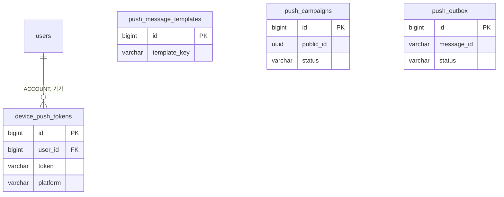

# DB 스키마

이 문서는 NOTIFICATION 도메인이 관리하는 PostgreSQL 테이블의 컬럼, 제약, 인덱스, Redis 키, 메시지 큐와 데이터 수명을 정한다.

다른 도메인의 테이블에서는 NOTIFICATION 도메인이 관리하거나 참조하는 컬럼만 설명한다.

입력값의 검증 규칙은 보안에, 잠금 순서와 멱등 규칙은 동시성에, 수명과 주기는 오류 처리에 있다. ([입력 검증](SECURITY.md#입력-검증), [동시성](CONCURRENCY.md), [재시도와 시간 한도](ERROR-HANDLING.md#재시도와-시간-한도))

 

### 공통 규칙

| 규칙 | 내용 |
|---|---|
| 식별자 | 내부 PK는 `bigint` 자동 증가 캠페인은 외부 노출용 `public_id uuid`를 따로 둠 토큰 행 ID는 노출하지 않음 |
| 시각 | `timestamp with time zone` `created_at`은 아래 표에 표시하지 않으며 기본값은 `now()` 아웃박스의 `created_at`만 기본값 없이 기록 시점을 넣음 |
| 삭제 | 토큰은 물리 삭제 템플릿, 캠페인, 아웃박스, 발송 결과는 삭제 경로 없음 알림 내역은 회원 삭제 시 함께 삭제 |
| FK | 토큰은 회원 삭제 시 함께 삭제(`ON DELETE CASCADE`) 회원 행은 탈퇴해도 남으므로 실제 연쇄 삭제는 일어나지 않음 |

 

### 관계도

관계도는 데이터 묶음별 소유 관계를 보여준다. 각 상자에는 식별과 연결에 쓰는 컬럼만 표시한다. 전체 컬럼은 아래 표에서 정의한다. 다른 도메인의 테이블은 관계 라벨에 도메인을 적고 컬럼을 생략한다.

 

### 푸시 토큰

**`device_push_tokens`**

회원 기기의 설치본 하나가 한 행이다. 게스트 기기는 저장하지 않는다.

| 컬럼 | 타입 | 제약 | 의미 |
|---|---|---|---|
| `id` | bigint | PK | |
| `user_id` | bigint | NOT NULL, FK `users.id` CASCADE | 소유 회원 같은 기기에서 계정이 바뀌면 소유 회원 변경 |
| `token` | varchar(512) | NOT NULL, UNIQUE | FCM 등록 토큰 |
| `platform` | varchar(16) | NOT NULL, CHECK `ANDROID` `WEB` | |
| `updated_at` | timestamptz | NOT NULL, 기본 `now()` | 마지막 등록 시각 값이 같아도 재등록마다 갱신 |

| 인덱스 | 컬럼 |
|---|---|
| `idx_device_push_tokens_user` | `user_id` |

 

### 수신 동의

**`users`**

회원 행의 세 컬럼은 이 도메인이 관리한다. 다른 컬럼은 계정 도메인이 정한다.

| 컬럼 | 타입 | 제약 | 의미 |
|---|---|---|---|
| `service_push_enabled` | boolean | NOT NULL, 기본 `true` | 서비스 알림 수신 여부 |
| `marketing_push_agreed_at` | timestamptz | | 광고 알림 최초 동의 시각 `NULL`이면 미동의 또는 철회 |
| `marketing_push_night_agreed_at` | timestamptz | | 야간 광고 알림 최초 동의 시각 광고 동의 없이 단독으로 값이 있을 수 없음 |

 

### 문구 템플릿

**`push_message_templates`**

출석 리마인드와 이프 만료 예정 알림 문구의 오버라이드 1건이 한 행이다. 행이 없으면 기본 문구를 쓴다. 운영자가 직접 기록한다.

| 컬럼 | 타입 | 제약 | 의미 |
|---|---|---|---|
| `id` | bigint | PK | |
| `template_key` | varchar(64) | NOT NULL | 템플릿 키 값은 `attendance_reminder`, `credit_expiry_reminder` |
| `title` | varchar(100) | NOT NULL | 광고 표기 없는 제목 |
| `body` | varchar(300) | NOT NULL | 수신거부 안내 없는 본문 |
| `effective_from` | timestamptz | NOT NULL, 기본 `now()` | 적용 시작 유효한 행이 여럿이면 가장 늦게 시작한 행 |
| `effective_until` | timestamptz | | 적용 종료 `NULL`은 상시 적용 |

| 인덱스 | 컬럼 |
|---|---|
| `idx_push_message_templates_key` | `template_key` |

 

### 캠페인

**`push_campaigns`**

프로모션 푸시 1건의 예약과 결과가 한 행이다. 운영자가 예약 행을 추가하고 스케줄러가 결과를 기록한다.

| 컬럼 | 타입 | 제약 | 의미 |
|---|---|---|---|
| `id` | bigint | PK | |
| `public_id` | uuid | NOT NULL, UNIQUE | 푸시 데이터의 캠페인 식별자 |
| `title` | varchar(100) | NOT NULL | 광고 표기 없는 제목 |
| `body` | varchar(300) | NOT NULL | 수신거부 안내 없는 본문 |
| `scheduled_at` | timestamptz | NOT NULL | 발송 예약 시각 |
| `status` | varchar(20) | NOT NULL, CHECK `SCHEDULED` `SENDING` `SENT` `CANCELED` `FAILED` | |
| `target_count` | integer | | 마지막 회차에서 조회된 대상 수 |
| `sent_count` | integer | | 마지막 회차의 결과 원격 모드는 기록한 발송 요청 수, 로컬 모드는 발송기 호출 수 |
| `skipped_count` | integer | | 사용하지 않음 |
| `started_at` | timestamptz | | 선점 시각 |
| `finished_at` | timestamptz | | 회차 종료 시각 |

| 인덱스 | 컬럼 |
|---|---|
| `idx_push_campaigns_status_scheduled_at` | `status`, `scheduled_at` |

 

### 아웃박스

**`push_outbox`**

원격 모드에서 발송 요청 1건이 한 행이다. 도메인 커밋과 같은 트랜잭션에 기록한다.

| 컬럼 | 타입 | 제약 | 의미 |
|---|---|---|---|
| `id` | bigint | PK | 선점 순서 |
| `message_id` | varchar(255) | NOT NULL, UNIQUE | 메시지 식별자 |
| `payload` | jsonb | NOT NULL | 큐 메시지 본문 |
| `status` | varchar(16) | NOT NULL, 기본 `PENDING`, CHECK `PENDING` `PUBLISHED` `FAILED` | |
| `attempts` | integer | NOT NULL, 기본 0 | 발행 실패 횟수 관찰용이며 포기 판정에 쓰지 않음 |
| `next_attempt_at` | timestamptz | NOT NULL | 다음 선점 가능 시각 선점 중에는 임대 만료 시각 |
| `published_at` | timestamptz | | |

| 인덱스 | 컬럼 |
|---|---|
| `idx_push_outbox_pending` | `next_attempt_at` WHERE `status = 'PENDING'` |

 

### 참조하는 다른 도메인의 컬럼

| 테이블 | 컬럼 | NOTIFICATION이 하는 일 |
|---|---|---|
| `users` | `status` | 발송 자격 판정 |
| `users` | `public_id` | 수신자 식별자 |
| `users` | `reward_identity_user_id` | 출석 미수령 판정 |
| `credit_transactions` | `idempotency_key` | 당일 출석 보상 키의 존재 여부로 미수령 판정 |
| `credit_lots` | `remaining` | 잔여가 있는 로트만 만료 예정 판정 |
| `credit_lots` | `expires_at` | 만료 예정 판정과 발송 요청의 유효 기한 |

 

### Redis 키

`push:` 키는 서버가 쓴다. `notification:` 키는 알림 서비스가 쓴다.

| 키 | 값 | 삭제 |
|---|---|---|
| `push:attendance-reminder:{KST 날짜}` | `1` | 선점 키 수명 만료 |
| `push:credit-expiry-reminder:{KST 날짜}` | `1` | 선점 키 수명 만료 |
| `push:credit-expiry-reminder:cooldown:{회원 내부 ID}` | `1` | 쿨다운 수명 만료 |
| `notification:processed:{메시지 식별자}` | 처리 중이면 소유자 값, 완료면 `done` | 처리 중 선점 수명 만료 완료 후 멱등 기록 수명 만료 |
| `notification:sent:{메시지 식별자}` | 성공한 토큰의 SHA-256 해시 집합 | 멱등 기록 수명 만료 |

 

### 메시지 큐

| 큐 | 내용 | 설정 |
|---|---|---|
| `push-requested` | 발송 요청 | SQS 표준 큐 실제 이름에는 프로젝트와 환경 접두를 붙임 수신 상한을 넘기면 실패 메시지 큐로 이동 |
| `push-requested-dlq` | 재전달 상한을 넘긴 메시지 | 보존 기간 만료 시 삭제 |

 

### 데이터 수명

| 데이터 | 삭제 |
|---|---|
| 푸시 토큰 | 삭제 요청, 탈퇴, 무효 통지, 기기 상한 초과 삭제 |
| 수신 동의 | 없음 철회는 값을 비움 |
| 문구 템플릿, 캠페인, 아웃박스, 발송 결과 | 없음 |
| 알림 내역 | 회원 행 삭제 시 연쇄 삭제 |

 

### 알림 내역과 발송 결과

**`user_notifications`**

회원이 받은 알림의 사본 1건이 한 행이다. 알림함이 읽는다. 이프 만료 예정 알림은 회차 트랜잭션에서 대상 회원마다 기록한다.

| 컬럼 | 타입 | 제약 | 의미 |
|---|---|---|---|
| `id` | bigint | PK | |
| `public_id` | uuid | NOT NULL, UNIQUE | 알림함 API의 식별자 |
| `user_id` | bigint | NOT NULL, FK `users.id` CASCADE | 받는 회원 |
| `message_key` | varchar(255) | NOT NULL | 메시지 식별자와 같은 값 |
| `type` | varchar(40) | NOT NULL, CHECK `STORY_COMPLETED` `STORY_MODERATION_COMPLETED` `NOTICE` `ATTENDANCE_REMINDER` `CREDIT_EXPIRY_REMINDER` `PROMOTION` | 시나리오 식별자 `CREDIT_EXPIRY_REMINDER`는 CHECK 확장 마이그레이션이 필요 |
| `category` | varchar(16) | NOT NULL, CHECK `NEWS` `ACTIVITY` | 알림 분류 `CREDIT_EXPIRY_REMINDER`는 `ACTIVITY` |
| `title` | varchar(120) | NOT NULL | |
| `body` | varchar(300) | NOT NULL | |
| `deep_link` | varchar(512) | | |
| `story_public_id` | uuid | | 이프 만료 예정 알림은 NULL |
| `notice_public_id` | uuid | | 이프 만료 예정 알림은 NULL |
| `notice_tag` | varchar(16) | | 이프 만료 예정 알림은 NULL |
| `read_at` | timestamptz | | 읽음 시각 |

| 인덱스 | 컬럼 |
|---|---|
| `uk_user_notifications_user_message` | `user_id`, `message_key` UNIQUE |
| `idx_user_notifications_user_created` | `user_id`, `created_at DESC`, `id DESC` |
| `idx_user_notifications_user_category_created` | `user_id`, `category`, `created_at DESC`, `id DESC` |
| `idx_user_notifications_unread` | `user_id`, `category` WHERE `read_at IS NULL` |

 

**`push_delivery_results`**

메시지 식별자별 최종 발송 결과 1건이 한 행이다. 알림 서비스의 보고와 로컬 모드 발송기가 기록한다.

| 컬럼 | 타입 | 제약 | 의미 |
|---|---|---|---|
| `id` | bigint | PK | |
| `message_id` | varchar(255) | NOT NULL, UNIQUE | 메시지 식별자 |
| `type` | varchar(40) | NOT NULL | 시나리오 식별자 허용 값은 발송 결과 보고의 `type`과 같음 |
| `kind` | varchar(16) | NOT NULL, CHECK `SERVICE` `MARKETING` | |
| `campaign_id` | bigint | FK `push_campaigns.id` | 캠페인 발송만 |
| `user_id` | bigint | FK `users.id` | 보고 시점에 존재한 회원만 |
| `outcome` | varchar(16) | NOT NULL, CHECK `DELIVERED` `UNDELIVERED` `DISCARDED` | |
| `reason` | varchar(40) | NOT NULL | 발송 응답의 `reason` 값 |
| `delivered_devices` | integer | NOT NULL, CHECK `>= 0` | |
| `failed_devices` | integer | NOT NULL, CHECK `>= 0` | |
| `completed_at` | timestamptz | NOT NULL | |

| 인덱스 | 컬럼 |
|---|---|
| `idx_push_delivery_results_campaign` | `campaign_id` WHERE `campaign_id IS NOT NULL` |
| `idx_push_delivery_results_type_completed` | `type`, `completed_at` |
