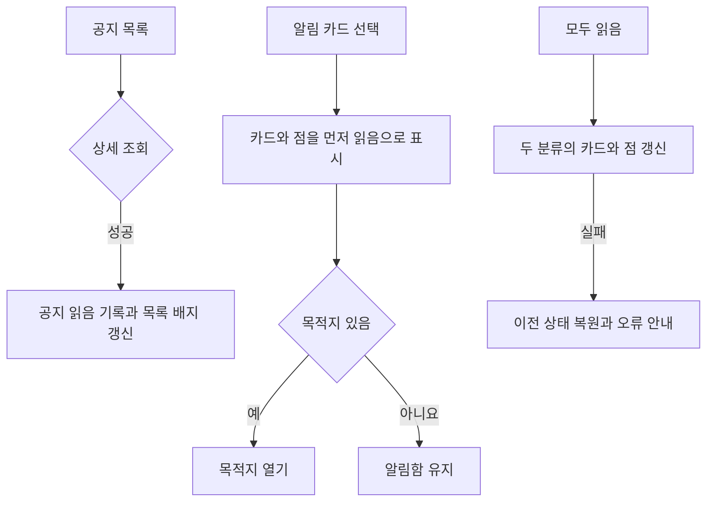
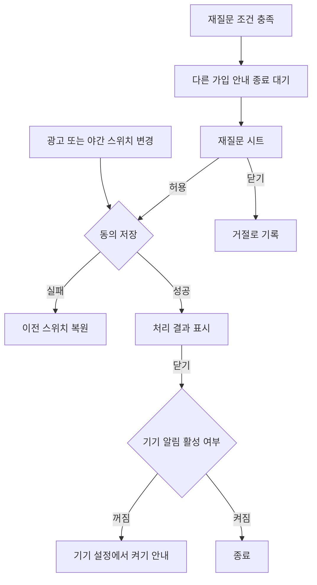

# 3-2 화면 흐름

기준: [화면 구성](3-1-INFORMATION-ARCHITECTURE.md).

 

### 3-2-1 열람과 읽음

1. 공지 목록에서는 읽음 상태를 바꾸지 않는다. 상세를 성공적으로 받으면 읽음으로 기록하고 복귀 목록과 배지를 갱신한다.
2. 알림 카드를 누르면 해당 카드와 점을 먼저 읽음으로 바꾸고 목적지를 연다. 공개 제한 알림은 제작 탭을 연다. 갈 곳이 없으면 알림함에 머문다.
3. 모두 읽음을 누르면 두 분류의 카드와 점을 함께 바꾼다. 실패하면 이전 상태로 되돌리고 알린다.
4. 공지와 알림 목록 끝에서는 다음 페이지를 이어 붙인다. 추가 조회 실패 때 기존 목록을 남기고 재시도 버튼으로 다시 요청한다.

 

### 3-2-2 권한과 동의

1. 최초 필수 동의의 선택 답을 전달하고 플랫폼의 권한 요청 순서에 맞춰 처리한다. 선택 미동의도 가입과 필수 동의 완료를 허용한다.
2. 재질문 조건이 맞으면 다른 가입 안내가 끝난 뒤 시트를 연다. 허용하면 저장 후 처리 결과, 닫으면 거절로 기록한다.
3. 설정의 광고 또는 야간 스위치를 변경하면 저장 성공 후 처리 결과를 보인다. 광고를 끄면 야간 행도 사라진다.
4. 처리 결과를 닫을 때 기기 알림이 꺼졌으면 설정에서 켜야 한다고 알린다. 저장 실패는 이전 스위치로 돌아가며 처리 결과를 표시하지 않는다.
