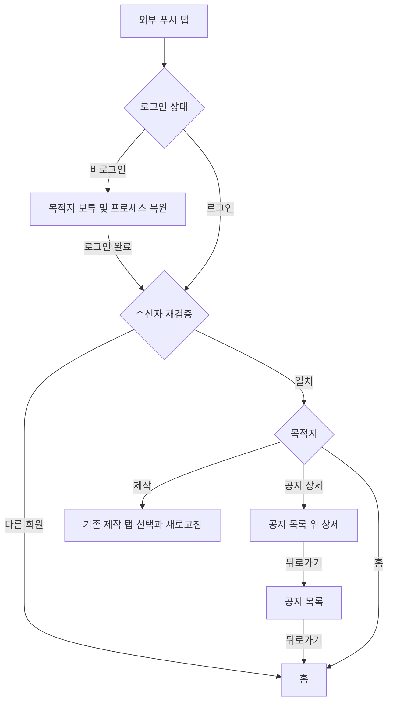

# 3-2 화면 흐름: 안드로이드

기준: [공통 흐름](../3-2-INTERACTION-FLOWS.md), [Android 목적지](3-1-INFORMATION-ARCHITECTURE.md).

 

### 3-2-1 열람과 복귀

| 진입 | 복귀 |
|---|---|
| 마이에서 공지 목록 | 들어온 탭 |
| 목록에서 공지 상세 | 공지 목록 |
| 알림함에서 공지나 스토리 상세 | 알림함 |
| 알림함에서 설정 | 알림함 |
| 외부 푸시에서 공지 상세 | 공지 목록, 이어 홈 |
| 제작 목적지 | 알림함과 이전 상세를 닫고 기존 제작 탭 선택 및 즉시 새로고침 |

푸시 이동은 공통 셸과 목적지로 백스택을 정리해 상세를 중복 적재하지 않는다. 이미 제작 탭이어도 다시 읽으며 홈 목적지는 실제 홈 탭을 선택한다.

로그인 전 푸시 탭은 목적지를 보류하고 로그인 후 수신자를 재검증한다. 다른 회원이면 홈으로 간다. 외부 인증 중 프로세스 종료 뒤에도 같은 보류 진입을 복원한다.
