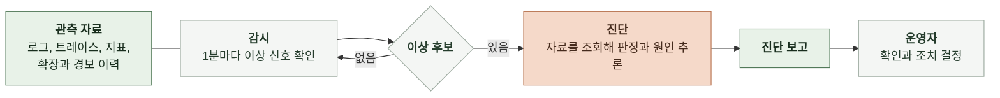

# 1. 배경

이 문서는 장애 진단 에이전트가 해결하려는 문제와 에이전트에 맡길 역할을 정한다.

 

### 1-1 도메인

관측은 서비스가 지금 어떻게 동작하는지를 밖에서 알아내는 일이다. 마냑은 네 가지 자료로 서비스를 관측한다.

| 자료 | 담는 것 | 저장 위치 |
|---|---|---|
| 로그 | 요청 완료, 외부 호출, 오류 같은 사건 한 건과 그 필드 | OpenSearch 로그 인덱스 |
| 트레이스 | 요청 하나가 서비스와 DB를 거치며 쓴 시간. 구간 하나를 스팬이라 부름 | OpenSearch 스팬 인덱스 |
| 지표 | 서비스, DB, 캐시, 로드밸런서의 1분 단위 수치(CPU, 메모리, 연결 수, 요청 수) | CloudWatch |
| 확장과 경보 이력 | 오토스케일링이 태스크 수를 바꾼 기록과 경보 상태 변화 | Application Auto Scaling, CloudWatch 경보 |

마냑은 백엔드(manyak-server), AI 서버(manyak-ai), 알림 서버(manyak-notification)가 ECS 서비스로 돌고 PostgreSQL(RDS)과 Redis(ElastiCache)를 쓴다. 채팅 한 턴은 백엔드가 받아 턴 실행기에서 차례를 기다린 뒤 AI 서버를 호출하고 그 결과를 DB에 저장한다.

 

### 1-2 현재 업무와 문제

장애를 찾는 일은 사람이 한다. 운영자는 응답이 느리거나 실패한다는 신호를 보고 트레이스, 로그, 지표를 한 화면씩 열어 시각을 맞춰 대조한다. 부하 테스트(KNK-1498, KNK-1598)에서 찾은 병목 네 건도 이 방식으로 찾았다.

| 병목 | 드러난 모습 | 원인 |
|---|---|---|
| 채팅 턴 큐 대기 | 동시 사용자 25명부터 턴 응답 p95 16초, 50명에서 48초 | 턴 실행기가 태스크당 4개만 동시에 실행해 나머지가 큐에서 대기 |
| 동시 턴 상한 재도달 | 동시 사용자 400명에서 큐 대기 p95 5~9초 | 동시 턴 상한 64에 닿았지만 CPU 기준 오토스케일링이라 백엔드가 늘어나지 않음 |
| AI 서버 CPU 포화 | AI 서버 CPU 평균 65~74%, 순간 100% | 평균이 확장 기준 70% 근처를 오르내려 3분 연속 초과 조건을 채우지 못해 확장 0회 |
| DB CPU 포화 | 동시 사용자 200명 혼합 부하에서 RDS CPU 82~90% | 스토리별 누적 턴을 매 요청 합산하는 쿼리가 채팅 수에 비례해 느려짐 |

이 방식에는 세 가지 문제가 있다.

- **오류가 없는 장애를 놓친다.** 채팅 턴 큐 대기는 오류 없이 지연만 25~68초로 늘었다. 오류를 모아 알리는 Sentry는 이 장애를 알리지 않는다.
- **확장 정책이 장애를 가린다.** 동시 턴 상한과 AI 서버 CPU 병목에서는 오토스케일링이 동작하지 않았고 경보도 울리지 않았다. 사람이 지표를 열어 보기 전까지 장애가 드러나지 않는다.
- **대조에 시간이 든다.** 진입 요청의 지연을 하위 스팬으로 나누고 자원 지표와 확장 이력을 같은 시각에 맞춰 보는 일을 매번 손으로 한다.

 

### 1-3 목적과 범위

장애 진단 에이전트는 관측 자료를 하루 종일 감시하다가 장애를 스스로 찾아 운영자에게 원인과 개선 방향을 보고한다. 운영자는 대시보드를 열기 전에 어디가 왜 문제인지 근거와 함께 받는다.

| 구분 | 내용 |
|---|---|
| 에이전트가 하는 일 | 이상 구간 탐지 장애인지 판정 영향 범위, 첫 이상 시각, 의심 구성 요소, 원인 가설, 근거, 제안 조치 보고 |
| 사람이 하는 일 | 보고 확인 조치 실행 여부와 방법 결정 정답과 원인 가설 채점 |
| 다루지 않는 것 | 조치 실행(설정 변경, 확장, 배포) 운영 환경 연결 Sentry와 Langfuse 자료 소스 코드 열람 |

 

### 1-4 진단의 흐름과 주체

| 주체 | 누구인가 | 하는 일 |
|---|---|---|
| 운영자 | 마냑 백엔드 개발자. 장애 대응을 겸함 | 에이전트를 실행하고 보고를 받아 조치를 정함 |
| 에이전트 | 개발자 PC에서 도는 명령줄 프로그램 | 감시, 탐지, 진단, 보고 |
| 관측 저장소 | OpenSearch, CloudWatch | 에이전트가 읽기 전용으로 조회하는 자료 |

 

### 1-5 공통 용어

| 용어 | 의미 |
|---|---|
| 이상 신호 | 지연, 실패율, 오류 로그, 자원 사용률 중 하나가 정해진 조건을 넘은 1분 |
| 이상 후보 | 이상 신호가 이어져 코드가 진단을 요청한 구간. 장애인지는 아직 모름 |
| 장애 | 사용자 요청이 지연 기준을 넘거나 실패한 구간 |
| 진입 스팬 | 외부 요청을 처음 받은 서비스의 스팬. 요청 한 건의 전체 시간 |
| 대기 스팬 | 요청이 실행 차례를 기다린 시간을 담은 스팬. 채팅 턴이 턴 실행기 큐에서 기다린 시간이 있음 |
| 구성 요소 | 장애 원인으로 지목할 수 있는 단위. 서비스, 서비스 안의 실행기, DB, 캐시, 로드밸런서, 오토스케일링 |
| 시스템 설명서 | 운영자가 관리하는 구성 요소 목록, 자원 크기, 동시성 상한, 확장 정책, 지연 기준 |
| 감시 시각 | 에이전트가 지금이라고 보는 시각. 에이전트는 감시 시각 이후의 자료를 보지 않음 |
| 재생 | 보관한 관측 자료를 감시 시각을 앞으로 옮기며 다시 흘려 보내는 실행 |
| 진단 보고 | 이상 후보 하나에 대한 판정, 원인, 근거, 제안 조치 |
